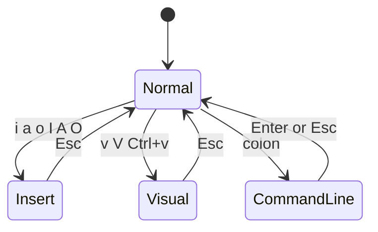

# 📝 Vim Cheat Sheet

[[DevOps/NaNa/0. Nana DevOps Table of Contents|📚 Nana DevOps Table of Contents]]

> [!toc]- 📑 Contents
>
> - [[#🎛️ Modes|🎛️ Modes]]
> - [[#🚪 Open, Save, and Quit|🚪 Open, Save, and Quit]]
> - [[#🧭 Movement|🧭 Movement]]
> - [[#✏️ Edit, Delete, and Undo|✏️ Edit, Delete, and Undo]]
> - [[#✂️ Copy and Paste|✂️ Copy and Paste]]
> - [[#🔍 Search and Replace|🔍 Search and Replace]]
> - [[#🧩 Visual Mode and Indentation|🧩 Visual Mode and Indentation]]
> - [[#🪟 Buffers, Splits, and Shell Commands|🪟 Buffers, Splits, and Shell Commands]]
> - [[#⚙️ A Basic vimrc|⚙️ A Basic vimrc]]
> - [[#🧪 Interview Q&A|🧪 Interview Q&A]]
> - [[#🔨 Hands-On Practice|🔨 Hands-On Practice]]
> - [[#📋 Quick Reference|📋 Quick Reference]]
> - [[#🧠 Things to Remember|🧠 Things to Remember]]
> - [[#💡 Pro Tips|💡 Pro Tips]]
> - [[#🔗 Related Topics|🔗 Related Topics]]

## 🎛️ Modes

Vim is a **modal** editor: the same key does different things depending on the mode. On a server, it is often the only editor available, so the basics are worth knowing.

- 🧭 **Normal mode** → move, copy, delete, paste. Vim starts here. `Esc` always returns here.

- ✍️ **Insert mode** → type text. Enter with `i`, `a`, `o`, and friends.

- 🧩 **Visual mode** → select text. `v` characters, `V` lines, `Ctrl+v` block.

- 💻 **Command-line mode** → commands that start with `:`, such as `:w` or `:%s/a/b/g`.



> ⚠️ **The `:` rule:** only command-line commands start with `:` (`:w`, `:q`, `:set number`). Normal-mode keys like `yy`, `dd`, `p`, and `"+yy` are typed directly. When in doubt, press `Esc` first.

| Key | Enters Insert mode… |
|---|---|
| `i` / `a` | Before / after the cursor |
| `I` / `A` | At start / end of the line |
| `o` / `O` | On a new line below / above |

---

## 🚪 Open, Save, and Quit

```bash
vim /etc/ssh/sshd_config
```

| Command | Action |
|---|---|
| `:w` | Save |
| `:q` | Quit (fails if there are unsaved changes) |
| `:wq` or `:x` | Save and quit |
| `:q!` | Quit and discard changes |
| `:w newname` | Save as another file |

💡 Editing a root-owned file without `sudo`? `:w !sudo tee %` saves it anyway, then `:q!` to exit.

---

## 🧭 Movement

| Key | Moves to |
|---|---|
| `h` `j` `k` `l` | Left, down, up, right |
| `w` / `b` / `e` | Next word / previous word / end of word |
| `0` / `^` / `$` | Line start / first non-blank / line end |
| `gg` / `G` | First line / last line |
| `42G` or `:42` | Line 42 |
| `Ctrl+d` / `Ctrl+u` | Half page down / up |
| `Ctrl+f` / `Ctrl+b` | Full page down / up |
| `%` | Matching `()`, `{}`, or `[]` |

🔢 **Counts work with most commands:** `5j` moves down 5 lines, `3w` jumps 3 words, `3dd` deletes 3 lines.

---

## ✏️ Edit, Delete, and Undo

Vim commands are built as **operator + motion**: `d` (delete), `c` (change), or `y` (copy) followed by where to act.

- 🗑️ **Delete**

    - `x` → one character

    - `dd` → whole line; `5dd` → five lines

    - `dw` → to the next word; `d$` or `D` → to end of line

    - `dG` / `dgg` → to end / start of file

- ✏️ **Change** (delete and enter Insert mode)

    - `cw` → word; `cc` → whole line; `C` → to end of line

    - `r` → replace one character; `R` → overwrite mode

- 🔧 **Other edits**

    - `J` → join the next line onto this one

    - `~` → toggle case

- ↩️ **Undo / redo**

    - `u` → undo; `Ctrl+r` → redo

    - `.` → **repeat the last change**, one of Vim's most useful keys

---

## ✂️ Copy and Paste

In Vim, copying is **yanking**, and `d` also acts as cut.

| Key | Action |
|---|---|
| `yy` / `3yy` | Copy current line / 3 lines |
| `yw` | Copy a word |
| `p` / `P` | Paste after / before the cursor |

### 🖥️ System clipboard

Vim has its own registers. The `+` register is the system clipboard (needs Vim built with clipboard support, e.g. `vim-gtk3`).

- `"+yy` → copy the line to the clipboard

- `v` select, then `"+y` → copy the selection

- `"+p` → paste from the clipboard

These are Normal-mode keys: press `"`, `+`, `y`, `y` in sequence, with no `:`. To check the clipboard, use the command-line form `:echo @+`.

To make `yy` and `p` use the clipboard automatically, add this to `~/.vimrc`:

```vim
set clipboard=unnamedplus
```

---

## 🔍 Search and Replace

- 🔎 **Search**

    - `/text` forward, `?text` backward

    - `n` / `N` → next / previous match

    - `*` / `#` → search the word under the cursor forward / backward

    - `:noh` → clear the highlight

- 🔄 **Replace** with `:s/old/new/flags`

    ```vim
    :s/old/new/       " first match on this line
    :s/old/new/g      " every match on this line
    :%s/old/new/g     " every match in the file
    :%s/old/new/gc    " ask before each one: y / n / a (all) / q
    ```

    - `%` → the whole file instead of the current line.

    - `g` → every match on a line, not only the first.

    - `c` → confirm each replacement.

> 💡 **Real-World Example**
>
> Disable root login in `sshd_config`:
>
> ```vim
> :%s/^PermitRootLogin yes/PermitRootLogin no/
> ```
>
> `^` anchors the match to the start of the line, so commented lines like `#PermitRootLogin yes` stay untouched.

---

## 🧩 Visual Mode and Indentation

Select with `v`, `V`, or `Ctrl+v`, then act on the selection:

- `y` copy, `d` delete, `c` change

- `>` / `<` indent / unindent

Without a selection: `>>` / `<<` indent the current line, `5>>` indents five lines, and `gg=G` auto-indents the whole file.

---

## 🪟 Buffers, Splits, and Shell Commands

| Command | Action |
|---|---|
| `:e file` | Open another file |
| `:ls` / `:bn` / `:bp` / `:bd` | List / next / previous / close buffer |
| `:sp file` / `:vsp file` | Horizontal / vertical split |
| `Ctrl+w` then `h` `j` `k` `l` or `w` | Move between splits |
| `:!cmd` | Run a shell command, e.g. `:!git status` |
| `:r !cmd` | Insert a command's output into the file |

---

## ⚙️ A Basic `vimrc`

📁 `~/.vimrc` is read every time Vim starts.

```vim
set number relativenumber   " absolute number on current line, relative elsewhere
set clipboard=unnamedplus   " yy / p use the system clipboard
set tabstop=4 shiftwidth=4 expandtab autoindent
set ignorecase smartcase    " case-insensitive unless the search has a capital
set hlsearch incsearch      " highlight matches, search while typing
syntax on
```

- 🔢 **`relativenumber`** makes jumps like `7j` easy to read off the screen.

- ⌨️ **`expandtab`** inserts spaces instead of tab characters, which matters for YAML.

- 🔎 **`smartcase`** makes `/Error` case-sensitive but `/error` not.

Inside a running Vim, the same settings work as commands, e.g. `:set number`.

---

### 🧪 Interview Q&A

**Q1:** You opened a file and typed text, but nothing appears where expected. What happened?

**Q2:** When do you type `:` and when don't you?

**Q3:** How do you quit without saving?

**Q4:** What does `:%s/8080/9090/g` do?

**Q5:** What does `.` do?

> [!answer]- 📋 Answers
>
> **A1:** Vim starts in Normal mode, so the keys ran as commands. Press `Esc`, then `i` to insert text, and `u` to undo the accidental commands.
>
> **A2:** Use `:` for command-line commands like `:w`, `:q`, and `:%s`. Normal-mode keys like `dd`, `yy`, and `p` are typed directly.
>
> **A3:** `:q!`
>
> **A4:** It replaces every `8080` with `9090` on every line of the file.
>
> **A5:** It repeats the last change, such as a delete or an insert.

---

## 🔨 Hands-On Practice

Run `vimtutor` for a full 30-minute guided lesson. For a quick drill:

1. 📝 **Create a practice file.**

    ```bash
    printf "server_port=8080\nlog_level=debug\nuser=root\n" > app.conf
    vim app.conf
    ```

2. 🔄 **Replace the port** with `:%s/8080/9090/g`.

3. ✏️ **Change a word.** Move to `debug` with `/debug`, then type `cw` → `info` → `Esc`.

4. ✂️ **Duplicate a line.** On the `user` line, press `yy` then `p`.

5. ↩️ **Undo it** with `u`, then save and quit with `:wq`.

    ✅ `cat app.conf` shows `server_port=9090`, `log_level=info`, and one `user=root` line.

6. 🧹 Clean up: `rm app.conf`.

---

### 📋 Quick Reference

```text
Esc          Normal mode           i / a / o    Insert
h j k l      Move                  w / b        Word forward / back
0 / $        Line start / end      gg / G       File start / end
yy / dd / p  Copy / cut / paste    u / Ctrl+r   Undo / redo
/text  n N   Search, next, prev    .            Repeat last change
:%s/a/b/g    Replace all           :noh         Clear highlight
:w  :q  :wq  Save / quit / both    :q!          Quit, discard changes
```

### 🧠 Things to Remember

- Vim starts in **Normal mode**; `Esc` always brings you back.

- Only command-line commands start with `:`.

- Commands combine as **count + operator + motion**: `3dw` deletes three words.

- `"+` is the system clipboard register.

### 💡 Pro Tips

- Learn `.` and counts early; they remove most repetitive editing.

- Use `:%s/.../gc` on config files so you approve each change.

- Use `sudoedit /etc/file` instead of `sudo vim`: you edit a copy with your own `vimrc`, and the editor doesn't run as root.

- Set `expandtab` before editing YAML (Compose files, pipelines); tabs break YAML parsing.

### 🔗 Related Topics

- [[DevOps/NaNa/Linux/1. Linux Pipes, `grep`, `less`, and Output Redirection|Pipes, grep, less, and Output Redirection]]

- [[DevOps/NaNa/Linux/3. Environment Variables|Environment Variables]]

- [[DevOps/NaNa/Linux/7. Server Configuration|Server Configuration]]
