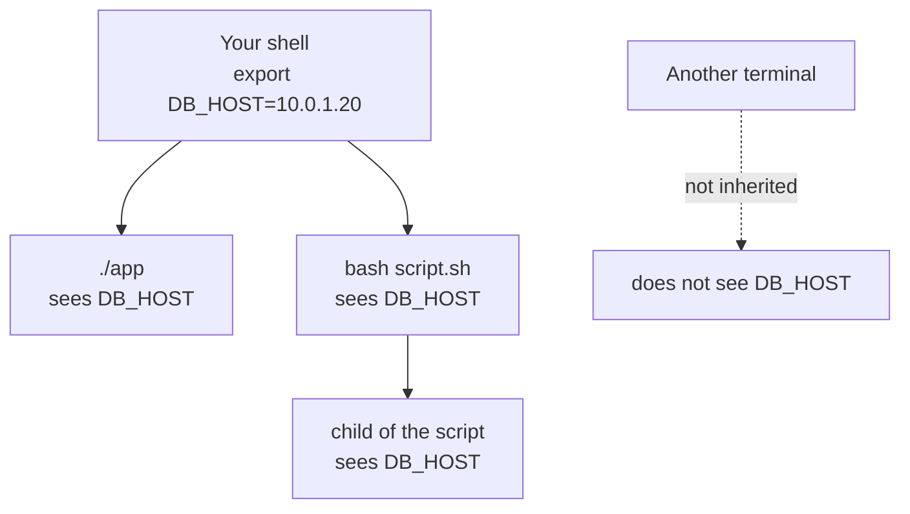
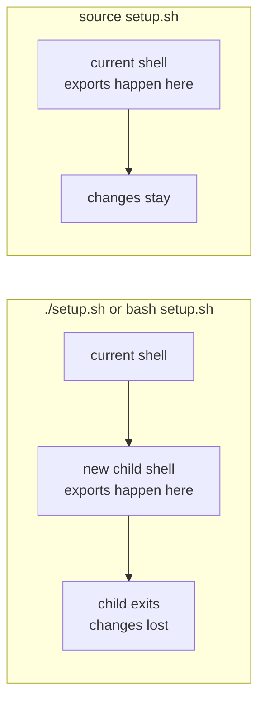

# 🌱 Environment Variables

[[DevOps/NaNa/0. Nana DevOps Table of Contents|📚 Nana DevOps Table of Contents]]

📘 Merged into the Linux Handbook: [[Linux/Linux Handbook/6. Environment Variables and Shell Startup|6. Environment Variables and Shell Startup]]

> [!toc]- 📑 Contents
>
> - [[#🌱 What an Environment Variable Is|🌱 What an Environment Variable Is]]
> - [[#📤 Set a Variable with export|📤 Set a Variable with export]]
> - [[#🔎 View Variables|🔎 View Variables]]
> - [[#💾 Make It Permanent|💾 Make It Permanent]]
> - [[#🔄 Reload with source|🔄 Reload with source]]
> - [[#🛣️ PATH|🛣️ PATH]]
> - [[#🩺 Common Failures|🩺 Common Failures]]
> - [[#🧪 Interview Q&A|🧪 Interview Q&A]]
> - [[#🔨 Hands-On Practice|🔨 Hands-On Practice]]
> - [[#📋 Quick Reference|📋 Quick Reference]]
> - [[#🧠 Things to Remember|🧠 Things to Remember]]
> - [[#💡 Pro Tips|💡 Pro Tips]]
> - [[#🔗 Related Topics|🔗 Related Topics]]

## 🌱 What an Environment Variable Is

An **environment variable** is a named value that a process passes down to every program it starts. Tools read them for configuration: `HOME`, `PATH`, `EDITOR`, or your own `DB_HOST`.

> 💡 **Real-World Example**
>
> A Go service reads its database host from the environment instead of hard-coding it:
>
> - 🧪 On a laptop → `DB_HOST=localhost`
>
> - 🚀 On the server → `DB_HOST=10.0.1.20`
>
> Same binary, different configuration. Docker, Compose, and Jenkins all pass settings to apps this way.



Variables flow **down** to child processes only, never up to the parent or sideways to other terminals.

---

## 📤 Set a Variable with `export`

```bash
export DB_HOST=10.0.1.20
export GREETING="Hello, World"          # quote values with spaces
export PROJECT_HOME="$HOME/projects/app" # build from other variables
```

- ⚠️ **No spaces around `=`.** `export A = 1` is an error.

- 🔤 **`UPPER_SNAKE_CASE`** is a convention, not a rule. It separates environment variables from lowercase script variables.

Without `export`, the variable exists only in the current shell and child processes don't see it:

| Command | Current shell | Child processes | After the terminal closes |
|---|---|---|---|
| `VAR=value` | ✅ | ❌ | ❌ |
| `export VAR=value` | ✅ | ✅ | ❌ |
| `export` line in `~/.bashrc` or `~/.zshrc` | ✅ | ✅ | ✅ set again in every new shell |
| `VAR=value ./app` | ❌ | ✅ only `./app` | ❌ |

The last row is handy for one-off overrides: `LOG_LEVEL=debug ./app` changes the level for that single run.

To remove a variable: `unset DB_HOST`.

---

## 🔎 View Variables

```bash
printenv              # all environment variables
printenv PATH         # one variable
echo "$PATH"          # same, using shell expansion
printenv | grep -i db # search
```

- 📋 **`printenv` / `env`** → only exported variables.

- 📚 **`set`** → every shell variable, exported or not, plus functions. Much noisier.

- 🔎 A variable that shows up in `set` but not in `printenv` was never exported.

---

## 💾 Make It Permanent

`export` lasts only for the current terminal. To have a variable in every new shell, add the line to the shell's **startup file** in your home directory.

| File | Shell | Runs for |
|---|---|---|
| `~/.bashrc` | Bash | Each new interactive shell (a new terminal tab) |
| `~/.profile` or `~/.bash_profile` | Bash | Login shells, e.g. an SSH session |
| `~/.zshrc` | Zsh | Each new interactive shell |

```bash
# ~/.bashrc or ~/.zshrc
export EDITOR=vim
export DB_HOST=10.0.1.20
```

💡 On Ubuntu, `~/.profile` already sources `~/.bashrc` for Bash, so `~/.bashrc` covers both terminals and SSH.

> ⚠️ Startup files apply to **your interactive shells only**. A `systemd` service or cron job doesn't read them. Use `Environment=` in the unit file, an env file, or Compose `environment:` for services.

---

## 🔄 Reload with `source`

Editing `~/.bashrc` doesn't change shells that are already open. `source` runs the file **inside the current shell**, so its exports take effect immediately.

```bash
source ~/.bashrc     # or: . ~/.bashrc
```

Compare with running it as a script:



That's why `source venv/bin/activate` must be sourced: executing it would change only a throwaway child shell.

---

## 🛣️ `PATH`

`PATH` is a colon-separated list of directories. When you type `git`, the shell searches these directories **left to right** and runs the first `git` it finds.

```bash
echo "$PATH"
```

```text
/usr/local/bin:/usr/bin:/bin:/home/deploy/.local/bin
```

Add your own scripts directory so its scripts run from anywhere, like built-in commands:

1. 📁 **Create the directory and a script.**

    ```bash
    mkdir -p ~/bin
    printf '#!/usr/bin/env bash\necho "Deploying..."\n' > ~/bin/deploy
    chmod +x ~/bin/deploy
    ```

    - Without `chmod +x`, the shell finds the file but reports `Permission denied`.

2. 🛣️ **Add it to `PATH` in `~/.bashrc`.**

    ```bash
    export PATH="$HOME/bin:$PATH"
    ```

    - Prepending (`$HOME/bin:` first) lets your version win over a system command with the same name.

    - Appending (`$PATH:$HOME/bin`) lets system commands win.

3. 🔄 **Reload and check.**

    ```bash
    source ~/.bashrc
    command -v deploy
    deploy
    ```

    ✅ `command -v` prints `/home/<user>/bin/deploy`, and `deploy` runs from any directory.

| You type | Script directory in `PATH`? | Result |
|---|---|---|
| `deploy` | ❌ | `command not found` |
| `./deploy` | — | Runs, but only from that directory |
| `deploy` | ✅ | Runs from anywhere |

> ⚠️ Always include `$PATH` in the new value. `export PATH="$HOME/bin"` replaces the whole list, and commands like `ls` stop working until you open a new shell.

---

## 🩺 Common Failures

| Symptom | Cause | Fix |
|---|---|---|
| Variable is empty in a script | Set without `export` | `export VAR=...` |
| Variable gone in a new terminal | Only exported in the old one | Add it to `~/.bashrc` / `~/.zshrc` |
| `.bashrc` edit has no effect | File not reloaded | `source ~/.bashrc` or open a new terminal |
| Works in terminal, not in a service | Services don't read shell startup files | Set it in the unit file, env file, or Compose |
| Script in `~/bin` → `Permission denied` | Missing execute bit | `chmod +x ~/bin/script` |
| Wrong version of a tool runs | Earlier `PATH` entry wins | Check with `type -a tool`, reorder `PATH` |

---

### 🧪 Interview Q&A

**Q1:** What is the difference between `VAR=value` and `export VAR=value`?

**Q2:** You added an `export` to `~/.bashrc` but `printenv` doesn't show it. Why?

**Q3:** Why doesn't `./setup.sh` keep the variables it exports?

**Q4:** Why prepend instead of append when adding a directory to `PATH`?

**Q5:** Your app works when started by hand but not as a `systemd` service. What do you check?

> [!answer]- 📋 Answers
>
> **A1:** Without `export`, only the current shell sees it. With `export`, child processes inherit it too.
>
> **A2:** The current shell started before the edit. Run `source ~/.bashrc` or open a new terminal.
>
> **A3:** It runs in a child shell, and variables never flow back to the parent. Use `source ./setup.sh`.
>
> **A4:** Prepending makes your directory searched first, so your version of a command wins. Appending lets system commands win.
>
> **A5:** Whether the variables it needs are set for the service, because `systemd` doesn't read `~/.bashrc`. Add them with `Environment=` or `EnvironmentFile=`.

---

## 🔨 Hands-On Practice

1. 📤 **See inheritance.**

    ```bash
    MSG=hello
    bash -c 'echo "child sees: $MSG"'
    export MSG
    bash -c 'echo "child sees: $MSG"'
    ```

    ✅ The first prints `child sees: `; the second prints `child sees: hello`.

2. ⏱️ **One-off override.**

    ```bash
    MSG=override bash -c 'echo $MSG'
    echo $MSG
    ```

    ✅ Prints `override`, then `hello`. The override applied only to that command.

3. 🛣️ **Add `~/bin` to `PATH`** using the three steps in [[#🛣️ PATH|PATH]].

4. 🧹 Clean up: `unset MSG`, and remove `~/bin/deploy` and its `PATH` line if you don't want them.

---

### 📋 Quick Reference

| Task | Command |
|---|---|
| Set for this shell and children | `export VAR=value` |
| Set for one command | `VAR=value cmd` |
| Remove | `unset VAR` |
| Show one / all | `printenv VAR` / `printenv` |
| Persist | Add `export` line to `~/.bashrc` or `~/.zshrc` |
| Reload startup file | `source ~/.bashrc` |
| Add a directory to `PATH` | `export PATH="$HOME/bin:$PATH"` |
| Find which binary runs | `command -v cmd` or `type -a cmd` |

### 🧠 Things to Remember

- Environment variables pass **down** to child processes only.

- `export` lasts until the terminal closes; startup files recreate it each session.

- `source` runs a file in the current shell; `./file` runs it in a child.

- `PATH` is searched left to right; the first match wins.

### 💡 Pro Tips

- Comment each `PATH` addition in `~/.bashrc`; you will forget why it's there.

- Keep secrets out of `~/.bashrc` if you sync dotfiles to Git. Source a separate `chmod 600` file instead.

- Fail fast in scripts when a required variable is missing: `: "${DB_HOST:?DB_HOST is not set}"`.

- Run `bash -n ~/.bashrc` to syntax-check before sourcing, and keep one working terminal open while testing.

### 🔗 Related Topics

- [[DevOps/NaNa/Linux/1. Linux Pipes, `grep`, `less`, and Output Redirection|Pipes, grep, less, and Output Redirection]]

- [[DevOps/NaNa/Linux/5. Ownership and Permissions|Ownership and Permissions]]

- [[DevOps/NaNa/Docker/5. Docker Compose|Docker Compose]]

- [[DevOps/Server Administration/9. Secrets and File Permissions|Secrets and File Permissions]]
