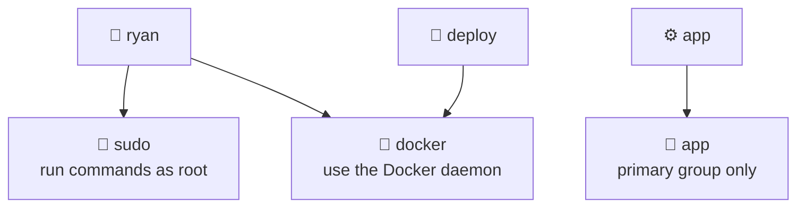
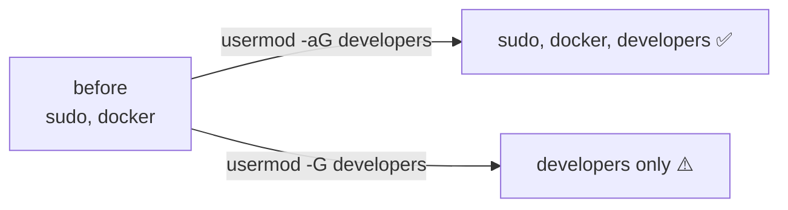

# 👥 Users and Groups

[[DevOps/NaNa/0. Nana DevOps Table of Contents|📚 Nana DevOps Table of Contents]]

> [!toc]- 📑 Contents
>
> - [[#👤 Users, Groups, and Why They Matter|👤 Users, Groups, and Why They Matter]]
> - [[#📁 Where Accounts Are Stored|📁 Where Accounts Are Stored]]
> - [[#➕ Create Users|➕ Create Users]]
> - [[#🔑 Passwords and Switching Users|🔑 Passwords and Switching Users]]
> - [[#👥 Create Groups and Manage Membership|👥 Create Groups and Manage Membership]]
> - [[#🛠️ Modify Users|🛠️ Modify Users]]
> - [[#🗑️ Delete Users and Groups|🗑️ Delete Users and Groups]]
> - [[#🧪 Interview Q&A|🧪 Interview Q&A]]
> - [[#🔨 Hands-On Practice|🔨 Hands-On Practice]]
> - [[#📋 Quick Reference|📋 Quick Reference]]
> - [[#🧠 Things to Remember|🧠 Things to Remember]]
> - [[#💡 Pro Tips|💡 Pro Tips]]
> - [[#🔗 Related Topics|🔗 Related Topics]]

## 👤 Users, Groups, and Why They Matter

Every process and file on Linux belongs to a **user**. A **group** is a named set of users that share access. Linux decides what a process may do based on its user and groups.

- 👑 **root** (UID `0`) → can do anything. Avoid working as root.

- ⚙️ **System users** (UID below `1000` on Debian/Ubuntu) → run services like `www-data` or `jenkins`; usually can't log in.

- 👤 **Regular users** (UID `1000`+) → real people.

Each user has one **primary group** (owns the files they create) and any number of **secondary groups** (extra access).

> 💡 **Real-World Example**
>
> On a deploy server:
>
> - 👤 **`ryan`** → admin, in group `sudo`
>
> - 🤖 **`deploy`** → CI uses it over SSH, in group `docker`
>
> - ⚙️ **`app`** → system user that runs the service, no login shell
>
> If the app is compromised, the attacker gets only `app`'s limited access, not root.



---

## 📁 Where Accounts Are Stored

- 📄 **`/etc/passwd`** → one line per user (readable by everyone)

    ```text
    deploy:x:1001:1001:Deploy user:/home/deploy:/bin/bash
    ```

    `name : x (password in shadow) : UID : primary GID : comment : home : shell`

- 🔐 **`/etc/shadow`** → password hashes and expiry (root only).

- 👥 **`/etc/group`** → groups and their secondary members.

    ```text
    docker:x:998:ryan,deploy
    ```

Read them through `getent`, which also covers LDAP or other account sources:

```bash
getent passwd deploy
getent group docker
id deploy
```

```text
uid=1001(deploy) gid=1001(deploy) groups=1001(deploy),998(docker)
```

`id` is the quickest check: UID, primary group, and every group in one line.

---

## ➕ Create Users

Debian and Ubuntu ship two tools:

| | `adduser` | `useradd` |
|---|---|---|
| Style | Interactive, friendly | Flags only, scriptable |
| Home directory | Created automatically | Needs `-m` |
| Password | Prompts for it | Set separately with `passwd` |
| Default shell | From `/etc/adduser.conf` (`/bin/bash`) | `/bin/sh` unless `-s` |
| Best for | A person, by hand | Scripts, Ansible, Dockerfiles |

```bash
sudo adduser deploy
```

```bash
sudo useradd -m -s /bin/bash -c "Deploy user" -G docker deploy
```

- `-m` → create `/home/deploy`.

- `-s /bin/bash` → login shell.

- `-c` → comment (full name or purpose).

- `-G docker` → secondary groups, comma-separated.

For a service account that should never log in:

```bash
sudo useradd -r -s /usr/sbin/nologin app
```

- `-r` → system user (UID below 1000, no home by default).

- `nologin` → login attempts are refused.

---

## 🔑 Passwords and Switching Users

```bash
passwd                  # change your own password
sudo passwd deploy      # set another user's password
sudo passwd -l deploy   # lock password login
sudo passwd -u deploy   # unlock
sudo passwd -e deploy   # force a change at next login
```

💡 `passwd -l` blocks **password** login only. SSH key login still works; to block that too, use `sudo usermod -e 1 deploy` (expires the account).

### 🔄 `su` and `sudo`

- 🔄 **`su - deploy`** → become `deploy`, asking for **deploy's** password.

    - The `-` starts a login shell: `deploy`'s `HOME`, `PATH`, and startup files. Without it, you keep much of your own environment.

- 👑 **`sudo command`** → run one command as root, asking for **your own** password. Requires membership in `sudo` (Ubuntu) or `wheel` (RHEL).

- 🔁 **`sudo -iu deploy`** → become `deploy` without knowing its password. Useful for accounts that have no password.

---

## 👥 Create Groups and Manage Membership

```bash
sudo groupadd developers        # or: sudo addgroup developers
sudo groupadd -g 2000 shared    # pick the GID
```

### ➕ Add a user to groups

```bash
sudo usermod -aG docker,developers deploy
```

- `-G` → list of secondary groups.

- `-a` → **append** to the existing list.

> ⚠️ Without `-a`, `usermod -G docker deploy` **replaces** all secondary groups with only `docker`. On an admin account this can remove `sudo` and lock you out of root access.



Debian shortcut for one group: `sudo adduser deploy docker`.

### ➖ Remove a user from a group

```bash
sudo gpasswd -d deploy developers   # or: sudo deluser deploy developers
```

### 🔎 Verify

```bash
groups deploy
id deploy
```

> ⚠️ New group membership applies to **new login sessions**. An already-logged-in user must log out and back in (or run `newgrp docker`) before `docker ps` works without `sudo`.

---

## 🛠️ Modify Users

`usermod` changes an existing account:

| Change | Command |
|---|---|
| Login shell | `sudo usermod -s /bin/zsh deploy` |
| Primary group | `sudo usermod -g developers deploy` |
| Rename | `sudo usermod -l deployer deploy` |
| Move home directory | `sudo usermod -d /srv/deploy -m deploy` |
| Lock / unlock | `sudo usermod -L deploy` / `-U` |
| Expire on a date | `sudo usermod -e 2027-01-31 deploy` |

---

## 🗑️ Delete Users and Groups

```bash
sudo userdel deploy        # remove the account, keep /home/deploy
sudo userdel -r deploy     # also remove home and mail spool
sudo deluser --remove-home deploy   # Debian equivalent
sudo groupdel developers   # or: sudo delgroup developers
```

- 📦 **Files outside the home directory survive** and now show a bare UID as owner. Find them with `sudo find / -uid 1001 2>/dev/null`.

- 🚫 **A group can't be deleted** while it is some user's primary group.

> ⚠️ `userdel -r` permanently deletes the home directory. Back it up first if anything in it matters: `sudo tar -czf deploy-home.tar.gz /home/deploy`.

---

### 🧪 Interview Q&A

**Q1:** What is the difference between a primary and a secondary group?

**Q2:** Why is `usermod -G docker ryan` dangerous on an admin account?

**Q3:** You added `deploy` to `docker`, but `docker ps` still says permission denied. Why?

**Q4:** `su` vs `sudo`: whose password does each ask for?

**Q5:** How would you create an account for a service that must never log in?

> [!answer]- 📋 Answers
>
> **A1:** The primary group owns new files the user creates; each user has exactly one. Secondary groups grant extra access, and a user can have many.
>
> **A2:** Without `-a`, it replaces every secondary group with only `docker`, removing `sudo` and therefore root access.
>
> **A3:** Group membership is read at login. Log out and back in, or run `newgrp docker`.
>
> **A4:** `su` asks for the **target** user's password; `sudo` asks for **your** password and checks that you're allowed in the sudoers rules.
>
> **A5:** `sudo useradd -r -s /usr/sbin/nologin app`: a system user with no login shell.

---

## 🔨 Hands-On Practice

Use a VM or test machine.

1. ➕ **Create a user and a group.**

    ```bash
    sudo useradd -m -s /bin/bash alice
    sudo groupadd devteam
    sudo usermod -aG devteam alice
    id alice
    ```

    ✅ `groups=` lists `alice` and `devteam`.

2. ⚠️ **See `-G` replace groups.**

    ```bash
    sudo groupadd qa
    sudo usermod -G qa alice
    id alice
    ```

    ✅ `devteam` is gone; only `alice` and `qa` remain.

3. 🔄 **Switch to the user.**

    ```bash
    sudo -iu alice
    whoami && pwd
    exit
    ```

    ✅ Prints `alice` and `/home/alice`.

4. 🧹 **Clean up.**

    ```bash
    sudo userdel -r alice
    sudo groupdel devteam
    sudo groupdel qa
    ```

---

### 📋 Quick Reference

| Task | Command |
|---|---|
| Show a user's IDs and groups | `id user` |
| Create a user (interactive) | `sudo adduser user` |
| Create a user (scripted) | `sudo useradd -m -s /bin/bash -G grp user` |
| Create a service user | `sudo useradd -r -s /usr/sbin/nologin svc` |
| Set password | `sudo passwd user` |
| Become another user | `su - user` or `sudo -iu user` |
| Create a group | `sudo groupadd grp` |
| Add to groups | `sudo usermod -aG g1,g2 user` |
| Remove from a group | `sudo gpasswd -d user grp` |
| Delete user + home | `sudo userdel -r user` |
| Delete group | `sudo groupdel grp` |

### 🧠 Things to Remember

- Users live in `/etc/passwd`, hashes in `/etc/shadow`, groups in `/etc/group`.

- `useradd` needs `-m` and `-s`; `adduser` sets them for you.

- Always `usermod -aG`, never plain `-G`, when adding groups.

- Group changes need a new login session.

- Membership in `docker` is effectively root access to the host.

### 💡 Pro Tips

- Give each service its own system user. A compromised service then can't touch other services' files.

- Use `useradd` with flags in scripts and Ansible; `adduser`'s prompts hang automation.

- Before removing someone from `sudo`, make sure another admin account still works in a second session.

- Use `getent passwd user` to check if an account exists before creating it in scripts.

### 🔗 Related Topics

- [[DevOps/NaNa/Linux/5. Ownership and Permissions|Ownership and Permissions]]

- [[DevOps/NaNa/Linux/7. Server Configuration|Server Configuration]]

- [[DevOps/Server Administration/2. SSH Hardening and Brute Force|SSH Hardening and Brute Force]]

- [[DevOps/Server Administration/4. Docker Daemon and Container Hardening|Docker Daemon and Container Hardening]]
