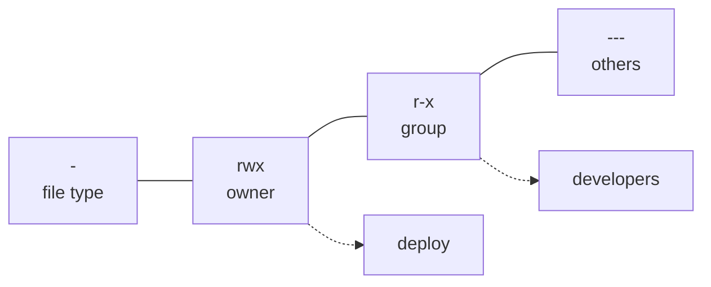
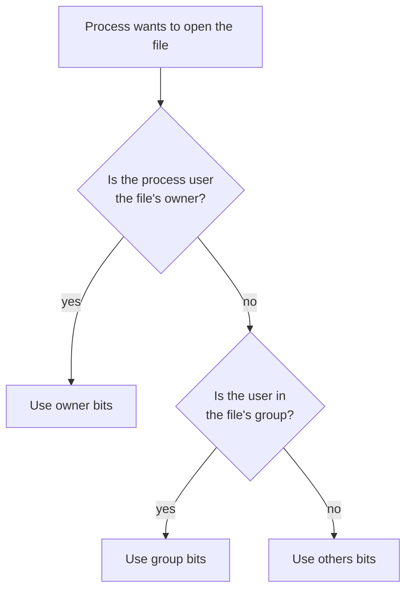

# 🔐 Ownership and Permissions

[[DevOps/NaNa/0. Nana DevOps Table of Contents|📚 Nana DevOps Table of Contents]]

> [!toc]- 📑 Contents
>
> - [[#🔎 Read ls -l|🔎 Read ls -l]]
> - [[#🔤 What r, w, and x Mean|🔤 What r, w, and x Mean]]
> - [[#👤 Change Ownership with chown and chgrp|👤 Change Ownership with chown and chgrp]]
> - [[#✏️ chmod Symbolic Mode|✏️ chmod Symbolic Mode]]
> - [[#🔢 chmod Numeric Mode|🔢 chmod Numeric Mode]]
> - [[#🛡️ Default Permissions and Special Bits|🛡️ Default Permissions and Special Bits]]
> - [[#🩺 Common Failures|🩺 Common Failures]]
> - [[#🧪 Interview Q&A|🧪 Interview Q&A]]
> - [[#🔨 Hands-On Practice|🔨 Hands-On Practice]]
> - [[#📋 Quick Reference|📋 Quick Reference]]
> - [[#🧠 Things to Remember|🧠 Things to Remember]]
> - [[#💡 Pro Tips|💡 Pro Tips]]
> - [[#🔗 Related Topics|🔗 Related Topics]]

## 🔎 Read `ls -l`

Every file has an **owner**, a **group**, and three sets of permissions: for the owner, for the group, and for everyone else. `ls -l` shows all of them.

```bash
ls -l deploy.sh
```

```text
-rwxr-x--- 1 deploy developers 4096 Jan 15 10:30 deploy.sh
```



- 📄 **Type `-`** → regular file. `d` = directory, `l` = symlink.

- 👤 **Owner `deploy`: `rwx`** → read, write, run.

- 👥 **Group `developers`: `r-x`** → read and run, no changes.

- 🔒 **Others: `---`** → no access.

Then: hard-link count `1`, size `4096` bytes, modification time, name. Use `ls -ld dir` to see a directory itself rather than its contents.

### 🧭 How Linux picks which set applies

Linux checks **one** set, in order, and stops at the first match:



root bypasses these checks for read and write.

---

## 🔤 What `r`, `w`, and `x` Mean

The letters mean different things on files and directories:

| | File | Directory |
|---|---|---|
| `r` | Read the contents | List names inside (`ls`) |
| `w` | Change the contents | Create, delete, rename entries inside |
| `x` | Run as a program | Enter it (`cd`) and reach files inside |

- 📁 **Directory `x` is required to reach anything inside**, even a file you have permission to read.

- 🗑️ **Deleting a file depends on the directory's `w`**, not the file's. You can delete a read-only file in a directory you can write to.

---

## 👤 Change Ownership with `chown` and `chgrp`

```bash
sudo chown deploy file.txt                  # owner only
sudo chown deploy:developers file.txt       # owner and group
sudo chown :developers file.txt             # group only
sudo chown -R app:app /srv/app              # whole directory tree
sudo chgrp developers file.txt              # group only, alternative
```

- 👑 **Changing the owner needs root.** Otherwise anyone could hand files to another user.

- 👥 **A regular user may change the group** of their own files, but only to a group they belong to.

> 💡 **Real-World Example**
>
> A container runs as UID `1000` and writes to a bind-mounted `/srv/app/data`. If that directory is owned by root, writes fail with `Permission denied`.
>
> ```bash
> sudo chown -R 1000:1000 /srv/app/data
> ```
>
> Ownership is stored as numbers, so the UID inside and outside the container must match.

---

## ✏️ `chmod` Symbolic Mode

Symbolic mode changes specific bits and leaves the rest alone: **who** + **operator** + **permissions**.

- 👥 **Who:** `u` owner, `g` group, `o` others, `a` all

- ➕ **Operator:** `+` add, `-` remove, `=` set exactly

- 🔤 **Permissions:** `r`, `w`, `x`

```bash
chmod u+x deploy.sh          # owner may run it
chmod g-w report.txt         # group can no longer edit
chmod o-rwx secrets.env      # others get nothing
chmod a+r index.html         # everyone may read
chmod u=rw,g=r,o= app.conf   # set all three exactly → rw-r-----
```

💡 `=` replaces that class's bits. `chmod g=r` removes the group's `w` and `x` if they were set.

Recursive with a capital `X`:

```bash
chmod -R g+rX /srv/shared
```

- `X` adds execute to **directories** (so they can be entered) and to files that are already executable, without making every text file executable.

---

## 🔢 `chmod` Numeric Mode

Each permission has a value, and each class's digit is the sum:

- `r` = **4**, `w` = **2**, `x` = **1**

```text
rwx = 4 + 2 + 1 = 7
r-x = 4 + 0 + 1 = 5
rw- = 4 + 2 + 0 = 6
r-- = 4 + 0 + 0 = 4
--- = 0
```

Three digits → owner, group, others:

```text
chmod 750 deploy.sh

  7    5    0
 rwx  r-x  ---
owner group others
```

| Mode | Result | Typical use |
|---|---|---|
| `755` | `rwxr-xr-x` | Scripts, binaries, directories |
| `644` | `rw-r--r--` | Normal files, configs |
| `750` | `rwxr-x---` | Group-shared app directory |
| `640` | `rw-r-----` | Config readable by the service group |
| `700` | `rwx------` | `~/.ssh`, private directories |
| `600` | `rw-------` | Private keys, `authorized_keys`, `.env` |
| `777` | `rwxrwxrwx` | ⚠️ Anyone may change it; avoid |

Numeric mode sets **all** bits at once. Symbolic mode is better for adding or removing one bit.

---

## 🛡️ Default Permissions and Special Bits

### 🎭 `umask`

New files start from `666` and directories from `777`. The **umask** removes bits from that.

```bash
umask        # → 0022 for root; often 0002 for Ubuntu users
```

```text
files:       666 − 022 = 644  (rw-r--r--)
directories: 777 − 022 = 755  (rwxr-xr-x)
```

Strictly, the umask masks bits rather than subtracting, but with these common values the result is the same.

### ⭐ Special bits

| Bit | Numeric | Shows as | Effect |
|---|---|---|---|
| **setuid** | `4xxx` | `rws------` | File runs as its **owner** (e.g. `/usr/bin/passwd` runs as root) |
| **setgid** | `2xxx` | `---rws---` | On a directory: new files inherit the directory's **group** |
| **sticky** | `1xxx` | `--------t` | In a shared directory, only a file's owner can delete it (`/tmp`) |

A practical one is a shared team directory:

```bash
sudo mkdir /srv/shared
sudo chown root:developers /srv/shared
sudo chmod 2775 /srv/shared
```

- `2` → setgid: every new file belongs to `developers`, not the creator's primary group.

- `775` → owner and group can create files; others can only read.

---

## 🩺 Common Failures

| Symptom | Likely cause | Fix |
|---|---|---|
| `./script.sh: Permission denied` | No `x` bit | `chmod u+x script.sh` |
| `cat` works in one dir, fails in a subdir | Missing `x` on a parent directory | `ls -ld` each parent; add `x` |
| SSH key ignored, password prompt appears | `~/.ssh` or `authorized_keys` too open | `chmod 700 ~/.ssh`, `chmod 600 ~/.ssh/authorized_keys` |
| Container can't write to bind mount | UID mismatch | `chown` the host directory to the container's UID |
| `chown: Operation not permitted` | Not root | Use `sudo` |

---

### 🧪 Interview Q&A

**Q1:** What does `chmod 640 app.conf` give each class?

**Q2:** A user can read `/srv/app/config.yml` by its permissions but gets `Permission denied`. Where do you look?

**Q3:** Why is `chmod 777` a bad fix?

**Q4:** What is the difference between `chmod g=r` and `chmod g+r`?

**Q5:** Why must `~/.ssh/authorized_keys` not be group-writable?

> [!answer]- 📋 Answers
>
> **A1:** Owner `rw-`, group `r--`, others nothing.
>
> **A2:** The parent directories. Each of `/srv` and `/srv/app` needs `x` for that user, or the file can't be reached.
>
> **A3:** Anyone on the system can modify or replace the file, and it hides the real problem, usually wrong ownership. Fix the owner or group instead.
>
> **A4:** `g=r` sets the group to exactly read-only, removing `w` and `x`. `g+r` adds read and keeps whatever else was set.
>
> **A5:** Another user could add their own key and log in as you, so `sshd` refuses to use it (`StrictModes`).

---

## 🔨 Hands-On Practice

1. 📝 **Create a script and try to run it.**

    ```bash
    printf '#!/bin/bash\necho ok\n' > hello.sh
    ./hello.sh
    ```

    ✅ `Permission denied`: new files never get `x` by default.

2. ✏️ **Add execute, then read the result.**

    ```bash
    chmod u+x hello.sh
    ls -l hello.sh && ./hello.sh
    ```

    ✅ The owner bits become `rwx` and it prints `ok`.

3. 📁 **Remove directory `x`.**

    ```bash
    mkdir box && echo hi > box/note.txt
    chmod u-x box
    cat box/note.txt
    chmod u+x box
    ```

    ✅ `cat` fails while the directory lacks `x`, even though `note.txt` is readable.

4. 🔢 **Set modes numerically** with `chmod 600 hello.sh`, then `stat -c '%a %A' hello.sh`.

    ✅ Prints `600 -rw-------`.

5. 🧹 Clean up: `rm -r hello.sh box`.

---

### 📋 Quick Reference

| Task | Command |
|---|---|
| Show permissions | `ls -l file` / `ls -ld dir` |
| Show numeric mode | `stat -c '%a %A %U:%G' file` |
| Change owner and group | `sudo chown user:group file` |
| Recursively | `sudo chown -R user:group dir` |
| Add / remove a bit | `chmod u+x file` / `chmod o-rwx file` |
| Set exactly | `chmod 640 file` |
| Directories traversable, recursively | `chmod -R g+rX dir` |
| Shared group directory | `chmod 2775 dir` |
| Check default mask | `umask` |

### 🧠 Things to Remember

- Linux checks owner → group → others and uses only the first match.

- `r=4`, `w=2`, `x=1`; each digit is the sum for one class.

- Directory `x` = can enter; directory `w` = can create and delete inside.

- Only root changes file owners.

- `600` for private keys and secrets, `700` for `~/.ssh`.

### 💡 Pro Tips

- When you see `Permission denied`, check `ls -l` on the file **and** `ls -ld` on every parent. `namei -l /full/path` shows them all at once.

- Grant shared access through a group and `chmod 2775`, not by widening "others".

- Use `chmod -R ... X` (capital) on trees so files don't all become executable.

- Never run `chmod -R 777` to "fix" an app; find the user the app runs as with `ps -o user= -p <pid>` and `chown` to it.

### 🔗 Related Topics

- [[DevOps/NaNa/Linux/4. Users and Groups|Users and Groups]]

- [[DevOps/NaNa/Linux/7. Server Configuration|Server Configuration]]

- [[DevOps/Server Administration/9. Secrets and File Permissions|Secrets and File Permissions]]

- [[DevOps/NaNa/Docker/7. Docker Volume|Docker Volume]]
