# 🌐 Networking Fundamentals

[[DevOps/NaNa/0. Nana DevOps Table of Contents|📚 Nana DevOps Table of Contents]]

> [!toc]- 📑 Contents
>
> - [[#🗺️ The Big Picture|🗺️ The Big Picture]]
> - [[#📍 IP Addresses and IPv4|📍 IP Addresses and IPv4]]
> - [[#🏠 LAN, Switch, Router, and WAN|🏠 LAN, Switch, Router, and WAN]]
> - [[#🧮 Subnets and CIDR|🧮 Subnets and CIDR]]
> - [[#🚪 Default Gateway|🚪 Default Gateway]]
> - [[#🔁 NAT|🔁 NAT]]
> - [[#🔌 Ports|🔌 Ports]]
> - [[#🖥️ Interfaces: One Door per Network|🖥️ Interfaces: One Door per Network]]
> - [[#🔗 Sockets: Local and Peer|🔗 Sockets: Local and Peer]]
> - [[#🧱 Firewall and Port Forwarding|🧱 Firewall and Port Forwarding]]
> - [[#🧪 Interview Q&A — Networking|🧪 Interview Q&A — Networking]]
> - [[#📛 DNS and Domain Names|📛 DNS and Domain Names]]
> - [[#🔎 How DNS Resolution Works|🔎 How DNS Resolution Works]]
> - [[#⏱️ Caching, TTL, and Record Types|⏱️ Caching, TTL, and Record Types]]
> - [[#🧪 Interview Q&A — DNS|🧪 Interview Q&A — DNS]]
> - [[#💻 Networking Commands|💻 Networking Commands]]
> - [[#🩺 Troubleshooting Scenarios|🩺 Troubleshooting Scenarios]]
> - [[#🔨 Hands-On Practice|🔨 Hands-On Practice]]
> - [[#📋 Quick Reference|📋 Quick Reference]]
> - [[#🧠 Things to Remember|🧠 Things to Remember]]
> - [[#💡 Pro Tips|💡 Pro Tips]]
> - [[#🔗 Related Topics|🔗 Related Topics]]

## 🗺️ The Big Picture

A network lets devices exchange packets. Most of networking is answering a few questions about each packet's journey:

| Question | Concept |
|---|---|
| Who am I? | 📍 IP address |
| Is the destination on my network? | 🧮 Subnet |
| Where does remote traffic go? | 🚪 Default gateway |
| How does my private IP reach the Internet? | 🔁 NAT |
| Which application receives it? | 🔌 Port |
| Is the traffic allowed? | 🧱 Firewall |
| How does `example.com` become an IP? | 📛 DNS |

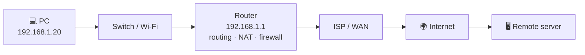

---

## 📍 IP Addresses and IPv4

An **IP address** identifies a **network interface** so packets can be delivered to it. A machine with Ethernet, Wi-Fi, a VPN, and Docker has several interfaces, each with its own address. Loopback `127.0.0.1` always means "this machine".

An **IPv4** address is **32 bits**, written as four 8-bit **octets**:

```text
192 . 168 .   1 .  20
 8  +  8  +   8 +   8  = 32 bits
```

- 🔢 Each octet holds `2^8 = 256` values → `0` to `255`.

- 🌍 The whole space is `2^32 = 4,294,967,296` addresses, and many ranges are reserved, which is why IPv4 ran short.

### 🏠 Public vs private

Three ranges are **private**: free to use inside any LAN, never routed on the public Internet.

```text
10.0.0.0/8        10.0.0.0    – 10.255.255.255
172.16.0.0/12     172.16.0.0  – 172.31.255.255
192.168.0.0/16    192.168.0.0 – 192.168.255.255
```

Everything else usable is **public**: globally unique and reachable on the Internet. Your laptop uses a private address; your router's WAN side holds the public one.

---

## 🏠 LAN, Switch, Router, and WAN

- 🏠 **LAN** → a local network: a home, office, or data-center segment, usually one subnet like `192.168.1.0/24`.

- 🔀 **Switch** → connects devices **inside** a LAN. It learns which **MAC address** sits on which port and forwards Ethernet frames there (Layer 2).

- 🧭 **Router** → connects **different IP networks** and forwards packets by destination IP using its routing table (Layer 3).

- 🌍 **WAN** → a wide-area network. For a home or small office, the router's WAN side faces the ISP. The Internet is a huge interconnection of networks.

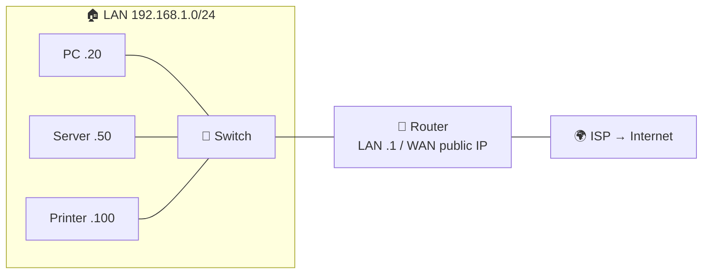

| Switch | Router |
|---|---|
| Inside one network | Between networks |
| Forwards frames by MAC address | Routes packets by IP address |
| Layer 2 | Layer 3 |

A home "router" box is usually a router, switch, Wi-Fi access point, NAT, and firewall in one device.

---

## 🧮 Subnets and CIDR

A **subnet** splits an IP address into a **network part** (which network) and a **host part** (which interface on it). The **CIDR prefix** `/24` says how many leading bits are the network part.

```text
192.168.1.20/24

32 total bits − 24 network bits = 8 host bits
```

### 🎭 `/24` as a subnet mask

The mask is the prefix written as bits: 24 ones, then 8 zeros.

```text
11111111.11111111.11111111.00000000
   255  .   255  .   255  .    0     → 255.255.255.0
```

### 🔢 Addresses in a `/24`

```text
8 host bits → 2^8 = 256 addresses

Network address:   192.168.1.0     (identifies the subnet)
Usable hosts:      192.168.1.1 – 192.168.1.254
Broadcast address: 192.168.1.255   (all hosts)

256 − 1 network − 1 broadcast = 254 usable
```

The same formula works for any prefix: **usable = 2^(32 − prefix) − 2**.

| Prefix | Mask | Total | Usable |
|---|---|---|---|
| `/16` | `255.255.0.0` | 65,536 | 65,534 |
| `/24` | `255.255.255.0` | 256 | 254 |
| `/28` | `255.255.255.240` | 16 | 14 |
| `/32` | `255.255.255.255` | 1 | a single host |

> 💡 **Real-World Example**
>
> The PC is `192.168.1.20/24`, so its network is `192.168.1.0/24`.
>
> - ✅ `192.168.1.50` → same first 24 bits → **local**
>
> - ❌ `192.168.2.50` → third octet differs → **remote**, needs a router

---

## 🚪 Default Gateway

The **default gateway** is the router a host sends packets to when the destination isn't on any directly connected network.

```text
PC:       192.168.1.20/24
Gateway:  192.168.1.1
```

Every packet goes through one decision:

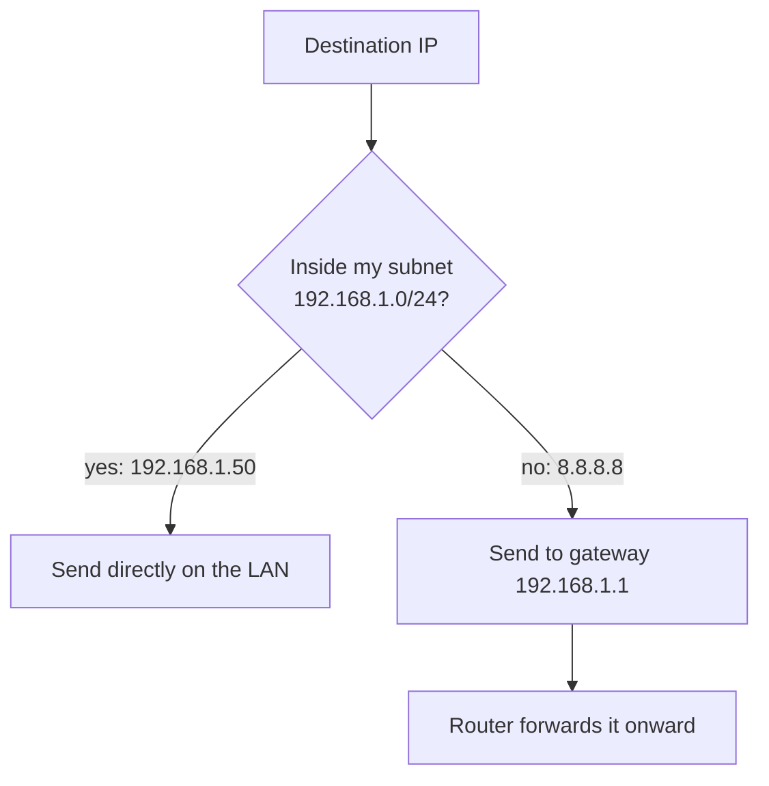

On Linux, the gateway is the `default` line in the routing table:

```bash
ip route
```

```text
default via 192.168.1.1 dev enp5s0
192.168.1.0/24 dev enp5s0 proto kernel scope link src 192.168.1.20
```

- 🚪 **`default via 192.168.1.1`** → "no better route? send it here."

- 🏠 **`192.168.1.0/24 dev enp5s0`** → the local subnet, reached directly.

⚠️ The gateway must be inside the host's own subnet. A PC at `192.168.1.20/24` with gateway `192.168.10.1` reaches local devices but not the Internet.

---

## 🔁 NAT

**NAT (Network Address Translation)** rewrites addresses as packets pass through a router. At home, it lets many private devices share **one public IPv4 address**.

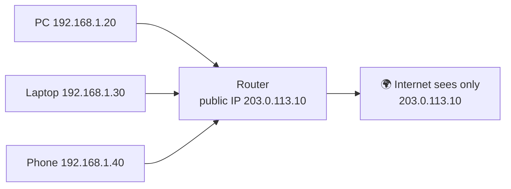

Home routers use **PAT** (port address translation, also called NAPT): they rewrite the source port too, and keep a table to match replies.

```text
Outgoing:  192.168.1.20:51500  →  rewritten to  203.0.113.10:62001  →  93.184.216.34:443

NAT table: 203.0.113.10:62001  ↔  192.168.1.20:51500
```

When the reply comes back to port `62001`, the router looks up the table and delivers it to the PC.

Docker uses the same mechanism: containers on a bridge network reach the Internet through NAT on the host.

---

## 🔌 Ports

An IP address finds the machine; a **port** finds the application on it. TCP and UDP each have ports `0`–`65535`.

```text
192.168.1.50:443/tcp
   address  :port/protocol
```

| Service | Default port |
|---|---|
| SSH | 22/tcp |
| DNS | 53/udp and tcp |
| HTTP / HTTPS | 80/tcp / 443/tcp |
| MySQL / PostgreSQL | 3306/tcp / 5432/tcp |

These are defaults; services can listen on any port.

- ⚠️ **Two programs can't bind the same IP + protocol + port.** A second app on `0.0.0.0:8080/tcp` fails with `address already in use`.

- ✅ **`8080/tcp` and `8080/udp`** are separate; TCP and UDP have separate port spaces.

### 🎯 The bind address matters

| Listening on | Reachable from |
|---|---|
| `127.0.0.1:8080` | This machine only |
| `0.0.0.0:8080` | Every IPv4 interface, so other machines too (if the firewall allows) |
| `192.168.1.50:8080` | Only via that one interface |

"Works with `curl localhost` on the server but not from my laptop" is very often a service bound to `127.0.0.1`.

---

## 🖥️ Interfaces: One Door per Network

A machine doesn't have just a "local" and a "public" address. It has **interfaces**, each a door to one network with its own addresses. **Loopback (`lo`)** always exists; the rest depend on the hardware and software installed.

```bash
ip -br addr
```

```text
lo               UNKNOWN  127.0.0.1/8 ::1/128
eth0             UP       203.0.113.10/24 2001:db8:0:4::1/64 fe80::be24:11ff:fe4c:331a/64
docker0          DOWN     172.17.0.1/16
br-eec8dadb89e5  UP       172.18.0.1/16
vethe7bd5dc@if2  UP       fe80::28fa:ffff:fe52:549d/64
```

Illustrative VPS output. `-br` (brief) prints one line per interface: **name, state, addresses**.

- 🔁 **`lo`** → this machine only.

    - `/8` means every `127.x.x.x` address is loopback; `::1` is the IPv6 loopback.

- 🌍 **`eth0`** → the Internet.

    - `203.0.113.10` is the public IPv4; `2001:db8:…` is a public IPv6, so the server is reachable on both.

- 🐳 **`docker0`, `br-…`, `veth…`** → Docker's virtual networks and the cables to containers. See [[DevOps/NaNa/Docker/9. Docker Networking|Docker Networking]].

- 🏷️ **`fe80::…`** → automatic IPv6 **link-local** addresses, valid only on that one link. Usually safe to ignore.

Other machines look different. A home laptop has `lo` plus a private Wi-Fi address like `192.168.1.20`, and the router holds the public IP. Some cloud VMs (AWS) show only a private address like `10.0.1.5`; the provider maps the public IP to it.

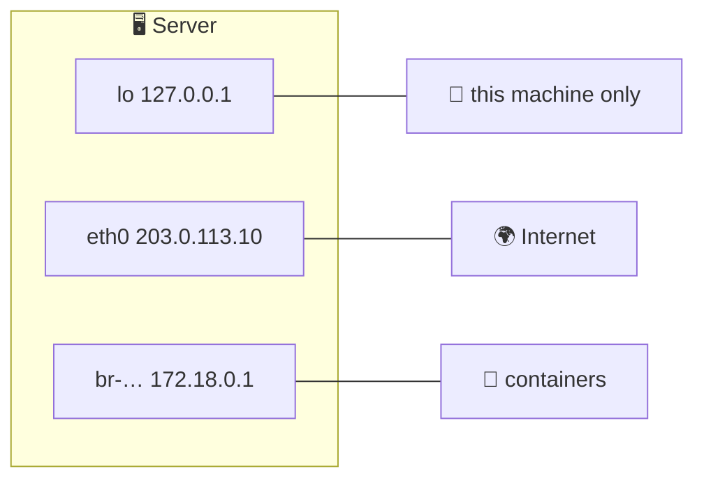

### 🧑‍⚖️ The program picks the door, the kernel enforces it

Linux doesn't decide who may connect. **Each program chooses which address to bind to**, using the [[#🎯 The bind address matters|bind address]] table above. The choice comes from the program's own config:

- 🔐 **`sshd`** → `ListenAddress` in `sshd_config`; default `0.0.0.0`.

- 🐳 **Docker** → `-p 80:80` binds `0.0.0.0`; `-p 127.0.0.1:81:81` binds loopback.

- 🐙 **Gitea** → `HTTP_ADDR` in `app.ini`.

- 💻 **`nc -l 127.0.0.1 9999`** → loopback, because we typed it.

The kernel then makes loopback binding reliable:

- 🔁 Packets to `127.0.0.1` never leave the machine.

- 🚫 Packets arriving from the network addressed to `127.0.0.1` are dropped as invalid ("martian" packets).

⚠️ Binding to a non-loopback address is weaker than it looks. Linux accepts packets for **any** of its own addresses arriving on **any** interface, so a service on `172.18.0.1` is also reachable from other Docker networks. Use the firewall when that matters.

### 🧱 Binding and firewall are separate layers

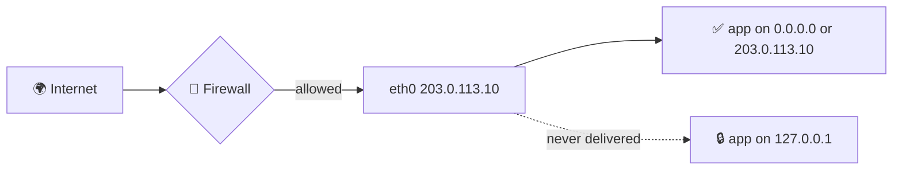

- 🔒 Bound to `127.0.0.1` → private **even with no firewall**.

- 🌍 Bound to `0.0.0.0` → public **unless the firewall blocks it**. Docker-published ports skip ufw; see [[DevOps/Server Administration/3. Firewalls and Docker Port Publishing|Firewalls and Docker Port Publishing]].

---

## 🔗 Sockets: Local and Peer

A **socket** is one endpoint of a network conversation. Every TCP connection is identified by **four values**:

```text
( local IP , local port , peer IP , peer port )
  └──── this side ────┘   └─── other side ───┘
```

`ss` shows them as **Local Address:Port** (this machine's side) and **Peer Address:Port** (the other side).

### 📋 LISTEN is a template; ESTAB is a real conversation

A **listening socket** only knows its own side. The unknown parts are shown as wildcards: `0.0.0.0` (any address) and `*` (any port).

```text
State   Local Address:Port   Peer Address:Port
LISTEN  0.0.0.0:443          0.0.0.0:*
```

- 🏠 **Local `0.0.0.0:443`** → "I accept on **all my addresses**, port 443."

- ❓ **Peer `0.0.0.0:*`** → "Nobody is connected yet; **any** client from any port may connect."

The two `0.0.0.0` values answer different questions. Local controls **exposure**; Peer on a LISTEN row is always the wildcard.

> 💡 **Real-World Example**
>
> A company has phone lines 555-1000 and 555-2000 and a receptionist at extension 443.
>
> - 📋 **The receptionist's sign** (LISTEN) → "I answer any of our lines on ext 443, from any caller."
>
> - 📞 **Alice calls 555-1000 from 555-7777** (ESTAB) → a new call record: line 555-1000 ext 443, caller 555-7777.
>
> The sign doesn't change. Every caller gets their own call record.

When a client connects, the kernel fills in every blank and creates a **new socket** for that conversation:

```bash
sudo ss -tan '( sport = :443 )'
```

```text
State   Local Address:Port    Peer Address:Port
LISTEN  0.0.0.0:443           0.0.0.0:*             ← still waiting for new clients
ESTAB   203.0.113.10:443      198.51.100.7:51234    ← Alice, tab 1
ESTAB   203.0.113.10:443      192.0.2.44:60100      ← Bob
ESTAB   203.0.113.10:443      198.51.100.7:51240    ← Alice, tab 2
```

- 🏠 **Local is the same** on every ESTAB row: the address the visitors actually reached.

- 👥 **Peer is different** on each row. That's how the kernel tells conversations apart; Alice's two tabs share her IP but not her port.

- 📋 **The LISTEN row never changes.**

### 🎲 Client ports are random

The client's OS picks a temporary **ephemeral port** for each connection:

```bash
cat /proc/sys/net/ipv4/ip_local_port_range
```

```text
32768	60999
```

So the **well-known port** (443, 22, 9999) marks the server side, and the **random high port** marks the client. When the server itself connects out, for example `apt update` reaching a mirror, the roles flip:

```text
ESTAB   203.0.113.10:41822   91.189.91.81:443     ← this server is the client
```

### 🔁 Both ends on one machine

When client and server run on the same host, `ss` shows the connection **twice**, once from each end, with Local and Peer swapped:

```text
State   Local Address:Port   Peer Address:Port
ESTAB   127.0.0.1:51642      127.0.0.1:9999       ← client (nc 127.0.0.1 9999)
ESTAB   127.0.0.1:9999       127.0.0.1:51642      ← server (nc -l 127.0.0.1 9999)
```

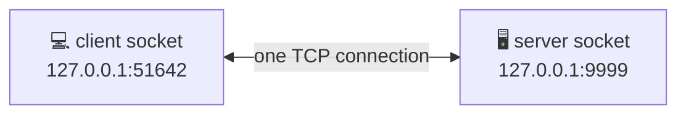

| Row | Read it as |
|---|---|
| `LISTEN 0.0.0.0:443 0.0.0.0:*` | I wait on all my addresses, port 443, for anyone |
| `LISTEN 127.0.0.1:81 0.0.0.0:*` | I wait on loopback only, so only this machine can connect |
| `ESTAB 203.0.113.10:443 198.51.100.7:51234` | I'm serving 443 to a client at 198.51.100.7 |
| `ESTAB 203.0.113.10:41822 91.189.91.81:443` | I'm the client, talking to a web server |

---

## 🧱 Firewall and Port Forwarding

A **firewall** allows or drops traffic by rules: source and destination IP, protocol, port, connection state, and interface.

```text
Allow tcp 443 from anywhere
Allow tcp 22 from 192.168.1.0/24 only
Deny everything else inbound
```

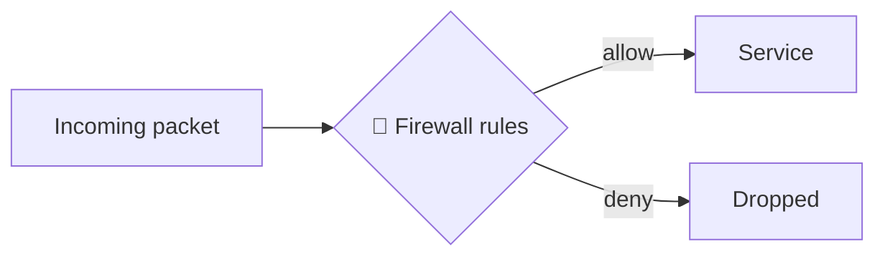

| NAT | Firewall |
|---|---|
| Translates addresses and ports | Decides whether traffic is allowed |
| Lets private hosts share a public IP | Enforces security policy |

Routers often do both, which is why they're confused. NAT is **not** a security control on its own.

### 📬 Port forwarding

Inbound connections can't reach a private IP directly. **Port forwarding** is a NAT rule on the router: "traffic arriving at my public IP on port X goes to this internal host and port".

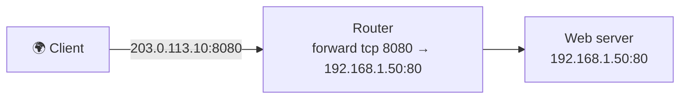

The external and internal ports may differ. The server's own firewall must still allow the traffic.

`docker run -p 8080:80` is port forwarding on the host: host port `8080` → container port `80`.

---

### 🧪 Interview Q&A — Networking

**Q1:** Why does a host need a default gateway?

**Q2:** What is the difference between a switch and a router?

**Q3:** How many usable addresses are in a `/24`, and why?

**Q4:** What is the difference between NAT and a firewall?

**Q5:** A service listens on `127.0.0.1:8080`. Why can't other machines reach it?

**Q6:** In `ss`, what's the difference between Local `0.0.0.0:443` and Peer `0.0.0.0:*`?

**Q7:** Who decides whether a service is reachable only locally or from the network?

**Q8:** In an ESTAB row, how do you tell which side is the server?

> [!answer]- 📋 Answers
>
> **A1:** To reach destinations outside its own subnet. Those packets go to the gateway router, which forwards them onward.
>
> **A2:** A switch connects devices inside one network using MAC addresses; a router connects different networks using IP addresses.
>
> **A3:** 254. `32 − 24 = 8` host bits gives `2^8 = 256` addresses, minus the network and broadcast addresses.
>
> **A4:** NAT rewrites addresses so private hosts can share a public IP. A firewall decides which traffic is allowed.
>
> **A5:** `127.0.0.1` is loopback, so only processes on the same machine can connect. Bind to `0.0.0.0` or the LAN IP.
>
> **A6:** Local is this machine's side: listen on all its addresses, port 443. Peer is the other side: no client yet, so any address and port may connect.
>
> **A7:** The program, through its bind address. The kernel enforces it (loopback never leaves the machine), and the firewall filters what reaches public interfaces.
>
> **A8:** The server side has the well-known port (443, 22); the client side has a random ephemeral port (32768–60999).

---

## 📛 DNS and Domain Names

**DNS (Domain Name System)** turns names into data computers need, mainly IP addresses. We type `example.com`; DNS returns the address behind it.

A domain name is a hierarchy read **right to left**:

```text
git.example.com.
 │     │     │ └─ root (the trailing dot, usually omitted)
 │     │     └─── TLD: com
 │     └───────── registered domain: example
 └─────────────── subdomain: git
```

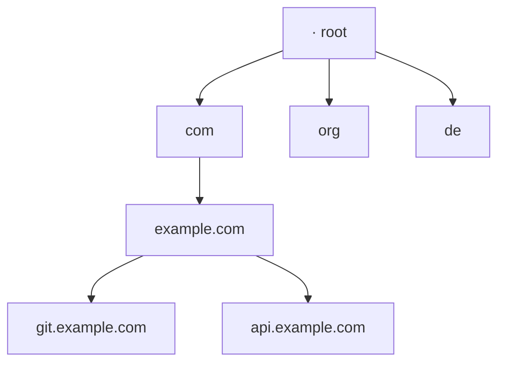

- 🏷️ **TLD** → the last label. Generic (`.com`, `.org`, `.net`) or country-code **ccTLDs** (`.de`, `.uk`, `.ir`).

- 🌿 **Subdomains** → names you create under your domain: `git`, `api`, `vpn`. Each can point to the same server or different ones.

- 📌 **FQDN** → the full name down to the root, like `git.example.com.`.

- 🏛️ **ICANN** → coordinates the root zone and TLDs (through the IANA functions). It does not answer everyday DNS queries.

---

## 🔎 How DNS Resolution Works

Your computer doesn't walk the hierarchy itself. It asks a **recursive resolver** (your router, ISP, company, or a public one like `1.1.1.1`), and the resolver does the work.

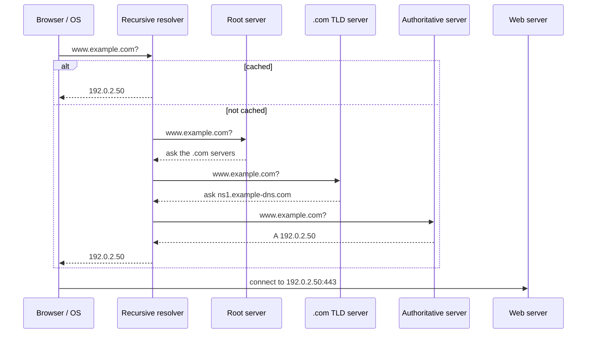

1. 💻 **Browser and OS** check their own caches and `/etc/hosts`, then ask the configured resolver.

2. 🔁 **Recursive resolver** answers from cache if it can; otherwise it starts at the top.

3. 🌳 **Root server** doesn't know the IP. It refers the resolver to the `.com` servers.

4. 🏷️ **TLD server** refers it to the domain's **authoritative** name servers.

5. ✅ **Authoritative server** holds the domain's records and returns the answer.

DNS only finds the address. TCP/IP then carries the connection, and TLS secures HTTPS. They're separate stages that fail separately.

---

## ⏱️ Caching, TTL, and Record Types

Every answer carries a **TTL (Time To Live)** in seconds. Resolvers and clients may reuse it until it expires.

```text
www.example.com   3600   IN   A   192.0.2.50

TTL 3600 s ÷ 60 = 60 minutes = 1 hour
```

That's why a DNS change can take up to the old TTL to appear everywhere. 💡 Lower the TTL a day before a planned migration, then raise it again afterwards.

| Record | Purpose | Example |
|---|---|---|
| `A` | Name → IPv4 | `api.example.com → 192.0.2.20` |
| `AAAA` | Name → IPv6 | `api.example.com → 2001:db8::20` |
| `CNAME` | Alias to another name | `www → web.example.com` |
| `MX` | Mail servers for the domain | `example.com → mail.example.com` |
| `NS` | Authoritative name servers | `example.com → ns1.example-dns.com` |
| `TXT` | Free text: SPF, domain verification | `"v=spf1 ..."` |
| `PTR` | Reverse lookup: IP → name | `192.0.2.20 → api.example.com` |

---

### 🧪 Interview Q&A — DNS

**Q1:** Does your PC query the root servers directly?

**Q2:** What does a root server return for `www.example.com`?

**Q3:** Which server holds the actual records for a domain?

**Q4:** You changed an `A` record but some users still reach the old server. Why?

**Q5:** What is the difference between `A` and `CNAME`?

> [!answer]- 📋 Answers
>
> **A1:** Usually not. It asks a recursive resolver, which queries root, TLD, and authoritative servers when needed.
>
> **A2:** A referral to the `.com` TLD servers, not the IP address.
>
> **A3:** The domain's authoritative name server.
>
> **A4:** Resolvers cached the old record and keep using it until its TTL expires.
>
> **A5:** `A` maps a name to an IPv4 address. `CNAME` maps a name to another name, which is then resolved.

---

## 💻 Networking Commands

Modern Linux uses the `iproute2` tools. The older `net-tools` commands still appear in tutorials.

| Legacy | Modern |
|---|---|
| `ifconfig` | `ip addr` |
| `route` | `ip route` |
| `netstat` | `ss` |

### 📍 `ip addr` — interfaces and addresses

```bash
ip a
```

```text
2: enp5s0: <BROADCAST,MULTICAST,UP,LOWER_UP> mtu 1500
    inet 192.168.1.20/24 brd 192.168.1.255 scope global enp5s0
```

- `enp5s0` → interface name; `UP` → it's active.

- `inet 192.168.1.20/24` → IPv4 address and prefix.

- `brd 192.168.1.255` → broadcast address.

### 🚪 `ip route` — routing table

```bash
ip route
ip route get 8.8.8.8    # which route and interface a specific destination uses
```

See [[#🚪 Default Gateway|Default Gateway]] for how to read the output.

### 📡 `ping` — basic reachability

```bash
ping -c 4 192.168.1.1   # gateway
ping -c 4 8.8.8.8       # Internet by IP
ping -c 4 example.com   # Internet by name (also tests DNS)
```

```text
64 bytes from 8.8.8.8: icmp_seq=1 ttl=117 time=20.4 ms
```

- `icmp_seq` → packet number; gaps mean loss.

- `ttl` → hops remaining on the reply.

- `time` → round-trip latency.

- `-c 4` → stop after 4 packets (Linux `ping` runs forever otherwise).

⚠️ No reply doesn't prove the host is down. Many firewalls and cloud providers block ICMP while HTTPS works fine.

### 📛 `nslookup` and `dig` — DNS

```bash
nslookup example.com
nslookup example.com 1.1.1.1      # ask a specific resolver
dig +short example.com
dig example.com MX
```

`nslookup` is quick; `dig` shows TTLs, record types, and which server answered. Comparing your resolver with `1.1.1.1` tells you whether a problem is local.

### 🔌 `ss` — listening sockets

```bash
sudo ss -ltnp
```

- `-l` listening, `-t` TCP, `-n` numeric ports, `-p` owning process (needs `sudo` for other users' processes). Use `-u` for UDP.

- `-a` shows listening **and** connected sockets; without `-l` or `-a`, `ss` shows only connections.

- `'( sport = :443 )'` filters by local port; `dport` filters by peer port.

| Column | LISTEN row | ESTAB row |
|---|---|---|
| **Recv-Q** | Connections waiting to be accepted by the app | Bytes received but not yet read by the app |
| **Send-Q** | Maximum accept queue (backlog), e.g. `4096` | Bytes sent but not yet acknowledged |
| **Local Address:Port** | Where it listens | This side of the conversation |
| **Peer Address:Port** | Always `0.0.0.0:*` / `[::]:*` | The other side |
| **Process** | Name, PID, file descriptor | Same |

`0` in both queues is healthy. A queue that keeps growing means the app or network isn't keeping up.

A real VPS running Docker and an SSH server (trimmed, IPv6 rows omitted):

```text
State   Recv-Q Send-Q  Local Address:Port   Peer Address:Port  Process
LISTEN  0      4096          0.0.0.0:443         0.0.0.0:*      users:(("docker-proxy",pid=2484516,fd=8))
LISTEN  0      4096          0.0.0.0:2202        0.0.0.0:*      users:(("sshd",pid=2421230,fd=3),("systemd",pid=1,fd=86))
LISTEN  0      4096          0.0.0.0:2222        0.0.0.0:*      users:(("docker-proxy",pid=2065318,fd=8))
LISTEN  0      4096          0.0.0.0:80          0.0.0.0:*      users:(("docker-proxy",pid=2484480,fd=8))
LISTEN  0      128         127.0.0.1:38409       0.0.0.0:*      users:(("code-8761a5560c",pid=1832,fd=10))
LISTEN  0      4096    127.0.0.53%lo:53          0.0.0.0:*      users:(("systemd-resolve",pid=2063010,fd=18))
LISTEN  0      4096        127.0.0.1:81          0.0.0.0:*      users:(("docker-proxy",pid=2484502,fd=8))
```

- 🌍 **Public:** `80`, `443` (reverse proxy container), `2202` (SSH), `2222` (Gitea's git-over-SSH container).

- 🔒 **Loopback only:** `81` (proxy admin UI), `53` (DNS stub resolver), random ports for the VS Code Remote-SSH server.

- 🐳 **`docker-proxy`** → Docker forwarding a published port into a container. The container itself doesn't appear.

- ⚙️ **`sshd` and `systemd` share 2202** → **socket activation**: `ssh.socket` opens the port and hands connections to `sshd`. Changing the SSH port means changing the socket unit as well as `sshd_config`.

- 👯 Most ports appear twice: once for IPv4 (`0.0.0.0`) and once for IPv6 (`[::]`).

✅ Identify any process with `ps -fp <pid>` or `systemctl status <pid>`.

### ⚙️ `ps` — is the process running?

```bash
ps aux | grep nginx
```

`ps` answers **"is it running?"**; `ss` answers **"is it listening, and where?"**. A running process may still not be listening on the port you expect.

---

## 🩺 Troubleshooting Scenarios

Work from the bottom up, one layer at a time:

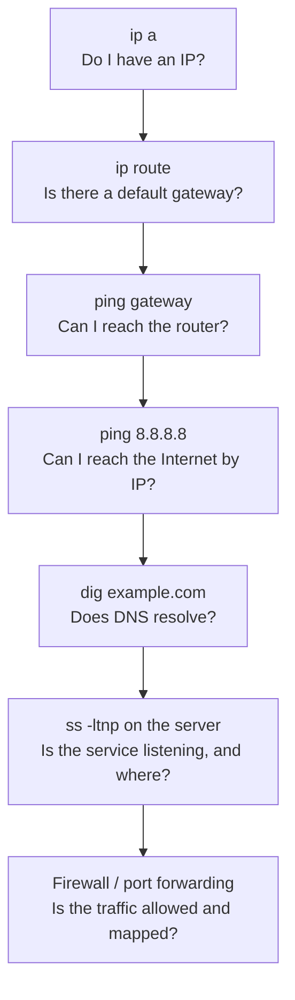

| Symptom | Likely cause | Check |
|---|---|---|
| `ping 8.8.8.8` works, `ping example.com` fails | DNS | `dig example.com`, `resolvectl status` |
| LAN works, Internet doesn't | Wrong or missing gateway | `ip route` → `default via` in your subnet? |
| Service works on the server, not from outside | Bound to `127.0.0.1` | `ss -ltnp` shows the bind address |
| Listening on `0.0.0.0`, still unreachable | Firewall | `sudo ufw status`, cloud security group |
| Reachable on LAN, not from the Internet | No port forwarding or public IP | Router forwarding rule, ISP CGNAT |
| `address already in use` on start | Another process owns the port | `sudo ss -ltnp \| grep :8080` |

---

## 🔨 Hands-On Practice

1. 📍 **Find your address and subnet.**

    ```bash
    ip a
    ```

    ✅ An active interface shows `inet <address>/<prefix>`, e.g. `192.168.1.20/24`.

2. 🚪 **Find your gateway** with `ip route`.

    ✅ The `default via <gateway>` line shows the router's IP.

3. 📡 **Test each layer.**

    ```bash
    ping -c 3 <gateway>
    ping -c 3 8.8.8.8
    dig +short example.com
    ```

    ✅ All three succeed on a healthy network. Whichever fails first is the broken layer.

4. 🎯 **See bind addresses in action.**

    ```bash
    python3 -m http.server 8000 --bind 127.0.0.1 &
    ss -ltn | grep 8000
    curl -s -o /dev/null -w "%{http_code}\n" http://127.0.0.1:8000
    ```

    ✅ `ss` shows `127.0.0.1:8000` and `curl` prints `200`. From another device on the LAN, `http://<your-ip>:8000` fails. Restart with `--bind 0.0.0.0` and it works (if your firewall allows port 8000).

5. 🧹 Stop the server: `kill %1`.

6. 🔗 **Watch a socket go from LISTEN to ESTAB.** Use three terminals on the same machine.

    In terminal 1, start a listener:

    ```bash
    nc -l 127.0.0.1 9999
    ```

    In terminal 2, check it, then connect:

    ```bash
    ss -tln '( sport = :9999 )'
    nc 127.0.0.1 9999
    ```

    In terminal 3, look again:

    ```bash
    ss -tan '( sport = :9999 or dport = :9999 )'
    ```

    ✅ First a LISTEN row with Peer `0.0.0.0:*`; then two ESTAB rows with Local and Peer swapped. Ubuntu's `nc -l` stops listening after its first client, so the LISTEN row disappears. Type a line in one `nc` window and it appears in the other; Ctrl+C in both to finish.

---

### 📋 Quick Reference

| Concept | One-line meaning |
|---|---|
| IP address | Identifies a network interface |
| Subnet / CIDR `/24` | First 24 bits = network; 254 usable hosts |
| Default gateway | Router for destinations outside the subnet |
| NAT / PAT | Many private IPs share one public IP |
| Port | Selects the application: `0`–`65535` per TCP/UDP |
| Interface | One door to one network: `lo`, `eth0`, `br-…` |
| Socket | One endpoint: Local IP:port + Peer IP:port |
| LISTEN / ESTAB | Waiting template / one real conversation |
| Firewall | Allows or drops traffic by rules |
| Port forwarding | Public IP:port → internal host:port |
| DNS | Name → IP via resolver, root, TLD, authoritative |
| TTL | How long a DNS answer may be cached |

| Task | Command |
|---|---|
| Show addresses | `ip a` |
| One line per interface | `ip -br addr` |
| All sockets on a port | `sudo ss -tanp '( sport = :443 )'` |
| Show routes / gateway | `ip route` |
| Route for one destination | `ip route get 8.8.8.8` |
| Test reachability | `ping -c 4 host` |
| DNS lookup | `dig +short name` / `nslookup name` |
| Listening TCP ports + processes | `sudo ss -ltnp` |
| Who uses a port | `sudo ss -ltnp \| grep :8080` |

### 🧠 Things to Remember

- Every packet: **local subnet → send directly; otherwise → default gateway**.

- `usable hosts = 2^(32 − prefix) − 2`.

- Private ranges: `10/8`, `172.16/12`, `192.168/16`.

- NAT translates; the firewall allows or blocks.

- `127.0.0.1` = this machine only; `0.0.0.0` = all interfaces.

- The **program** picks the bind address; the kernel enforces it; the firewall filters the public doors.

- In `ss`, Local = this side, Peer = the other side. A LISTEN row's Peer is always the wildcard.

- Well-known port = server side; random high port = client side.

- DNS goes resolver → root → TLD → authoritative, and answers are cached for the TTL.

### 💡 Pro Tips

- Test by IP before testing by name; it separates DNS problems from connectivity problems.

- Check the bind address with `ss -ltnp` before touching the firewall.

- Use `curl -v http://host:port` to test a TCP service; it works where ICMP `ping` is blocked.

- Lower DNS TTLs ahead of server migrations so the cutover propagates quickly.

- With Docker, published ports (`-p`) can bypass `ufw` rules. Bind sensitive ports to `127.0.0.1:` explicitly.

### 🔗 Related Topics

- [[DevOps/NaNa/Linux/7. Server Configuration|Server Configuration]]

- [[DevOps/Server Administration/3. Firewalls and Docker Port Publishing|Firewalls and Docker Port Publishing]]

- [[DevOps/Server Administration/10. TLS HTTPS and Reverse Proxy Exposure|TLS, HTTPS, and Reverse Proxy Exposure]]

- [[DevOps/Server Administration/2. SSH Hardening and Brute Force|SSH Hardening and Brute Force]]

- [[DevOps/NaNa/Docker/2. Docker Architecture And its Components|Docker Architecture and Its Components]]

- [[DevOps/NaNa/Docker/9. Docker Networking|Docker Networking]]
