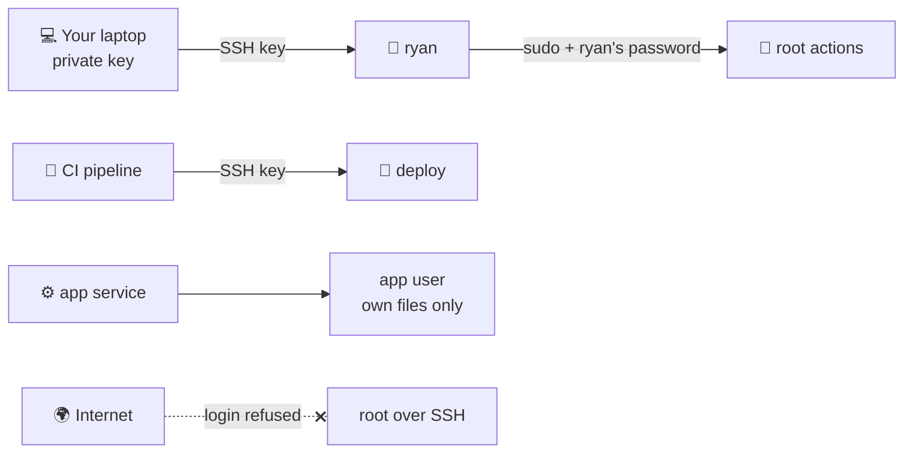
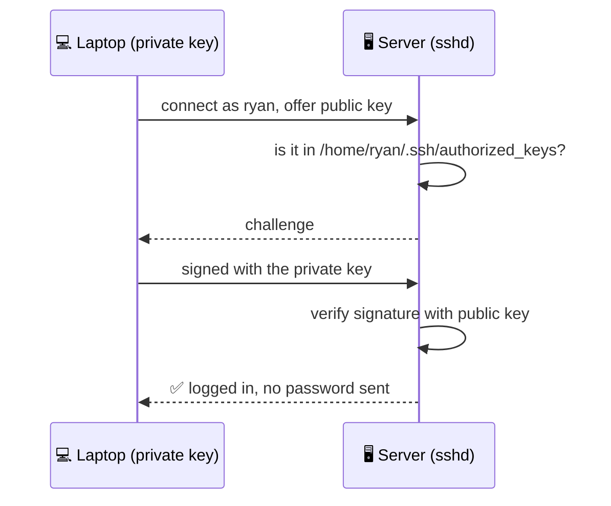

# 🖥️ Server Configuration

[[DevOps/NaNa/0. Nana DevOps Table of Contents|📚 Nana DevOps Table of Contents]]

> [!toc]- 📑 Contents
>
> - [[#🚫 Don't Work as root|🚫 Don't Work as root]]
> - [[#👑 Give an Admin sudo|👑 Give an Admin sudo]]
> - [[#⚙️ One User per Service|⚙️ One User per Service]]
> - [[#🔑 SSH Key Login|🔑 SSH Key Login]]
> - [[#🩺 Common Failures|🩺 Common Failures]]
> - [[#🧪 Interview Q&A|🧪 Interview Q&A]]
> - [[#🔨 Hands-On Practice|🔨 Hands-On Practice]]
> - [[#📋 Quick Reference|📋 Quick Reference]]
> - [[#🧠 Things to Remember|🧠 Things to Remember]]
> - [[#💡 Pro Tips|💡 Pro Tips]]
> - [[#🔗 Related Topics|🔗 Related Topics]]

## 🚫 Don't Work as root

A fresh server often gives you only `root`. Working as root means every typo and every compromised process has full control of the machine. Instead, give each **person** and each **service** its own account with only the access it needs.

> 💡 **Real-World Example**
>
> A new VPS that will run a web app:
>
> - 👤 **`ryan`** → admin; logs in with an SSH key and uses `sudo` when needed
>
> - ⚙️ **`app`** → runs the application; no login, no `sudo`
>
> - 🤖 **`deploy`** → CI connects as this user to ship releases
>
> - 🚫 **`root`** → no direct SSH login



---

## 👑 Give an Admin `sudo`

Create the admin user and add it to the `sudo` group (`wheel` on RHEL-family systems). Run this as root on the new server:

```bash
adduser ryan
usermod -aG sudo ryan
```

- `adduser` creates the home directory and asks for a password.

- `-aG sudo` **appends** the `sudo` group; see [[DevOps/NaNa/Linux/4. Users and Groups#👥 Create Groups and Manage Membership|why `-a` matters]].

Now `ryan` runs admin commands with `sudo`:

```bash
sudo apt update
```

🔑 **`sudo` asks for `ryan`'s own password, not root's.** Root's password never needs to be shared, and every `sudo` command is logged under the real user's name (`/var/log/auth.log` or `journalctl`).

| | `su -` | `sudo command` |
|---|---|---|
| Password asked | Root's | Your own |
| Scope | A full root shell | One command |
| Audit trail | "root did it" | "ryan ran X as root" |

---

## ⚙️ One User per Service

Each service gets a **system user** with no login shell, owning only its own files.

```bash
sudo useradd -r -s /usr/sbin/nologin app
sudo mkdir -p /srv/app
sudo chown -R app:app /srv/app
```

- `-r` → system account.

- `/usr/sbin/nologin` → nobody can log in as `app`.

- `chown` → the service can write to its own directory and nothing else.

Many packages do this for you: installing Nginx, PostgreSQL, or Jenkins creates `www-data`, `postgres`, or `jenkins`. If one service is compromised, the attacker gets that user's limited access, not the whole server.

---

## 🔑 SSH Key Login

To log in with an SSH key, the user's **public** key goes into `~/.ssh/authorized_keys` on the server. The **private** key never leaves your laptop.



1. 🔐 **Create a key pair on your laptop** (skip if you already have one).

    ```bash
    ssh-keygen -t ed25519 -C "ryan@laptop"
    ```

    - Creates `~/.ssh/id_ed25519` (private) and `~/.ssh/id_ed25519.pub` (public).

2. 📤 **Copy the public key to the server.**

    ```bash
    ssh-copy-id ryan@<server-ip>
    ```

    - Appends your public key to `/home/ryan/.ssh/authorized_keys` and sets safe permissions.

    - Manual alternative, as root on the server:

        ```bash
        mkdir -p /home/ryan/.ssh
        echo "<contents of id_ed25519.pub>" >> /home/ryan/.ssh/authorized_keys
        chown -R ryan:ryan /home/ryan/.ssh
        chmod 700 /home/ryan/.ssh
        chmod 600 /home/ryan/.ssh/authorized_keys
        ```

3. ✅ **Test in a new terminal** while the old session stays open.

    ```bash
    ssh ryan@<server-ip>
    sudo whoami
    ```

    - Logs in without the account password; `sudo whoami` prints `root`.

4. 🚫 **Then disable root and password login** in `/etc/ssh/sshd_config`:

    ```text
    PermitRootLogin no
    PasswordAuthentication no
    ```

    ```bash
    sudo sshd -t && sudo systemctl reload ssh
    ```

    - `sshd -t` checks the config for errors before reloading. The service is `ssh` on Ubuntu, `sshd` on RHEL.

> ⚠️ Disable password login only after key login **and** `sudo` work for your admin user, tested from a second session. Otherwise you can lock yourself out and need the provider's web console to recover.

---

## 🩺 Common Failures

| Symptom | Likely cause | Fix |
|---|---|---|
| `ryan is not in the sudoers file` | Not in `sudo` group | As root: `usermod -aG sudo ryan`, then log in again |
| Added to `sudo` but still refused | Old session | Log out and back in |
| SSH still asks for a password | Key not in `authorized_keys`, or permissions too open | Check `~/.ssh` is `700`, file is `600`, owned by the user |
| `Permission denied (publickey)` | Wrong user, wrong key, or password login already disabled | `ssh -v ryan@host` shows which keys were tried |
| Service can't write its files | Directory owned by root | `chown -R app:app /srv/app` |

---

### 🧪 Interview Q&A

**Q1:** Why not just run everything as root?

**Q2:** Whose password does `sudo` ask for, and why is that useful?

**Q3:** Why give each service its own user?

**Q4:** Which key goes on the server, and where?

**Q5:** In what order should you disable password login and set up keys?

> [!answer]- 📋 Answers
>
> **A1:** Any mistake or compromised process then has full control of the server, and logs can't show which person did what.
>
> **A2:** The current user's. Root's password is never shared, and each `sudo` command is logged under the real user.
>
> **A3:** A compromised service is limited to that user's files and permissions instead of the whole machine.
>
> **A4:** The **public** key, appended to `~/.ssh/authorized_keys` in the target user's home directory.
>
> **A5:** Set up and test key login and `sudo` first, from a second session. Only then disable password and root login.

---

## 🔨 Hands-On Practice

Use a test VM or a throwaway VPS.

1. 👤 **Create an admin user** as root: `adduser alice` and `usermod -aG sudo alice`.

2. 🔑 **Install your key** from your laptop: `ssh-copy-id alice@<vm-ip>`.

3. ✅ **Verify in a new terminal.**

    ```bash
    ssh alice@<vm-ip>
    id
    sudo whoami
    ```

    ✅ `id` lists `sudo`; `sudo whoami` asks for **alice's** password and prints `root`.

4. ⚙️ **Create a service user** and confirm it can't log in.

    ```bash
    sudo useradd -r -s /usr/sbin/nologin demo-svc
    sudo su - demo-svc
    ```

    ✅ Prints `This account is currently not available.`

5. 🧹 Clean up: `sudo userdel demo-svc`.

---

### 📋 Quick Reference

| Task | Command |
|---|---|
| Create admin | `adduser ryan` |
| Grant sudo | `usermod -aG sudo ryan` |
| Create service user | `useradd -r -s /usr/sbin/nologin app` |
| Give service its directory | `chown -R app:app /srv/app` |
| Make a key pair | `ssh-keygen -t ed25519` |
| Install public key | `ssh-copy-id user@host` |
| Key file permissions | `chmod 700 ~/.ssh`, `chmod 600 ~/.ssh/authorized_keys` |
| Check and reload sshd | `sudo sshd -t && sudo systemctl reload ssh` |

### 🧠 Things to Remember

- Nobody works as root day to day; admins use `sudo`.

- `sudo` asks for **your** password; `su` asks for the target's.

- One system user per service, with `nologin`.

- Public key → server's `authorized_keys`; private key stays on your machine.

- Test key login before turning off password login.

### 💡 Pro Tips

- Keep one root or admin SSH session open while changing `sshd_config` or `sudo` access.

- Use a separate key for CI (`deploy`) so you can revoke it without touching your own.

- Use `sudo -iu app` to debug as a service user that has no password or shell.

- Group changes need a fresh login; reconnect over SSH after `usermod -aG`.

### 🔗 Related Topics

- [[DevOps/NaNa/Linux/4. Users and Groups|Users and Groups]]

- [[DevOps/NaNa/Linux/5. Ownership and Permissions|Ownership and Permissions]]

- [[DevOps/NaNa/Linux/6. Networking Fundamentals|Networking Fundamentals]]

- [[DevOps/Server Administration/2. SSH Hardening and Brute Force|SSH Hardening and Brute Force]]

- [[DevOps/Server Administration/12. Production Readiness Checklist|Production Readiness Checklist]]
