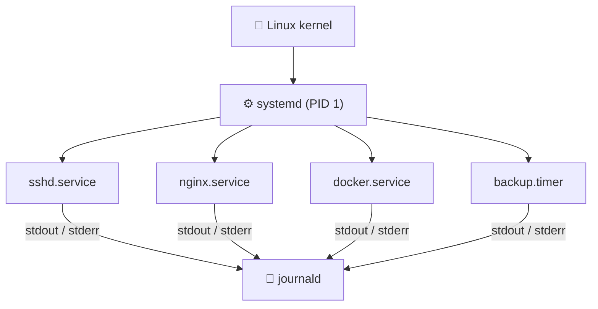
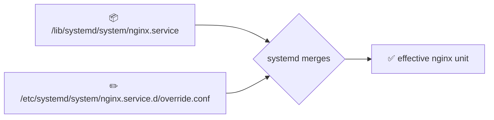
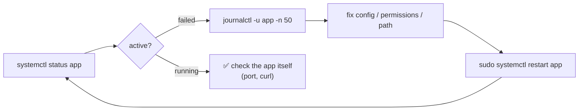
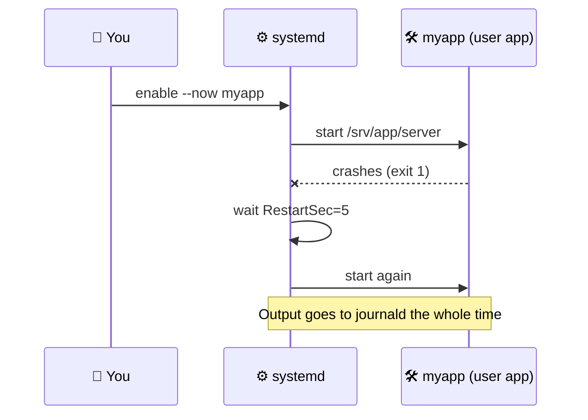

# ⚙️ systemd and Services

[[DevOps/NaNa/0. Nana DevOps Table of Contents|📚 Nana DevOps Table of Contents]]

> [!toc]- 📑 Contents
>
> - [[#🚀 What systemd Is|🚀 What systemd Is]]
> - [[#🧩 Units and Unit Files|🧩 Units and Unit Files]]
> - [[#💻 Control Services with systemctl|💻 Control Services with systemctl]]
> - [[#📜 Read Logs with journalctl|📜 Read Logs with journalctl]]
> - [[#🛠️ Run Your Own App as a Service|🛠️ Run Your Own App as a Service]]
> - [[#✏️ Override a Package's Service|✏️ Override a Package's Service]]
> - [[#⏰ Timers Instead of cron|⏰ Timers Instead of cron]]
> - [[#🩺 Common Failures|🩺 Common Failures]]
> - [[#🧪 Interview Q&A|🧪 Interview Q&A]]
> - [[#🔨 Hands-On Practice|🔨 Hands-On Practice]]
> - [[#📋 Quick Reference|📋 Quick Reference]]
> - [[#🧠 Things to Remember|🧠 Things to Remember]]
> - [[#💡 Pro Tips|💡 Pro Tips]]
> - [[#🔗 Related Topics|🔗 Related Topics]]

## 🚀 What systemd Is

When the kernel finishes booting, it starts exactly one program: **PID 1**. On Ubuntu, Debian, Fedora, RHEL, and Arch, that program is **systemd**. It brings up the rest of the system and then keeps managing it until shutdown.

- 🚀 **Boot.** Starts services in dependency order, in parallel where possible.

- 🔁 **Services.** Starts, stops, and restarts daemons such as `sshd`, `nginx`, `docker`, and `postgresql`. It can restart them automatically after a crash.

- 📜 **Logs.** `journald` collects every service's output in one place.

- ⏰ **Scheduling.** Timers run jobs on a schedule, like cron.

- 🧰 **Other jobs.** Mounts, hostname, time sync, login sessions, and shutdown.



🔎 Confirm it on any machine:

```bash
ps -p 1 -o comm=
```

✅ Prints `systemd`.

---

## 🧩 Units and Unit Files

Everything systemd manages is a **unit**. Each unit is described by a small INI-style text file, and the file's extension says what kind of unit it is.

| Unit type | Purpose | Example |
|---|---|---|
| `.service` | A program or daemon | `nginx.service` |
| `.timer` | Runs a service on a schedule | `backup.timer` |
| `.socket` | Starts a service when a connection arrives | `ssh.socket` |
| `.mount` | A filesystem mount | `home.mount` |
| `.target` | A group of units, a boot milestone | `multi-user.target` |

📁 **Where unit files live:**

- `/lib/systemd/system/` (also `/usr/lib/systemd/system/`)
    - Installed by packages. **Don't edit**: an upgrade overwrites your changes.

- `/etc/systemd/system/`
    - Your own units and overrides. **These take priority** over package files.



🎯 **Targets** replace the old runlevels:

- `multi-user.target` is a normal server with networking and no GUI.

- `graphical.target` is the same plus a desktop.

When a service says `WantedBy=multi-user.target`, it means "start me when the system reaches normal server mode".

---

## 💻 Control Services with `systemctl`

`systemctl` is the command for talking to systemd. The `.service` suffix is optional: `nginx` means `nginx.service`.

```bash
systemctl status nginx
```

- 🔎 Shows whether the unit is `active (running)`, whether it is enabled at boot, its main PID, its memory use, and the last few log lines.

```bash
sudo systemctl start nginx      # start now
sudo systemctl stop nginx       # stop now
sudo systemctl restart nginx    # stop, then start
sudo systemctl reload nginx     # re-read config, keep running
```

- `reload` asks the service to re-read its config without dropping connections. Not every service supports it; use `systemctl reload-or-restart` when you're unsure.

### ⚠️ `start` ≠ `enable`

These two do different things, and mixing them up is the most common systemd mistake.

| Command | Effect now | Effect at next boot |
|---|---|---|
| `start` | Runs it | Nothing |
| `enable` | Nothing | Runs it |
| `enable --now` | Runs it | Runs it |
| `disable --now` | Stops it | Doesn't run it |

```bash
sudo systemctl enable --now nginx
systemctl is-enabled nginx      # enabled / disabled
systemctl is-active nginx       # active / inactive / failed
```

💡 `enable` works by creating a symlink in `/etc/systemd/system/multi-user.target.wants/`, which points at the unit file. `disable` removes that symlink.

🔎 **Find services:**

```bash
systemctl list-units --type=service                  # loaded and running
systemctl list-units --type=service --state=failed   # broken ones
systemctl list-unit-files --type=service             # everything installed + enabled state
```

---

## 📜 Read Logs with `journalctl`

systemd captures each service's stdout and stderr into the **journal**. You don't need to know where an app writes its logs: ask for the unit.

```bash
journalctl -u nginx                      # all logs for one unit
journalctl -u nginx -f                   # follow live, like tail -f
journalctl -u nginx --since "1 hour ago"
journalctl -u nginx -n 50 --no-pager     # last 50 lines, plain output
journalctl -b -p err                     # errors since this boot
```

- `-u` → unit name.

- `-b` → current boot only (`-b -1` is the previous boot, handy after a crash).

- `-p err` → priority `err` and worse.

🩺 **Debugging pattern** for any broken service:



---

## 🛠️ Run Your Own App as a Service

Instead of `nohup ./server &` or a `screen` session, give your app a unit file. You get start at boot, restart on crash, a non-root user, and central logs.

1. 📄 **Create the unit file** `/etc/systemd/system/myapp.service`:

    ```ini
    [Unit]
    Description=My backend API
    After=network-online.target
    Wants=network-online.target

    [Service]
    User=app
    Group=app
    WorkingDirectory=/srv/app
    ExecStart=/srv/app/server
    Environment=PORT=8080
    EnvironmentFile=-/etc/myapp/env
    Restart=on-failure
    RestartSec=5

    [Install]
    WantedBy=multi-user.target
    ```

    - **`[Unit]`** describes the unit and its ordering. `After=network-online.target` waits until the network is up.

    - **`[Service]`** says how to run it.
        - `User=app` runs it as the service user from [[DevOps/NaNa/Linux/7. Server Configuration#⚙️ One User per Service|Server Configuration]], not as root.

        - `ExecStart` must be an **absolute path**. It is not run through a shell, so pipes, `&&`, and `~` don't work.

        - `EnvironmentFile=-/etc/myapp/env` loads `KEY=value` lines from that file. The leading `-` means "don't fail if the file is missing". Keep secrets here with `chmod 600`, not in the unit file.

        - `Restart=on-failure` restarts the app if it crashes or exits non-zero, waiting `RestartSec=5` seconds first.

    - **`[Install]`** says what `enable` hooks the unit into.

2. 🔄 **Tell systemd the file changed.**

    ```bash
    sudo systemctl daemon-reload
    ```

    - systemd caches unit files. You need this after **every** edit to a unit file.

3. 🚀 **Enable and start it.**

    ```bash
    sudo systemctl enable --now myapp
    ```

4. ✅ **Verify.**

    ```bash
    systemctl status myapp
    journalctl -u myapp -f
    curl localhost:8080
    ```

    ✅ Status shows `active (running)` and `enabled`, and the app's output appears in the journal.



---

## ✏️ Override a Package's Service

To change a service installed by a package, don't edit its file in `/lib`. Add a **drop-in override** instead:

```bash
sudo systemctl edit nginx
```

This opens an editor for `/etc/systemd/system/nginx.service.d/override.conf`. Add only the lines you want to change:

```ini
[Service]
Restart=always
LimitNOFILE=65535
```

- Saving runs `daemon-reload` for you. Restart the service to apply the change.

- 🔎 `systemctl cat nginx` shows the original file plus every override, in order.

- `systemctl revert nginx` deletes your overrides.

---

## ⏰ Timers Instead of cron

A timer is a pair of units: a `.service` that does the job, and a `.timer` that says when to run it. Compared with cron, you get logs in the journal, a `status` command, and catch-up runs if the machine was off.

📄 `/etc/systemd/system/backup.service`

```ini
[Unit]
Description=Nightly backup

[Service]
Type=oneshot
User=app
ExecStart=/srv/app/backup.sh
```

📄 `/etc/systemd/system/backup.timer`

```ini
[Unit]
Description=Run backup nightly

[Timer]
OnCalendar=*-*-* 02:00:00
Persistent=true

[Install]
WantedBy=timers.target
```

- `Type=oneshot` → the job runs to completion and exits; it isn't a long-running daemon.

- `OnCalendar` → runs at 02:00 every day. `daily` and `hourly` also work.

- `Persistent=true` → if the server was off at 02:00, it runs at the next boot.

```bash
sudo systemctl daemon-reload
sudo systemctl enable --now backup.timer   # enable the TIMER, not the service
systemctl list-timers                      # next and last run times
journalctl -u backup.service               # the job's output
```

---

## 🩺 Common Failures

| Symptom | Likely cause | Fix |
|---|---|---|
| Edited a unit, nothing changed | Cache not reloaded | `sudo systemctl daemon-reload`, then restart |
| Service gone after reboot | Started but never enabled | `sudo systemctl enable myapp` |
| `status=203/EXEC` | Wrong `ExecStart` path, or the binary isn't executable | Use an absolute path; `chmod +x` the binary |
| `status=217/USER` | `User=` doesn't exist | Create the user or fix the name |
| `Permission denied` in logs | Service user can't read or write its files | `chown -R app:app /srv/app` |
| Keeps restarting, then `start-limit-hit` | App crashes on startup | Read `journalctl -u myapp -n 50`, fix, then `systemctl reset-failed myapp` |
| `Unit myapp.service not found` | File name or location wrong | File must be in `/etc/systemd/system/` and end in `.service` |

---

### 🧪 Interview Q&A

**Q1:** What is PID 1, and why does it matter which program it is?

**Q2:** What's the difference between `systemctl start` and `systemctl enable`?

**Q3:** You edited `/etc/systemd/system/myapp.service`, restarted it, and nothing changed. Why?

**Q4:** Why use `systemctl edit` instead of editing the file in `/lib/systemd/system/`?

**Q5:** Your app works when you run it by hand but fails as a service with `Permission denied`. What do you check?

**Q6:** Do Docker containers usually run systemd?

> [!answer]- 📋 Answers
>
> **A1:** PID 1 is the first process the kernel starts. It starts and supervises everything else. If it dies, the kernel panics. On most distros it is systemd.
>
> **A2:** `start` runs the service now. `enable` makes it start at boot. `enable --now` does both.
>
> **A3:** systemd still has the old version cached. Run `sudo systemctl daemon-reload`, then restart.
>
> **A4:** Package upgrades overwrite files in `/lib`. Drop-ins in `/etc/systemd/system/<unit>.d/` survive upgrades and show exactly what you changed.
>
> **A5:** The service runs as `User=`, not as you. Check that this user owns or can read its working directory, binary, and config. Check `journalctl -u` for the exact path it was denied.
>
> **A6:** No. A container normally runs one process as its PID 1. systemd runs on the host and manages `docker.service` itself.

---

## 🔨 Hands-On Practice

Use a test VM or any machine with systemd.

1. 🔎 **Inspect an existing service.**

    ```bash
    systemctl status ssh        # sshd on RHEL
    systemctl cat ssh
    journalctl -u ssh -n 20
    ```

    ✅ You see its unit file, its enabled state, and recent logins in the logs.

2. 🛠️ **Create a tiny service** that logs a line every 5 seconds. Write `/etc/systemd/system/hello.service`:

    ```ini
    [Unit]
    Description=Hello loop

    [Service]
    ExecStart=/bin/sh -c 'while true; do echo "hello $(date)"; sleep 5; done'
    Restart=on-failure

    [Install]
    WantedBy=multi-user.target
    ```

    ```bash
    sudo systemctl daemon-reload
    sudo systemctl enable --now hello
    journalctl -u hello -f
    ```

    ✅ A new `hello ...` line appears every 5 seconds.

3. 💥 **Watch auto-restart.** Kill the process and check again.

    ```bash
    sudo systemctl kill -s KILL hello
    systemctl status hello
    ```

    ✅ systemd starts it again, with a new main PID.

4. 🧹 **Clean up.**

    ```bash
    sudo systemctl disable --now hello
    sudo rm /etc/systemd/system/hello.service
    sudo systemctl daemon-reload
    ```

---

### 📋 Quick Reference

| Task | Command |
|---|---|
| Status | `systemctl status <unit>` |
| Start / stop / restart | `sudo systemctl start\|stop\|restart <unit>` |
| Reload config | `sudo systemctl reload <unit>` |
| Start at boot (and now) | `sudo systemctl enable --now <unit>` |
| Stop and disable | `sudo systemctl disable --now <unit>` |
| After editing a unit file | `sudo systemctl daemon-reload` |
| Override a package unit | `sudo systemctl edit <unit>` |
| Show effective unit | `systemctl cat <unit>` |
| Failed units | `systemctl --failed` |
| Unit logs, live | `journalctl -u <unit> -f` |
| Errors this boot | `journalctl -b -p err` |
| Timers | `systemctl list-timers` |

### 🧠 Things to Remember

- systemd is PID 1: it boots the system and supervises every service.

- Everything is a unit; services are `.service` files.

- Your units and overrides go in `/etc/systemd/system/`. Never edit `/lib`.

- `start` is for now, `enable` is for boot.

- `daemon-reload` after every unit file edit.

- When something breaks, run `status`, then `journalctl -u`.

### 💡 Pro Tips

- Run `systemd-analyze verify myapp.service` before starting a new unit. It catches typos and bad paths early.

- Use `Restart=on-failure` for apps, not `always`. A clean, intentional exit then stays stopped.

- `systemd-analyze blame` lists which services slowed down boot.

- For a quick hardening win, add `NoNewPrivileges=true` and `ProtectSystem=strict` (plus `ReadWritePaths=/srv/app`) to your own services.

- `journalctl --disk-usage` shows how much space logs take. Cap it with `SystemMaxUse=` in `/etc/systemd/journald.conf`.

### 🔗 Related Topics

- [[DevOps/NaNa/Linux/7. Server Configuration|Server Configuration]]

- [[DevOps/NaNa/Linux/4. Users and Groups|Users and Groups]]

- [[DevOps/NaNa/Linux/5. Ownership and Permissions|Ownership and Permissions]]

- [[DevOps/NaNa/Linux/3. Environment Variables|Environment Variables]]

- [[DevOps/Server Administration/7. Logs and Disk Space|Logs and Disk Space]]

- [[DevOps/Server Administration/11. Monitoring and Health Checks|Monitoring and Health Checks]]

- [[DevOps/Server Administration/4. Docker Daemon and Container Hardening|Docker Daemon and Container Hardening]]
