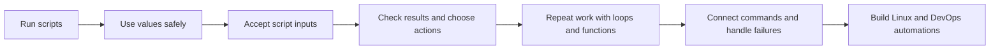

# 🐚 Bash Scripting Learning Path

[[DevOps/NaNa/Linux/0. Linux Learning Path|📚 Linux Learning Path]]

Learn Bash one practical skill at a time, from running a first script to automating Linux and DevOps operations. Each Markdown lesson has a real command-line task, a short recall check, and a prompt to continue the practice through conversation.

> [!toc]- 📑 Contents
>
> - [[#📚 Source Books|📚 Source Books]]
> - [[#🧭 Start Here|🧭 Start Here]]
> - [[#🗺️ Learning Sequence|🗺️ Learning Sequence]]

## 📚 Source Books

| Book | Chapter | Role |
|---|---|---|
| *The Software Developer’s Guide to Linux* | 12 — Automating Tasks with Shell Scripts | Main sequence and developer-focused examples. |
| *Linux Bible*, 11th edition | 7 — Writing Simple Shell Scripts | Adds administration examples and shell practice. |
| *CompTIA Linux+ Guide to Linux Certification* | 7 — Working with the BASH Shell | Reinforces Bash fundamentals. |

## 🧭 Start Here

| Lesson | Skill | Time |
|---|---|---:|
| [[lessons/0001-first-script|01 · Run your first Bash script]] | Launch one script through Bash and directly, then explain the shebang and execute permission. | 3 min |
| [[lessons/0002-variables-and-quoting|02 · Pass Bash values safely]] | Pass deployment settings and keep an application name with spaces intact. | 5 min |
| [[lessons/0003-script-inputs|03 · Pass inputs to a Bash script]] | Read positional parameters and preserve argument boundaries. | 4 min |
| [[lessons/0004-exit-status-and-tests|04 · Check status and prerequisites]] | Check a config file and return a useful success or failure status. | 4 min |
| [[lessons/0005-branching-with-if-and-case|05 · Choose an action with if and case]] | Validate inputs and select a safe operational plan. | 5 min |
| [[lessons/0006-loops-and-file-batches|06 · Loop over a batch of files]] | Apply a read-only command to matching log files safely. | 5 min |

Open a lesson, predict the result before running its commands, then complete the small practice on a Linux VM or WSL. Return later for a short recall prompt. Ask me about any confusing output.

## 🗺️ Learning Sequence

Lessons 7–11 are planned: arithmetic, functions, pipelines, debugging, and small operational projects.
