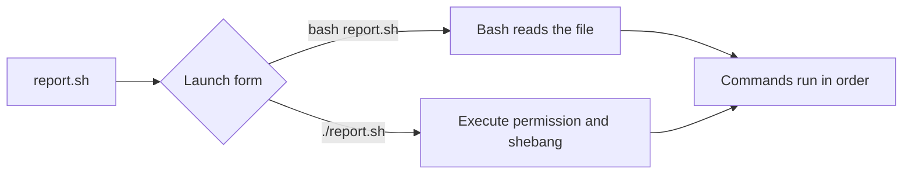

# 01 · Run Your First Bash Script

[[DevOps/NaNa/Linux/Bash Scripting/0. Bash Scripting Learning Path|🐚 Bash Scripting Learning Path]]

A Bash script is a text file of commands that Bash runs in order. The first line, called the **shebang**, tells Linux which interpreter to use when you launch the file directly.

> 💡 **Real-World Example**
>
> A CI job can print the account, host, and kernel it is running on. That small report helps explain why a command behaves differently on a runner than on your laptop.

```bash
#!/usr/bin/env bash

printf 'User: '
id -un
printf 'Host: '
hostname
printf 'Kernel: '
uname -srm
```

Save this as `report.sh`. There are two common ways to start it:

| Command | What chooses Bash? | Needs execute permission? |
|---|---|---|
| `bash report.sh` | You name Bash explicitly. | No |
| `./report.sh` | Linux reads the shebang. | Yes |

`./` means “from the current directory.” In either launch form, relative paths inside the script are resolved from the **current working directory**, not automatically from the script’s folder. The shebang `#!/usr/bin/env bash` asks `env` to find Bash through `PATH`. [GNU Bash: Shell Scripts](https://www.gnu.org/software/bash/manual/html_node/Shell-Scripts.html)



`bash -n report.sh` asks Bash to check syntax without running the commands. No output usually means the syntax is valid; it does not show that the commands will succeed on this machine.

### 🧪 Check Your Understanding

**Q1:** Why can `bash report.sh` work when `./report.sh` fails?

**Q2:** What determines where `./settings.conf` is searched for?

> [!answer]- 📋 Answers
>
> **A1:** Direct execution needs execute permission and a usable shebang. Invoking `bash` explicitly needs neither.
>
> **A2:** The process’s current working directory.

### 🔨 Try It

1. Create a practice folder and enter it:

    ```bash
    mkdir -p "$HOME/bash-labs/lesson-1"
    cd "$HOME/bash-labs/lesson-1"
    ```

2. Save the report above as `report.sh`, then run:

    ```bash
    bash -n report.sh
    bash report.sh
    chmod u+x report.sh
    ./report.sh
    ```

✅ Both launch methods should print your user, host, and kernel details. `chmod u+x` adds execute permission for the file’s owner.

### 📋 Quick Reference

| Need | Command |
|---|---|
| Run with Bash | `bash report.sh` |
| Run directly | `chmod u+x report.sh && ./report.sh` |
| Check syntax | `bash -n report.sh` |

### 🧠 Things to Remember

- The shebang is used for direct execution.
- Relative paths depend on where the script was launched.

### 💡 Pro Tips

- Use `printf` for predictable formatted output.
- A syntax check is only one kind of check; it does not test command behavior.

### 🔗 Related Topics

- Next: [[0002-variables-and-quoting|Variables and quoting]]
- [[DevOps/NaNa/Linux/3. Environment Variables|Linux environment variables]]
- [Script launch quick reference](../reference/01-script-launch.html)
- [GNU Bash: Shell Scripts](https://www.gnu.org/software/bash/manual/html_node/Shell-Scripts.html)

**Primary reading:** *The Software Developer’s Guide to Linux*, Ch. 12; [GNU Bash: Shell Scripts](https://www.gnu.org/software/bash/manual/html_node/Shell-Scripts.html).

Ask me about any confusing output. For practice, reply with which launch form uses the shebang and what your report printed.
