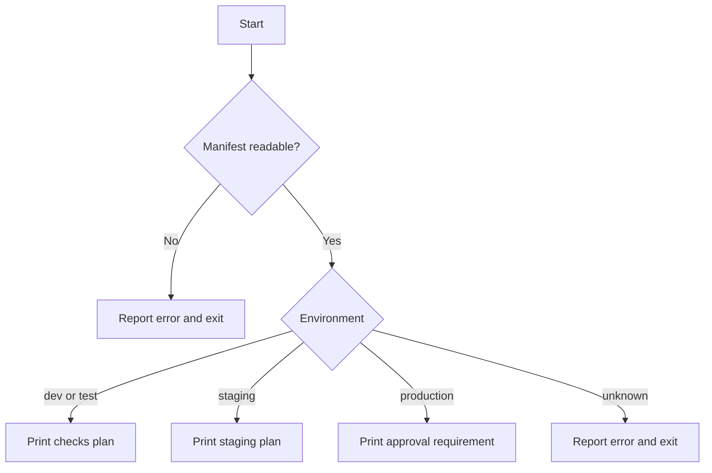

# 05 · Choose an Action with `if` and `case`

[[DevOps/NaNa/Linux/Bash Scripting/0. Bash Scripting Learning Path|🐚 Bash Scripting Learning Path]]

Use `if` to branch on whether a command or test succeeded. Use `case` when one named value selects among a small set of known actions. Together, they help a script reject unexpected inputs before it starts operational work.

This example checks a release file, then prints a deployment **plan**. It does not deploy anything:

```bash
#!/usr/bin/env bash

manifest=${1:-./release.env}
environment=${DEPLOY_ENV:-staging}

if [[ ! -f "$manifest" || ! -r "$manifest" ]]; then
    printf 'Cannot read release file: %s\n' "$manifest" >&2
    exit 1
fi

case "$environment" in
    dev|test)
        printf 'Plan: run checks; no deployment.\n'
        ;;
    staging)
        printf 'Plan: prepare a staging release.\n'
        ;;
    production)
        printf 'Plan: production requires approval.\n'
        ;;
    *)
        printf 'Unknown environment: %s\n' "$environment" >&2
        exit 2
        ;;
esac
```

The test uses `||` because either a missing file **or** an unreadable file should stop the script. In `case`, `dev|test` matches either label, `*)` catches anything not handled earlier, and `;;` ends a branch. The [GNU Bash manual](https://www.gnu.org/software/bash/manual/html_node/Conditional-Constructs.html) covers both conditional forms.



### 🧪 Check Your Understanding

**Q1:** When does the body of an `if` branch run?

**Q2:** What values match `dev|test`?

**Q3:** Why include a final `*)` branch?

> [!answer]- 📋 Answers
>
> **A1:** When the condition command returns status zero.
>
> **A2:** Either `dev` or `test`.
>
> **A3:** It catches unexpected values so the script can report or reject them explicitly.

### 🔨 Try It

Save the example as `deployment-plan.sh`. Create `release.env`, then compare two inputs:

```bash
printf 'APP_NAME=demo\n' > release.env
DEPLOY_ENV=test bash deployment-plan.sh release.env
DEPLOY_ENV=qa bash deployment-plan.sh release.env
```

✅ `test` should print the checks plan. `qa` should print an error and exit with status `2`. No deployment action occurs.

### 📋 Quick Reference

| Need | Syntax |
|---|---|
| Branch on a test | `if [[ condition ]]; then ...; fi` |
| Match alternatives | `case "$value" in a|b) ... ;; esac` |
| Catch unknown values | `*) ... ;;` |
| Require both conditions | `[[ A && B ]]` |
| Stop if either condition holds | `[[ A || B ]]` |

### 🧠 Things to Remember

- Bash treats a zero status as true for `if` conditions.
- `case` is useful when a value must match one of several known options.
- Validate input before performing a consequential operation.

### 💡 Pro Tips

- Keep a safe fallback branch for unknown values.
- Start by printing a plan before connecting branching logic to a real deployment.

### 🔗 Related Topics

- Previous: [[0004-exit-status-and-tests|Check status and prerequisites]]
- Next: [[0006-loops-and-file-batches|Loop over a batch of files]]
- [Decisions and loops quick reference](../reference/05-decisions-and-loops.html)
- [GNU Bash: Conditional Constructs](https://www.gnu.org/software/bash/manual/html_node/Conditional-Constructs.html)

**Primary reading:** [GNU Bash: Conditional Constructs](https://www.gnu.org/software/bash/manual/html_node/Conditional-Constructs.html).

Ask me about any confusing output. For practice, predict the `qa` branch and status before running it.
