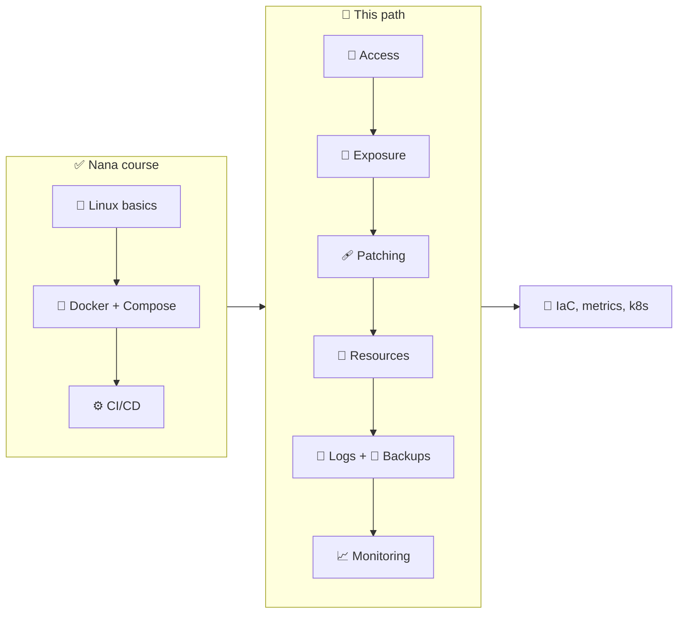
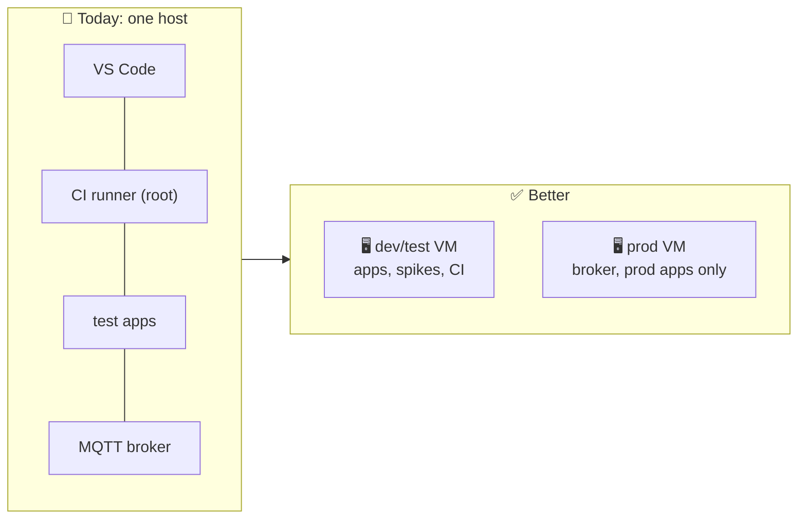

# 🧭 Server Administration Learning Path

[[DevOps/NaNa/0. Nana DevOps Table of Contents|📚 Nana DevOps Table of Contents]]

> [!toc]- 📑 Contents
>
> - [[#📍 Where You Are|📍 Where You Are]]
> - [[#🩺 Start Here: The Audit|🩺 Start Here: The Audit]]
> - [[#🗺️ Learning Order|🗺️ Learning Order]]
> - [[#🏗️ The Big Idea: Environment Separation|🏗️ The Big Idea: Environment Separation]]
> - [[#🚀 From Dev to Production|🚀 From Dev to Production]]
> - [[#🔭 After This Path|🔭 After This Path]]
> - [[#📚 Books|📚 Books]]
> - [[#🗂️ Audit Work Files|🗂️ Audit Work Files]]

These notes come from a **real audit of your own develop server** (`SERVER_IP`, 2026-11-11). Every concept starts from something that is actually wrong or right on that machine.

The server is **dev/test, not production**. The notes still use the **production standard**, because that is the skill you are building: harden and run the dev server as if it were production, then build the real production server from [[DevOps/Server Administration/12. Production Readiness Checklist|the Production Readiness Checklist]].

> 🔒 This vault is public, so real addresses and names are replaced with placeholders: `SERVER_IP`, `example.com` and `example.net`. Keep it that way when you add notes.

---

## 📍 Where You Are

From the Nana course you already have:

- 🐧 **Linux:** shell, pipes, Vim, environment variables, users and groups, permissions, networking basics, and the first server-configuration steps.
- 🌿 **Git**, 🐳 **Docker and Compose**, ⚙️ **Jenkins CI**, 📦 **artifact management** (Nexus, Gitea registry).

The gap between "I can run containers" and "I can run a server" is **operations**: access control, network exposure, patching, resources, logs, backups and monitoring. That's this path.

---

## 🩺 Start Here: The Audit

[[DevOps/Server Administration/1. Develop Server Audit 2026-11-11|🩺 Develop Server Audit 2026-11-11]] lists 17 findings, ranked from 🔴 critical to 🔵 low. Each one has evidence, a fix, a check, and a link to the note below that teaches it. It ends with a **safe fix order**.

Read a finding, then its concept note, apply the fix yourself, and run its check. That loop is the learning.

---

## 🗺️ Learning Order

| # | Note | What you learn | Audit findings |
|---:|---|---|---|
| 1 | [[DevOps/Server Administration/2. SSH Hardening and Brute Force\|SSH Hardening and Brute Force]] | How sshd reads its config, keys-only access, StrictModes, fail2ban | C1, L3 |
| 2 | [[DevOps/Server Administration/9. Secrets and File Permissions\|Secrets and File Permissions]] | 600/640/700, secrets in containers, least privilege, sudo | M4, L3 |
| 3 | [[DevOps/Server Administration/3. Firewalls and Docker Port Publishing\|Firewalls and Docker Port Publishing]] | Attack surface, why Docker bypasses ufw, provider firewall, SSH tunnels | H2, H3 |
| 4 | [[DevOps/Server Administration/10. TLS HTTPS and Reverse Proxy Exposure\|TLS, HTTPS and Reverse Proxy Exposure]] | Force SSL, HSTS, certificate chains, keeping admin panels private | H2, M5 |
| 5 | [[DevOps/Server Administration/8. Backups and Restore\|Backups and Restore]] | 3-2-1, RPO and RTO, consistent DB dumps, systemd timers, restore drills | C2 |
| 6 | [[DevOps/Server Administration/5. Patching Reboots and Kernel Updates\|Patching, Reboots and Kernel Updates]] | Installed ≠ running, safe reboots, patching images | H4 |
| 7 | [[DevOps/Server Administration/4. Docker Daemon and Container Hardening\|Docker Daemon and Container Hardening]] | docker.sock = root, CI isolation, hardened compose template, daemon.json | H1, M6, L4 |
| 8 | [[DevOps/Server Administration/6. Memory Swap and Resource Limits\|Memory, Swap and Resource Limits]] | `available`, overcommit, OOM killer, swap, PSI, cgroup limits | M2, L1 |
| 9 | [[DevOps/Server Administration/7. Logs and Disk Space\|Logs and Disk Space]] | journald caps, Docker log rotation, build-cache cleanup | M1, L2 |
| 10 | [[DevOps/Server Administration/11. Monitoring and Health Checks\|Monitoring and Health Checks]] | Health ≠ alert, what to watch, outside-in troubleshooting | M3 |
| 11 | [[DevOps/Server Administration/12. Production Readiness Checklist\|Production Readiness Checklist]] | Everything above as one go-live list, plus change control and incident response | all |

The order follows the **fix order**: close the open doors first (1–4), build the safety net (5), then patch and tune (6–10).

---

## 🏗️ The Big Idea: Environment Separation

One 4 GB VM currently runs **all** of these:

- 🧑‍💻 your editor (VS Code Server as root)
- ⚙️ CI, with root-level Docker access
- 🧪 test services and spikes
- 🔀 public websites
- 📡 the new MQTT broker, for your tests and learning

Any one of them can break or compromise all the others. Professional setups separate **environments** (dev, test/staging, production) and **roles** (CI, apps, data) onto separate machines or accounts, so the **blast radius** of a mistake stays small.

A realistic next step is a **second small VM** for anything real customers depend on.

---

## 🚀 From Dev to Production

When you build a real production server, follow [[DevOps/Server Administration/12. Production Readiness Checklist|🚀 Production Readiness Checklist]]. It collects every lesson of this path into one go-live list, and it adds what a dev server never needs: change control, alerts that wake someone up, and an incident runbook.

---

## 🔭 After This Path

Once the findings are fixed, these are the natural next topics, roughly in order:

- 🤖 **Configuration as code (Ansible).** Write the SSH, firewall, swap and log fixes as a playbook, so a new server comes up hardened in minutes. *Linux Bible* Ch 30, p. 713.

- 📊 **Metrics (Prometheus, node_exporter, Grafana).** Graphs and alert rules instead of scripts.

- 🔐 **A secrets manager** (Vault, SOPS, or your CI's secret store) instead of `.env` files.

- ☁️ **Infrastructure as code (Terraform)** for creating the VMs themselves. *Linux Bible* Ch 28–29.

- ☸️ **Kubernetes basics**, after you can run single hosts well. *Linux Bible* Ch 31, p. 729.

---

## 📚 Books

All of these are in `/home/ryan/Media/Code/Book/`. Page numbers are the **printed** page numbers from each book's table of contents, not PDF page indexes.

| Book | File | Best for |
|---|---|---|
| 📕 *Linux Bible*, 11th ed. (2026) | [Linux BIBLE 11th 2026.pdf](file:///home/ryan/Media/Code/Book/Linux%20BIBLE%2011th%202026.pdf) | Ch 13 Server Administration (p. 305), Ch 23–24 Security (p. 547, 579), Ch 26 Network Security and firewalls (p. 641), Ch 15 systemd (p. 367), Ch 21 Troubleshooting (p. 505) |
| 📗 *The Software Developer's Guide to Linux* (Packt) | [Packt.The.Software.Developers.Guide.to.Linux.pdf](file:///home/ryan/Media/Code/Book/Packt.The.Software.Developers.Guide.to.Linux.pdf) | Short, practical: Ch 3 systemd (p. 37), Ch 13 SSH (p. 167), Ch 15 Docker (p. 203), Ch 16 Logs (p. 223), Ch 17 HTTP and load balancing (p. 235) |
| 📘 *CompTIA Linux+ and LPIC-1 Guide*, 6th ed. (Eckert, 2024) | [CompTIA Linux+ and LPIC-1 Guide … 6th ed - Eckert.pdf](file:///home/ryan/Media/Code/Book/CompTIA%20Linux%2B%20and%20LPIC-1%20Guide%20to%20Linux%20Certification%206th%20ed%20-%20Eckert.pdf) | Exam-style coverage: Ch 10 Logs (p. 399), Ch 11 Backup (p. 442), Ch 12 SSH (p. 511), Ch 14 Security, Troubleshooting and Performance (p. 583) |
| 📙 *Designing Data-Intensive Applications* (Kleppmann) | [Kleppmann - Designing Data Intensive Applications.pdf](file:///home/ryan/Media/Code/Book/Kleppmann%20-%20Designing%20Data%20Intensive%20Applications.pdf) | Later: replication, durability, what "reliable" means |

> 💡 The `( PDFDrive )` CompTIA copy may be damaged: `file` reports it as 0 pages. Use the 6th edition above.

Already in your vault, and worth re-reading alongside:

- [[DevOps/NaNa/Linux/7. Server Configuration|Server Configuration (Nana)]]
- [[DevOps/NaNa/Linux/6. Networking Fundamentals|Networking Fundamentals]]
- [[DevOps/NaNa/Docker/8. Docker Best Practices|Docker Best Practices]]
- [[Linux/The Software Developer’s Guide to Linux/2. Working with Processes - Study Guide|Working with Processes (SDGL)]]

---

## 🗂️ Audit Work Files

The working files behind these notes: the plan, the progress log, the raw command evidence, and a critical review of this work.

- [[DevOps/Server Administration/Audit Work/PLAN|PLAN]]
- [[DevOps/Server Administration/Audit Work/PROGRESS|PROGRESS]]
- [[DevOps/Server Administration/Audit Work/RAW EVIDENCE|RAW EVIDENCE]]
- [[DevOps/Server Administration/Audit Work/REVIEW|REVIEW]]

Related project: the MQTT broker deployment guide in the learning repo, at `mqtt-5-learning/docs/broker-deployment/README.md`.
