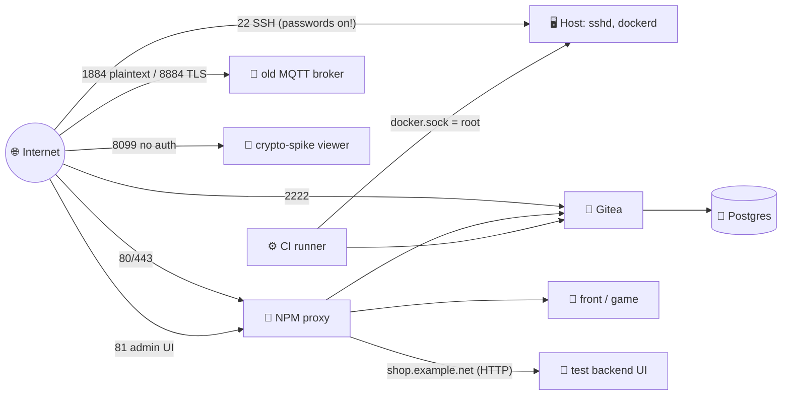
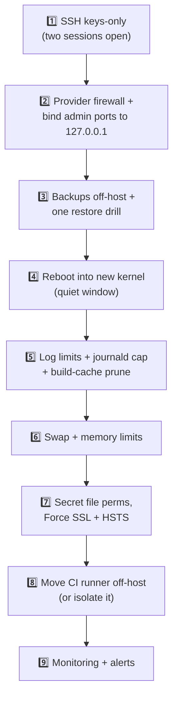

# 🩺 Develop Server Audit — 2026-11-11

[[DevOps/Server Administration/0. Server Administration Learning Path|📚 Server Administration Learning Path]]

> [!toc]- 📑 Contents
>
> - [[#🖥️ The Server at a Glance|🖥️ The Server at a Glance]]
> - [[#🚦 Findings by Severity|🚦 Findings by Severity]]
> - [[#🔴 Critical|🔴 Critical]]
> - [[#🟠 High|🟠 High]]
> - [[#🟡 Medium|🟡 Medium]]
> - [[#🔵 Low|🔵 Low]]
> - [[#✅ What Is Already Right|✅ What Is Already Right]]
> - [[#🛠️ Safe Fix Order|🛠️ Safe Fix Order]]
> - [[#🧪 Interview Q&A|🧪 Interview Q&A]]

This is a read-only audit of the develop/test server `SERVER_IP`. Each finding has **evidence**, **why it matters**, a **fix**, a **check** that proves the fix worked, and a link to the concept note that teaches it.

The commands and full numbers are in [[DevOps/Server Administration/Audit Work/RAW EVIDENCE|RAW EVIDENCE]].

> ⚠️ Nothing was changed on the server. Every fix below is yours to apply. Read the linked concept note first, and follow [[#🛠️ Safe Fix Order]]: some fixes, like SSH and reboots, can lock you out or cause downtime if done in the wrong order.

---

## 🖥️ The Server at a Glance

- 🖥️ **Host:** Ubuntu 26.04.1 LTS, 2 vCPU, 3.8 GiB RAM, **no swap**, 58 GB disk (38% used), up 72 days.

- 🐳 **Runs:** 12 containers in 7 Compose projects.
    - Nginx Proxy Manager (NPM) and its MariaDB.
    - Gitea with Postgres, plus a Gitea Actions runner.
    - The MQTT test broker and the test backend.
    - `vending-machine-game`.
    - The 3 `crypto-interop-spike` containers.

Every arrow from the internet is a door. The diagram shows **six**. A hardened host would show about four: SSH (key-only), 80/443 and 2222, plus 8883 for the new broker.

---

## 🚦 Findings by Severity

| # | Severity | Finding | Learn it in |
|---|---|---|---|
| C1 | 🔴 Critical | SSH accepts passwords; root has a password; ~23k attacks per day | [[DevOps/Server Administration/2. SSH Hardening and Brute Force\|SSH]] |
| C2 | 🔴 Critical | No automated or off-host backups (one manual dump from Sep 10) | [[DevOps/Server Administration/8. Backups and Restore\|Backups]] |
| H1 | 🟠 High | The CI runner holds `docker.sock`: any CI job is root on the host | [[DevOps/Server Administration/4. Docker Daemon and Container Hardening\|Docker hardening]] |
| H2 | 🟠 High | Admin and debug surfaces are public: NPM admin, :8099 viewer, test UI over HTTP, MQTT plaintext | [[DevOps/Server Administration/3. Firewalls and Docker Port Publishing\|Firewalls]] |
| H3 | 🟠 High | No firewall layer: ufw is off, and Docker bypasses it anyway | [[DevOps/Server Administration/3. Firewalls and Docker Port Publishing\|Firewalls]] |
| H4 | 🟠 High | 72 days without a reboot: kernel and libc security fixes are installed but **not running** | [[DevOps/Server Administration/5. Patching Reboots and Kernel Updates\|Patching]] |
| M1 | 🟡 Medium | Unbounded logs: most containers have no rotation; the journal is 3.6 GB | [[DevOps/Server Administration/7. Logs and Disk Space\|Logs]] |
| M2 | 🟡 Medium | No memory limits, no swap, 6.1 GB committed on 3.9 GB of RAM | [[DevOps/Server Administration/6. Memory Swap and Resource Limits\|Memory]] |
| M3 | 🟡 Medium | The old MQTT broker has been **unhealthy** for hours, and nothing alerted | [[DevOps/Server Administration/11. Monitoring and Health Checks\|Monitoring]] |
| M4 | 🟡 Medium | `.env` secrets are world-readable (644); ryan's `authorized_keys` is 664 (works, but loose) | [[DevOps/Server Administration/9. Secrets and File Permissions\|Secrets]] |
| M5 | 🟡 Medium | Most sites don't force HTTPS, and no HSTS header was seen | [[DevOps/Server Administration/10. TLS HTTPS and Reverse Proxy Exposure\|TLS]] |
| M6 | 🟡 Medium | Some containers run as root with no hardening and no limits | [[DevOps/Server Administration/4. Docker Daemon and Container Hardening\|Docker hardening]] |
| L1 | 🔵 Low | VS Code Server runs as root: 491 MB RAM, 4.5 GB disk | [[DevOps/Server Administration/6. Memory Swap and Resource Limits\|Memory]] |
| L2 | 🔵 Low | 6 GB of reclaimable Docker build cache | [[DevOps/Server Administration/7. Logs and Disk Space\|Logs]] |
| L3 | 🔵 Low | Leftover access: the provider's key in root, unused `ubuntu` with NOPASSWD, X11 forwarding | [[DevOps/Server Administration/2. SSH Hardening and Brute Force\|SSH]] |
| L4 | 🔵 Low | `live-restore` off: restarting dockerd restarts every container | [[DevOps/Server Administration/4. Docker Daemon and Container Hardening\|Docker hardening]] |
| A1 | 🏗️ Architecture | Dev tools, CI, test services and a "production" broker share one host | [[DevOps/Server Administration/0. Server Administration Learning Path\|Learning Path]] |

---

## 🔴 Critical

### C1 — SSH accepts passwords while being brute-forced

- 🔎 **Evidence**
    - `sshd -T` → `passwordauthentication yes`, `permitrootlogin yes`.
    - `/etc/ssh/sshd_config.d/50-cloud-init.conf` says `yes`, and `60-cloudimg-settings.conf` says `no`. sshd uses the **first** value it reads, and `50-` sorts first.
    - **22,941** failed logins in 24 h, from 135 IPs. **8,780** of them targeted `root`, and `root` has a usable password (`passwd -S root` → `P`).

- ⚠️ **Why it matters:** The attackers only need to guess one password, and they get a million tries a month. Your real logins all use keys (36 × `publickey root` in 7 days), so passwords add risk and no value.

- 🛠️ **Fix:** Disable password and keyboard-interactive auth in a drop-in that sorts first (`00-hardening.conf`). Keep a second SSH session open while you test. Later, log in as `ryan` and set `PermitRootLogin no`.

- ✅ **Check:** `sshd -T | grep passwordauthentication` → `no`. From your laptop, `ssh -o PubkeyAuthentication=no root@SERVER_IP` → `Permission denied (publickey)`.

### C2 — No real backups

- 🔎 **Evidence:** `/backups/gitea-bak/` holds one manual Gitea dump and DB dump from **2026-09-10**, on the same disk. No cron job or timer runs any backup tool. The NPM database (proxy hosts and certificates), the Compose files and `.env` files, and the MQTT data have no backup at all.

- ⚠️ **Why it matters:** A disk failure, a bad `rm`, or a compromise through C1 or H1 would lose two months of Gitea history and every proxy configuration. A backup on the same disk dies with the disk.

- 🛠️ **Fix:**
    - Schedule nightly `gitea dump` and `pg_dump` runs, plus a MariaDB dump for NPM.
    - Archive `/opt/*/compose.yaml` and the `.env` files.
    - Copy everything **off the host**, encrypted with restic.
    - Restore once to prove it works.

- ✅ **Check:** A dated archive appears every night on the remote side, and a restore drill brings Gitea up in a throwaway container.

---

## 🟠 High

### H1 — The CI runner is root on the host

- 🔎 **Evidence:**
    - `gitea-runner-runner-1` mounts `/var/run/docker.sock`.
    - Its config passes `--volume /opt/robot-market-front:/opt/robot-market-front` into every job.
    - It allows `valid_volumes` `/opt/test-mqtt-5/backend` and `/opt/robot-market-front`.
    - `container.docker_host` is unset (commented out). With that default, act_runner also mounts the Docker socket into the **job** containers. Setting it to `"-"` would stop that.

- ⚠️ **Why it matters:** Whoever can talk to the Docker socket can run `docker run -v /:/host --privileged …`, which gives them full root on the host. Any workflow in any repository the runner serves can do that, including a malicious dependency in a build. From there it can read every secret on the box.

- 🛠️ **Fix (pick one):**
    - Move the runner to its own small VM. This is best.
    - Use a Docker-in-Docker sidecar or rootless Docker for the runner.
    - At minimum, restrict which repositories can use it and review every workflow.

- ✅ **Check:** `docker inspect gitea-runner-runner-1 --format '{{range .Mounts}}{{.Source}} {{end}}'` no longer lists `docker.sock`, or the runner no longer lives on this host.

### H2 — Admin and debug pages are on the internet

- 🔎 **Evidence:** All of these return **200** from the internet:
    - `http://SERVER_IP:81` and `https://npm.example.com`: the NPM admin UI.
    - `http://SERVER_IP:8099`: the crypto-spike viewer, with no authentication.
    - `http://shop.example.net`: the test backend UI, which shows raw MQTT payloads, over plain HTTP.

    Port **1884** is plaintext MQTT, and internet scanners already connect to it (the `LZR` scanner).

- ⚠️ **Why it matters:** Admin panels are the first thing scanners try: default credentials, known CVEs, password spraying. Over HTTP, anyone on the path can read the session cookie.

- 🛠️ **Fix:**
    - Bind `81` and `8099` to `127.0.0.1` and reach them through an SSH tunnel.
    - Put an NPM **Access List** on `npm.example.com`, or remove that proxy host.
    - Give `shop.example.net` a certificate, Force SSL and an access list.
    - Retire port 1884, as the MQTT broker guide describes.

- ✅ **Check:** From your laptop, `curl -m5 http://SERVER_IP:81` and `:8099` → timeout or connection refused.

### H3 — No firewall layer

- 🔎 **Evidence:** `ufw status` → `inactive`. The `DOCKER-USER` chain is empty, and every published port binds `0.0.0.0`.

- ⚠️ **Why it matters:** Today, "published in Compose" means "public on the internet". One mistake in a compose file, like `ports: ["5432:5432"]`, exposes a database. Also note that **Docker-published ports bypass ufw**, so turning ufw on would *not* protect them.

- 🛠️ **Fix:** Set a default-deny inbound policy in the **provider firewall** (hosting provider panel) that allows only 22, 80, 443, 2222 and 8883. Bind internal-only ports to `127.0.0.1` in compose files.

- ✅ **Check:** From outside, `nmap -Pn -p 1-10000 SERVER_IP` shows only the allowed ports as open.

### H4 — Security patches installed but not running

- 🔎 **Evidence:**
    - Uptime 72 days.
    - `uname -r` → `7.0.0-30`, but `/boot` has `7.0.0-43`.
    - `/var/run/reboot-required.pkgs` lists kernels -31 … -43 and **libc6**.

- ⚠️ **Why it matters:** `unattended-upgrades` replaced the files on disk, but the **running** kernel is still the old one, and so is the libc loaded into every long-lived process. The fixed vulnerabilities stay exploitable until you reboot or restart those processes.

- 🛠️ **Fix:** Do this **after** backups (C2). Reboot in a quiet window. Then confirm every container came back (`docker ps`). Note that `crypto-interop-spike` uses `restart: no` and will **not** come back by itself. Afterwards, set a monthly reboot habit, or enable `Unattended-Upgrade::Automatic-Reboot` with a fixed time.

- ✅ **Check:** `uname -r` → `7.0.0-43-generic`, and `/var/run/reboot-required` is gone.

---

## 🟡 Medium

### M1 — Logs can fill the disk

- 🔎 **Evidence:**
    - There is no `/etc/docker/daemon.json`, so containers default to json-file logging with **no size limit**. Only the MQTT stack sets `max-size`.
    - `crypto-interop-spike-broker-1`'s log is **200 MB** and growing: `log_type all` logs every subscribe.
    - The journal uses **3.6 GB**. sshd produced 75,857 of its lines in the last 24 h.

- ⚠️ **Why it matters:** When the disk fills, Postgres, MariaDB and Gitea fail to write, and corruption becomes possible. Logs are the most common way that happens.

- 🛠️ **Fix:** Add `daemon.json` with `"log-driver": "local"`, or json-file with `max-size`/`max-file`. Then **recreate** the containers, because the setting only applies to new ones. Set `SystemMaxUse=1G` for journald. Fixing C1 will also cut the sshd noise.

- ✅ **Check:** `docker inspect -f '{{.HostConfig.LogConfig}}' <c>` shows the limits, and `journalctl --disk-usage` stays at or below 1 GB.

### M2 — Memory: no limits, no swap

- 🔎 **Evidence:**
    - RAM is 3,910 MB, with about 2,000 MB available.
    - `Committed_AS` is **6.08 GB**: processes have reserved about 1.5× physical RAM.
    - There is **no swap**. Only one container has `mem_limit`.
    - Memory PSI `full avg300 ≈ 1%`. There were 0 OOM kills in 30 days.

- ⚠️ **Why it matters:** Today it's fine. But during one big CI build, or a VS Code session plus Gitea indexing, the kernel's **OOM killer** chooses a victim, and that can be Postgres. Without swap there is no cushion at all.

- 🛠️ **Fix:**
    - Add a 2 GB swapfile with `vm.swappiness=10`.
    - Set `mem_limit` on the CI runner's jobs and on the noisy services.
    - Watch `/proc/pressure/memory`.

- ✅ **Check:** `free -m` shows swap. `docker stats` shows a limit column for every service.

### M3 — An unhealthy broker went unnoticed

- 🔎 **Evidence:**
    - `robot-market-mqtt5-test-broker-1` is `unhealthy`. Every health check fails with `OCI runtime exec failed … procReady not received`, and so does a manual `docker exec`.
    - The cgroup reports `pids.current=61/64` and `pids.events max=3,878,909`, yet the container has only **1** process.
    - The broker itself still answers TLS on :8884. Its last log line is from 2026-11-10 18:51 UTC.

- ⚠️ **Why it matters:** Two lessons here.
    1. **Health is only useful if someone is told.** Nothing alerted on this.
    2. A **tight `pids_limit` (64)** combined with failed exec attempts left the container unable to run *any* new process. The exact leak mechanism is unconfirmed: one real task, but 61 PIDs counted.

- 🛠️ **Fix:** You are retiring this broker anyway (see the MQTT guide). If you keep it for now, restart it to reset the cgroup, and raise `pids_limit` to 256. Long-term, add alerting (see the Monitoring note).

- ✅ **Check:** `docker inspect -f '{{.State.Health.Status}}' robot-market-mqtt5-test-broker-1` → `healthy`.

### M4 — Secrets readable by every local user

- 🔎 **Evidence:**
    - These `.env` files are **644**: `/opt/gitea/.env`, `/opt/gitea-runner/.env` (runner registration token), `/opt/nginx-proxy-manager/.env`, `/opt/robot-market-front/.env(.previous)`, `/opt/test-mqtt-5/*/.env`.
    - `/home/ryan/.ssh/authorized_keys` is **664**.

- ⚠️ **Why it matters:** Any process running as any local user can read these secrets, including a compromised non-root service.

    The `authorized_keys` mode is a smaller issue. A key login as `ryan` was **tested and works**: sshd's `StrictModes` tolerates group-write when the group is the user's own private group (`ryan:ryan`, with no other members). It becomes a real hole the moment anyone else joins that group, so tighten it anyway.

- 🛠️ **Fix:**
    - `chmod 600` the `.env` files, owned by root, because only Compose reads them.
    - `chmod 600 ~ryan/.ssh/authorized_keys` and `chmod 700 ~ryan/.ssh`.
    - Delete the `.env.previous` copies once you no longer need them.

- ✅ **Check:** `find /opt -name '.env*' -perm -o=r` prints nothing.

### M5 — HTTPS is optional on most sites

- 🔎 **Evidence:**
    - `http://example.net` → `200` with no redirect.
    - NPM's `force-ssl` is enabled only for `ui.example.com`.
    - No `Strict-Transport-Security` header appears on `git.` or `npm.`.
    - `shop.example.net` has no certificate at all.

- ⚠️ **Why it matters:** A user, or an API client, who types `http://` sends cookies and credentials in the clear.

- 🛠️ **Fix:** In NPM, enable **Force SSL** and **HSTS** on every host that has a certificate.

- ✅ **Check:** `curl -sI http://example.net` → `301` to `https://`, and `curl -sI https://example.net | grep -i strict-transport` returns a header.

### M6 — Unhardened containers

- 🔎 **Evidence:**
    - `vending-machine-game` and the 3 `crypto-interop-spike` containers run as **root**, with no `cap_drop`, a writable rootfs, no memory limit and no log limit.
    - The spike containers have `restart: no`.

- ⚠️ **Why it matters:** If one of these apps is exploited, the attacker is root inside the container, with all default capabilities. That is one kernel bug away from the host.

- 🛠️ **Fix:**
    - Apply the same pattern the MQTT stack uses: `user:`, `read_only: true`, `cap_drop: [ALL]`, `security_opt: [no-new-privileges:true]`, `mem_limit`, `pids_limit`, log limits.
    - Delete the spike when you're done with it.

- ✅ **Check:** `docker inspect` shows `User` set and `CapDrop=[ALL]`.

---

## 🔵 Low

- 🧑‍💻 **L1 — VS Code Server as root.**
    - `/root/.vscode-server` is 4.5 GB on disk, and its `node` process uses 491 MB of RAM.
    - Extensions run with root rights on the server.
    - Fix: connect as `ryan`, and delete old server versions in `~/.vscode-server/cli/servers/`.

- 🧹 **L2 — Build cache.** 6.0 GB is reclaimable (`docker system df`). Run `docker builder prune --filter until=168h` monthly, or let the runner do it.

- 🔑 **L3 — Leftover access.**
    - Root's `authorized_keys` contains a `support@provider` key, so the hosting provider can log in as root. Ask the provider whether they need it. Remove it if not, or keep it knowingly.
    - The unused `ubuntu` account (locked, no keys) still has `NOPASSWD` sudo. Delete it, or remove `/etc/sudoers.d/90-cloud-init-users`.
    - Set `X11Forwarding no`.

- 🔁 **L4 — `live-restore` off.** Upgrading or restarting Docker stops every container. Add `"live-restore": true` to `daemon.json`.

- 🏗️ **A1 — Everything on one host.** Dev tools (VS Code), CI (runner with root), test services and the new "production" MQTT broker share one 4 GB VM. A problem in any of them hits all of them. The fix is **environment separation**: at least a separate VM for CI, and a separate host for anything real customers depend on.

---

## ✅ What Is Already Right

Not everything is wrong. These are good practices you already have, so keep them.

- 🛡️ **AppArmor** is enforcing (105 profiles), and Docker's default **seccomp** profile is active.

- 🩹 **Unattended security upgrades** run daily. They only need the reboot step (H4).

- ⏰ **NTP** is synchronized, and the clock is in UTC, so logs from different services line up.

- 🦊 **Gitea registration** is disabled.

- 🗄️ **Databases are not published**: they live on internal Docker networks.

- 🐳 **The MQTT and Gitea stacks** already drop capabilities. The MQTT stack also runs non-root with a read-only rootfs, pinned image digests, and memory, PID and log limits. Use it as the template for the others.

- 🔑 **Every real login used SSH keys.** Turning passwords off costs you nothing.

---

## 🛠️ Safe Fix Order

Order matters. Some fixes create the safety net that the risky fixes need.

1. 🔐 **SSH first.** It is the open door being hammered right now, and it takes 10 minutes.

2. 🧱 **Firewall second.** It closes every other accidental door in one place.

3. 💾 **Backups before the reboot.** A reboot is the first risky change, so have a way back.

4. 🔁 **Reboot.** Afterwards, check `docker ps` against the list of 12 containers.

5. 🧹 **Then the hygiene items.** They are low risk, and each one is independent of the others.

---

### 🧪 Interview Q&A

**Q1:** Why did enabling `unattended-upgrades` not fully protect this server?

**Q2:** Why would `sudo ufw enable` with `ufw deny 81` *not* close port 81 here?

**Q3:** The broker is "unhealthy" but still serves TLS. Is it up or down?

**Q4:** Why fix backups before rebooting?

**Q5:** The server shows 0 OOM kills in 30 days. Why still add swap and memory limits?

> [!answer]- 📋 Answers
>
> **A1:** It installs new packages, but a running kernel and processes that already loaded the old libc keep using the old code until a reboot or restart.
>
> **A2:** Port 81 is published by Docker, which adds its own iptables rules that send traffic to the container before ufw's rules see it. You need the provider firewall, the `DOCKER-USER` chain, or a `127.0.0.1:` binding.
>
> **A3:** Both, depending on what you ask. Clients can still connect, but the health check — your *automated* view — cannot run. Orchestration that acts on health status (a restart policy, a load balancer) would treat it as down.
>
> **A4:** The reboot is the first change that can fail badly. For example, a container that doesn't come back, or a disk problem that only shows up at boot. A tested backup turns that into an inconvenience instead of data loss.
>
> **A5:** Peak load hasn't hit yet: CI builds, indexing, a VS Code session all at once. Limits decide **who** gets killed: the noisy job instead of Postgres. Swap buys time instead of an instant kill.
