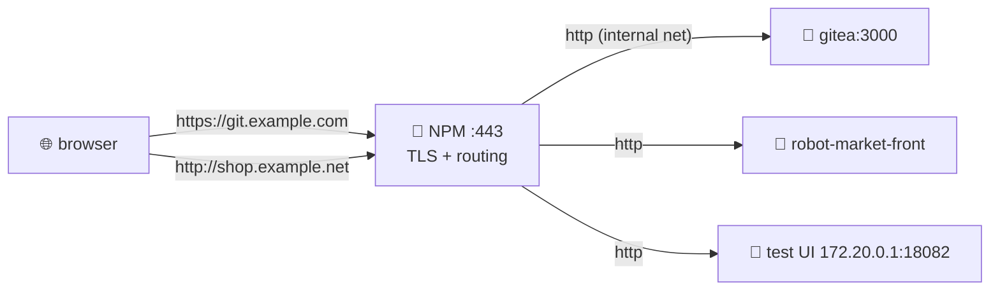
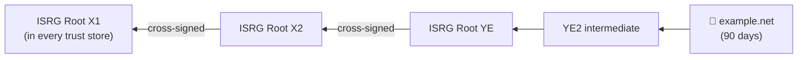

# 🔒 TLS, HTTPS and Reverse Proxy Exposure

[[DevOps/Server Administration/0. Server Administration Learning Path|📚 Server Administration Learning Path]]

> [!toc]- 📑 Contents
>
> - [[#🔀 What the Reverse Proxy Does|🔀 What the Reverse Proxy Does]]
> - [[#🔒 Force HTTPS and HSTS|🔒 Force HTTPS and HSTS]]
> - [[#🧾 Certificates and Chains|🧾 Certificates and Chains]]
> - [[#🚪 Never Publish Admin Panels|🚪 Never Publish Admin Panels]]
> - [[#🧪 Interview Q&A|🧪 Interview Q&A]]
> - [[#📋 Quick Reference|📋 Quick Reference]]

## 🔀 What the Reverse Proxy Does

**Nginx Proxy Manager (NPM)** receives every HTTP(S) request on 80/443. It uses the hostname to pick a backend, and it terminates TLS with a Let's Encrypt certificate.



The backends don't need public ports. The proxy is the **single front door**, so its configuration *is* your web security.

---

## 🔒 Force HTTPS and HSTS

> 💡 **Real-World Example**
>
> - `http://example.net` → **200** (served over plain HTTP, with no redirect).
>
> - Force SSL is on only for `ui.example.com`.
>
> - No `Strict-Transport-Security` header on `git.` or `npm.`.
>
> - `shop.example.net` has **no certificate**, and it serves the test UI with raw MQTT payloads.

- ↪️ **Force SSL** → every `http://` request is redirected (`301`) to `https://`.
- 📌 **HSTS** → the response header `Strict-Transport-Security: max-age=…` tells browsers to *never* try HTTP for this site again, even if someone types `http://` or an attacker strips the redirect.

In NPM, open each proxy host → **SSL** tab → enable **Force SSL**, **HSTS** and **HTTP/2**.

```bash
curl -sI http://example.net | head -3                     # expect 301 + Location: https://…
curl -sI https://example.net | grep -i strict-transport   # expect the header
```

> ⚠️ HSTS is "sticky": browsers remember it for `max-age`. Only enable it once HTTPS works for that hostname, and add `includeSubDomains` only if **every** subdomain has HTTPS.

---

## 🧾 Certificates and Chains

A server certificate is trusted because it chains up to a **root** that the client already trusts.



This is the real chain NPM serves today, checked with `openssl` on our server.

- 🔁 **The leaf rotates** every 60–90 days, and NPM renews it automatically.
- 🛡️ **Clients trust the root**, so leaf rotation never breaks them. That's why devices should pin roots, never the leaf.

```bash
openssl s_client -connect git.example.com:443 -servername git.example.com -brief </dev/null
```

- `-servername` → sends SNI, so the server picks the right certificate.
- `-brief` → prints the protocol, cipher and verification result.

---

## 🚪 Never Publish Admin Panels

| Exposed now | Risk | Fix |
|---|---|---|
| NPM admin on `:81` | Password spraying, CVEs | `127.0.0.1:81:81` plus an SSH tunnel |
| NPM admin via `npm.example.com` | same, over HTTPS | NPM **Access List** (IP allowlist and basic auth), or remove the host |
| Viewer on `:8099` (no auth) | Anyone can read the data | Bind to localhost, or delete the spike |
| Test UI on `shop.example.net` (HTTP) | Raw MQTT payloads are public | Certificate, Force SSL and an Access List |

> 💡 Rule: tools *for you* (admin UIs, debug viewers, dashboards) should only be reachable through SSH, a VPN, or an IP allowlist. Public hostnames are for things *customers* use.

---

### 🧪 Interview Q&A

**Q1:** Force SSL already redirects to HTTPS. What does HSTS add?

**Q2:** Why should IoT devices trust a root CA rather than pin the server's leaf certificate?

**Q3:** Your backend has no TLS, but NPM does. Is the traffic encrypted end to end?

**Q4:** What's the safest way to reach the NPM admin UI?

> [!answer]- 📋 Answers
>
> **A1:** The browser stops trying HTTP at all, so the first request can't be intercepted or downgraded.
>
> **A2:** Leaves rotate every few months, and a pinned leaf would break every device at renewal. Roots last for years.
>
> **A3:** It's encrypted from the client to NPM. From NPM to the backend it's plaintext, but on an internal Docker network on the same host, which is usually acceptable.
>
> **A4:** Bind it to `127.0.0.1` and open it through an SSH tunnel (`ssh -L 8181:127.0.0.1:81 …`).

---

## 📋 Quick Reference

| Task | Command |
|---|---|
| Check redirect | `curl -sI http://<host>` |
| Check HSTS | `curl -sI https://<host> \| grep -i strict` |
| Inspect TLS | `openssl s_client -connect <host>:443 -servername <host> -brief` |
| Cert dates and SAN | `openssl x509 -in cert.pem -noout -dates -ext subjectAltName` |
| SSH tunnel | `ssh -L 8181:127.0.0.1:81 user@host` |

## 🧠 Things to Remember

- The reverse proxy is the front door, so configure it like one.
- Force SSL plus HSTS on every host that has a certificate.
- Admin tools never get a public port.

## 💡 Pro Tips

- Run SSL Labs (`ssllabs.com/ssltest`) against each public hostname once.
- Keep an inventory: hostname → backend → who uses it → is it public on purpose?

## 🔗 Related Topics

- [[DevOps/NaNa/Artifact Management/Gitea/5 - Deploy a Registry Image Behind a Reverse Proxy|Deploy Behind a Reverse Proxy]]
- [[DevOps/Server Administration/3. Firewalls and Docker Port Publishing|Firewalls]]
- [[DevOps/Server Administration/9. Secrets and File Permissions|Secrets]]

## 📚 Books

- *The Software Developer's Guide to Linux*, Ch 17 "Load Balancing and HTTP", p. 235.
- *Linux Bible* 11th ed., Ch 17 "Configuring a Web Server", p. 409; Ch 24 "Implementing Linux Security with Cryptography", p. 579.
- *CompTIA Linux+ and LPIC-1 Guide* 6th ed., Ch 13 "Web Services", p. 537.
