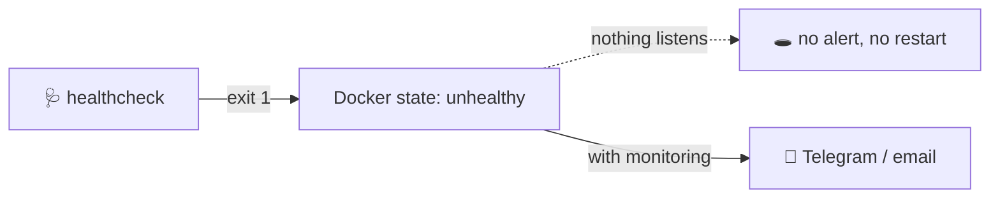

# 📈 Monitoring and Health Checks

[[DevOps/Server Administration/0. Server Administration Learning Path|📚 Server Administration Learning Path]]

> [!toc]- 📑 Contents
>
> - [[#🩺 A Health Check Nobody Reads|🩺 A Health Check Nobody Reads]]
> - [[#🧭 What to Watch on a Small Server|🧭 What to Watch on a Small Server]]
> - [[#🔔 From Signal to Alert|🔔 From Signal to Alert]]
> - [[#🛠️ Troubleshooting Method|🛠️ Troubleshooting Method]]
> - [[#🧪 Interview Q&A|🧪 Interview Q&A]]
> - [[#📋 Quick Reference|📋 Quick Reference]]

## 🩺 A Health Check Nobody Reads

A **health check** is a small command Docker runs periodically. Its exit code marks the container `healthy` or `unhealthy`. That's all it does: by itself, Docker Compose **does not** restart or alert on `unhealthy`.

> 💡 **Real-World Example**
>
> `robot-market-mqtt5-test-broker-1` has been **unhealthy** for hours.
>
> - 🔎 The health log shows `OCI runtime exec failed … procReady not received`, every 30 seconds.
>
> - 🧮 The container hit its `pids_limit` of 64 (61 PIDs counted, though only 1 process exists), so no new process (exec) can start.
>
> - 📡 Meanwhile the broker still accepts TLS connections.
>
> Nobody noticed, because nothing turns `unhealthy` into a notification.



---

## 🧭 What to Watch on a Small Server

Start with the signals that predict outages on *this* server:

| Signal | Command | Alert when |
|---|---|---|
| 💾 Disk | `df -h /` | > 80% |
| 🧠 Memory pressure | `cat /proc/pressure/memory` | `full avg60` > 5% |
| 🐳 Container health | `docker ps --filter health=unhealthy` | any result |
| 🔁 Container restarts | `docker inspect -f '{{.RestartCount}}'` | increasing |
| 🩹 Reboot pending | `test -f /var/run/reboot-required` | older than 7 days |
| 💾 Backup age | newest file in the backup directory | older than 26 h |
| 🔒 Certificate expiry | `openssl x509 -checkend 1209600` | < 14 days |
| 🌐 External reachability | an uptime check from **outside** | down for 2 minutes |

> 💡 The **outside** check matters most. A server can't report that it's unreachable: something else has to notice. Free uptime services (Uptime Kuma on another host, or a hosted one) can probe `https://git.example.com` and the MQTT port.

---

## 🔔 From Signal to Alert

There are three levels. Start at the first.

1. 🧰 **A script plus a systemd timer** (today, 30 minutes of work). Every 5 minutes, check the table above and send a Telegram or email message on failure.

    ```bash
    #!/bin/sh
    # /usr/local/sbin/health-alert  (sketch)
    bad=$(docker ps --filter health=unhealthy --format '{{.Names}}')
    use=$(df --output=pcent / | tail -1 | tr -dc 0-9)
    [ -n "$bad" ] || [ "$use" -gt 80 ] || exit 0
    curl -s "https://api.telegram.org/bot$TOKEN/sendMessage" -d chat_id="$CHAT" -d text="⚠️ $(hostname): unhealthy=[$bad] disk=${use}%"
    ```

2. 🐻 **Uptime Kuma** (one container on a *different* host). It gives you HTTP, TCP and certificate checks with a dashboard and notifications.

3. 📊 **Prometheus, node_exporter, cAdvisor and Grafana.** Metrics over time, graphs and alert rules. This is the industry standard to learn next, once the basics are in place.

---

## 🛠️ Troubleshooting Method

When something is "down", work from the outside in, and change one thing at a time:

1. 🌐 **Reachable?** `curl -v`, `nc -vz host port`, `openssl s_client` from your laptop.
2. 🚪 **Listening?** `ss -tlnp` on the server. Is the port bound, and on which address?
3. 🐳 **Running and healthy?** `docker ps`, `docker inspect -f '{{json .State.Health}}'`.
4. 📜 **What does it say?** `docker logs --tail 50`, `journalctl -u <unit> -n 50`.
5. 🧮 **Resources?** `df -h`, `free -m`, PSI, `docker stats`, the cgroup `pids.current` and `pids.max`.

That last step is how the broker problem above was found: the logs looked fine, but `pids.current=61/64` explained why exec failed.

---

### 🧪 Interview Q&A

**Q1:** A container becomes `unhealthy`. What does Docker Compose do by default?

**Q2:** Why must at least one check run from outside the server?

**Q3:** Which three signals would have warned early about the problems on this server?

**Q4:** The logs look normal but `docker exec` fails. What do you check?

> [!answer]- 📋 Answers
>
> **A1:** Nothing, beyond marking it. It doesn't restart it or alert anyone. Something else must act on the status.
>
> **A2:** If the server or its network is down, it can't send an alert about itself.
>
> **A3:** Container health (the broker), reboot pending for more than 7 days (the kernel), and backup age (no backups since September).
>
> **A4:** Resource limits on the container: `pids.current` versus `pids.max`, memory, and the health log via `docker inspect`.

---

## 📋 Quick Reference

| Task | Command |
|---|---|
| Unhealthy containers | `docker ps --filter health=unhealthy` |
| Health history | `docker inspect -f '{{json .State.Health}}' <c>` |
| Container PIDs | `cat /sys/fs/cgroup/system.slice/docker-<id>.scope/pids.current` |
| Port reachable? | `nc -vz <host> <port>` |
| Recent unit logs | `journalctl -u <unit> -n 50 --no-pager` |
| Certificate expiry | `openssl x509 -in cert.pem -noout -checkend 1209600` |

## 🧠 Things to Remember

- A health check without an alert is just a hidden status.
- Watch disk, memory pressure, health, backups, certificates and reachability.
- Troubleshoot from the outside in.

## 💡 Pro Tips

- Send yourself a weekly "all OK" message, so you notice when the alerting itself breaks.
- Write down each incident in a few lines: symptom, cause, fix. That becomes your runbook.

## 🔗 Related Topics

- [[DevOps/Server Administration/6. Memory Swap and Resource Limits|Memory and Resource Limits]]
- [[DevOps/Server Administration/7. Logs and Disk Space|Logs and Disk Space]]
- [[DevOps/Server Administration/8. Backups and Restore|Backups and Restore]]
- [[DevOps/Server Administration/4. Docker Daemon and Container Hardening|Docker Hardening]]

## 📚 Books

- *Linux Bible* 11th ed., Ch 13 "Step 5: Monitor the server", p. 312; "Checking System Resources with sar", p. 331.
- *Linux Bible* 11th ed., Ch 21 "Troubleshooting Linux", p. 505; networking, p. 520.
- *Linux Bible* 11th ed., Ch 23 "Monitoring Your Systems", p. 563.
- *CompTIA Linux+ and LPIC-1 Guide* 6th ed., Ch 14 "Troubleshooting Methodology", p. 609; "Performance Monitoring", p. 618.
- *The Software Developer's Guide to Linux*, Ch 16 "Monitoring Application Logs", p. 223.
