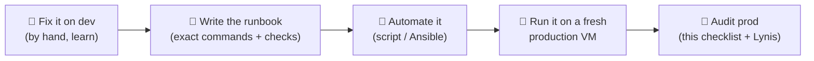

# 🚀 Production Readiness Checklist

[[DevOps/Server Administration/0. Server Administration Learning Path|📚 Server Administration Learning Path]]

> [!toc]- 📑 Contents
>
> - [[#🎯 Dev vs Production|🎯 Dev vs Production]]
> - [[#🏋️ Use the Dev Server as a Rehearsal|🏋️ Use the Dev Server as a Rehearsal]]
> - [[#✅ The Checklist|✅ The Checklist]]
> - [[#🔎 Audit Yourself|🔎 Audit Yourself]]
> - [[#🧪 Interview Q&A|🧪 Interview Q&A]]
> - [[#📋 Quick Reference|📋 Quick Reference]]

## 🎯 Dev vs Production

The commands are the same on both. What changes is **what a mistake costs**, and therefore how much discipline you need.

| | 🧪 Dev / test | 🚀 Production |
|---|---|---|
| Who is hurt by an outage | you | customers and devices |
| Data | can be recreated | must survive anything: off-site backups, tested restores |
| Changes | edit on the server, try things | reviewed, repeatable (Ansible / CI), with a rollback |
| Access | you, often as root | named users, least privilege, no shared root |
| Exposure | whatever is convenient | only what customers need, everything else private |
| Problems found by | you, eventually | an alert, within minutes |
| Mixed workloads | fine | no CI, editors or experiments on the host |

> 💡 **Real-World Example**
>
> Our develop server is a normal dev box: everything on one VM, fixes made by hand, no alerts. That's fine for dev. The same setup in production would break most rows of this table.

---

## 🏋️ Use the Dev Server as a Rehearsal

You learn production by doing every production step on the dev server first, **writing each step down**, and then repeating it from your notes.



The audit's [[DevOps/Server Administration/1. Develop Server Audit 2026-11-11#🛠️ Safe Fix Order|Safe Fix Order]] is your first runbook.

---

## ✅ The Checklist

The **Dev today** column is our develop server on 2026-11-11.

### 🔐 Access

| Item | Dev today | Learn it in |
|---|---|---|
| SSH keys only, `PasswordAuthentication no` checked with `sshd -T` | ❌ C1 | [[DevOps/Server Administration/2. SSH Hardening and Brute Force\|SSH]] |
| No direct root login; admins use named accounts plus `sudo` | ❌ | [[DevOps/Server Administration/2. SSH Hardening and Brute Force\|SSH]] |
| Every key in `authorized_keys` belongs to a known, current person | ❌ L3 | [[DevOps/Server Administration/2. SSH Hardening and Brute Force\|SSH]] |
| fail2ban (or similar) on SSH | ❌ | [[DevOps/Server Administration/2. SSH Hardening and Brute Force\|SSH]] |
| 2FA on the provider panel, the DNS account and every admin UI | ❓ not checked | [[DevOps/Server Administration/10. TLS HTTPS and Reverse Proxy Exposure\|TLS]] |

### 🧱 Network exposure

| Item | Dev today | Learn it in |
|---|---|---|
| Provider firewall: default deny, allow only the public ports | ❌ H3 | [[DevOps/Server Administration/3. Firewalls and Docker Port Publishing\|Firewalls]] |
| Admin UIs reachable only through VPN or an SSH tunnel | ❌ H2 | [[DevOps/Server Administration/3. Firewalls and Docker Port Publishing\|Firewalls]] |
| Internal ports bound to `127.0.0.1` in compose | ❌ | [[DevOps/Server Administration/3. Firewalls and Docker Port Publishing\|Firewalls]] |
| HTTPS everywhere: Force SSL, HSTS, auto-renewing certificates | ❌ M5 | [[DevOps/Server Administration/10. TLS HTTPS and Reverse Proxy Exposure\|TLS]] |
| An outside `nmap` scan matches the list of ports you intended | ❌ | [[DevOps/Server Administration/3. Firewalls and Docker Port Publishing\|Firewalls]] |

### 🩹 Operating system

| Item | Dev today | Learn it in |
|---|---|---|
| Unattended security upgrades on | ✅ | [[DevOps/Server Administration/5. Patching Reboots and Kernel Updates\|Patching]] |
| A planned reboot window, so new kernels actually run | ❌ H4 | [[DevOps/Server Administration/5. Patching Reboots and Kernel Updates\|Patching]] |
| Swap, plus memory limits on every service | ❌ M2 | [[DevOps/Server Administration/6. Memory Swap and Resource Limits\|Memory]] |
| journald size cap and Docker log rotation | ❌ M1 | [[DevOps/Server Administration/7. Logs and Disk Space\|Logs]] |
| AppArmor enforcing, NTP synchronized | ✅ | [[DevOps/Server Administration/5. Patching Reboots and Kernel Updates\|Patching]] |

### 🐳 Containers

| Item | Dev today | Learn it in |
|---|---|---|
| No `docker.sock` mount in anything that runs untrusted code | ❌ H1 | [[DevOps/Server Administration/4. Docker Daemon and Container Hardening\|Docker]] |
| Non-root, `read_only`, `cap_drop: ALL`, `no-new-privileges` | 🟡 some stacks | [[DevOps/Server Administration/4. Docker Daemon and Container Hardening\|Docker]] |
| Images pinned by digest, scanned with `trivy` before deploy | 🟡 MQTT only | [[DevOps/Server Administration/4. Docker Daemon and Container Hardening\|Docker]] |
| `daemon.json` with `live-restore` and log defaults | ❌ L4 | [[DevOps/Server Administration/4. Docker Daemon and Container Hardening\|Docker]] |
| Health checks with **headroom** in their limits | ❌ M3 | [[DevOps/Server Administration/11. Monitoring and Health Checks\|Monitoring]] |

### 💾 Data and secrets

| Item | Dev today | Learn it in |
|---|---|---|
| Automated nightly backups, one copy off-site and encrypted | ❌ C2 | [[DevOps/Server Administration/8. Backups and Restore\|Backups]] |
| A restore drill done and timed (you know your RTO) | ❌ | [[DevOps/Server Administration/8. Backups and Restore\|Backups]] |
| Secret files `600`/`640`, never in git or in images | ❌ M4 | [[DevOps/Server Administration/9. Secrets and File Permissions\|Secrets]] |
| Databases not published to the internet | ✅ | [[DevOps/Server Administration/3. Firewalls and Docker Port Publishing\|Firewalls]] |

### 📈 Operations

| Item | Dev today | Learn it in |
|---|---|---|
| Outside-in uptime checks that **alert** a person | ❌ M3 | [[DevOps/Server Administration/11. Monitoring and Health Checks\|Monitoring]] |
| Alerts for disk, memory, certificate expiry and backup age | ❌ | [[DevOps/Server Administration/11. Monitoring and Health Checks\|Monitoring]] |
| Production runs only production workloads: no CI, editor or spikes | ❌ A1 | [[DevOps/Server Administration/0. Server Administration Learning Path#🏗️ The Big Idea: Environment Separation\|Environment separation]] |
| Every change goes through git and CI, with a known rollback | ❌ | [[DevOps/NaNa/Ci-CD/Jenkins/3. Jenkins pipeline\|Jenkins Pipeline]] |
| A one-page runbook: how to deploy, restore, rotate a secret, and who to call | ❌ | this note |

---

## 🔎 Audit Yourself

Re-check production regularly. Hardening drifts as people make "quick fixes".

1. 🧰 **Lynis:** an open-source host audit. It lists warnings and suggestions with a hardening index.

    ```bash
    sudo apt install lynis
    sudo lynis audit system      # read the "Warnings" and "Suggestions" at the end
    ```

2. 📏 **CIS Benchmarks:** the industry checklist for Ubuntu and Docker. Use them as a reference, not as a rule to apply blindly.

3. 🌐 **Outside-in:** from your laptop, `nmap -Pn SERVER_IP` and `curl -I https://…`. Attackers see what these show, not what your config files say.

> ⚠️ Do the first production hardening on a **fresh VM** from your runbook, not by "cleaning up" an old dev box. You can't fully trust a box that ran with password SSH open for months.

---

### 🧪 Interview Q&A

**Q1:** Your dev server has the same problems as a production one would. Why is its risk still lower, and why is it not zero?

**Q2:** Why build production on a fresh VM instead of hardening the existing dev server?

**Q3:** What is the difference between a health check and monitoring?

**Q4:** Why should production changes go through git and CI instead of SSH edits?

> [!answer]- 📋 Answers
>
> **A1:** No customers or real data depend on it, so outages and data loss cost less. It is not zero because it still holds source code, CI tokens and secrets, and a compromised box is used to reach other systems.
>
> **A2:** A fresh VM built from a runbook is known to be clean and can be rebuilt the same way. An old box may already be compromised or carry undocumented changes.
>
> **A3:** A health check tells Docker the state of a container. Monitoring watches from outside and **alerts a person** when something is wrong.
>
> **A4:** The change is reviewed, repeatable, recorded, and can be rolled back. An SSH edit is none of these, and the next rebuild loses it.

---

## 📋 Quick Reference

| Task | Command |
|---|---|
| Effective SSH config | `sudo sshd -T \| grep -E 'passwordauth\|permitroot'` |
| Listening ports | `sudo ss -tlnp` |
| Outside view | `nmap -Pn -p 1-10000 SERVER_IP` (from your laptop) |
| Reboot needed? | `cat /var/run/reboot-required.pkgs` |
| Host audit | `sudo lynis audit system` |
| Image scan | `trivy image <image>` |

## 🧠 Things to Remember

- Production is a **discipline**, not different commands.
- Practise on dev, write the runbook, then build production from it.
- Production hosts run production workloads only.

## 💡 Pro Tips

- Keep this checklist in git next to your Ansible playbook, and tick it on every new server.
- Schedule a monthly "security hour": Lynis, `nmap` from outside, a restore drill, a key review.

## 🔗 Related Topics

- [[DevOps/Server Administration/1. Develop Server Audit 2026-11-11|Develop Server Audit]]
- [[DevOps/Server Administration/0. Server Administration Learning Path|Server Administration Learning Path]]
- [[DevOps/NaNa/Docker/8. Docker Best Practices|Docker Best Practices]]

## 📚 Books

- *Linux Bible* 11th ed., Ch 23 "Understanding Basic Linux Security", p. 547: root access p. 549, updates p. 562, monitoring p. 563.
- *Linux Bible* 11th ed., Ch 26 "Securing Linux on a Network", p. 641: nmap p. 642, firewalls p. 649.
- *Linux Bible* 11th ed., Ch 30 "Automating Apps and Infrastructure with Ansible", p. 713.
- *CompTIA Linux+ and LPIC-1 Guide* 6th ed., Ch 14 "Securing the Local Computer", p. 583; "Protecting against Network Attacks", p. 591.
