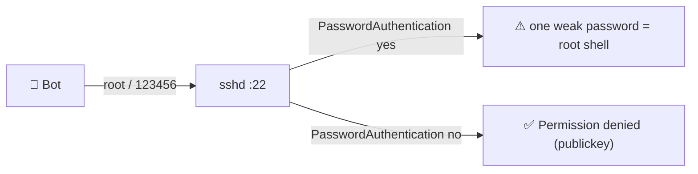

# 🔐 SSH Hardening and Brute Force

[[DevOps/Server Administration/0. Server Administration Learning Path|📚 Server Administration Learning Path]]

> [!toc]- 📑 Contents
>
> - [[#🎯 Why SSH Is Attacked All Day|🎯 Why SSH Is Attacked All Day]]
> - [[#🧩 How sshd Reads Its Config|🧩 How sshd Reads Its Config]]
> - [[#🔑 Keys Only, No Root|🔑 Keys Only, No Root]]
> - [[#🛡️ StrictModes and Key File Permissions|🛡️ StrictModes and Key File Permissions]]
> - [[#🚧 Reducing the Noise|🚧 Reducing the Noise]]
> - [[#🧪 Interview Q&A|🧪 Interview Q&A]]
> - [[#🔨 Hands-On Practice|🔨 Hands-On Practice]]
> - [[#📋 Quick Reference|📋 Quick Reference]]

## 🎯 Why SSH Is Attacked All Day

Every public IPv4 address gets scanned within minutes of going online. Bots try common usernames and passwords on port 22, forever.

> 💡 **Real-World Example**
>
> On 2026-11-11, our develop server logged **22,941** failed SSH logins in 24 hours, from 135 IPs. One IP alone tried 9,175 times.
>
> - 👤 **Most tried:** `root` (8,780), `user` (3,496), `admin`, `debian`, `test`, `deploy`.
>
> - ✅ **Our own logins:** 36 in a week, **all** by SSH key.

The bots can't win against a key. They can only win against a **password**. So the whole defense is: make passwords impossible.



---

## 🧩 How sshd Reads Its Config

`/etc/ssh/sshd_config` starts with `Include /etc/ssh/sshd_config.d/*.conf`. The included files are read in **alphabetical order**, and for each keyword sshd keeps the **first** value it sees.

- 📁 **On our server:**
    - `50-cloud-init.conf` → `PasswordAuthentication yes` ← read first, **wins**
    - `60-cloudimg-settings.conf` → `PasswordAuthentication no` ← ignored

This is the opposite of most programs, where the *last* value wins. That is why a correct-looking `no` did nothing.

💻 To see the **effective** settings (what sshd actually uses), run:

```bash
sudo sshd -T | grep -E '^(passwordauthentication|permitrootlogin|kbdinteractiveauthentication|x11forwarding|maxauthtries) '
```

- `-T` → "test mode, extended": parse every file and print the final values.

---

## 🔑 Keys Only, No Root

1. 🔎 **Prove that your key works for the account you'll use.**

    ```bash
    ssh -i ~/.ssh/id_ed25519 ryan@SERVER_IP 'sudo -v && echo ok'
    ```

2. ✍️ **Create a drop-in that sorts first.**

    ```bash
    sudo tee /etc/ssh/sshd_config.d/00-hardening.conf >/dev/null <<'EOF'
    PasswordAuthentication no
    KbdInteractiveAuthentication no
    PermitRootLogin prohibit-password
    X11Forwarding no
    MaxAuthTries 3
    LoginGraceTime 30
    EOF
    ```

    - `prohibit-password` → root may log in **with a key only**. Switch to `no` once you work as `ryan` with `sudo`.
    - `MaxAuthTries 3` → fewer guesses per connection.
    - `LoginGraceTime 30` → unauthenticated connections are dropped sooner.

3. ✅ **Validate the config, then reload.** Reloading doesn't drop open sessions.

    ```bash
    sudo sshd -t && sudo systemctl reload ssh
    ```

4. 🧪 **Test from a NEW terminal, keeping the old one open.**

    ```bash
    ssh -o PubkeyAuthentication=no root@SERVER_IP     # expect: Permission denied (publickey)
    ssh ryan@SERVER_IP                                 # expect: works
    ```

> ⚠️ If the new login fails, use the old session to delete `00-hardening.conf` and reload. Never close your last working session during an SSH change.

---

## 🛡️ StrictModes and Key File Permissions

sshd refuses a key file that someone else could have modified. That check is `StrictModes yes`, which is the default.

| Path | Required | Ours |
|---|---|---|
| `~/.ssh/` | `700` | — |
| `~/.ssh/authorized_keys` | `600` (no group/other write) | **`664`** ❌ |

Normally a group-writable file is refused with `Authentication refused: bad ownership or modes`. There is one exception: OpenSSH accepts group-write when the group is the user's **private group** with no other members. On our server that group is `ryan:ryan`, so the key login was **tested and works**. That exception disappears the moment someone else joins the group, so tighten it now:

```bash
sudo chmod 700 /home/ryan/.ssh && sudo chmod 600 /home/ryan/.ssh/authorized_keys && sudo chown -R ryan:ryan /home/ryan/.ssh
```

---

## 🚧 Reducing the Noise

Once passwords are off, the attacks **can't succeed**, but they still fill the journal. On our server, sshd wrote 75k log lines a day.

| Option | What it does | Worth it? |
|---|---|---|
| **fail2ban** / **CrowdSec** | Bans an IP after N failures | ✅ Cuts log noise and load |
| Provider firewall: port 22 only from your IPs | Bots never reach sshd | ✅✅ Best, if your IP is stable |
| Change the port (e.g. 2202) | Fewer dumb bots | 🟡 Noise only, **not** security |
| Ed25519 keys | Short, modern keys | ✅ Use for new keys |

> 💡 **Leftover access to review:** root's `authorized_keys` also contains a `support@provider` key (the hosting provider's support access). Decide on purpose whether it stays. Remove access nobody uses.

---

### 🧪 Interview Q&A

**Q1:** Two files set `PasswordAuthentication` to different values. Which one wins?

**Q2:** Why is `systemctl reload ssh` safer than `restart` during hardening?

**Q3:** Is moving SSH to port 2202 a security control?

**Q4:** What does `PermitRootLogin prohibit-password` allow?

> [!answer]- 📋 Answers
>
> **A1:** The first one sshd reads. `sshd_config.d/*.conf` files are read in alphabetical order, so `00-…` beats `50-…`.
>
> **A2:** Reload re-reads the config without dropping existing sessions. You can also run `sshd -t` first, so a typo never stops the daemon.
>
> **A3:** No. It only reduces noise from bots that scan port 22. Real scanners find the new port in seconds.
>
> **A4:** Root may log in with a public key only. Password and keyboard-interactive logins as root are refused.

---

## 🔨 Hands-On Practice

1. 🔎 **Count today's attacks.**

    ```bash
    sudo journalctl -u ssh --since today | grep -cE 'Failed password|Invalid user'
    ```

2. 🔐 **Apply the drop-in above**, following all four steps.

    ✅ `sudo sshd -T | grep passwordauthentication` → `passwordauthentication no`

3. 📉 **Repeat step 1 tomorrow.** The attempts continue, but every one now ends at `Connection closed … [preauth]`, with no password prompt.

---

## 📋 Quick Reference

| Task | Command |
|---|---|
| Effective config | `sudo sshd -T` |
| Validate config | `sudo sshd -t` |
| Apply without dropping sessions | `sudo systemctl reload ssh` |
| Failed logins | `journalctl -u ssh \| grep -E 'Failed\|Invalid'` |
| Successful logins | `journalctl -u ssh \| grep Accepted` |
| New key (laptop) | `ssh-keygen -t ed25519 -C "ryan@laptop"` |
| Install key | `ssh-copy-id ryan@host` |

## 🧠 Things to Remember

- sshd keeps the **first** value it reads. Use `sshd -T` to see the truth.
- Bots can't beat keys. Remove passwords, and the risk is gone.
- Test from a **new** session, and keep the old one open.

## 💡 Pro Tips

- Use `AllowUsers ryan` to whitelist exactly who may log in.
- Put your key on a hardware token (`ed25519-sk`) for extra protection.

## 🔗 Related Topics

- [[DevOps/NaNa/Linux/7. Server Configuration|Server Configuration (Nana)]]
- [[DevOps/NaNa/Linux/4. Users and Groups|Users and Groups]]
- [[DevOps/NaNa/Linux/5. Ownership and Permissions|Ownership and Permissions]]
- [[Linux/Scatterd Learning/SSH|SSH (scattered notes)]]
- [[DevOps/Server Administration/3. Firewalls and Docker Port Publishing|Firewalls]]
- [[DevOps/Server Administration/9. Secrets and File Permissions|Secrets and File Permissions]]

## 📚 Books

- *Linux Bible* 11th ed., Ch 13 "Managing Remote Access with the Secure Shell Service", p. 314; key-based authentication, p. 322.
- *Linux Bible* 11th ed., Ch 23 "Limiting access to the root user account", p. 549.
- *The Software Developer's Guide to Linux*, Ch 13 "Secure Remote Access with SSH", p. 167.
- *CompTIA Linux+ and LPIC-1 Guide* 6th ed., Ch 12 "Secure Shell (SSH)", p. 511.
