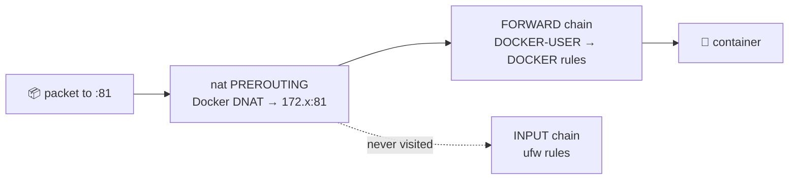

# 🧱 Firewalls and Docker Port Publishing

[[DevOps/Server Administration/0. Server Administration Learning Path|📚 Server Administration Learning Path]]

> [!toc]- 📑 Contents
>
> - [[#🚪 Attack Surface|🚪 Attack Surface]]
> - [[#🐳 Why Docker Bypasses ufw|🐳 Why Docker Bypasses ufw]]
> - [[#🧱 Three Layers That Actually Work|🧱 Three Layers That Actually Work]]
> - [[#🔎 Auditing Exposure|🔎 Auditing Exposure]]
> - [[#🧪 Interview Q&A|🧪 Interview Q&A]]
> - [[#📋 Quick Reference|📋 Quick Reference]]

## 🚪 Attack Surface

The **attack surface** is everything an attacker can reach. On a server, that means every listening port that is reachable from outside.

> 💡 **Real-World Example**
>
> Our server answers on 22, 80, 443, **81**, 2222, **1884**, 8884 and **8099**, all from the internet.
>
> - 🔀 **81** → the Nginx Proxy Manager admin login.
>
> - 👀 **8099** → a debug viewer with no login at all.
>
> - 📡 **1884** → plaintext MQTT, already probed by internet scanners.
>
> Only 22, 80/443 and 2222 (plus 8883 for the new broker) need to be public.

A firewall's job: **deny by default, allow on purpose.**

---

## 🐳 Why Docker Bypasses ufw

`ufw` filters the **INPUT** chain: traffic addressed to the host itself. A published Docker port (`ports: ["81:81"]`) is different. Docker adds a **DNAT** rule in the `nat` table, so the packet is rewritten to the container's IP and travels the **FORWARD** chain instead. ufw's INPUT rules never see it.



So `ufw deny 81` would **not** close port 81 here. People get burned by this constantly.

---

## 🧱 Three Layers That Actually Work

1. ☁️ **Provider firewall (best first layer).**

    In the hosting provider panel, set inbound to default **deny**, then allow `22, 80, 443, 2222, 8883`. Packets are dropped before they reach the VM, and Docker can't override that.

2. 📌 **Bind internal ports to localhost in Compose.**

    ```yaml
    ports:
      - "127.0.0.1:81:81"     # NPM admin: reachable only from the host
    ```

    Then use an SSH tunnel from your laptop:

    ```bash
    ssh -L 8181:127.0.0.1:81 root@SERVER_IP
    ```

    Open `http://localhost:8181`. The admin UI is only reachable through your SSH session.

3. 🔗 **`DOCKER-USER` chain (host-level rules for containers).**

    Docker checks this chain before its own rules, and never overwrites it. For example, to allow 8099 only from your office IP:

    ```bash
    sudo iptables -I DOCKER-USER -p tcp -m conntrack --ctorigdstport 8099 --ctdir ORIGINAL ! -s 203.0.113.10 -j DROP
    ```

    - `--ctorigdstport` → match on the **original** port before DNAT, which is the port the client used.
    - `--ctdir ORIGINAL` → only match packets going *to* the container, not its replies.

    Rules added with `iptables` are lost at reboot unless you persist them (`iptables-persistent`). That is one more reason to prefer layers 1 and 2.

> ⚠️ When you change firewalls remotely, allow SSH **first**, and keep a session open. A default-deny rule without an SSH allow locks you out. You would then need the provider's web console to get back in.

---

## 🔎 Auditing Exposure

💻 **From the server**, list what is listening and which process owns it:

```bash
sudo ss -tlnp
```

- `0.0.0.0:81` or `[::]:81` → all interfaces (public).
- `127.0.0.1:18080` → localhost only (private).

💻 **From outside** (your laptop), check what an attacker actually sees:

```bash
nmap -Pn -p 1-10000 SERVER_IP
```

- `-Pn` → skip the ping check and scan anyway (many hosts drop ping).

Compare the two lists. Any port that is open outside but not intended is a finding.

---

### 🧪 Interview Q&A

**Q1:** Why doesn't `ufw deny 81` block a Docker-published port 81?

**Q2:** What is the safest way to keep an admin UI usable but private?

**Q3:** `ss` shows `127.0.0.1:18080`. Can the internet reach it?

**Q4:** Why is a provider firewall the strongest first layer?

> [!answer]- 📋 Answers
>
> **A1:** Docker rewrites the destination (DNAT) to the container, so the packet goes through FORWARD, not INPUT. ufw's rules live in INPUT.
>
> **A2:** Bind it to `127.0.0.1` and reach it through an SSH tunnel. Nothing is published, and access requires an SSH key.
>
> **A3:** No. It only listens on the loopback interface.
>
> **A4:** It drops packets before they reach the VM, so neither Docker nor a mistake on the host can open a port by accident.

---

## 📋 Quick Reference

| Task | Command |
|---|---|
| Listening sockets | `sudo ss -tlnp` |
| Docker published ports | `docker ps --format '{{.Names}} {{.Ports}}'` |
| External scan | `nmap -Pn -p 1-10000 <ip>` |
| DOCKER-USER rules | `sudo iptables -L DOCKER-USER -n -v` |
| SSH tunnel | `ssh -L 8181:127.0.0.1:81 user@host` |

## 🧠 Things to Remember

- Deny by default, and allow on purpose.
- Docker-published ports **bypass ufw**.
- `127.0.0.1:` in Compose `ports` is the simplest private binding.

## 💡 Pro Tips

- Check the published ports in every compose file during code review: it's a one-line mistake.
- Keep a short "expected open ports" list in your repository, and compare `nmap` against it monthly.

## 🔗 Related Topics

- [[DevOps/NaNa/Linux/6. Networking Fundamentals|Networking Fundamentals]]
- [[DevOps/NaNa/Docker/5. Docker Compose|Docker Compose]]
- [[DevOps/Server Administration/10. TLS HTTPS and Reverse Proxy Exposure|TLS and Reverse Proxy Exposure]]
- [[DevOps/Server Administration/2. SSH Hardening and Brute Force|SSH Hardening]]

## 📚 Books

- *Linux Bible* 11th ed., Ch 26 "Securing Linux on a Network": nmap p. 642, firewalls p. 649, Ubuntu UFW p. 651.
- *Linux Bible* 11th ed., Ch 14 "Administering Networking", p. 339; Ch 21 "Troubleshooting incoming connections", p. 523.
- *CompTIA Linux+ and LPIC-1 Guide* 6th ed., Ch 14 "Protecting against Network Attacks", p. 591.
