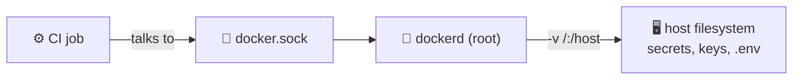

# 🐳 Docker Daemon and Container Hardening

[[DevOps/Server Administration/0. Server Administration Learning Path|📚 Server Administration Learning Path]]

> [!toc]- 📑 Contents
>
> - [[#👑 The Docker Socket Is Root|👑 The Docker Socket Is Root]]
> - [[#⚙️ CI Runners and the Socket|⚙️ CI Runners and the Socket]]
> - [[#🛡️ Hardening a Single Container|🛡️ Hardening a Single Container]]
> - [[#📄 daemon.json: Host-Wide Defaults|📄 daemon.json: Host-Wide Defaults]]
> - [[#🧪 Interview Q&A|🧪 Interview Q&A]]
> - [[#📋 Quick Reference|📋 Quick Reference]]

## 👑 The Docker Socket Is Root

`/var/run/docker.sock` is the API of `dockerd`, and dockerd runs as **root**. Anyone who can write to the socket can ask dockerd to start a container that mounts the host's `/`:

```bash
docker run --rm -it -v /:/host alpine chroot /host sh     # a root shell on the HOST
```

So **membership in the `docker` group, or a socket mount in a container, equals root on the host.** There is no way to give "a little" Docker access.



---

## ⚙️ CI Runners and the Socket

> 💡 **Real-World Example**
>
> Our `gitea-runner` mounts `docker.sock`, so jobs can build images. Its config also mounts `/opt/robot-market-front` into every job.
>
> - ⚠️ A malicious `npm` package pulled during a build can reach the socket → root → read `/opt/gitea/.env`, the TLS keys and the MQTT credentials.

| Option | Isolation | Effort |
|---|---|---|
| Runner on its **own VM** | ✅✅ The host only holds CI | Medium |
| Docker-in-Docker (`dind`) sidecar, socket not shared | ✅ The job's Docker is separate | Medium |
| **Rootless Docker** for the runner user | ✅ "Root" is an unprivileged user | Medium |
| Kaniko / Buildah (no daemon) | ✅ Builds without any socket | Medium |
| Keep the socket, restrict repositories and review workflows | 🟡 Trust-based | Low |

The rule of thumb: **CI runs untrusted code**, so it should never share a host with things you care about.

---

## 🛡️ Hardening a Single Container

The MQTT test stack on our server is the good template. Compare it with `vending-machine-game`:

| Setting | MQTT broker ✅ | vending-machine-game ❌ | What it does |
|---|---|---|---|
| `user: "1883:1883"` | set | root | The process isn't root inside |
| `read_only: true` | ✅ | ❌ | The app can't modify its own files |
| `cap_drop: [ALL]` | ✅ | — | Removes kernel privileges such as `NET_RAW` and `CHOWN` |
| `security_opt: [no-new-privileges:true]` | ✅ | — | setuid binaries can't escalate |
| `mem_limit` / `pids_limit` | 256m / 64 | — | A bug can't eat the host |
| `logging.options.max-size` | 5m×3 | — | Logs can't fill the disk |
| `healthcheck` | ✅ | — | Docker knows when the app is broken |
| `image: …@sha256:` | pinned | tag | The deploy can't change underneath you |

Full template:

```yaml
services:
  app:
    image: example/app:1.4.2@sha256:<digest>
    user: "10001:10001"
    read_only: true
    tmpfs: ["/tmp:rw,noexec,nosuid,size=16m"]
    cap_drop: [ALL]
    security_opt: ["no-new-privileges:true"]
    mem_limit: 256m
    pids_limit: 256
    restart: unless-stopped
    logging:
      driver: json-file
      options: { max-size: "10m", max-file: "3" }
```

> ⚠️ **Limits that are too tight fail too.** Our broker's `pids_limit: 64` was reached: `docker exec` and the health check can no longer start a process, so the container is reported **unhealthy** while the broker keeps serving. Leave headroom (256 or more) for exec and health checks.

---

## 📄 daemon.json: Host-Wide Defaults

There is no `/etc/docker/daemon.json` on our server, so every container gets Docker's defaults. A sensible starting point:

```json
{
  "log-driver": "local",
  "log-opts": { "max-size": "10m", "max-file": "3" },
  "live-restore": true,
  "no-new-privileges": true
}
```

- 📜 **`log-driver: local`** → compressed logs that rotate by default. `docker logs` keeps working.
- 🔁 **`live-restore`** → containers keep running while `dockerd` restarts or upgrades.
- 🔒 **`no-new-privileges`** → the default for every container.

```bash
sudo systemctl reload docker       # live-restore can be applied with a reload (no container stop)
sudo systemctl restart docker      # needed for log-driver changes; stops containers while live-restore is still off!
docker info --format '{{.LoggingDriver}} {{.LiveRestoreEnabled}}'
```

Order: write `daemon.json`, **reload** first (this turns on live-restore), and only then restart if you need to.

> ⚠️ Log settings only apply to **newly created** containers. Run `docker compose up -d --force-recreate` per project afterwards. Do this in a maintenance window: the first restart stops every container.

---

### 🧪 Interview Q&A

**Q1:** Why is adding a user to the `docker` group equivalent to giving them root?

**Q2:** What problem does `read_only: true` solve, and what do you add so the app still works?

**Q3:** A container is "unhealthy" but its service still answers. Name one cause from this server.

**Q4:** You add `max-size` to `daemon.json` and restart Docker. Why are old containers still unbounded?

> [!answer]- 📋 Answers
>
> **A1:** They can start a container that mounts `/` from the host and chroot into it, which gives them a root shell.
>
> **A2:** An attacker or bug can't modify the app's files or drop tools onto disk. Add a `tmpfs` (like `/tmp`) and volumes for the few paths that need writes.
>
> **A3:** The PID limit was exhausted, so `docker exec` (which runs the health check) can't start a new process, even though the main process is fine.
>
> **A4:** The log config is copied into each container when it is created. Existing containers keep their old config until they are recreated.

---

## 📋 Quick Reference

| Task | Command |
|---|---|
| Who mounts the socket | `docker ps -q \| xargs docker inspect -f '{{.Name}} {{range .Mounts}}{{.Source}} {{end}}' \| grep docker.sock` |
| User / caps / RO | `docker inspect -f '{{.Config.User}} {{.HostConfig.CapDrop}} {{.HostConfig.ReadonlyRootfs}}' <c>` |
| Health log | `docker inspect -f '{{json .State.Health}}' <c>` |
| Usage vs limits | `docker stats --no-stream` |
| Daemon defaults | `docker info` |

## 🧠 Things to Remember

- `docker.sock` = root. CI + socket = untrusted code as root.
- Non-root, read-only, `cap_drop: ALL`, limits and log rotation are the baseline for every service.
- Limits need headroom, or they create their own outages.

## 💡 Pro Tips

- Scan images in CI (`trivy image …`) before deploying.
- Keep the hardened template as a snippet, and copy it into every new compose file.

## 🔗 Related Topics

- [[DevOps/NaNa/Docker/8. Docker Best Practices|Docker Best Practices]]
- [[DevOps/NaNa/Docker/5. Docker Compose|Docker Compose]]
- [[DevOps/NaNa/Artifact Management/Gitea/3 - Build and Publish Images with CI|Build and Publish Images with CI]]
- [[DevOps/Server Administration/6. Memory Swap and Resource Limits|Memory and Resource Limits]]
- [[DevOps/Server Administration/7. Logs and Disk Space|Logs and Disk Space]]
- [[DevOps/Server Administration/11. Monitoring and Health Checks|Monitoring and Health Checks]]

## 📚 Books

- *The Software Developer's Guide to Linux*, Ch 15 "Containerizing Applications with Docker", p. 203.
- *Linux Bible* 11th ed., Ch 27 "Shifting to Clouds and Containers", p. 663.
- *CompTIA Linux+ and LPIC-1 Guide* 6th ed., Ch 13 "Working with Containers", p. 554.
