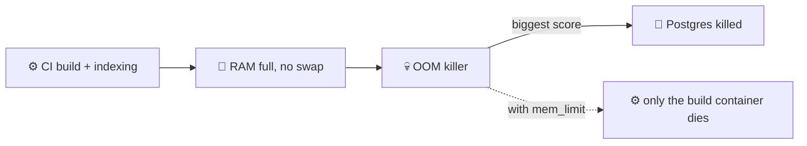

# 🧠 Memory, Swap and Resource Limits

[[DevOps/Server Administration/0. Server Administration Learning Path|📚 Server Administration Learning Path]]

> [!toc]- 📑 Contents
>
> - [[#📊 Reading free -m Correctly|📊 Reading free -m Correctly]]
> - [[#🧾 Overcommit and Committed Memory|🧾 Overcommit and Committed Memory]]
> - [[#💀 The OOM Killer|💀 The OOM Killer]]
> - [[#💤 Swap on a Small VPS|💤 Swap on a Small VPS]]
> - [[#📉 Pressure Stall Information (PSI)|📉 Pressure Stall Information (PSI)]]
> - [[#🧪 Interview Q&A|🧪 Interview Q&A]]
> - [[#📋 Quick Reference|📋 Quick Reference]]

## 📊 Reading free -m Correctly

```text
               total   used   free   shared  buff/cache   available
Mem:            3910   1909    210       43        2101        2001
Swap:              0      0      0
```

*(Snapshot from our server.)*

- 🟢 **`available` (2001 MB)** → what new programs can actually get. This is the number to watch.
- 🟡 **`free` (210 MB)** looks scary, but Linux uses idle RAM as **cache** (`buff/cache`) and gives it back on demand.
- 🔴 **`Swap: 0`** → there is no cushion when RAM runs out.

---

## 🧾 Overcommit and Committed Memory

Programs often reserve more memory than they use. Linux allows that (**overcommit**, `vm.overcommit_memory=0`) and hopes they never use all of it at once.

```bash
grep -E 'Committed_AS|MemTotal' /proc/meminfo
```

On our server: **Committed_AS ≈ 6.1 GB** on **3.9 GB** of RAM. Processes have been promised about 1.5× the physical memory.

That is normal-ish, but it means a burst (a CI build, Gitea indexing, a VS Code session) can try to cash in those promises at the same time.

---

## 💀 The OOM Killer

When memory truly runs out, the kernel's **Out-Of-Memory killer** picks a process and kills it. It favors big processes, and a database is often the biggest.



A container **memory limit** (`mem_limit`) puts the service in its own cgroup. When it overflows, **only that container** is OOM-killed, and the rest of the host is protected.

```bash
journalctl -k | grep -iE 'out of memory|killed process'     # past OOM kills
```

Our server had 0 OOM kills in 30 days, so the risk is **latent**, not active.

---

## 💤 Swap on a Small VPS

A small swapfile turns "instant OOM kill" into "slower for a moment". With low **swappiness**, the kernel only uses it under real pressure.

1. 💾 **Create and enable a 2 GB swapfile.**

    ```bash
    sudo fallocate -l 2G /swapfile && sudo chmod 600 /swapfile
    sudo mkswap /swapfile && sudo swapon /swapfile
    echo '/swapfile none swap sw 0 0' | sudo tee -a /etc/fstab
    ```

2. 🎚️ **Make swap a last resort.**

    ```bash
    echo 'vm.swappiness=10' | sudo tee /etc/sysctl.d/90-swap.conf && sudo sysctl --system
    ```

✅ `free -m` shows `Swap: 2047`.

> 💡 Swap is a safety net, not extra RAM. If `si`/`so` in `vmstat 1` stay above zero for a long time, the box needs more RAM or fewer services.

---

## 📉 Pressure Stall Information (PSI)

`/proc/pressure/{cpu,memory,io}` reports the share of time tasks were **stalled** waiting for a resource. It is the most honest "is this machine struggling?" signal.

```bash
cat /proc/pressure/memory /proc/pressure/io
```

- `some` → at least one task was waiting.
- `full` → **all** non-idle tasks were waiting (real lost time).

Our server: memory `full avg300 ≈ 1%`, and **IO `full avg300 ≈ 6%`**. Some disk waiting on an otherwise idle box is worth watching. The cause was **not** investigated. The heavy journal writes from SSH attacks are one possible contributor; `iotop` or `pidstat -d 1` would show the real one.

> 🧑‍💻 **Hidden memory user:** the VS Code Remote server running as root used **491 MB** (and 4.5 GB on disk). That is one-eighth of the RAM, spent on an editor. Close it when you're done, or connect as `ryan`.

---

### 🧪 Interview Q&A

**Q1:** `free` shows 210 MB free. Is the server out of memory?

**Q2:** Why can a memory limit on a CI container protect Postgres?

**Q3:** What does swap buy you on a 4 GB VPS?

**Q4:** Which file tells you whether tasks are actually waiting on memory?

> [!answer]- 📋 Answers
>
> **A1:** No. Look at `available` (about 2 GB). Most of the "used" memory is reclaimable cache.
>
> **A2:** The container gets its own cgroup. If it overflows, the kernel OOM-kills inside that cgroup instead of choosing a victim from the whole host.
>
> **A3:** Time and a soft landing: a short slowdown instead of an immediate OOM kill during a spike.
>
> **A4:** `/proc/pressure/memory` (PSI).

---

## 📋 Quick Reference

| Task | Command |
|---|---|
| Memory summary | `free -m` |
| Committed memory | `grep Committed_AS /proc/meminfo` |
| Live activity | `vmstat 1 5` |
| Pressure | `cat /proc/pressure/{cpu,memory,io}` |
| Top memory processes | `ps -eo rss,comm --sort=-rss \| head` |
| Per-container usage | `docker stats --no-stream` |
| OOM history | `journalctl -k \| grep -i 'killed process'` |

## 🧠 Things to Remember

- Watch `available`, not `free`.
- No swap plus no limits means the OOM killer chooses the victim.
- PSI shows stalls; load average alone doesn't.

## 💡 Pro Tips

- Give every container a `mem_limit` a bit above its normal `docker stats` peak.
- Run CI jobs with memory limits. Builds are the classic memory spike.

## 🔗 Related Topics

- [[Linux/The Software Developer’s Guide to Linux/2. Working with Processes - Study Guide|Working with Processes]]
- [[DevOps/Server Administration/4. Docker Daemon and Container Hardening|Docker Hardening]]
- [[DevOps/Server Administration/11. Monitoring and Health Checks|Monitoring and Health Checks]]

## 📚 Books

- *Linux Bible* 11th ed., Ch 6 "Managing Running Processes", p. 129; Ch 13 "Checking System Resources with sar", p. 331.
- *Linux Bible* 11th ed., Ch 24 "Implementing resources limits with PAM", p. 603.
- *The Software Developer's Guide to Linux*, Ch 2 "Working with Processes", p. 21.
- *CompTIA Linux+ and LPIC-1 Guide* 6th ed., Ch 14 "Performance Monitoring", p. 618; sysstat utilities, p. 619.
