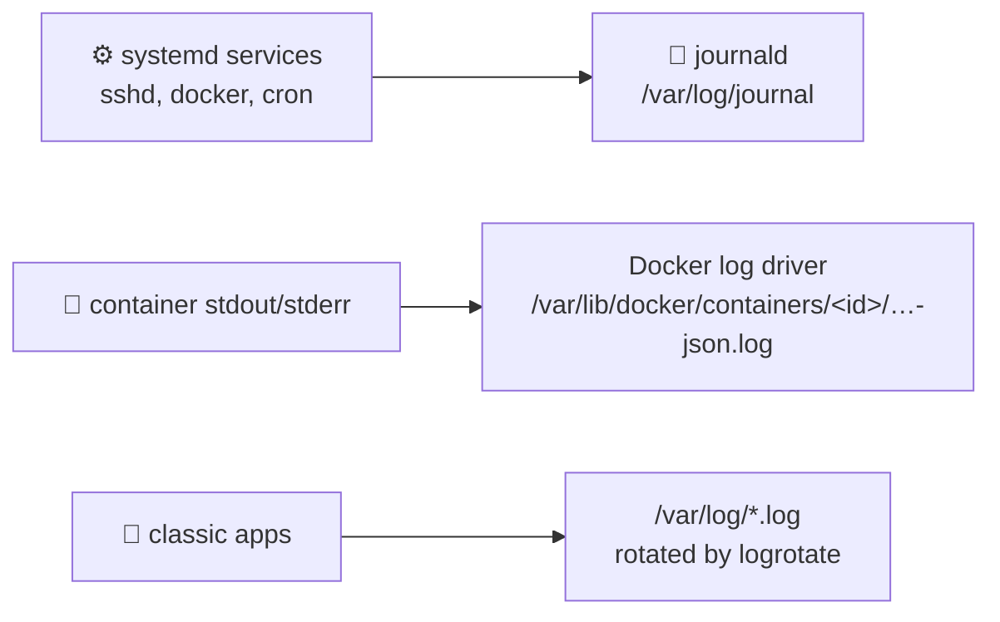

# 📜 Logs and Disk Space

[[DevOps/Server Administration/0. Server Administration Learning Path|📚 Server Administration Learning Path]]

> [!toc]- 📑 Contents
>
> - [[#💥 Why Full Disks Are Dangerous|💥 Why Full Disks Are Dangerous]]
> - [[#🗂️ Where Logs Live|🗂️ Where Logs Live]]
> - [[#📓 Capping the systemd Journal|📓 Capping the systemd Journal]]
> - [[#🐳 Rotating Container Logs|🐳 Rotating Container Logs]]
> - [[#🧹 Docker Build Cache and Images|🧹 Docker Build Cache and Images]]
> - [[#🧪 Interview Q&A|🧪 Interview Q&A]]
> - [[#📋 Quick Reference|📋 Quick Reference]]

## 💥 Why Full Disks Are Dangerous

When `/` hits 100%, databases can't write their WAL, Docker can't create containers, and SSH logins may fail. Recovering often means deleting things in a hurry. **Logs are the most common cause**, because they grow silently.

> 💡 **Real-World Example**
>
> Our server is only 38% full, but three things grow without limit:
>
> - 📓 **systemd journal: 3.6 GB.** Most of it is sshd logging brute-force attempts (75k lines a day).
>
> - 🐳 **`crypto-interop-spike-broker` log: 200 MB.** It logs every subscribe (`log_type all`), with no rotation.
>
> - 🧱 **Docker build cache: 6.2 GB**, of which 6.0 GB is reclaimable.

---

## 🗂️ Where Logs Live



💻 To find what's big:

```bash
sudo journalctl --disk-usage
sudo du -sh /var/lib/docker/containers/*/*-json.log | sort -rh | head
sudo du -xsh /var/log /var/lib/docker /opt/* /root 2>/dev/null | sort -rh
```

- `-x` → stay on one filesystem (don't descend into mounts).

---

## 📓 Capping the systemd Journal

By default, journald may use up to **10% of the filesystem, capped at 4 GB**. That is about 4 GB on our 58 GB disk, and we are at 3.6 GB.

1. ✍️ **Set an explicit cap.**

    ```bash
    sudo mkdir -p /etc/systemd/journald.conf.d
    printf '[Journal]\nSystemMaxUse=1G\nMaxRetentionSec=1month\n' | sudo tee /etc/systemd/journald.conf.d/size.conf
    sudo systemctl restart systemd-journald
    ```

2. 🧹 **Trim now**, without waiting for rotation.

    ```bash
    sudo journalctl --vacuum-size=1G
    ```

✅ `journalctl --disk-usage` → about 1 GB or less.

> 💡 Fixing the cause beats trimming the symptom. Once SSH password auth is off and fail2ban is running, sshd logs far less.

---

## 🐳 Rotating Container Logs

Docker's default `json-file` driver **never rotates** unless you set `max-size`. There are two ways to add limits:

- 🧩 **Per service** (in Compose):

    ```yaml
    logging:
      driver: json-file
      options: { max-size: "10m", max-file: "3" }
    ```

- 🌍 **Host-wide default** (`/etc/docker/daemon.json`): see [[DevOps/Server Administration/4. Docker Daemon and Container Hardening#📄 daemon.json: Host-Wide Defaults|daemon.json]].

Either way, **recreate** the container, because the log config is fixed when it is created:

```bash
docker compose up -d --force-recreate
```

> ⚠️ Never `rm` a container's `-json.log` while the container runs. Docker keeps the file open, so the space isn't freed. If you must free space immediately, `truncate -s 0 <file>`, then fix the rotation.

---

## 🧹 Docker Build Cache and Images

```bash
docker system df                                   # what is reclaimable
docker builder prune --filter until=168h           # build cache older than 7 days
docker image prune                                 # dangling images only
```

- `docker system prune -a` also deletes **unused images**, and you may need those for a rollback. Prefer the targeted commands above.

---

### 🧪 Interview Q&A

**Q1:** You set `max-size` in `daemon.json` and restarted Docker. Why is the 200 MB log still growing?

**Q2:** You deleted a big `-json.log` but `df` shows no free space. Why?

**Q3:** What's the default size limit of the systemd journal?

**Q4:** Which is better: a bigger disk, or a journald cap plus fixing the noisy source?

> [!answer]- 📋 Answers
>
> **A1:** Existing containers keep the log settings they were created with. Recreate them.
>
> **A2:** Docker still holds the file open. The space is freed only when the handle closes. Truncate files instead of deleting them.
>
> **A3:** 10% of the filesystem, capped at 4 GB (`SystemMaxUse`), unless configured.
>
> **A4:** The cap and the fix. A bigger disk only delays the same outage.

---

## 📋 Quick Reference

| Task | Command |
|---|---|
| Disk usage | `df -h`, `df -i` |
| Biggest dirs | `sudo du -xsh /* \| sort -rh \| head` |
| Journal size | `journalctl --disk-usage` |
| Trim journal | `sudo journalctl --vacuum-size=1G` |
| Container log size | `sudo du -sh /var/lib/docker/containers/*/*-json.log` |
| Docker reclaimable | `docker system df` |
| Prune build cache | `docker builder prune --filter until=168h` |

## 🧠 Things to Remember

- Every log needs a size limit: the journal, Docker and app logs.
- Docker log settings apply at **create** time.
- Free space by truncating, not deleting, open files.

## 💡 Pro Tips

- Alert at 80% disk, not 100%.
- Turn debug-level logging (`log_type all`) off once the experiment ends.

## 🔗 Related Topics

- [[DevOps/NaNa/Docker/7. Docker Volume|Docker Volume]]
- [[DevOps/NaNa/Artifact Management/Gitea/4 - Storage Cleanup and Troubleshooting|Gitea Storage Cleanup]]
- [[Linux/File & Directory/Search|Searching files]]
- [[DevOps/Server Administration/11. Monitoring and Health Checks|Monitoring and Health Checks]]

## 📚 Books

- *Linux Bible* 11th ed., Ch 13 "Configuring System Logging", p. 324; "Checking System Space" (df, du, find), p. 333.
- *Linux Bible* 11th ed., Ch 12 "Managing Disks and Filesystems", p. 271.
- *The Software Developer's Guide to Linux*, Ch 16 "Monitoring Application Logs", p. 223.
- *CompTIA Linux+ and LPIC-1 Guide* 6th ed., Ch 10 "Log File Administration", p. 399; systemd journal, p. 403.
