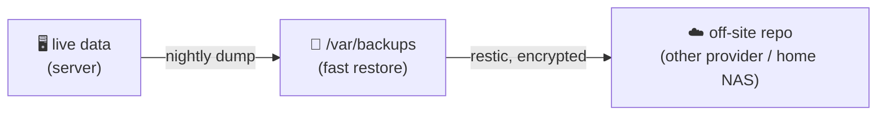

# 💾 Backups and Restore

[[DevOps/Server Administration/0. Server Administration Learning Path|📚 Server Administration Learning Path]]

> [!toc]- 📑 Contents
>
> - [[#🎯 A Backup Is a Restore You Tested|🎯 A Backup Is a Restore You Tested]]
> - [[#🔢 The 3-2-1 Rule|🔢 The 3-2-1 Rule]]
> - [[#⏱️ RPO and RTO|⏱️ RPO and RTO]]
> - [[#🗃️ What to Back Up on This Server|🗃️ What to Back Up on This Server]]
> - [[#🔁 Automate It With a systemd Timer|🔁 Automate It With a systemd Timer]]
> - [[#🧪 Interview Q&A|🧪 Interview Q&A]]
> - [[#📋 Quick Reference|📋 Quick Reference]]

## 🎯 A Backup Is a Restore You Tested

A backup's only purpose is a successful **restore**. A backup that has never been restored is a hope, not a backup.

> 💡 **Real-World Example**
>
> Our server has one backup: a manual Gitea dump from **2026-09-10**, in `/backups/gitea-bak/` on the **same disk**.
>
> - 📅 **Two months of Gitea history:** not backed up.
>
> - 🔀 **NPM's database** (every proxy host and certificate setting): never backed up.
>
> - 💥 **Disk failure:** loses the data *and* the backup together.

---

## 🔢 The 3-2-1 Rule

- **3** copies of the data (the live data plus 2 backups)
- **2** different media or systems
- **1** copy off-site, meaning not on this server or at this provider



---

## ⏱️ RPO and RTO

- ⏪ **RPO (Recovery Point Objective):** how much data you can afford to lose. Nightly backups give an RPO of 24 hours.

- ⏩ **RTO (Recovery Time Objective):** how long recovery may take. You only know your real RTO after a restore drill.

For a dev/test server, a 24-hour RPO and a few hours of RTO are reasonable. Write those numbers down: they decide how often to back up.

---

## 🗃️ What to Back Up on This Server

| Data | How | Why not just copy files? |
|---|---|---|
| 🦊 Gitea (repos, issues, attachments) | `docker exec -w /tmp gitea-gitea-1 gitea dump -c /etc/gitea/app.ini -f /tmp/gitea.zip`, then `docker cp gitea-gitea-1:/tmp/gitea.zip .` | The dump is consistent. The rootless image already runs as `git` (uid 1000) |
| 🐘 Gitea Postgres | `docker exec gitea-db-1 pg_dump -U <user> -Fc <db> > gitea.dump` | Copying a running DB's files can give a **corrupt** backup |
| 🔀 NPM MariaDB | `docker exec nginx-proxy-manager-npm-db-1 sh -c 'MYSQL_PWD="$MYSQL_ROOT_PASSWORD" exec mariadb-dump -uroot --all-databases' > npm.sql` | same reason. The password comes from the container's env, not your command line |
| 🔐 NPM certs and data | `tar -czf npm-data.tgz -C /opt/nginx-proxy-manager data ssl` | files only |
| 📄 Compose and config | `tar -czf configs.tgz /opt/*/compose*.y*ml /opt/*/docker-compose.yml /opt/*/.env` | Recreate everything fast |
| 📡 MQTT broker | `tar -czf mqtt.tgz -C /opt/mqtt-broker config data admin health` | identities live in `dynamic-security.json` |

> ⚠️ Backups contain secrets (`.env` files, password hashes). Store them `chmod 600` and **encrypt** them off-site. restic encrypts by default.

---

## 🔁 Automate It With a systemd Timer

1. ✍️ **Write the script** `/usr/local/sbin/server-backup`, using the commands from the table, writing to `/var/backups/server/$(date +%F)/`.

2. ⏰ **Create the service and the timer.**

    ```ini
    # /etc/systemd/system/server-backup.service
    [Service]
    Type=oneshot
    ExecStart=/usr/local/sbin/server-backup
    ```

    ```ini
    # /etc/systemd/system/server-backup.timer
    [Timer]
    OnCalendar=*-*-* 02:30
    Persistent=true
    [Install]
    WantedBy=timers.target
    ```

    - `Persistent=true` → if the server was off at 02:30, the job runs at the next boot.

3. ▶️ **Enable it, and run it once by hand.**

    ```bash
    sudo systemctl daemon-reload && sudo systemctl enable --now server-backup.timer
    sudo systemctl start server-backup.service && journalctl -u server-backup -n 20
    ```

4. ☁️ **Ship it off-site** with restic, from the same script:

    ```bash
    restic -r sftp:backup@other-host:/srv/restic backup /var/backups/server
    restic -r sftp:backup@other-host:/srv/restic forget --keep-daily 7 --keep-weekly 4 --prune
    ```

5. 🧪 **Restore drill, monthly:** restore the Postgres dump into a throwaway container, and check that the row counts look right.

---

### 🧪 Interview Q&A

**Q1:** Why is `cp -r /opt/gitea/db` a bad Postgres backup?

**Q2:** Your backups are on the same server. Which failures do they survive?

**Q3:** What's the difference between RPO and RTO?

**Q4:** Why use `Persistent=true` on a backup timer?

> [!answer]- 📋 Answers
>
> **A1:** The database is writing while you copy, so the files can be inconsistent. `pg_dump` takes a consistent snapshot.
>
> **A2:** Only mistakes like a deleted file or a bad upgrade. Not disk loss, a compromised server, or the provider losing the VM.
>
> **A3:** RPO is how much data you may lose (time since the last backup). RTO is how long it may take to be running again.
>
> **A4:** If the machine was off at the scheduled time, the missed run happens at the next boot instead of being skipped.

---

## 📋 Quick Reference

| Task | Command |
|---|---|
| Gitea dump | `docker exec -u git <gitea> gitea dump -f /tmp/gitea.zip` |
| Postgres dump | `docker exec <db> pg_dump -U <user> -Fc <db> > db.dump` |
| Postgres restore | `pg_restore -d <db> db.dump` |
| MariaDB dump | `docker exec <db> mariadb-dump --all-databases …` |
| Timers | `systemctl list-timers` |
| restic snapshots | `restic -r <repo> snapshots` |

## 🧠 Things to Remember

- 3-2-1: one copy must be off this server.
- Dump databases; don't copy their files.
- Test restores on a schedule.

## 💡 Pro Tips

- Get an alert when the newest backup is older than 26 hours. Silent backup failures are the classic disaster.
- Keep one restore runbook per service, next to the backup script.

## 🔗 Related Topics

- [[DevOps/NaNa/Docker/7. Docker Volume|Docker Volume]]
- [[DevOps/Server Administration/9. Secrets and File Permissions|Secrets and File Permissions]]
- [[DevOps/Server Administration/11. Monitoring and Health Checks|Monitoring and Health Checks]]

## 📚 Books

- *CompTIA Linux+ and LPIC-1 Guide* 6th ed., Ch 11 "Compression, System Backup, and Software Installation", System Backup, p. 442.
- *Linux Bible* 11th ed., Ch 13 "Copying files between systems with scp and rsync", p. 319.
- *Linux Bible* 11th ed., Ch 15 "Starting and Stopping Services" (systemd units), p. 367.
- *The Software Developer's Guide to Linux*, Ch 3 "Service Management with systemd", p. 37; Ch 12 "Automating Tasks with Shell Scripts", p. 151.
- *Designing Data-Intensive Applications* (Kleppmann), on replication versus backup. It's in your Book folder.
