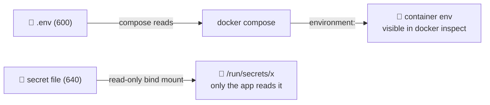

# 🔐 Secrets and File Permissions

[[DevOps/Server Administration/0. Server Administration Learning Path|📚 Server Administration Learning Path]]

> [!toc]- 📑 Contents
>
> - [[#🗝️ Where Secrets Hide on a Server|🗝️ Where Secrets Hide on a Server]]
> - [[#🔢 Permission Bits for Secrets|🔢 Permission Bits for Secrets]]
> - [[#🐳 Secrets and Containers|🐳 Secrets and Containers]]
> - [[#👤 Least Privilege for Accounts|👤 Least Privilege for Accounts]]
> - [[#🧪 Interview Q&A|🧪 Interview Q&A]]
> - [[#📋 Quick Reference|📋 Quick Reference]]

## 🗝️ Where Secrets Hide on a Server

A **secret** is anything that grants access: passwords, tokens, private keys, database URLs. On a Docker host they usually sit in `.env` files, mounted credential files and TLS keys.

> 💡 **Real-World Example**
>
> On our server, every `.env` under `/opt` is mode **644**: readable by **every** local user and process.
>
> - ⚙️ `/opt/gitea-runner/.env` → the runner registration token.
>
> - 🦊 `/opt/gitea/.env`, `/opt/nginx-proxy-manager/.env` → database passwords.
>
> - 📄 `…/.env.previous` copies → old secrets that nobody needs anymore.
>
> ✅ Done right on the same server: `/opt/test-mqtt-5/*/secrets` is `750 root:<service gid>`, with files at `640`.

---

## 🔢 Permission Bits for Secrets

| Mode | Owner | Group | Others | Use for |
|---|---|---|---|---|
| `600` | rw | — | — | `.env`, private keys, `authorized_keys` |
| `640` | rw | r | — | a secret one service group must read |
| `700` / `750` | rwx / rwx | — / r-x | — | directories holding secrets |
| `644` ❌ | rw | r | **r** | **public** files only |

```bash
sudo find /opt -name '.env*' -perm -o=r -printf '%m %p\n'           # find world-readable secrets
sudo chmod 600 /opt/*/.env && sudo chown root:root /opt/*/.env       # Compose runs as root, so root:600 is enough
```

> 💡 A directory also needs the **execute** bit (`x`) to be entered. A readable file inside a `700` directory is still unreachable for others. The MQTT broker setup failed once exactly because of that.

---

## 🐳 Secrets and Containers



- 🟡 **Environment variables** are easy to use, but they show up in `docker inspect`, crash dumps, and sometimes in logs.
- ✅ **Mounted files** (Compose `secrets:` or a read-only bind mount) stay out of `inspect`, and can be `640` for exactly one service user.
- ❌ **Never** pass passwords on the command line (`-P secret`): other users can read them with `ps`.

---

## 👤 Least Privilege for Accounts

| Finding on our server | Better |
|---|---|
| Everyday work as **root** (36/36 logins) | Log in as `ryan` and use `sudo`, so every command is attributable |
| `ubuntu` (unused) has `NOPASSWD` sudo | Delete the account, or remove its sudoers line |
| `root` has a usable password | Lock it: `sudo passwd -l root` (keys still work) |
| VS Code Server runs as root | Connect as `ryan` |

```bash
for u in root ubuntu ryan; do sudo passwd -S "$u"; done     # P = password set, L = locked (passwd -S takes one user)
sudo grep -r NOPASSWD /etc/sudoers /etc/sudoers.d/
```

> ⚠️ Before locking root's password, make sure `ryan` can log in with a key **and** run `sudo`, and that you know ryan's password (sudo asks for it).

---

### 🧪 Interview Q&A

**Q1:** Why is `644` wrong for `.env`, even on a server with only two users?

**Q2:** Env var or mounted file: which keeps a DB password out of `docker inspect`?

**Q3:** A file is `640 root:1883`, inside a directory that is `700 root:root`. Can UID 1883 read it?

**Q4:** Why prefer `sudo` from a personal account over logging in as root?

> [!answer]- 📋 Answers
>
> **A1:** Any compromised service running as any user can read it. Least privilege limits the damage from *processes*, not just people.
>
> **A2:** The mounted file. Environment variables are part of the container config that `inspect` shows.
>
> **A3:** No. It can't enter the directory, because it lacks the `x` bit on it.
>
> **A4:** Every privileged command is logged under a real person, and a stolen session doesn't start out as root.

---

## 📋 Quick Reference

| Task | Command |
|---|---|
| Find world-readable secrets | `sudo find /opt -name '.env*' -perm -o=r` |
| Lock down | `chmod 600 <file>`; `chmod 700 <dir>` |
| Account status | `sudo passwd -S <user>` |
| Lock a password | `sudo passwd -l <user>` |
| NOPASSWD audit | `sudo grep -r NOPASSWD /etc/sudoers*` |

## 🧠 Things to Remember

- Secrets: `600` files, `700` directories, owned by whoever reads them.
- Mounted secret files beat environment variables, and both beat command-line arguments.
- Least privilege applies to accounts *and* processes.

## 💡 Pro Tips

- Rotate any secret that has been world-readable, if the host might have been compromised.
- Keep a `.env.example` with **no values** in Git, and never commit the real `.env`.

## 🔗 Related Topics

- [[DevOps/NaNa/Linux/4. Users and Groups|Users and Groups]]
- [[DevOps/NaNa/Linux/5. Ownership and Permissions|Ownership and Permissions]]
- [[DevOps/NaNa/Linux/3. Environment Variables|Environment Variables]]
- [[DevOps/NaNa/Ci-CD/Jenkins/7. Credentials in Jenkins|Credentials in Jenkins]]
- [[DevOps/Server Administration/2. SSH Hardening and Brute Force|SSH Hardening]]

## 📚 Books

- *Linux Bible* 11th ed., Ch 11 "Managing User Accounts", p. 247; Ch 23 "Managing dangerous filesystem permissions", p. 558; "Limiting access to the root user account", p. 549.
- *The Software Developer's Guide to Linux*, Ch 7 "Users and Groups", p. 81; Ch 8 "Ownership and Permissions", p. 93.
- *CompTIA Linux+ and LPIC-1 Guide* 6th ed., Ch 14 "Securing the Local Computer", p. 583.
