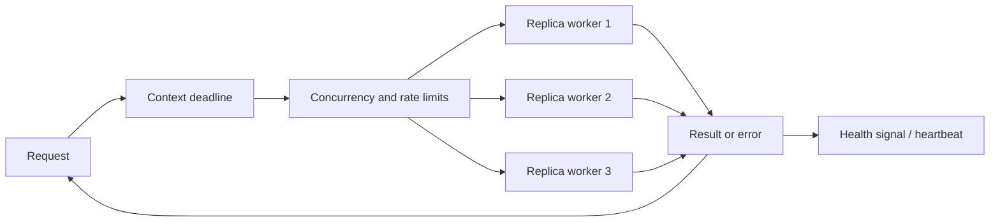
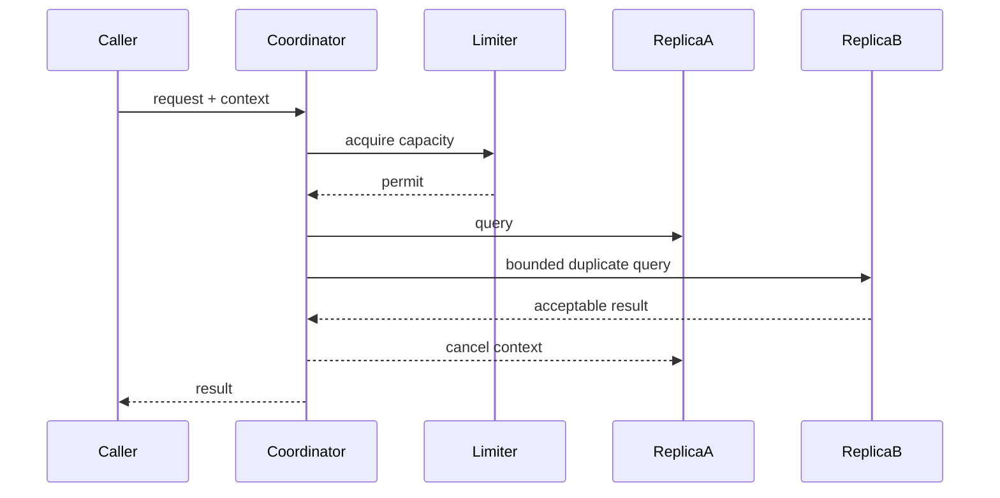

# 🌐 Concurrency at Scale

> **Book:** *Concurrency in Go: Tools and Techniques for Developers*, Katherine Cox-Buday, Ch. 5  
> **Focus:** Compose goroutines and channels into operations that remain understandable under delay, failure, and load.

## 📖 Chapter Overview

Chapter 4 introduced reusable patterns. This chapter asks how those patterns behave when real work is slow, unreliable, or replicated. The central shift is from “how do I start goroutines?” to “how does work terminate, fail, recover, and stay within resource limits?”

Imagine an API querying three independent inventory replicas. It may return the first useful response, but it must still bound the wait, stop unnecessary work, report failures clearly, and avoid launching unlimited requests during a traffic spike.



## 🚦 Error Propagation

Concurrent work creates multiple possible failure points. Decide which errors are fatal to the overall operation, which can be tolerated, and where each error should be recorded. A goroutine cannot return an error to its caller through the ordinary function return path; it needs an explicit result channel, a shared synchronized collector, or a structured task group.

Wrap errors with operation context while preserving their identity for `errors.Is` and `errors.As`. Avoid logging the same failure at every layer: add context as errors move upward, then log once at the boundary that owns the decision.

```go
// Example: return one result per worker and let the caller decide policy.
type Result struct {
	Value string
	Err   error
}

func lookup(ctx context.Context, id string) Result {
	value, err := queryReplica(ctx, id)
	if err != nil {
		return Result{Err: fmt.Errorf("query replica for %q: %w", id, err)}
	}
	return Result{Value: value}
}
```

With multiple failures, “first error wins” can hide useful diagnostics. Conversely, collecting every error may be wasteful when one failure makes the whole operation pointless. Make that policy explicit.

## ⏱️ Timeouts and Cancellation

A timeout is a deadline on how long a caller is willing to wait. Cancellation is a signal that work should stop. In Go, `context.Context` carries cancellation and deadlines through API boundaries; it does not forcibly terminate a goroutine. Every blocking operation must observe the context or have another unblocking path.

```go
func fetch(ctx context.Context, client *http.Client, url string) (*http.Response, error) {
	req, err := http.NewRequestWithContext(ctx, http.MethodGet, url, nil)
	if err != nil {
		return nil, fmt.Errorf("build request: %w", err)
	}
	resp, err := client.Do(req)
	if err != nil {
		return nil, fmt.Errorf("fetch %s: %w", url, err)
	}
	return resp, nil
}
```

Create derived contexts near the operation that owns the deadline and always call the returned cancel function. Do not store contexts in structs or pass `nil`; pass them explicitly as the first parameter. A canceled context is cooperative: CPU loops should periodically check `ctx.Err()`, and channel sends/receives should select on `ctx.Done()`.

```go
ctx, cancel := context.WithTimeout(parent, 800*time.Millisecond)
defer cancel()

select {
case result := <-results:
	return result, nil
case <-ctx.Done():
	return zero, fmt.Errorf("wait for result: %w", ctx.Err())
}
```

## 💓 Heartbeats

A heartbeat is a periodic signal that a long-running worker is still alive or making progress. It is useful when silence is ambiguous: a network read may simply be slow, or a worker may be stuck. Heartbeats help detect liveness; they do not prove correctness or successful completion.

Use a ticker with a clear stop path. The supervisor should define what a missed heartbeat means and whether the worker can be safely restarted. In distributed systems, heartbeat intervals must account for scheduling pauses and network jitter to avoid mistaking a slow process for a dead one.

## 🪞 Replicated Requests

Replicated requests send equivalent work to more than one independent backend, often returning the first acceptable response. This can reduce tail latency when one replica is slow, but increases load and can amplify an outage if used without limits.

Only duplicate operations that are safe to repeat. Reads are often repeatable; writes may need an idempotency key or deduplication. Cancel losing requests after obtaining a result, while remembering cancellation is cooperative and may not retract work already accepted by a remote service.

## 🚥 Rate Limiting

Rate limiting controls how quickly work begins; concurrency limiting controls how much work is in flight. These solve different problems. A service can have a modest in-flight count and still overload a dependency by starting work too rapidly, or have a low request rate but too many long-lived requests simultaneously.

The token bucket is a common model: tokens accrue up to a capacity, and each operation consumes tokens. Capacity permits short bursts; refill rate limits sustained throughput. Place limits at the boundary that owns the constrained resource, and expose rejections, queue depth, and wait time as metrics.

| Control | Limits | Typical Go mechanism |
|---|---|---|
| Concurrency | Simultaneous work | Bounded worker pool or semaphore |
| Rate | Work starts per interval | Token bucket / `golang.org/x/time/rate` |
| Queue capacity | Waiting work | Bounded channel / explicit queue |
| Deadline | Time spent waiting | `context.WithTimeout` |

## 🩹 Healing Unhealthy Goroutines

Supervision means observing worker health and deciding how to recover. A restart is useful only if the cause is transient and restarting does not repeat a harmful side effect indefinitely. Add backoff and jitter, cap retries, and distinguish permanent errors from temporary ones.

Go does not provide a universal supervisor abstraction. Design one around ownership: who starts the worker, who observes its exit, who cancels siblings, and who closes shared channels? A panic should not be treated as an ordinary error; recover only at a deliberate goroutine boundary when the process can safely continue, and preserve diagnostic information.

## 🧪 Practical Pattern: Bounded, Cancellable Workers

```go
func Map[T any, U any](ctx context.Context, inputs []T, workers int, fn func(context.Context, T) (U, error)) ([]U, error) {
	if workers < 1 {
		return nil, fmt.Errorf("workers must be positive")
	}
	ctx, cancel := context.WithCancel(ctx)
	defer cancel()

	type item struct { index int; value T }
	type result struct { index int; value U; err error }
	jobs := make(chan item)
	results := make(chan result)
	var wg sync.WaitGroup

	for range workers {
		wg.Add(1)
		go func() {
			defer wg.Done()
			for job := range jobs {
				value, err := fn(ctx, job.value)
				select {
				case results <- result{job.index, value, err}:
				case <-ctx.Done(): return
				}
			}
		}()
	}
	go func() {
		defer close(jobs)
		for i, value := range inputs {
			select { case jobs <- item{i, value}: case <-ctx.Done(): return }
		}
	}()
	go func() { wg.Wait(); close(results) }()

	output := make([]U, len(inputs))
	for r := range results {
		if r.err != nil { cancel(); return nil, r.err }
		output[r.index] = r.value
	}
	if err := ctx.Err(); err != nil { return nil, err }
	return output, nil
}
```

This example illustrates bounded concurrency and cooperative cancellation. Production implementations should carefully define partial-result behavior, preserve all desired errors, and test cancellation while workers are blocked. For standard structured task coordination, consider `golang.org/x/sync/errgroup` with a concurrency limit.

## ⚖️ Book Pattern and Current Go Practice

| Concern | Chapter perspective | Current engineering practice |
|---|---|---|
| Cancellation | Propagate cancellation and timeouts through concurrent work | Pass `context.Context` explicitly; ensure every blocking call can exit |
| Errors | Treat error flow as part of system design | Wrap with `%w`; classify retryability at policy boundaries |
| Replication | Trade extra work for lower tail latency | Bound hedged requests, make writes idempotent, cancel losers |
| Rate | Protect downstream systems | Separate request-rate, in-flight, and queue limits; instrument all three |
| Recovery | Detect and heal failed workers | Retry only transient failures with bounded backoff, jitter, and shutdown awareness |

The book’s patterns remain useful, while details like APIs and deployment practices evolve. Verify timeouts, retry safety, and limits against the actual dependency behavior.

## 🧠 Chapter Flow



## 🧪 Check Your Understanding

**Q1:** Why does canceling a context not guarantee a goroutine has stopped?

**Q2:** How is a rate limit different from a concurrency limit?

**Q3:** When can a replicated request make an outage worse?

**Q4:** What makes a retry safe for a write operation?

**Q5:** What can a heartbeat tell you, and what can it not prove?

> [!answer]- 📋 Answers
>
> **A1:** Context cancellation is cooperative. The goroutine must observe the context, and its current blocking operation must also be interruptible or have a cancellation path.
>
> **A2:** A rate limit bounds operation starts over time; a concurrency limit bounds how many operations are in flight at once.
>
> **A3:** Unbounded duplicates consume more downstream capacity precisely when the dependency is degraded. Replication needs strict limits and cancellation of losing requests.
>
> **A4:** The operation must be idempotent or deduplicated, commonly with a stable idempotency key whose result is stored by the receiver.
>
> **A5:** A heartbeat is evidence of recent liveness or progress. It does not prove the worker is correct, healthy in every respect, or that a business operation completed.

## 📋 Quick Reference

- Give each concurrent operation an owner, a cancellation path, and an error policy.
- Bound in-flight work, request starts, and queued work independently.
- Use deadlines that reflect the caller’s budget and dependency behavior.
- Make repeated writes idempotent before adding retries or hedging.
- Observe latency, queue depth, rejection, cancellation, retry, and worker health.

## 🧠 Things to Remember

- Context cancellation is a signal, not a goroutine kill switch.
- Fastest-replica strategies spend extra capacity to reduce tail latency.
- A restart policy without backoff can become an outage amplifier.

## 💡 Pro Tips

- Propagate one request context through every child operation.
- Release permits and stop tickers with `defer` at the scope that acquires them.
- Add jitter to retry delays to avoid synchronized retry storms.
- Treat queue size as a latency and memory decision, not just a throughput knob.

## 🔗 Related Topics

- [[Go/Concurrency in Go/04 - Chapter Four/3.Preventing Goroutine Leaks]]
- [[Go/Concurrency in Go/04 - Chapter Four/4.Pipelines]]
- [[Go/Concurrency in Go/04 - Chapter Four/5.Fan Out,Fan In]]
- [[Go/Concurrency in Go/03 - Chapter Three/2.Sync]]
- [[Go/Concurrency in Go/03 - Chapter Three/3.Channel]]
- [Go `context` package](https://pkg.go.dev/context)
- [Go rate limiter package](https://pkg.go.dev/golang.org/x/time/rate)
- [Go `errgroup` package](https://pkg.go.dev/golang.org/x/sync/errgroup)

