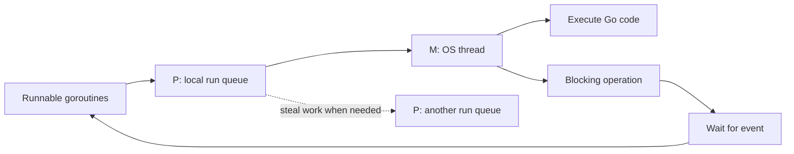
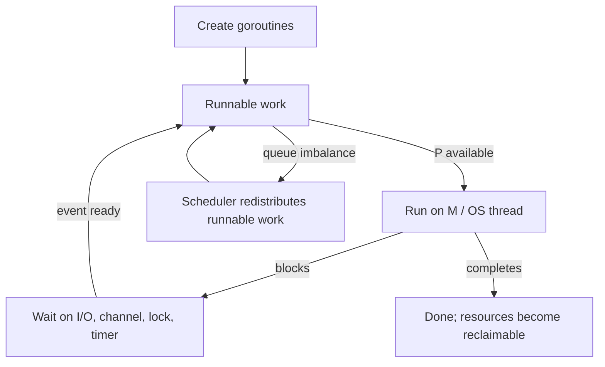

# ⚙️ Goroutines and the Go Runtime

> **Book:** *Concurrency in Go: Tools and Techniques for Developers*, Katherine Cox-Buday, Ch. 6  
> **Focus:** How the Go runtime schedules goroutines and why its implementation details should inform, but not dictate, application design.

## 📖 Chapter Overview

A goroutine is a function executing concurrently under the Go runtime. It is not a one-to-one wrapper around an operating-system thread. The runtime multiplexes many goroutines over a smaller or comparable set of OS threads, allowing blocking and ready work to be managed efficiently.

The scheduler model helps explain responsiveness and parallelism, but it is an implementation model. Write programs against language and library guarantees, not assumptions about a particular scheduler algorithm or runtime version.

## 🧩 The G, M, P Model

The runtime is commonly described using three scheduler entities:

| Name | Role |
|---|---|
| **G** | A goroutine: its stack, instruction state, and scheduling metadata |
| **M** | An OS thread that executes Go code |
| **P** | A logical processor holding resources needed to execute Go code; there are at most `GOMAXPROCS` Ps |

A goroutine that is ready to run needs a P and an M. A running goroutine may block on a channel, lock, system call, or other event. The runtime can then schedule another runnable goroutine, subject to the kind of blocking operation and runtime mechanisms involved.



## 🧺 Work Stealing

When a processor has no local runnable work, the scheduler can look for work elsewhere, including other processor queues. This helps balance runnable goroutines across available execution resources. Stealing concerns scheduling efficiency; it does not guarantee a specific goroutine order or fairness contract for application code.

The book distinguishes stealing tasks from stealing continuations. In practical terms, scheduler work distribution should remain invisible to most application logic: synchronization, ownership, and ordering must be expressed with channels, locks, atomics, or other documented mechanisms.

## 🔀 Tasks and Continuations

A task is work that can be executed. A continuation is the remaining work after a point where execution pauses or yields. Runtime schedulers can represent and move runnable work in different ways. These concepts help explain why goroutines can be suspended and resumed without requiring a dedicated OS thread for each one.

For application authors, the key lesson is not to depend on a particular internal representation. A channel send, mutex acquisition, timer, syscall, or preemption point may affect when work can run. Correctness must not rely on “this goroutine probably runs next.”

## 🎚️ `GOMAXPROCS` and Parallel Execution

`GOMAXPROCS` sets the maximum number of operating-system threads that can simultaneously execute Go code on behalf of the program. It is not the maximum goroutine count. Thousands of goroutines can exist while only a smaller number are actively executing Go instructions at once.

```go
// Runtime GOMAXPROCS controls simultaneous execution of Go code.
// It does not limit how many goroutines can be created.
n := runtime.GOMAXPROCS(0) // read current setting without changing it
fmt.Printf("Go execution processors: %d\n", n)
```

I/O-heavy programs can benefit from many goroutines because blocked operations do not all need a CPU at once. CPU-bound programs are constrained by available execution capacity. Benchmark realistic workloads before manually changing `GOMAXPROCS`; container CPU limits and Go version behavior affect the right choice.

## 🧵 Goroutine Stacks and Lifecycle

Goroutines begin with small stacks that can grow and shrink as needed. This is one reason goroutines are cheaper than dedicating a large fixed stack to every task, but they are not free: stacks, scheduler metadata, retained references, open resources, and queued work all consume memory.

The runtime does not automatically terminate a goroutine because its result is no longer needed. The program must arrange its lifetime: cancellation, channel closure, a finite input stream, or another explicit completion signal. This connects runtime scheduling back to the leak prevention patterns in Chapter 4.

## 📈 Observe Instead of Guessing

Use runtime and tooling evidence to understand a concurrency problem:

```bash
go test -race ./...
go test -run '^$' -bench . -benchmem ./...
go tool pprof cpu.prof
```

The race detector finds races only on execution paths exercised by that run; a clean run does not prove race freedom. Profiling can show CPU, blocking, mutex, and goroutine behavior depending on how profiles are collected. A goroutine count alone does not identify a leak; inspect whether goroutines are accumulating and what they are blocked on.

The runtime exposes diagnostics through `runtime/pprof`, execution traces, and `net/http/pprof` when explicitly registered. Protect profiling endpoints in deployed services: diagnostic output may reveal internal behavior and must not be exposed indiscriminately.

## ⚖️ Runtime Model and Safe Application Rules

| Runtime concept | Useful intuition | Do not infer |
|---|---|---|
| Goroutine multiplexing | Many logical tasks share runtime-managed threads | One goroutine always maps to one thread |
| Local queues and stealing | Runnable work can be balanced | Deterministic ordering or fairness |
| `GOMAXPROCS` | Upper bound on simultaneous Go code execution | A cap on goroutine count or total process threads |
| Stack growth | Goroutine stacks adjust to needs | Goroutines are cost-free |
| Preemption | Runtime can make progress despite long-running code | Every critical section can ignore synchronization |

## 🧪 Practical Example: CPU Work With Explicit Bounds

```go
func sumSquares(ctx context.Context, values []int, workers int) (int64, error) {
	if workers < 1 {
		return 0, fmt.Errorf("workers must be positive")
	}
	jobs := make(chan int)
	partials := make(chan int64, workers)
	var wg sync.WaitGroup

	for range workers {
		wg.Add(1)
		go func() {
			defer wg.Done()
			var subtotal int64
			for value := range jobs {
				select {
				case <-ctx.Done():
					return
				default:
					subtotal += int64(value) * int64(value)
				}
			}
			partials <- subtotal
		}()
	}

	go func() {
		defer close(jobs)
		for _, value := range values {
			select { case jobs <- value: case <-ctx.Done(): return }
		}
	}()
	go func() { wg.Wait(); close(partials) }()

	var total int64
	for partial := range partials { total += partial }
	if err := ctx.Err(); err != nil { return 0, err }
	return total, nil
}
```

The worker count is an application resource policy. The scheduler makes runnable goroutines execute; it does not choose the correct pool size for the workload. For CPU-bound work, start with a limit informed by `GOMAXPROCS`, then benchmark. For I/O-bound work, tune against downstream limits and latency.

## 🗂️ A Mental Model for Scheduling



This model supports reasoning about throughput and blocked work. It does not replace synchronization: if goroutines share mutable data, the program still needs a happens-before relationship established by synchronization.

## 🧪 Check Your Understanding

**Q1:** What does `GOMAXPROCS` limit?

**Q2:** Why can a program have far more goroutines than OS threads?

**Q3:** What is work stealing intended to improve?

**Q4:** Does a race-free `go test -race ./...` prove the program has no data races?

**Q5:** Why must application correctness avoid relying on goroutine scheduling order?

> [!answer]- 📋 Answers
>
> **A1:** It limits the number of OS threads that may execute Go code simultaneously, not the number of goroutines.
>
> **A2:** Goroutines are runtime-managed tasks. Many can be waiting on I/O, channels, timers, or locks while fewer OS threads execute runnable Go code.
>
> **A3:** It helps distribute runnable work when one processor has less work than another, improving utilization. It does not promise order or fairness to application code.
>
> **A4:** No. The detector can report races only on paths exercised by the test run. It is valuable evidence, not a proof of all possible executions.
>
> **A5:** Scheduling order is not an application-level synchronization guarantee. Use explicit communication or synchronization to establish ordering and visibility.

## 📋 Quick Reference

- **G:** goroutine; **M:** OS thread; **P:** runtime resource for executing Go code.
- `GOMAXPROCS` concerns simultaneous Go execution, not goroutine count.
- Work stealing balances runnable work; it does not define business ordering.
- Goroutines need explicit lifecycle management even though the runtime schedules them.
- Use race detection, profiles, traces, and benchmarks to inspect behavior.

## 🧠 Things to Remember

- Runtime implementation details are explanatory, not synchronization contracts.
- More goroutines do not automatically mean more throughput.
- Measure under realistic CPU limits, data sizes, and dependency behavior.

## 💡 Pro Tips

- Use a worker pool when work volume or downstream capacity needs a hard bound.
- Profile before optimizing scheduler behavior.
- Keep CPU-bound tasks coarse enough that scheduling overhead does not dominate.
- Read goroutine profiles to find blocked stacks when investigating suspected leaks.

## 🔗 Related Topics

- [[Go/Concurrency in Go/03 - Chapter Three/1.Goroutine]]
- [[Go/Concurrency in Go/03 - Chapter Three/2.Sync]]
- [[Go/Concurrency in Go/03 - Chapter Three/3.Channel]]
- [[Go/Concurrency in Go/04 - Chapter Four/3.Preventing Goroutine Leaks]]
- [[Go/Concurrency in Go/04 - Chapter Four/4.Pipelines]]
- [[Go/Concurrency in Go/05 - Chapter Five/Concurrency at Scale]]
- [Go runtime package](https://pkg.go.dev/runtime)
- [Go race detector](https://go.dev/doc/articles/race_detector)
- [Go diagnostics](https://go.dev/doc/diagnostics)

