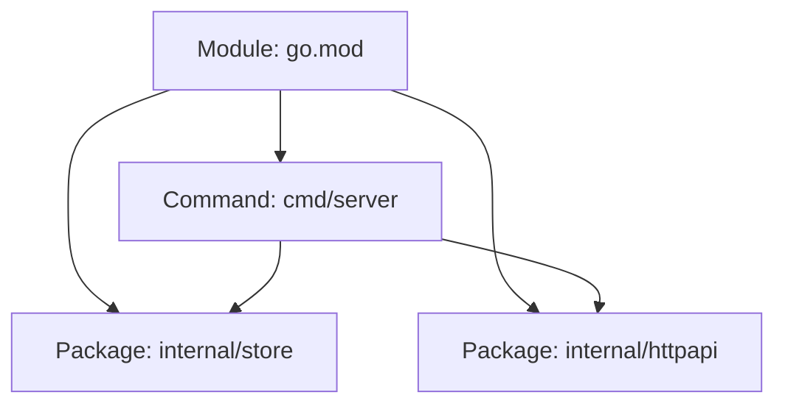
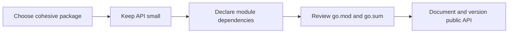

# 📦 Modules, Packages, and Imports

### 📖 Chapter Summary

Chapter 10 connects Go's source organization to its compilation and dependency model. A **package** is the unit compiled together; a **module** is the versioned collection of packages described by `go.mod`. Good boundaries make APIs discoverable, tests focused, and dependency changes reviewable.

| Reference | Chapter/Section | Focus |
|---|---|---|
| Learning Go (Bodner) | Ch.10 | Packages, imports, modules, visibility |
| 100 Go Mistakes (Harsanyi) | Ch.2 (#12–#15) | Organization, utility packages, collisions, docs |
| Go in Practice (2nd ed.) | Ch.6; partial Ch.2 | Project cleanliness and CLI structure |
| Stdlib / community | Go Modules Reference | Current module semantics |

#### 🆕 Key New Concepts & Technologies

| Concept | Learning Go | Harsanyi | Go in Practice | Current practice (2026) |
|---|---|---|---|---|
| Package | source files compiled together | avoid arbitrary boundaries | organize related behavior | keep package cohesive and small |
| Module | versioned package collection | avoid project sprawl | manage dependencies | `go.mod` declares module path, Go version, requirements |
| Export | uppercase identifier | document public API | expose useful surface | compatibility is a user promise |
| `internal/` | import boundary | avoid bad layout | private implementation | compiler enforces import restriction |

#### 📊 Comparison at a Glance

| Topic | Bodner | Harsanyi | Go in Practice | Current practice (2026) |
|---|---|---|---|---|
| Structure | organize by package responsibility | #12–#15 warn about poor organization | practical project hygiene | start simple; split when concepts differ |
| Dependencies | modules and imports | keep dependency graph understandable | maintain clean builds | use Go commands; review `go.mod` changes |
| Public surface | capitalization controls export | docs and naming matter | build consumable packages | stable, minimal API with examples |

## Part 1: Understand packages and modules

### 📌 Concepts Explained

- A package gives names a shared scope and groups source files that compile together.
- A module gives packages a versioned identity and dependency boundary.
- Import paths are names, not filesystem-relative paths.

### 🔧 A practical mental model

Think of a module as a release unit and packages as its internal building blocks. A command package (`package main`) wires application components; reusable behavior belongs in packages with domain names.



### 🧪 Interview Q&A

**Q1:** How does a package differ from a module?

**Q2:** What determines whether an identifier is exported?

**Q3:** Why should files in one directory generally use one package name?

**Q4:** What does `internal/` enforce?

**Q5:** Why avoid a generic `util` package?

> [!success]- 📋 Answers — Part 1
> **A1:** A package is compiled together; a module is a versioned collection of packages with dependency metadata.
>
> **A2:** An identifier beginning with an uppercase Unicode letter is exported from its package.
>
> **A3:** The directory is the package boundary used by the compiler and tooling.
>
> **A4:** It prevents packages outside the permitted parent tree from importing that internal package.
>
> **A5:** It hides ownership and cohesion; put helpers with the concept that owns them.

## Part 2: Design package boundaries

### 📌 Concepts Explained

Prefer packages named for a coherent domain or capability. Avoid splitting code only by technical layer when that creates packages that constantly reach into one another.

### 🔧 Example: dependency direction

```go
// internal/price/price.go
package price

type Money struct { Cents int64 }

func (m Money) Add(other Money) Money {
    return Money{Cents: m.Cents + other.Cents}
}
```

Keep `Money` behavior with `Money`; consumers import `price` rather than duplicating arithmetic.

| Mistake | Why it hurts | Better approach |
|---|---|---|
| `common`, `helpers`, `misc` | unclear ownership | name package after its responsibility |
| package imports its consumer | import cycle | move shared contract to a lower-level owner |
| package exposes implementation fields | freezes internals | expose methods or constructors only when needed |

### 🧪 Interview Q&A

**Q1:** What is an import cycle, and how do you fix one?

**Q2:** When is a small package useful?

**Q3:** Should every package have an interface for its dependencies?

**Q4:** Where should an interface usually be declared?

**Q5:** What does package cohesion mean in practice?

> [!success]- 📋 Answers — Part 2
> **A1:** Packages depend on each other in a cycle; invert or relocate a dependency so imports form a directed acyclic graph.
>
> **A2:** When it creates a clear reusable or testable boundary with a focused concept.
>
> **A3:** No. Introduce an interface where substitution is useful, often at the consuming boundary.
>
> **A4:** Usually beside the consumer that needs the behavior, keeping the required contract narrow.
>
> **A5:** Names and behavior in the package serve one understandable purpose and change for related reasons.

## Part 3: Modules and dependency management

### 🔧 Core workflow

```sh
go mod init example.com/shop
go get example.com/library@v1.2.3
go mod tidy
go list -m all
```

`go.mod` records module identity, Go version, and module requirements. `go.sum` records checksums used to verify downloaded module content. `go mod tidy` reconciles requirements with imports; review its diff.

### 🧪 Interview Q&A

**Q1:** What information belongs in `go.mod`?

**Q2:** What is `go.sum` for?

**Q3:** What does `go mod tidy` do?

**Q4:** How do major module versions affect import paths?

**Q5:** Why pin or review dependency upgrades?

> [!success]- 📋 Answers — Part 3
> **A1:** Module path, Go language/toolchain requirements, and module dependency requirements and directives.
>
> **A2:** It records checksums that let the Go command verify module content.
>
> **A3:** It adds missing and removes unused module requirements and updates checksum entries.
>
> **A4:** For v2 and later, the module path includes the major version suffix, making incompatible APIs distinct.
>
> **A5:** Upgrades can change behavior, security posture, and transitive dependencies; a reviewed diff makes that change explicit.

## Part 4: Visibility and API design

### 💻 Public versus private

```go
package catalog

type Item struct { id string; Name string }

func NewItem(id, name string) Item { return Item{id: id, Name: name} }
func (i Item) ID() string          { return i.id }
```

Export only what callers need. A public API creates a compatibility obligation; documentation is part of that interface.

### 🧪 Interview Q&A

**Q1:** How can a package protect an invariant?

**Q2:** Why are exported names expected to have doc comments?

**Q3:** Is `internal` a security mechanism?

**Q4:** What makes a change breaking?

**Q5:** Why avoid exposing concrete implementation details?

> [!success]- 📋 Answers — Part 4
> **A1:** Keep state unexported and expose operations that validate changes.
>
> **A2:** Documentation lets users understand supported behavior and is surfaced by Go documentation tools.
>
> **A3:** No; it is a source import boundary, not runtime authorization.
>
> **A4:** A change that prevents existing valid clients from compiling or behaving as promised.
>
> **A5:** Callers become coupled to details that should remain changeable.

## Part 5: Common mistakes and operational concerns

Harsanyi's project-organization mistakes (#12–#15) point to the same remedy: make ownership obvious. Avoid premature package proliferation, import aliases that obscure identity, and exported APIs without examples or documentation. Prefer module-aware commands over manually editing dependency metadata.

## Part 6: Hands-on application

### 🔨 Hands-On Tasks

#### Task 1: Extract a focused package

**Goal:** Separate pricing rules from a command.

**Files:** `cmd/shop/`, `internal/price/`, `go.mod`.

**Steps:** Move the rule and its tests into `internal/price`; keep `main` as wiring; run `go test ./...` and `go list ./...`.

**Done when:** The command imports the focused package and all package tests pass.

## Part 7: Current practice

The module reference remains the authority for exact directive semantics. Module paths identify packages and commonly reflect repository locations; use semantic versions and review dependency changes. Avoid treating `replace` as a permanent substitute for a release process.

## Part 8: Senior synthesis



| Decision | Prefer | Avoid |
|---|---|---|
| Package naming | domain/capability | `util`, `common` catch-alls |
| Dependency | explicit module version | accidental transitive reliance |
| API | narrow and documented | exporting internals by default |

### 💡 Pro Tips & Best Practices (Combined)

1. Begin with a small number of cohesive packages.
2. Keep `main` focused on configuration and dependency wiring.
3. Declare narrow consumer-side interfaces only when substitution helps.
4. Use `internal/` to express implementation boundaries.
5. Run `go mod tidy` and inspect the resulting diff.
6. Treat exported APIs as compatibility promises.
7. Document package purpose and exported behavior.

### 📚 Further Reading

| Resource | Topic |
|---|---|
| [Go Modules Reference](https://go.dev/ref/mod) | Module and version semantics |
| [Organizing a Go module](https://go.dev/doc/modules/layout) | Project layouts |
| [[Go/Learning Go/11. Go Tooling - Study Guide]] | Tooling and quality checks |

*Study guide for Modules, Packages, and Imports (Ch.10), 2026.*

### 🤖 Regenerate this guide

1. [[AI Prompt/00 - General Study Guide Prompt]]
2. [[Go/AI Prompt - Go]]
3. [[Go/Learning Go/AI Prompt - learning go]]
