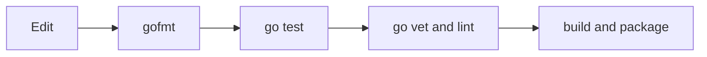
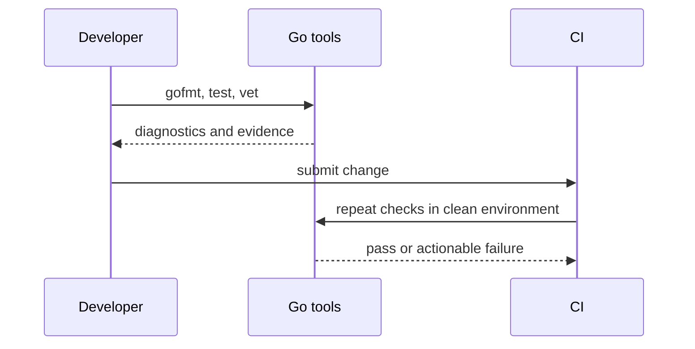

# 🛠️ Go Tooling

### 📖 Chapter Summary

Go's tooling makes formatting, compilation, tests, race checks, profiling, and documentation repeatable command-line steps. Tool output is evidence about a specific property: compilation does not prove correctness, and a race-free test run does not prove all executions are race-free.

| Reference | Chapter/Section | Focus |
|---|---|---|
| Learning Go (Bodner) | Ch.11 | Standard Go toolchain |
| 100 Go Mistakes (Harsanyi) | #16; Ch.11 | Linters and test pitfalls |
| Go in Practice (2nd ed.) | Ch.6 | Formatting, testing, debugging, benchmarks |
| Stdlib / community | Go command documentation | Tool flags and diagnostics |

#### 🆕 Key New Concepts & Technologies

| Concept | Learning Go | Harsanyi | Go in Practice | Current practice (2026) |
|---|---|---|---|---|
| `gofmt` | canonical formatting | avoid style-only churn | clean code workflow | format in editor and CI |
| `go vet` | suspicious constructs | lint discipline | static analysis | run alongside tests |
| race detector | detects observed races | concurrency/test pitfalls | debug concurrent behavior | `go test -race` on supported platforms |
| profiling | measure runtime costs | optimize with evidence | benchmark/debug | use `pprof` after identifying a question |

#### 📊 Comparison at a Glance

| Topic | Bodner | Harsanyi | Go in Practice | Current practice (2026) |
|---|---|---|---|---|
| Format | rely on gofmt | consistent style | automated workflow | `gofmt` is standard |
| Static checks | vet and tools | #16 linting | vet and debug | add focused linters, keep config maintainable |
| Performance | benchmark/profile | avoid premature optimization | benchmark tools | profile representative workload |

## Part 1: Understand the toolchain

### 📌 Concepts Explained

Go tools are ordinary commands, suitable for local development and CI. The key loop is edit → format → test → inspect diagnostics → build or run.



### 🧪 Interview Q&A

**Q1:** Why run `gofmt` automatically?

**Q2:** What does `go vet` do?

**Q3:** Does a successful build mean the program is correct?

**Q4:** Why keep tool commands reproducible in CI?

**Q5:** What is the difference between compiler errors and vet diagnostics?

> [!success]- 📋 Answers — Part 1
> **A1:** It removes formatting debates and makes diffs focus on behavior.
>
> **A2:** It reports suspicious constructs that compile but may indicate bugs.
>
> **A3:** No. It proves compilation for that configuration, not behavioral correctness.
>
> **A4:** It gives every change the same automated checks and reduces machine-specific assumptions.
>
> **A5:** Compiler errors prevent building; vet reports likely mistakes without defining language validity.

## Part 2: Build, inspect, and test

### 💻 Useful commands

```sh
gofmt -w .
go test ./...
go test -race ./...
go vet ./...
go test -cover ./...
go test -bench=. -benchmem ./...
```

Each command answers a different question. `-race` instruments executed paths and can be expensive. Coverage reports execution, not assertion quality.

## Part 3: Debug and diagnose

Use focused reproduction and inspect the failing package or stack trace first. A debugger helps inspect runtime state; logs should add context at meaningful boundaries. For production-like issues, record the exact command, Go version, OS/architecture, and relevant flags.

## Part 4: Benchmark and profile

Benchmarks should model representative inputs and avoid including setup unless setup is part of the behavior being measured. Use CPU, heap, block, or mutex profiles to answer a defined question; profile results identify hotspots, not the reason by themselves.

```sh
go test -bench=BenchmarkParse -benchmem ./internal/parser
go test -cpuprofile=cpu.out -memprofile=heap.out ./...
go tool pprof cpu.out
```

## Part 5: Common mistakes

Harsanyi #16 highlights treating lint as an afterthought. Conversely, a large pile of overlapping linters can create noisy, ignored output. Choose checks that catch meaningful defects, pin tool versions in CI, and fix or consciously document findings.

| Evidence | It supports | It does not prove |
|---|---|---|
| `go test` passes | tested assertions passed | untested paths are correct |
| `-race` passes | no race observed on exercised paths | absence of all possible races |
| coverage is high | statements/branches executed | assertions detect wrong behavior |
| benchmark improves | measured workload changed | production workload benefits |

## Part 6: Hands-on application

### 🔨 Hands-On Tasks

#### Task 1: Add a reproducible quality loop

**Goal:** Run formatting, tests, race detection, and vet consistently.

**Files:** Any small Go module and its CI configuration.

**Steps:** Run each command locally; add equivalent CI steps; introduce one intentionally failing assertion and confirm CI reports it.

**Done when:** The same checks run locally and in CI, with no hidden manual setup.

## Part 7: Current practice

Use standard Go commands as the baseline. Add `staticcheck`, `golangci-lint`, or `govulncheck` when their findings fit the project, and keep versions and configuration explicit. Benchmark and profile before optimizing.

## Part 8: Senior synthesis



### 💡 Pro Tips & Best Practices (Combined)

1. Format automatically before review.
2. Run checks from the module root in CI.
3. Use `go test ./...` to include all packages.
4. Use `-race` on meaningful concurrent test paths.
5. Treat coverage as a navigation aid, not a quality score.
6. Benchmark representative workloads before optimizing.
7. Keep tool versions and CI commands discoverable.

### 📚 Further Reading

| Resource | Topic |
|---|---|
| [Go command](https://pkg.go.dev/cmd/go) | Standard commands |
| [Data Race Detector](https://go.dev/doc/articles/race_detector) | Race instrumentation |
| [[Go/Learning Go/12. Concurrency in Go - Study Guide]] | Concurrency diagnostics |
| [[Go/Learning Go/15. Writing Tests - Study Guide]] | Test design |

*Study guide for Go Tooling (Ch.11), 2026.*

### 🤖 Regenerate this guide

1. [[AI Prompt/00 - General Study Guide Prompt]]
2. [[Go/AI Prompt - Go]]
3. [[Go/Learning Go/AI Prompt - learning go]]
