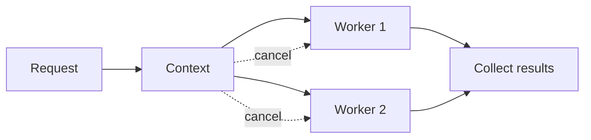

# 🧵 Concurrency in Go

### 📖 Chapter Summary

Concurrency is structuring work that can progress independently; parallelism is executing work simultaneously. Goroutines are lightweight execution units, but they still need lifecycle ownership, cancellation, synchronization, and bounded resource use. Use this guide with the deeper vault sequence [[Go/Concurrency in Go/01 - Chapter One/Atomicity]] and its goroutine, sync, channels, pipelines, and leak notes.

| Reference | Chapter/Section | Focus |
|---|---|---|
| Learning Go (Bodner) | Ch.12 | Goroutines, channels, synchronization |
| 100 Go Mistakes (Harsanyi) | Sections 8–9 (#57–#74) | Races, leaks, channels, WaitGroup, context |
| Go in Practice (2nd ed.) | Ch.5 | Concurrency patterns |
| Stdlib / community | Go memory model and `context` | Synchronization and cancellation |

#### 🆕 Key New Concepts & Technologies

| Concept | Learning Go | Harsanyi | Go in Practice | Current practice (2026) |
|---|---|---|---|---|
| Goroutine | concurrent function execution | leaks and panic ownership | worker patterns | every goroutine needs an exit path |
| Channel | communicate values and coordinate | misuse can deadlock | channel patterns | prefer clear ownership and close rules |
| Mutex | protect shared state | races/copying sync values | synchronization recipes | use simplest correct synchronization |
| Context | cancellation propagation | forgotten cancellation | service operations | pass request-scoped context explicitly |

#### 📊 Comparison at a Glance

| Topic | Bodner | Harsanyi | Go in Practice | Current practice (2026) |
|---|---|---|---|---|
| Communication | channels | avoid accidental blocking | pipeline patterns | channels for handoff; mutex for shared state |
| Lifetime | goroutines | leaks are production bugs | worker shutdown | parent owns cancellation and joining |
| Shared memory | sync primitives | race and copy pitfalls | mutex/channel recipes | run race detector; do not copy used locks |

## Part 1: Concurrency mental model

Concurrency introduces interleavings. Correctness must hold regardless of scheduling order; adding a goroutine does not automatically make code faster.



### 🧪 Interview Q&A

**Q1:** What is the difference between concurrency and parallelism?

**Q2:** What is a data race?

**Q3:** Why is starting a goroutine not enough?

**Q4:** When should a channel be closed?

**Q5:** What does a mutex protect?

> [!success]- 📋 Answers — Part 1
> **A1:** Concurrency is managing overlapping independent work; parallelism is simultaneous execution.
>
> **A2:** Unsynchronized concurrent access to the same memory where at least one access writes.
>
> **A3:** The goroutine needs cancellation, error handling, resource bounds, and a way for its owner to know it finished.
>
> **A4:** Usually the sender that owns the channel closes it to signal no more values; receivers should not close it.
>
> **A5:** A mutex establishes exclusive access to the state guarded by its locking protocol.

## Part 2: Goroutine lifecycle and cancellation

Always answer: who starts this goroutine, who stops it, and who waits for it? `context.Context` carries cancellation and deadlines across call boundaries; it is not a general-purpose optional-argument bag.

```go
func runWorker(ctx context.Context, jobs <-chan Job) error {
    for {
        select {
        case <-ctx.Done():
            return ctx.Err()
        case job, ok := <-jobs:
            if !ok { return nil }
            if err := process(ctx, job); err != nil { return err }
        }
    }
}
```

## Part 3: Channels and synchronization

Channels fit ownership transfer and coordination. A mutex often fits shared in-memory state more directly. Pick the model that makes invariants easiest to see.

| Need | Likely tool |
|---|---|
| Guard a map shared among goroutines | `sync.Mutex` or `sync.RWMutex` |
| Hand work/results to another goroutine | channel |
| Cancel a tree of work | `context.Context` |
| Wait for a fixed group | `sync.WaitGroup` or `errgroup` |

## Part 4: Select, pipelines, and backpressure

Buffered channels absorb a bounded amount of work; they do not provide unlimited queues. A pipeline stage must stop when downstream is gone or the context is canceled, and every blocked send needs an exit path.

## Part 5: Common concurrency failures

Harsanyi's concurrency sections emphasize races, goroutine leaks, incorrect channel close, blocked `select`, copying synchronization primitives, and inadequate tests. Run with `go test -race`; inspect lifecycle boundaries and avoid using sleeps as synchronization.

## Part 6: Hands-on application

### 🔨 Hands-On Tasks

#### Task 1: Make a cancellable worker pool

**Goal:** Process bounded jobs and stop cleanly.

**Files:** A small package with worker and tests.

**Steps:** Add context cancellation, a bounded jobs channel, result/error collection, and a test that cancels while workers are waiting. Run `go test -race ./...`.

**Done when:** Cancellation returns promptly, no test relies on sleeping, and race detection reports no race.

## Part 7: Current practice

Use `context` for cancellation and deadlines, and consider `errgroup` when a group should cancel on the first error. A context does not forcibly terminate code that ignores it. Ensure external calls accept and honor the context.

## Part 8: Senior synthesis

```mermaid
sequenceDiagram
  participant P as Parent
  participant C as Context
  participant W as Worker
  P->>C: create cancellable context
  P->>W: start worker(ctx)
  P->>C: cancel()
  C-->>W: Done closes
  W-->>P: return; parent joins
```

### 💡 Pro Tips & Best Practices (Combined)

1. Give every goroutine a clear owner and exit condition.
2. Propagate cancellation to blocking operations.
3. Bound queues, worker counts, and in-flight work.
4. Close channels only from the sender that owns them.
5. Do not copy `Mutex`, `WaitGroup`, or other used sync values.
6. Use channels for handoff and mutexes for shared state when that is clearer.
7. Test concurrency with synchronization, then run the race detector.

### 📚 Further Reading

| Resource | Topic |
|---|---|
| [Go memory model](https://go.dev/ref/mem) | Happens-before guarantees |
| [Data Race Detector](https://go.dev/doc/articles/race_detector) | Race detection |
| [[Go/Concurrency in Go/04 - Chapter Four/3.Preventing Goroutine Leaks]] | Lifecycle and leaks |
| [[Go/Learning Go/11. Go Tooling - Study Guide]] | Diagnostics |

*Study guide for Concurrency in Go (Ch.12), 2026.*

### 🤖 Regenerate this guide

1. [[AI Prompt/00 - General Study Guide Prompt]]
2. [[Go/AI Prompt - Go]]
3. [[Go/Learning Go/AI Prompt - learning go]]
