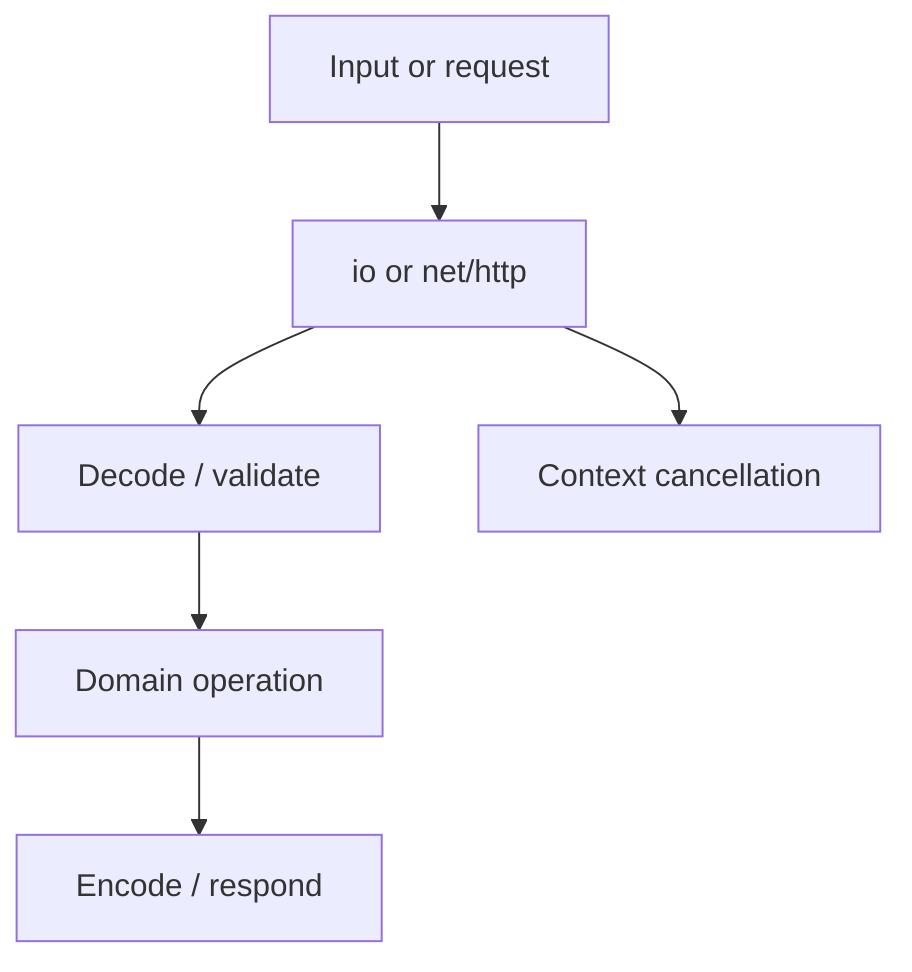
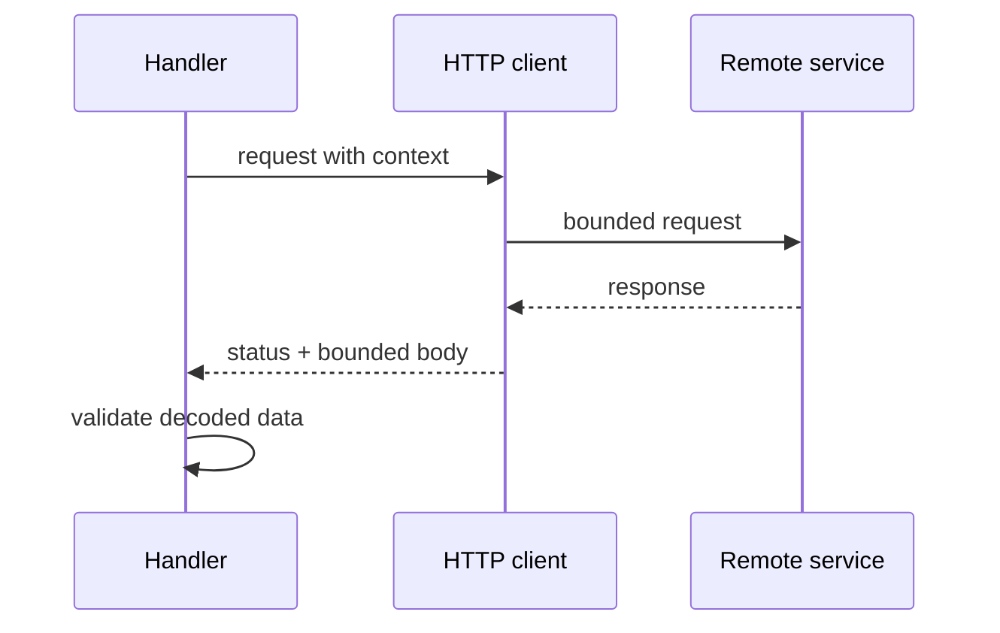

# 📚 The Standard Library

### 📖 Chapter Summary

Go's standard library supplies reusable building blocks for files, networking, encoding, time, and HTTP. The important skill is choosing the right abstraction, respecting resource lifetimes, and making network behavior bounded and observable.

| Reference | Chapter/Section | Focus |
|---|---|---|
| Learning Go (Bodner) | Ch.13 | Standard packages and `net/http` |
| 100 Go Mistakes (Harsanyi) | Section 10 (#75–#81) | Time, JSON, SQL, HTTP and cleanup |
| Go in Practice (2nd ed.) | Ch.7–11 | Files, networking, HTTP, templates, clients |
| Stdlib / community | `pkg.go.dev` | Package contracts and APIs |

#### 🆕 Key New Concepts & Technologies

| Concept | Learning Go | Harsanyi | Go in Practice | Current practice (2026) |
|---|---|---|---|---|
| `net/http` | handlers and clients | timeout/resource mistakes | server and client recipes | explicit timeouts, contexts, graceful shutdown |
| JSON | standard encoding | malformed/ambiguous data pitfalls | API payloads | validate semantics after decoding |
| `defer` cleanup | close resources | resource leaks | file/network recipes | check important close errors where relevant |
| `time` | durations and timestamps | time-zone mistakes | scheduling | use durations for elapsed time and UTC instants |

#### 📊 Comparison at a Glance

| Topic | Bodner | Harsanyi | Go in Practice | Current practice (2026) |
|---|---|---|---|---|
| HTTP | composable handlers | #79–#81 resource pitfalls | server/client patterns | configure deadlines and graceful lifecycle |
| Files | `os` and `io` interfaces | cleanup risks | streaming and file access | close promptly; avoid unbounded reads |
| Serialization | `encoding/json` | schema pitfalls | request/response payloads | validate and version API contracts |

## Part 1: Choose standard packages

Prefer standard library types when they express the problem directly: `io.Reader` for streaming input, `context.Context` for cancellation, and `http.Handler` for request handling.



### 🧪 Interview Q&A

**Q1:** Why accept `io.Reader` instead of `[]byte`?

**Q2:** What is the role of `http.Handler`?

**Q3:** Why must an HTTP client have timeouts?

**Q4:** Is successful JSON decoding the same as valid input?

**Q5:** Why use context on outbound requests?

> [!success]- 📋 Answers — Part 1
> **A1:** It supports streaming and decouples consumers from a particular storage source.
>
> **A2:** It is the interface for serving one HTTP request, enabling composable middleware and handlers.
>
> **A3:** Without deadlines, a stalled peer can hold connections and goroutines indefinitely.
>
> **A4:** No. Decoding checks representation; application validation must check required fields and business rules.
>
> **A5:** It allows caller cancellation and deadlines to propagate through the request.

## Part 2: Safe HTTP clients and servers

```go
client := &http.Client{Timeout: 5 * time.Second}
req, err := http.NewRequestWithContext(ctx, http.MethodGet, endpoint, nil)
if err != nil { return err }
resp, err := client.Do(req)
if err != nil { return err }
defer resp.Body.Close()
```

Reuse clients and transports. Check status codes, bound response bodies where input is untrusted, and close response bodies. Servers should set timeouts appropriate to the service and shut down gracefully.

## Part 3: Files, streams, and JSON

Streaming avoids holding entire files or payloads in memory. Decode into explicit types, reject invalid semantic states, and define how unknown fields and version changes are handled at the application boundary.

## Part 4: Time, SQL, and resource ownership

Use `time.Duration` for elapsed intervals and explicit time zones for civil time. With SQL, close rows, check iteration errors, and use context-aware operations. Resource cleanup should happen on every return path.

## Part 5: Common mistakes

Harsanyi's standard-library section calls attention to unbounded HTTP operations, leaked response bodies/rows, incorrect time assumptions, and trusting decoded data without validation. These failures arise from omitted lifecycle and boundary checks.

| Risk | Safer habit |
|---|---|
| HTTP call hangs | client timeout and request context |
| response body leak | close body; reuse transport |
| huge response | bounded read or stream |
| decoded but invalid JSON data | validate domain constraints |
| time-zone confusion | distinguish instant, duration, and local civil time |

## Part 6: Hands-on application

### 🔨 Hands-On Tasks

#### Task 1: Build a bounded HTTP client call

**Goal:** Fetch JSON with cancellation, timeout, status checks, and body limits.

**Files:** A small client package and table-driven tests using `httptest`.

**Steps:** Test success, non-2xx, malformed JSON, oversized body, and canceled context.

**Done when:** Each case has an assertion and the response body is closed on every path.

## Part 7: Current practice

The standard library API is documented per package at pkg.go.dev. For HTTP, explicitly choose timeout policy, request cancellation, server shutdown, and input size limits. When introducing a dependency, compare the concrete capability needed against the standard library first.

## Part 8: Senior synthesis



### 💡 Pro Tips & Best Practices (Combined)

1. Prefer standard interfaces that match the data flow.
2. Put deadlines on outbound network calls.
3. Reuse HTTP clients and transports.
4. Close bodies, rows, and files on all paths.
5. Bound untrusted input and response sizes.
6. Treat decoding and validation as separate steps.
7. Test HTTP behavior with `httptest`, not live services.

### 📚 Further Reading

| Resource | Topic |
|---|---|
| [Go package documentation](https://pkg.go.dev/) | Standard library APIs |
| [net/http](https://pkg.go.dev/net/http) | HTTP client and server |
| [[Go/Learning Go/15. Writing Tests - Study Guide]] | `httptest` and test coverage |
| [[Go/gRPC Microservices in Go/3. Getting up and running with gRPC and Golang - Study Guide]] | External service communication |

*Study guide for The Standard Library (Ch.13), 2026.*

### 🤖 Regenerate this guide

1. [[AI Prompt/00 - General Study Guide Prompt]]
2. [[Go/AI Prompt - Go]]
3. [[Go/Learning Go/AI Prompt - learning go]]
