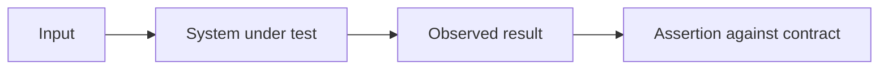
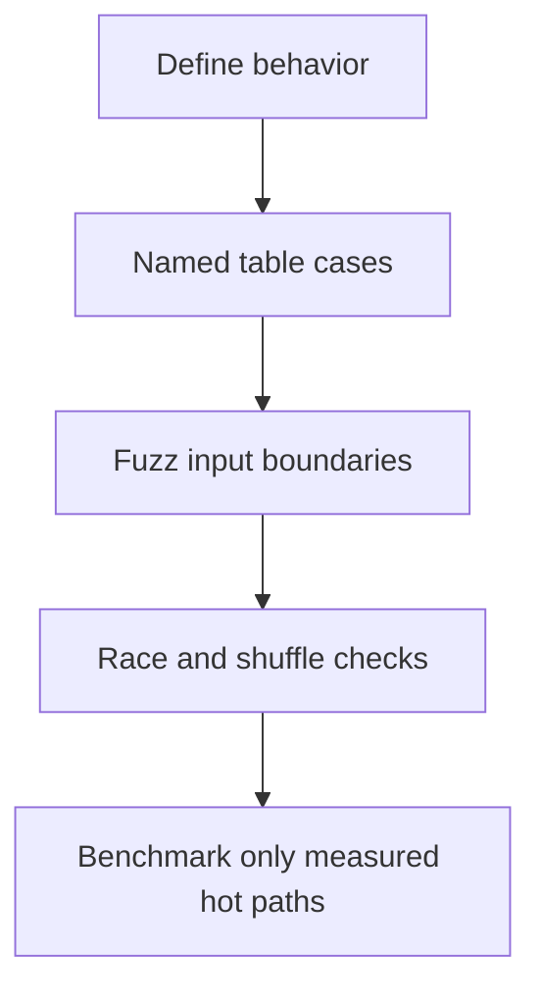

# 🧪 Writing Tests

### 📖 Chapter Summary

Tests are executable examples of expected behavior. Good tests isolate one behavior, make failures diagnostic, and avoid depending on timing or external state. This chapter guide consolidates the existing raw notes in [[Go/Learning Go/15 - Writing Tests/1.Basics]], [[Go/Learning Go/15 - Writing Tests/2.Test With Env]], [[Go/Learning Go/15 - Writing Tests/3.Using go-cmp]], and [[Go/Learning Go/15 - Writing Tests/4.Fuzz Testing]].

| Reference | Chapter/Section | Focus |
|---|---|---|
| Learning Go (Bodner) | Ch.15 | Tests, examples, benchmarks |
| 100 Go Mistakes (Harsanyi) | Section 11 (#82–#90) | Test design, races, sleeping, benchmarks |
| Go in Practice (2nd ed.) | Ch.6 | Table tests, fuzzing, coverage |
| Stdlib / community | `testing`, `httptest` | Test APIs |

#### 🆕 Key New Concepts & Technologies

| Concept | Learning Go | Harsanyi | Go in Practice | Current practice (2026) |
|---|---|---|---|---|
| Table test | repeat cases concisely | avoid weak tests | practical patterns | named subtests with clear inputs |
| Test helper | reduce repeated setup | avoid opaque test code | maintainable suites | `t.Helper()` improves failure location |
| Fuzz test | generated input exploration | catch edge cases | fuzz workflow | seed corpus plus invariants |
| Race test | concurrency checks | #84–#90 traps | debugging | `go test -race` on exercised paths |

#### 📊 Comparison at a Glance

| Topic | Bodner | Harsanyi | Go in Practice | Current practice (2026) |
|---|---|---|---|---|
| Cases | table-driven tests | tests can mislead | table test recipes | name cases and assert meaningful outcomes |
| Timing | avoid brittle tests | sleeping causes flaky tests | deterministic workflows | synchronize on events, not elapsed delay |
| Fuzz | test arbitrary values | hidden edge conditions | fuzzing | assert invariants and minimize failures |

## Part 1: What a test proves

A test proves that particular inputs and execution paths satisfy assertions. It does not prove all possible behaviors. Aim for tests that expose a contract, especially edge cases and failure behavior.



### 🧪 Interview Q&A

**Q1:** Why use table-driven tests?

**Q2:** What does `t.Helper()` do?

**Q3:** Why are sleeps poor synchronization in tests?

**Q4:** What does fuzz testing add?

**Q5:** Does high coverage guarantee correctness?

> [!success]- 📋 Answers — Part 1
> **A1:** It applies the same contract to multiple named inputs while keeping edge cases visible.
>
> **A2:** It marks a helper so failure locations point to the calling test line.
>
> **A3:** Scheduling and machine load vary, so a fixed delay is neither proof of readiness nor a reliable timeout.
>
> **A4:** It explores many inputs, including mutations that humans may not anticipate.
>
> **A5:** No. Coverage measures executed code, not whether assertions detect incorrect results.

## Part 2: Table tests and subtests

```go
func TestNormalize(t *testing.T) {
    tests := []struct{ name, in, want string }{
        {"empty", "", ""},
        {"trim spaces", " hello ", "hello"},
    }
    for _, tt := range tests {
        t.Run(tt.name, func(t *testing.T) {
            if got := Normalize(tt.in); got != tt.want {
                t.Fatalf("Normalize(%q) = %q, want %q", tt.in, got, tt.want)
            }
        })
    }
}
```

Modern Go gives range variables per-iteration semantics for modules declaring Go 1.22 or later; still pass test-case values explicitly when supporting older language versions or when clarity helps.

## Part 3: Test boundaries and environments

Use `t.TempDir`, `t.Setenv`, and cleanup helpers to isolate filesystem and environment state. For HTTP, `httptest` provides an in-process server. Tests should not require real credentials or a particular developer machine.

## Part 4: Fuzzing and benchmarks

Fuzz tests start with seed inputs and explore mutations. Assert invariants such as no panic, valid round-trip, or bounded output. Benchmarks measure repeated operations; keep setup out of timed work unless it is part of the target operation.

```sh
go test ./...
go test -race ./...
go test -fuzz=FuzzParse -fuzztime=30s ./internal/parser
go test -bench=. -benchmem ./...
```

## Part 5: Common test mistakes

Avoid tests that merely call code without asserting, share mutable globals, depend on test order, sleep to wait for goroutines, or compare complex values using fragile formatting. Use `go-cmp` when structural diffs improve readability; standard equality is sufficient for simple values.

## Part 6: Hands-on application

### 🔨 Hands-On Tasks

#### Task 1: Turn edge cases into executable contracts

**Goal:** Cover a parser's success and failure behavior.

**Files:** Parser implementation and `_test.go` file.

**Steps:** Add named table cases, a fuzz target asserting no panic, and a malformed-input regression case. Run tests and race detector.

**Done when:** Every case asserts an observable contract and fuzz seeds include the regression input.

## Part 7: Current practice

Use subtests, fuzzing, benchmarks, coverage profiles, and the race detector where they answer a real question. Run `go test -race -shuffle=on -count=1 ./...` in CI when runtime cost is suitable. No one flag substitutes for test design.

## Part 8: Senior synthesis



### 💡 Pro Tips & Best Practices (Combined)

1. Name cases after the behavior they demonstrate.
2. Assert outputs and errors, not just absence of panic.
3. Keep tests isolated from machine state and order.
4. Use `t.TempDir`, `t.Setenv`, and `httptest` for local fixtures.
5. Replace sleeps with explicit synchronization.
6. Use fuzzing for parsers and invariant-rich APIs.
7. Interpret race and coverage results within their limits.

### 📚 Further Reading

| Resource | Topic |
|---|---|
| [Testing package](https://pkg.go.dev/testing) | Tests, fuzzing, benchmarks |
| [Go fuzzing](https://go.dev/doc/security/fuzz/) | Fuzz workflow |
| [[Go/Learning Go/11. Go Tooling - Study Guide]] | Race detector and tooling |
| [[Go/Learning Go/13. The Standard Library - Study Guide]] | `httptest` use cases |

*Study guide for Writing Tests (Ch.15), 2026.*

### 🤖 Regenerate this guide

1. [[AI Prompt/00 - General Study Guide Prompt]]
2. [[Go/AI Prompt - Go]]
3. [[Go/Learning Go/AI Prompt - learning go]]
