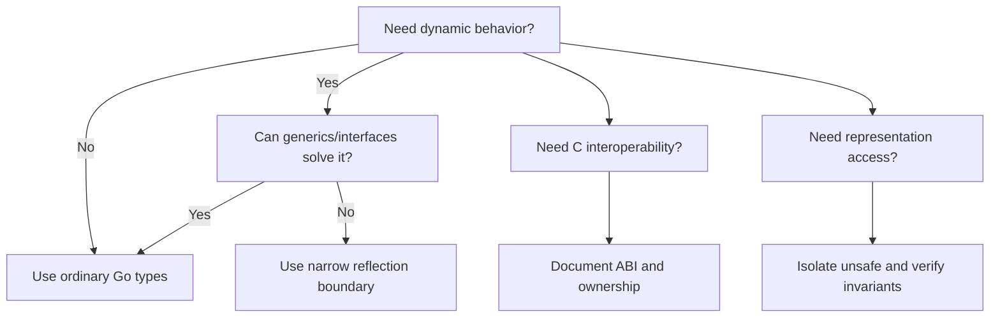

# 🐉 Here Be Dragons: Reflect, Unsafe, and Cgo

### 📖 Chapter Summary

Reflection inspects types and values at runtime; `unsafe` bypasses parts of Go's type and memory safety; cgo crosses the Go/C boundary. These tools solve specialized interoperability or framework problems and bring costs in clarity, portability, correctness, and maintenance. Default to ordinary types and interfaces until a measured requirement justifies the escape hatch.

| Reference | Chapter/Section | Focus |
|---|---|---|
| Learning Go (Bodner) | Ch.16 — Here Be Dragons: Reflect, Unsafe, and Cgo | Reflection, unsafe, cgo |
| 100 Go Mistakes (Harsanyi) | Advanced topics | Related memory and maintainability risks |
| Go in Practice (2nd ed.) | Ch.13 | Reflection, tags, code generation |
| Stdlib / community | `reflect`, `unsafe`, cgo docs | API and boundary contracts |

#### 🆕 Key New Concepts & Technologies

| Concept | Learning Go | Harsanyi | Go in Practice | Current practice (2026) |
|---|---|---|---|---|
| Reflection | runtime type/value operations | complexity risks | tags and generic tooling | constrain reflection to boundary code |
| `unsafe` | pointer/layout escape hatch | memory correctness | — | obey documented invariants; isolate and test |
| cgo | call C and share boundary types | deployment/ownership risks | — | account for toolchain, ABI, and memory ownership |
| Code generation | generated source | reduce repetitive mistakes | generation recipes | keep generator inputs and outputs reproducible |

#### 📊 Comparison at a Glance

| Topic | Bodner | Harsanyi | Go in Practice | Current practice (2026) |
|---|---|---|---|---|
| Reflection | inspect dynamic values | harder reasoning | tags/codegen recipes | use only when static types cannot express the task |
| Unsafe | bypass protections | correctness cost | — | isolate behind tiny reviewed APIs |
| cgo | interoperability | boundary and deployment cost | — | prefer pure Go when practical |

## Part 1: Understand the escape hatches

The compiler normally checks types and memory access. Reflection moves some decisions to runtime; unsafe code assumes representation details; cgo introduces another language, toolchain, and ownership model.



### 🧪 Interview Q&A

**Q1:** When is reflection justified?

**Q2:** What is a common reflection panic source?

**Q3:** Why is `unsafe` risky?

**Q4:** What extra concerns does cgo add?

**Q5:** When should code generation be preferred over reflection?

> [!success]- 📋 Answers — Part 1
> **A1:** At boundaries where types are genuinely only known at runtime, such as serializers or tooling, and a static design is impractical.
>
> **A2:** Calling an operation on an invalid `reflect.Value`, or using a kind-incompatible method.
>
> **A3:** It bypasses type guarantees and may depend on layouts or lifetimes that can change.
>
> **A4:** ABI compatibility, C toolchain availability, pointer rules, ownership, and deployment constraints.
>
> **A5:** When the set of types is known at build time and generated code is simpler and safer at runtime.

## Part 2: Reflection mechanics

Reflection works through `reflect.Type` and `reflect.Value`. Check validity, kind, and settable status before operations. Reflection is not a substitute for understanding the input contract.

```go
func fieldString(v reflect.Value, name string) (string, bool) {
    if v.Kind() == reflect.Pointer {
        if v.IsNil() { return "", false }
        v = v.Elem()
    }
    if v.Kind() != reflect.Struct { return "", false }
    f := v.FieldByName(name)
    if !f.IsValid() || f.Kind() != reflect.String { return "", false }
    return f.String(), true
}
```

## Part 3: Tags, generation, and alternatives

Struct tags are metadata interpreted by libraries; they are not compiler-enforced schemas. Code generators can turn known schemas into ordinary typed code, moving errors to generation or compilation time. Generics handle many reusable algorithms without runtime reflection.

## Part 4: Unsafe and cgo boundaries

Keep unsafe operations small, documented, and covered by tests that validate assumptions. For cgo, define ownership clearly: who allocates, who frees, and how long pointers remain valid. Keep C types at the boundary and convert to Go domain types promptly.

## Part 5: Common failure modes

Typical problems include reflection panics, silently ignored inaccessible fields, brittle assumptions about memory layout, C pointer lifetime violations, build failures on machines without a C compiler, and opaque generated files. Make the boundary narrow and provide a non-specialist explanation for why it exists.

| Tool | Cost to account for |
|---|---|
| Reflection | runtime checks, indirect errors, harder refactoring |
| `unsafe` | invalid memory assumptions, portability risk |
| cgo | toolchain and ABI requirements, crossing overhead, ownership complexity |
| Generation | stale output and generator reproducibility |

## Part 6: Hands-on application

### 🔨 Hands-On Tasks

#### Task 1: Replace unnecessary reflection

**Goal:** Compare a reflective field reader with a typed design.

**Files:** A small package and tests.

**Steps:** Implement a typed interface or generic helper for the known use case; retain reflection only if it supports a genuinely dynamic boundary. Benchmark if performance motivates the change.

**Done when:** The chosen API is covered for invalid inputs and documents why runtime type handling is necessary, if retained.

## Part 7: Current practice

Consult official package documentation for exact rules, especially for pointer interactions and representation assumptions. Treat Go version and platform as part of unsafe/cgo validation. Do not rely on undocumented struct layout or compiler implementation details.

## Part 8: Senior synthesis

| Requirement | First choice | Escape hatch when justified |
|---|---|---|
| Shared behavior over known types | interfaces or generics | reflection for genuinely dynamic types |
| repetitive typed code | helper or generator | reflection only if runtime schema is required |
| C library integration | pure Go alternative | cgo with explicit ABI and ownership |
| memory-layout optimization | profile and redesign | `unsafe` with isolated invariants |

### 💡 Pro Tips & Best Practices (Combined)

1. Ask whether ordinary Go types solve the problem first.
2. Use generics for known compile-time type sets.
3. Validate `reflect.Value` before using it.
4. Keep reflection at serialization or tooling boundaries.
5. Isolate every unsafe operation and explain its invariant.
6. Make cgo ownership and build requirements explicit.
7. Keep generated code reproducible and reviewable.

### 📚 Further Reading

| Resource | Topic |
|---|---|
| [reflect package](https://pkg.go.dev/reflect) | Runtime type inspection |
| [unsafe package](https://pkg.go.dev/unsafe) | Pointer and layout constraints |
| [cgo documentation](https://go.dev/blog/cgo) | Go/C interoperability |
| [[Go/Learning Go/8. Generics - Study Guide]] | Static polymorphism |

*Study guide for Here Be Dragons: Reflect, Unsafe, and Cgo (Ch.16), 2026.*

### 🤖 Regenerate this guide

1. [[AI Prompt/00 - General Study Guide Prompt]]
2. [[Go/AI Prompt - Go]]
3. [[Go/Learning Go/AI Prompt - learning go]]
