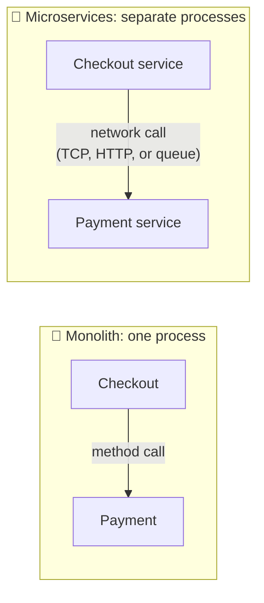
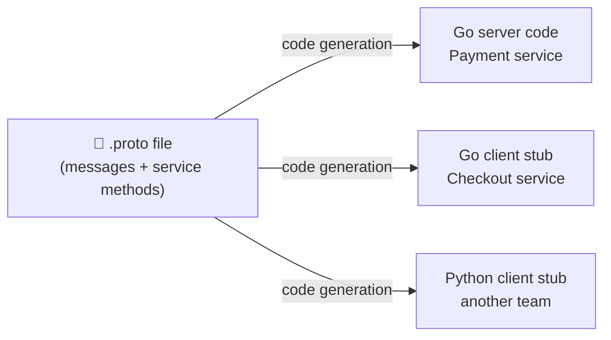
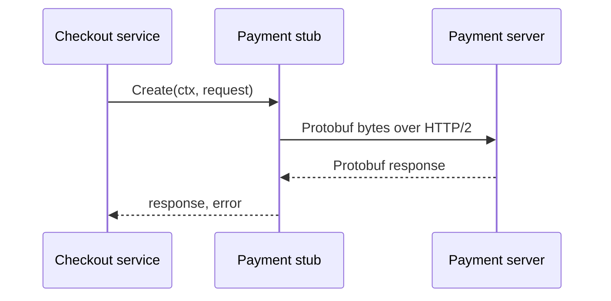
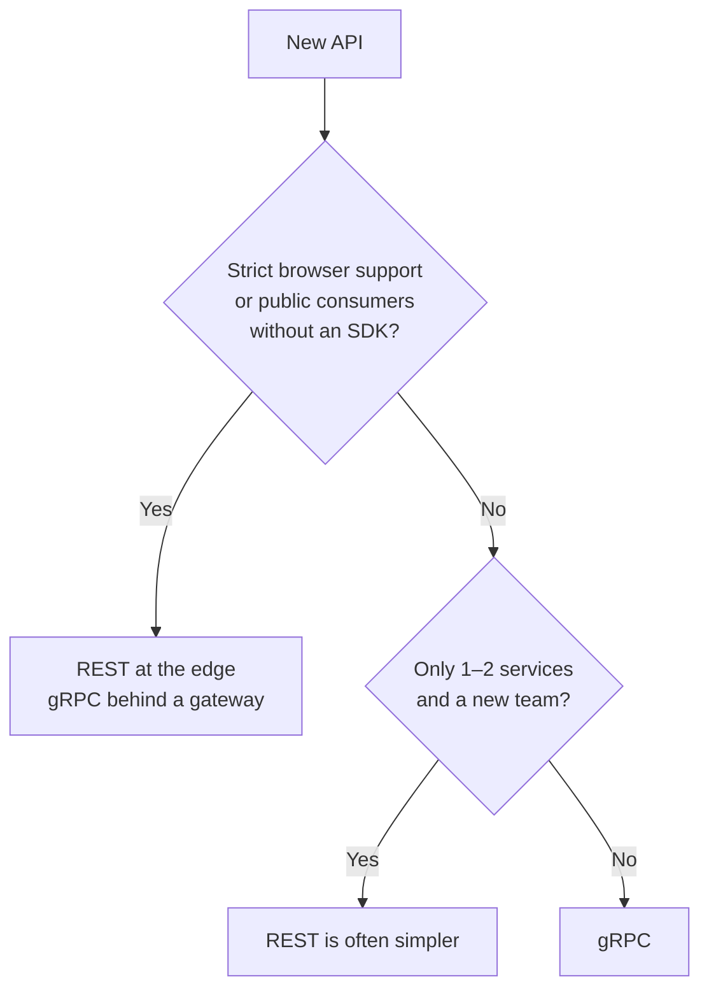
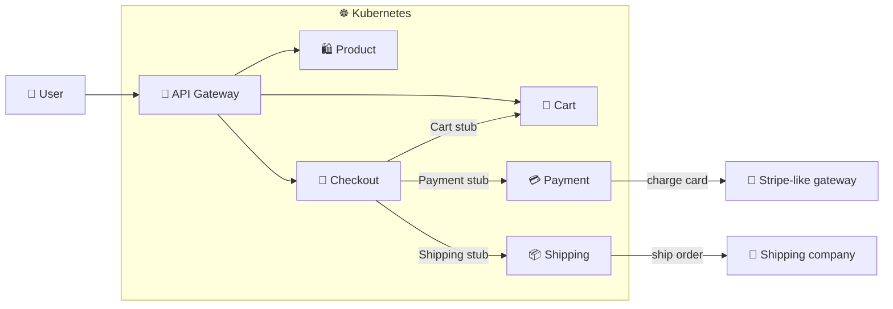
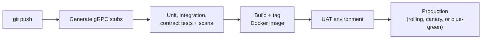

# 🚀 Introduction to Go gRPC Microservices

[[Go/gRPC Microservices in Go - Refactored/README|📚 gRPC Microservices in Go]] · Babal Ch.1

> [!toc]- 📑 Contents
>
> - [[#🧩 From Function Calls to Network Calls|🧩 From Function Calls to Network Calls]]
> - [[#🐹 Why Go for Microservices|🐹 Why Go for Microservices]]
> - [[#📡 What gRPC Is|📡 What gRPC Is]]
> - [[#⚡ Five Benefits of gRPC|⚡ Five Benefits of gRPC]]
> - [[#🔀 REST vs gRPC|🔀 REST vs gRPC]]
> - [[#🏗️ A Production-Grade System|🏗️ A Production-Grade System]]
> - [[#🔨 Hands-On Practice|🔨 Hands-On Practice]]
> - [[#📋 Quick Reference|📋 Quick Reference]]
> - [[#🧠 Things to Remember|🧠 Things to Remember]]
> - [[#💡 Pro Tips|💡 Pro Tips]]
> - [[#🔗 Related Topics|🔗 Related Topics]]

This chapter answers four questions: what changes when we split an application into services, why Go and gRPC suit that job, when REST is still the better choice, and what a production-grade system around those services looks like.

---

## 🧩 From Function Calls to Network Calls

A **microservice architecture** builds an application as loosely coupled, fine-grained services. Each service owns one **business capability**, such as payments or shipping, and can be developed, deployed, and scaled on its own.

In a monolith, Checkout charges a customer by calling a method on the Payment module. After the split, that same call travels over the network:

A method call either returns or throws. A network call can also **time out**, arrive twice, or succeed without the response ever coming back. That's why the book keeps repeating **design for failure**, and why it relies on gRPC features such as retries and TLS to handle much of that work.

Microservices are not automatically better. They trade one set of problems for another:

- ✅ **What we gain**

    - Independent deploys: ship a Payment fix without redeploying Checkout.

    - Independent scaling: add replicas only to the busy service.

    - Fault isolation: a crashing Shipping service doesn't take down product search.

- ⚠️ **What we pay** (Shuiskov)

    - More network traffic, latency, and total CPU/RAM.

    - Harder debugging: one failed request leaves logs in several services.

    - More integration testing, and no single database transaction across services.

> 💡 **When a monolith still wins**
>
> Shuiskov lists three cases: the product is still **loosely defined** and changing fast, the **scope is narrow** (a photo-upload service), or the system is **latency-sensitive**, like trading, where every extra network hop hurts.
>
> His rule: don't introduce microservices too early. Start with a monolith and split once business boundaries are clear. Chapter 2 covers monolith pain points in detail.

---

## 🐹 Why Go for Microservices

Go is well suited to cloud-native services running at scale in Kubernetes.

- ⚡ **Fast compilation and native binaries**

    - A Go service compiles to one executable with no JVM or interpreter, so containers stay small and simple.

- 🚀 **Low startup time**

    - Go services usually start in milliseconds, which helps when Kubernetes scales replicas up and down.

- ❗ **Explicit error handling**

    - Every `err` is handled in plain sight, which matches "design for failure" in a networked system.

- 🧵 **Easy concurrency**

    - Goroutines and channels make it simple to call several services at once and combine the results.

- ☸️ **Cloud-native ecosystem**

    - Docker and Kubernetes are written in Go, as are most CNCF projects, so the tooling and libraries are mature.

---

## 📡 What gRPC Is

**gRPC** is an open-source **remote procedure call (RPC)** framework that Google released in 2015. RPC means calling a function on another machine as if it were local. gRPC adds built-in support for load balancing, tracing, fault tolerance, and security.

Its main idea: describe messages and service methods **once**, in a language-neutral **IDL (Interface Definition Language)** file, then **generate** code from it for every language you need.

### 🔌 The Stub

A **stub** is a generated client-side object with the **same methods as the remote service**. The caller calls `Create(...)` on the stub; the stub serializes the request, sends it, and returns the decoded response.

The caller never touches HTTP or bytes, but the network is still there, so every stub call needs an error check. Chapter 2 writes the first `.proto` file and calls a real stub.

---

## ⚡ Five Benefits of gRPC

### 🚀 Performance

- 📦 **Protocol Buffers (Protobuf)** serialize messages into small, compact binary data on both sides.

    - Chapter 3 shows exactly how the encoding works.

- 📡 **HTTP/2** multiplexes many calls over one connection and compresses headers.

### 🌍 Code Generation and Interoperability

Without gRPC, Checkout needs request and response models for Payment. A **shared model library** looks convenient, but it couples the services and breaks down when they use different languages. The book quotes Sandi Metz: "A little duplication is far cheaper than wrong abstraction."

gRPC avoids both copying and sharing: define the messages once, then generate a client for each consumer's language, including Go, Java, Python, Ruby, JavaScript, and C#. The server and its clients don't need to use the same language.

### 🔁 Fault Tolerance

**Fault tolerance** is a system's ability to keep working despite failures. Its key ingredient is **idempotency**: an operation is idempotent if repeating it with the same parameters has no extra effect.

- ✅ **Delete user `42`** → retrying after a lost response is harmless; the user is already gone.

- ⚠️ **Charge a card** → a blind retry could charge twice.

    - If an operation can't be idempotent, it must return clear **validation errors** that tell the client when to stop retrying.

Once operations are idempotent or properly validated, retrying is just a gRPC **retry policy**. Chapter 6 adds retries, rate limiting, and circuit breakers.

### 🔐 Security

gRPC encourages **HTTP/2 over SSL/TLS** to authenticate and encrypt traffic between services. It also supports **ALTS** (Application Layer Transport Security) and token-based authentication. Chapter 6 sets up TLS.

### 🌊 Streaming

Instead of making a client page through a large result, a gRPC server can **stream** it in chunks over one open connection. Streaming works in three directions:

- ⬇️ **Server streaming** → one request, many responses.

- ⬆️ **Client streaming** → many requests, one response.

- 🔄 **Bidirectional streaming** → both sides stream at the same time.

The plain one-request, one-response call is a **unary RPC**. Chapter 2 shows how each type looks in a `.proto` file.

### 🧪 Interview Q&A

**Q1:** What is a gRPC stub?

**Q2:** Why does the book recommend generated stubs over a shared request/response library?

**Q3:** What makes an operation idempotent, and why does that matter for retries?

**Q4:** What should a non-idempotent operation do instead?

**Q5:** Which Go features help most when building microservices?

> [!answer]- 📋 Answers
>
> **A1:** A generated client-side object with the same methods as the remote service. Calling it sends the request over the network and returns the decoded response.
>
> **A2:** A shared library couples services and breaks across languages. Generated stubs give each consumer its own client, in its own language, from one contract.
>
> **A3:** Repeating it with the same parameters has no extra effect. Then a client can safely retry after a timeout without changing the resource twice.
>
> **A4:** Return clear validation errors so the client knows when to stop retrying.
>
> **A5:** Native binaries with fast startup, explicit error handling, simple concurrency, and a mature cloud-native ecosystem.

---

## 🔀 REST vs gRPC

| Aspect | gRPC | REST |
|---|---|---|
| **Format** | Binary Protobuf | Text JSON or XML |
| **Transport** | HTTP/2, built in | Usually HTTP/1.1 (HTTP/2 needs custom setup) |
| **Streaming** | Unary + three streaming types | Request-response |
| **Client code** | Generated stubs, built in | Needs a tool such as Swagger Codegen |
| **Changing messages** | Must follow compatibility rules | Fields can change freely without strict validation |
| **Browsers** | Minimal support; needs a proxy like gRPC-Web | Supported everywhere |

gRPC is strongest **between services**: low latency, strict contracts, and stubs for every language. REST is strongest **at the edge**, where browsers and outside developers need simple, readable APIs.

- 🌐 **Public access to gRPC services**

    - Put a gateway or gRPC load balancer in front for REST compatibility, or use **Twirp**, an RPC framework that also accepts JSON over HTTP.

    - If customers call gRPC directly, give them an SDK or share the `.proto` files with clear instructions.

- 🧪 **Contracts catch mistakes early**

    - When a service definition changes incompatibly, client tests fail, which verifies the contract between services.

> ⚠️ For a startup with one or two services, maintaining `.proto` files can cost more than gRPC saves, especially for an inexperienced team.

---

## 🏗️ A Production-Grade System

The book builds toward the e-commerce system in Figure 1.1: Go gRPC microservices running in Kubernetes, with CI/CD and observability around them.

- 🛍️ **Product** → searches, lists, and shows product details.

- 🛒 **Cart** → adds products to a virtual basket.

- 🧾 **Checkout** → orchestrates the purchase.

    - Gets basket items from Cart, calculates the price, charges through Payment, then ships through Shipping (which also provides the customer's address).

- 💳 **Payment** → charges customers through a payment gateway integration such as Stripe.

- 📦 **Shipping** → sends products to the customer through a shipping company.

Checkout adds the **generated stubs** of Cart, Payment, and Shipping as Go dependencies. gRPC provides connection pooling underneath, so each stub call reaches the right service.

Around these services sit five production concerns.

### 🧩 Splitting the Services

Two questions come up in every design meeting: *how micro should a service be?* and *what do we split by?* The book splits by **business capability**: product, cart, checkout, payment, and shipping.

Splitting also allows **polyglot** choices per service, such as MySQL for relational data, MongoDB for documents, or Neo4j for graphs. Small teams can then own a specific set of services.

> 💡 **Don't ship the org chart.** Shuiskov warns against one service per team when teams don't match business capabilities. Define the domains first, then assign owners.

### ☸️ Kubernetes as the Container Runtime

Each service runs in containers and scales **horizontally** with load. Kubernetes also solves addressing: a gRPC client needs a server address, and in Kubernetes the address is simply the **service name**. With good naming, no separate service-discovery product is needed.

Each service gets its own resources and scale factor. If customers mostly browse products during the day, only Product needs more replicas. The same container image also runs on AWS ECS, Fargate, or local Docker. Chapter 8 covers deployment.

### 🔄 CI/CD Pipeline

Automate everything that repeats: building artifacts, **generating stubs**, testing, quality checks, and deployment.

A green check alone isn't enough. Look for good unit-test coverage, integration tests against MySQL, Kubernetes, or AWS, **contract tests** between services, static analysis, and vulnerability checks. Monitoring then tells you when to roll back or ship a hotfix.

### 🔎 Monitoring and Observability

**Monitoring** lets a team watch the state of its systems; **observability** lets it debug them. Observability rests on three signals:

- 📈 **Metrics** → numbers such as latency or memory use.

    - Prometheus can alert when, for example, memory use exceeds 80% for one service.

- 📝 **Logs** → application events, used to spot rising error rates.

    - Tools like the Elastic Stack can alert on log patterns.

- 🧵 **Traces** → the life cycle of one request across services.

    - A middleware puts a **trace ID** in request and response headers, so one checkout can be followed through four or five services.

A successful response can still hide a problem: if one downstream call is slow, the customer still waits. Traces show which hop is slow. Chapter 9 covers observability.

### 🚪 Public Access

A product without throttling lets one user exhaust server resources. An **API gateway** handles this once for all services:

- 🔐 **Authentication and authorization**

- 🚦 **Rate limiting** → caps each user's request capacity.

- 🧭 **Clear resource naming** → readable API docs, plus optional SDKs for consumers.

In Kubernetes, the NGINX Ingress controller can provide auth and rate limiting; elsewhere, use an API gateway product.

### 🧪 Interview Q&A

**Q1:** In Figure 1.1, why does Checkout depend on three stubs?

**Q2:** How does a gRPC client find its server inside Kubernetes?

**Q3:** Why isn't a green CI check enough before deploying?

**Q4:** What is the difference between monitoring and observability?

**Q5:** What problem does an API gateway's rate limiting solve?

> [!answer]- 📋 Answers
>
> **A1:** Checkout orchestrates the purchase: it gets items from Cart, charges through Payment, and ships through Shipping, calling each through its generated stub.
>
> **A2:** It dials the Kubernetes service name, which acts as the server address, so no separate discovery tool is needed.
>
> **A3:** The pipeline must also prove the right checks ran: coverage, integration and contract tests, static analysis, and vulnerability scans.
>
> **A4:** Monitoring shows the system's state; observability helps debug it by combining metrics, logs, and traces.
>
> **A5:** Without throttling, one client can send unlimited requests and exhaust server resources for everyone.

---

## 🔨 Hands-On Practice

1. 🧩 **Split an app by business capability.**

   For a food-delivery app, list the services you'd create and mark each call between them as **gRPC** (internal) or **REST** (public).

   ✅ A reasonable answer: Restaurant, Menu, Order, Payment, Delivery services; the mobile app calls REST on the gateway; Order calls Payment and Delivery over gRPC.

2. 🔁 **Classify operations for retries.**

   Decide which are safe to retry blindly: `GetMenu`, `DeleteAddress(id)`, `ChargeCard`, `SetOrderStatus(id, DELIVERED)`, `AddItemToCart`.

   > [!answer]- ✅ Answer
   >
   > Safe: `GetMenu`, `DeleteAddress(id)`, `SetOrderStatus(id, DELIVERED)`; repeating them has no extra effect.
   >
   > Not safe: `ChargeCard` and `AddItemToCart`; each repeat adds another charge or item unless the server detects duplicates.

---

### 📋 Quick Reference

| Term | Meaning |
|---|---|
| **Microservice** | Independently deployable service that owns one business capability |
| **RPC** | Calling a function on another machine as if it were local |
| **IDL / `.proto`** | Language-neutral contract that defines messages and service methods |
| **Stub** | Generated client object with the remote service's methods |
| **Protobuf + HTTP/2** | Compact binary encoding + multiplexed transport |
| **Idempotent** | Repeating the operation has no extra effect |
| **Unary / streaming** | One request → one response, or a stream on one or both sides |
| **Observability signals** | Metrics, logs, traces |

### 🧠 Things to Remember

- Splitting a monolith turns method calls into network calls that can fail.

- Start with a monolith; split by business capability once boundaries are clear.

- gRPC generates stubs from one contract, so services can use different languages.

- Retry only idempotent operations; otherwise return clear validation errors.

- gRPC is for internal service-to-service calls; REST and gateways serve browsers and the public.

- Production also needs Kubernetes, CI/CD, observability, and an API gateway.

### 💡 Pro Tips

- **Generate stubs in CI, not by hand** → every consumer gets the same, up-to-date client.

- **Design idempotency into write RPCs early** → retries become a configuration change instead of a redesign.

- **Name Kubernetes services consistently** → the service name doubles as the gRPC address.

- **Add trace IDs from day one** → debugging a slow request across five services is otherwise guesswork.

### 🔗 Related Topics

- ➡️ Next: [[2. gRPC Meets Microservices]]

- 📖 Original study guide: [[Go/gRPC Microservices in Go/1. Introduction to Go gRPC microservices - Study Guide]]

- 🧵 Go concurrency: [[Go/Concurrency in Go/README]]

- 🌐 REST in Go: [[Go/HTTP/1.HTTP NET]]

- 🐳 Containers: [[DevOps/NaNa/Docker/1. Container]]
