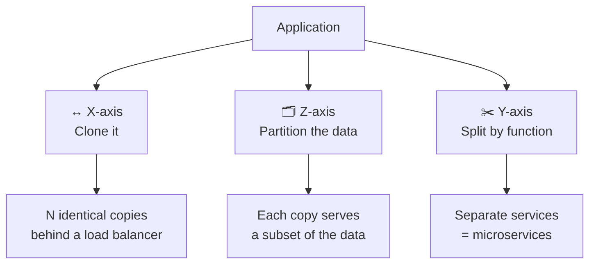
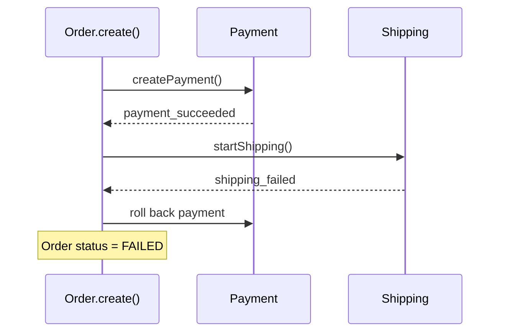
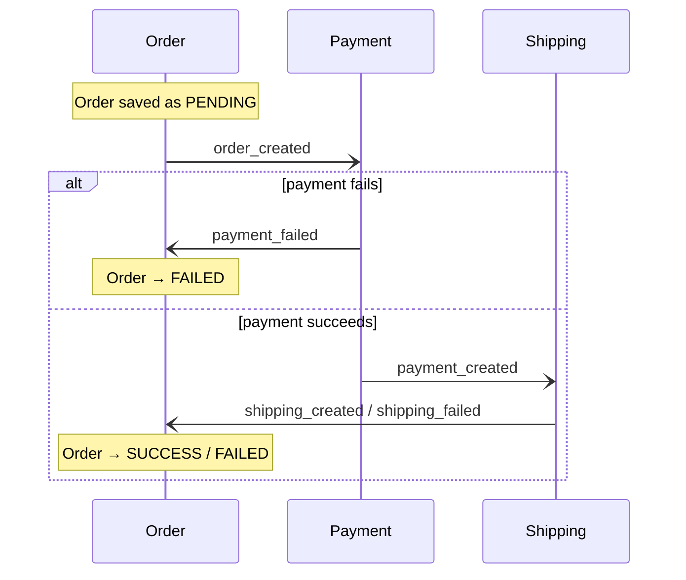
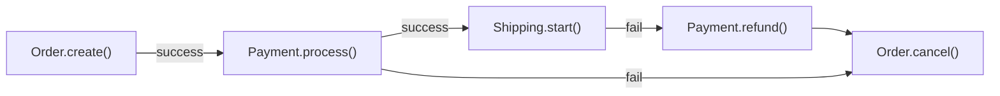
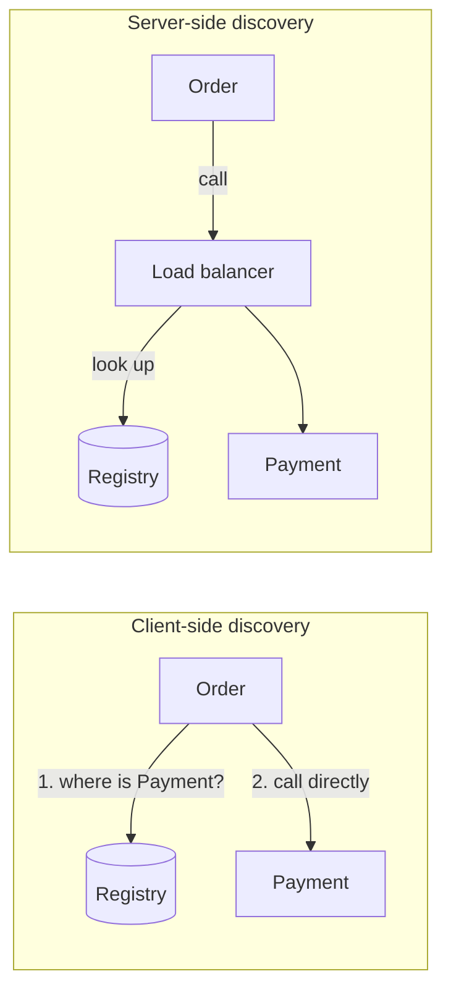
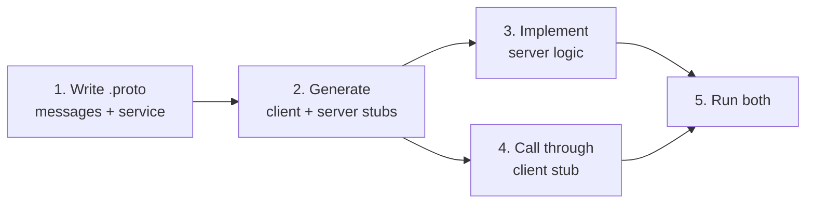

# 🧭 gRPC Meets Microservices

[[Go/gRPC Microservices in Go - Refactored/README|📚 gRPC Microservices in Go]] · Babal Ch.2

> [!toc]- 📑 Contents
>
> - [[#🏢 Monolithic Architecture|🏢 Monolithic Architecture]]
> - [[#🧊 The Scale Cube|🧊 The Scale Cube]]
> - [[#🧩 Microservice Architecture|🧩 Microservice Architecture]]
> - [[#🔄 Data Consistency and Sagas|🔄 Data Consistency and Sagas]]
> - [[#🧭 Service Discovery|🧭 Service Discovery]]
> - [[#📡 Using gRPC Between Services|📡 Using gRPC Between Services]]
> - [[#🔨 Hands-On Practice|🔨 Hands-On Practice]]
> - [[#📋 Quick Reference|📋 Quick Reference]]
> - [[#🧠 Things to Remember|🧠 Things to Remember]]
> - [[#💡 Pro Tips|💡 Pro Tips]]
> - [[#🔗 Related Topics|🔗 Related Topics]]

This chapter explains when a monolith stops scaling, what microservices cost in data consistency and discovery, and the minimum steps to make two services talk through gRPC.

---

## 🏢 Monolithic Architecture

A **monolith** combines all of an application's components (user interface, server logic, and database access) into one deployable unit: a JAR or WAR file in Java, or a single binary in Go.

A monolith is the right start for a new product. You learn the business domain without fighting distributed-system problems. The book's advice is to **reassess periodically** whether it's time to split.

As the codebase grows, three kinds of pain appear:

- 💻 **Development**

    - The IDE slows down under many modules.

    - Without isolated tests, a small change reruns the whole test suite, and compile and test times keep growing.

- 🚀 **Deployment**

    - A small change to the newsletter component still means testing, building, and deploying the entire application.

    - When several teams share it, one team's flaky test or broken feature can block everyone's release.

- 📈 **Scaling**

    - Copies behind a load balancer are exact duplicates, even when only one module is busy.

    - The tech stack is a long-term commitment, because all layers are tightly coupled in-process calls.

Shuiskov adds two more: a **higher blast radius**, where one bug in a widely used library hits the whole system, and **interference**, where a CPU-heavy module slows everything else.

### 🧮 The Cost of Scaling Everything

Suppose a monolith needs **16 GB** of memory, and only its customer module (which needs **2 GB**) is under load. We want two copies of that module.

```text
Scale the monolith ×2:
  2 × 16 GB = 32 GB   → 16 GB extra

Scale only the customer module ×2:
  16 GB + 2 GB = 18 GB → 2 GB extra
```

Scaling only the busy part costs 2 GB instead of 16 GB. That's the core economic argument for splitting.

---

## 🧊 The Scale Cube

The **scale cube** describes three ways to scale an application:



| Axis | How it works | Trade-off |
|---|---|---|
| **X: horizontal duplication** | Run N copies; each handles about 1/N of the load. In Kubernetes, a Service spreads requests across Pods. | Every copy holds all the code and data access, so memory use is high and the codebase stays complex. |
| **Z: data partitioning** | Copies are identical, but each serves part of the data, such as customers A–M and N–Z. | Saves cost and limits an outage to some users, but adds complexity and makes repartitioning hard. |
| **Y: functional decomposition** | Split the application by feature into services. | This is microservice architecture, with its own challenges. |

---

## 🧩 Microservice Architecture

Microservice architecture is **Y-axis scaling**. Its services are:

- 🔗 **Loosely coupled** → easy to maintain and test.

- 🚀 **Independently deployable and scalable.**

- 🎯 **Focused on business capabilities.**

- 👥 **Owned by dedicated teams.**

- 🔄 **Free of long-term stack commitments** → each service can pick its own technology.

- 🛡️ **Fault-isolated** → if one fails, the others keep working.

Start with a monolith to learn the business. Reassess when you hit scaling problems, slow development, or long release cycles. After splitting, you get smaller projects, faster test runs, and smaller release artifacts, but two new problems: **data consistency** and **interservice communication**.

---

## 🔄 Data Consistency and Sagas

### 🏢 Transactions in a Monolith

In a monolith, a **transaction** keeps data consistent: begin, run the business logic, then **commit** on success or **roll back** on failure.



One database and one transaction make this easy.

### 🧩 Why Microservices Need Something Else

After the split, **each service has its own data store**, so a single transaction can't cover Order, Payment, and Shipping. There are two options:

- 🔒 **Two-phase commit (2PC)** → a coordinator decides whether all participants commit or abort together.

- 🔗 **Saga** → a sequence of **local transactions**. Each service commits its own step, then triggers the next.

Sagas come in two styles.

### 💃 Choreography-Based Saga

Each service runs its local transaction and **publishes an event** that triggers the next service. Nobody is in charge.



The client learns the result in one of three ways:

- 📬 The service returns the result once the saga completes.

- 🔁 The client **polls** using an ID returned when the saga starts.

- 🔌 The service pushes the result over a **WebSocket**.

Events travel through a queue in one of two ways:

- 📨 **Command channel** → the publisher sends directly to the next service, with a `reply_to` channel for the answer.

    - Downside: the publisher must know where the next service is.

- 📢 **Pub/sub** → the publisher emits a domain event, and any interested service consumes it.

    - Downside: the shared broker becomes a possible single point of failure.

A command message carries a **correlation ID** so the whole series of events can be traced:

```json
{
  "data": { "customer_id": 435, "product_id": 123 },
  "reply_to": "order_events",
  "correlation_id": "12-423-233"
}
```

Payment answers on `order_events` with the same `correlation_id` and the new `bill_id`.

### 🎼 Orchestrator-Based Saga

An **orchestrator** tells each participant what to do and decides the next step from its response. If a step fails, it runs **compensating transactions** in reverse order.



If Shipping fails, the saga refunds the payment and cancels the order: compensation runs from the bottom up.

| | Choreography | Orchestration |
|---|---|---|
| **Who decides the next step?** | Each service, by reacting to events | The orchestrator |
| **Communication** | Events (asynchronous) | Commands or request/response |
| **Flow visibility** | Spread across services | In one place |

This book uses an **orchestrator with request/response calls**: Order calls Payment directly over gRPC. That means each service must know where the others are.

### 🧪 Interview Q&A

**Q1:** Why does scaling a monolith waste resources?

**Q2:** Which scale-cube axis do microservices represent?

**Q3:** Why can't a single database transaction keep data consistent across microservices?

**Q4:** What is a compensating transaction? Give an example.

**Q5:** What's the trade-off between a command channel and pub/sub?

> [!answer]- 📋 Answers
>
> **A1:** Every copy contains all modules, even when only one is busy. Scaling a 16 GB monolith ×2 adds 16 GB; scaling only the 2 GB busy module adds 2 GB.
>
> **A2:** The Y-axis: splitting the application by function.
>
> **A3:** Each service owns its own data store, so no single transaction spans them. A saga or 2PC is needed instead.
>
> **A4:** An action that undoes a completed step when a later step fails, such as `Payment.refund()` after `Shipping.start()` fails.
>
> **A5:** A command channel requires the publisher to know the next service's location. Pub/sub decouples them but makes the broker a single point of failure.

---

## 🧭 Service Discovery

**Service discovery** keeps track of where each service runs so callers can find it. Hard-coded addresses break as soon as instances are added, removed, or fail.

It's built on a **service registry**: services register on startup, deregister on shutdown, and the registry returns the current addresses for a service name.



- 🔎 **Client-side discovery** → the caller queries the registry by service name and calls an instance itself.

    - The caller also has to balance load across instances, which adds logic to every client.

- ⚖️ **Server-side discovery** → the caller talks to a load balancer, which queries the registry.

    - Clients stay simple, but you must run the load balancer.

To keep its list accurate, the registry uses **health checks** (Shuiskov): either it **pulls** by pinging each instance, or each instance **pushes** a regular "I'm alive" signal. HashiCorp Consul is a popular registry.

**Kubernetes has discovery built in**: any service is reachable by its name, such as `payment`. The book relies on this, and Chapter 8 covers it.

---

## 📡 Using gRPC Between Services

gRPC connects services with built-in load balancing, tracing, health checking, and authentication. The minimum workflow has five steps:



### 📜 1. Define the Contract

The Payment service exposes a `Create` method that takes a `CreatePaymentRequest` and returns a `CreatePaymentResponse` with the new bill's ID, which Order stores on its own entity:

```protobuf
// payment.proto
syntax = "proto3";

option go_package = "github.com/huseyinbabal/grpc-microservices-in-go/listing_2.1/payment";

message CreatePaymentRequest {
  float price = 1;
}

message CreatePaymentResponse {
  int64 bill_id = 1;
}

service Payment {
  rpc Create(CreatePaymentRequest) returns (CreatePaymentResponse) {}
}
```

- 📦 **`message`** → request and response shapes; they become Go structs.

- 📡 **`service`** → the remote methods; they become a client stub and a server interface.

- 📁 **`go_package`** → the import path of the generated Go package.

### ⚙️ 2. Generate the Go Code

```bash
protoc \
  --go_out=. --go_opt=paths=source_relative \
  --go-grpc_out=. --go-grpc_opt=paths=source_relative \
  payment.proto
```

- **`--go_out`** → message structs and their marshalling code (`payment.pb.go`).

- **`--go-grpc_out`** → the client stub and server interface (`payment_grpc.pb.go`).

- **`paths=source_relative`** → writes output next to the `.proto` file.

**Marshalling** means converting a Go struct into a byte array for the wire. Chapter 3 covers the compiler and its flags in depth.

### 🌊 Streaming Variants

Add `stream` to the side that sends many messages:

```protobuf
service Payment {
  // unary (above): one request, one response

  // server streaming: server returns data part by part
  rpc CreateStream(CreatePaymentRequest) returns (stream CreatePaymentResponse) {}

  // client streaming: many payment requests, one summary response
  rpc CreateBatch(stream CreatePaymentRequest) returns (CreatePaymentResponse) {}

  // bidirectional: both sides stream
  rpc CreateLive(stream CreatePaymentRequest) returns (stream CreatePaymentResponse) {}
}
```

- ⬇️ **Server streaming** suits bulk data. When it has sent everything, the server sends status metadata telling the client the stream is finished.

- 🔄 **Bidirectional streaming** runs asynchronously, so include a unique ID in each message to tell which operation failed.

Chapter 5 implements these in the real project.

### 🔌 3–4. Connect Order to Payment

To call Payment from Order:

1. 📦 **Import Payment's generated client** into Order as a dependency.

2. 📡 **Create a connection** to Payment's address, found through service discovery.

3. 🔌 **Create a Payment client** from that connection.

4. 💻 **Call `Create`** on the client.

```go
// order service
conn, err := grpc.Dial(*serverAddr, opts...)
if err != nil {
    // handle connection error
}
defer conn.Close()

payment := pb.NewPaymentClient(conn)
result, err := payment.Create(ctx, &pb.CreatePaymentRequest{Price: 32})
if err != nil {
    // handle Payment create error
}
```

> 🆕 **Current grpc-go:** `grpc.Dial` is deprecated. Use `grpc.NewClient(addr, grpc.WithTransportCredentials(insecure.NewCredentials()))` locally, and TLS credentials in production.

- 🔌 **`pb.NewPaymentClient`** → generated with the naming pattern `New<ServiceName>Client`.

- 🧹 **`defer conn.Close()`** → closes the connection when the function returns.

- ⏱️ **`ctx`** → the compiler adds a `context.Context` parameter to every RPC, even though the `.proto` file doesn't mention it.

### ⏱️ Add a Timeout

A call without a deadline can hang. An order stuck in `PENDING` for hours is a sign of a broken communication pattern. Give each call a time limit:

```go
ctx, cancel := context.WithTimeout(context.Background(), 10*time.Second)
defer cancel()

result, err := payment.Create(ctx, &pb.CreatePaymentRequest{Price: 32})
if err != nil {
    // fails if there is no result within 10 seconds
}
```

- ⏱️ **`context.WithTimeout`** → cancels the call after 10 seconds.

- 🧹 **`defer cancel()`** → releases the context's resources when the function exits.

Timeouts and retries keep data consistent between services. Chapter 6 builds them properly.

### 🔀 Synchronous vs Asynchronous

| Style | Examples | The caller… |
|---|---|---|
| **Synchronous** | gRPC request/response | Waits for the answer |
| **Asynchronous** | Pub/sub, command channels | Continues; the answer arrives later as an event |

### 🧪 Interview Q&A

**Q1:** What are the five steps to make two services communicate with gRPC?

**Q2:** Where does the `ctx` parameter on a generated RPC method come from?

**Q3:** Why should every stub call have a timeout?

**Q4:** What's the difference between client-side and server-side discovery?

**Q5:** How does Kubernetes simplify service discovery?

> [!answer]- 📋 Answers
>
> **A1:** Define the `.proto` file, generate stubs, implement the server, call through the client stub, then run both.
>
> **A2:** The Protobuf compiler adds a `context.Context` parameter to every RPC so callers can pass deadlines and cancellation.
>
> **A3:** Without one, a hung call can block forever and leave data in an inconsistent state, like an order stuck in `PENDING`.
>
> **A4:** In client-side discovery, the caller queries the registry and picks an instance. In server-side discovery, a load balancer queries the registry for it.
>
> **A5:** Every service is reachable by its name through cluster DNS, so no separate registry is needed.

---

## 🔨 Hands-On Practice

1. 📜 **Generate the Payment stub.**

   Save the `payment.proto` file above in an empty Go module, install the tools from [[3. Getting Up and Running with gRPC and Golang]], then run the `protoc` command.

   ✅ `payment.pb.go` contains `CreatePaymentRequest`, and `payment_grpc.pb.go` contains `PaymentClient`, `NewPaymentClient`, and `PaymentServer`.

2. 🌊 **Read a streaming signature.**

   Add the `CreateStream` RPC, regenerate, and find its method in `PaymentClient`.

   ✅ Instead of returning `*CreatePaymentResponse`, it returns a stream object with a `Recv()` method for reading responses one by one.

3. 🎼 **Design compensations.**

   An orchestrated saga runs `Order.create()` → `Payment.process()` → `Inventory.reserve()` → `Shipping.start()`. List the compensations if `Shipping.start()` fails.

   ✅ In reverse order: `Inventory.release()`, `Payment.refund()`, `Order.cancel()`.

---

### 📋 Quick Reference

| Concept | Key idea |
|---|---|
| **Scale cube** | X = clone, Z = partition data, Y = split by function |
| **Saga** | Sequence of local transactions with compensations |
| **Choreography** | Services react to each other's events |
| **Orchestration** | One orchestrator directs each step |
| **Client-side discovery** | Caller asks the registry |
| **Server-side discovery** | Load balancer asks the registry |
| **`New<Service>Client`** | Generated constructor for a client stub |

```go
ctx, cancel := context.WithTimeout(context.Background(), 10*time.Second)
defer cancel()
client := pb.NewPaymentClient(conn)
resp, err := client.Create(ctx, req)
```

### 🧠 Things to Remember

- Start with a monolith; split when scaling, development, or release pain appears.

- Microservices are Y-axis scaling and bring data consistency and communication problems.

- Each service owns its data, so cross-service consistency needs a saga or 2PC.

- Compensating transactions run in reverse order when a saga step fails.

- The book uses an orchestrator calling services over gRPC, with Kubernetes for discovery.

- Every RPC gets a `ctx`; always give it a timeout.

### 💡 Pro Tips

- **Put a correlation ID on every saga message** → the whole flow can be traced across services.

- **Make compensations idempotent** → a refund retried after a timeout must not refund twice.

- **Create one client connection per target service and reuse it** → connecting on every call wastes time.

- **Prefer Kubernetes service names over a separate registry** when the cluster is your only runtime → one less system to operate.

### 🔗 Related Topics

- ⬅️ Previous: [[1. Introduction to Go gRPC Microservices]]

- ➡️ Next: [[3. Getting Up and Running with gRPC and Golang]]

- 📖 Original study guide: [[Go/gRPC Microservices in Go/2. gRPC meets microservices - Study Guide]]

- 📬 Choreography with Kafka events in this project: [[Brokers/Kafka/Kafka The Definitive Guide/17. Event-Driven Order, Payment, and Shipping|Kafka lesson 17]]

- 🛠️ Code generation: [[Go/gRPC/1.Generate command]]

- 🧵 Cancellation in Go: [[Go/Concurrency in Go/04 - Chapter Four/3.Preventing Goroutine Leaks]]
