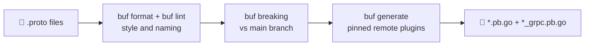
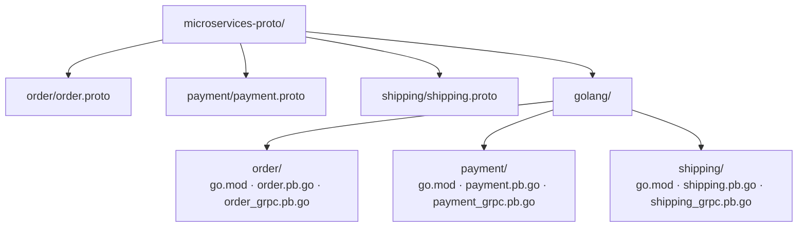
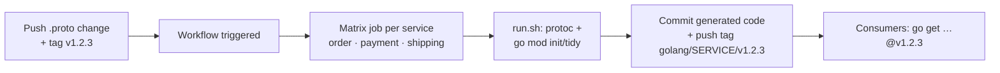

# 📜 Getting Up and Running with gRPC and Golang

[[Go/gRPC Microservices in Go - Refactored/README|📚 gRPC Microservices in Go]] · Babal Ch.3

> [!toc]- 📑 Contents
>
> - [[#📜 Defining a Message|📜 Defining a Message]]
> - [[#🔢 Field Numbers and reserved|🔢 Field Numbers and reserved]]
> - [[#⚙️ How Protobuf Encodes Data|⚙️ How Protobuf Encodes Data]]
> - [[#🛠️ Generating Go Stubs|🛠️ Generating Go Stubs]]
> - [[#🧰 Generating Stubs with Buf|🧰 Generating Stubs with Buf]]
> - [[#📦 A Separate Repository for .proto Files|📦 A Separate Repository for .proto Files]]
> - [[#🤖 Automating Generation with GitHub Actions|🤖 Automating Generation with GitHub Actions]]
> - [[#🔁 Backward and Forward Compatibility|🔁 Backward and Forward Compatibility]]
> - [[#🔨 Hands-On Practice|🔨 Hands-On Practice]]
> - [[#📋 Quick Reference|📋 Quick Reference]]
> - [[#🧠 Things to Remember|🧠 Things to Remember]]
> - [[#💡 Pro Tips|💡 Pro Tips]]
> - [[#🔗 Related Topics|🔗 Related Topics]]

If gRPC is the telephone line between two services, **Protocol Buffers** is the language they speak. This chapter covers writing messages, how they become bytes, generating Go code, sharing `.proto` files through a dedicated repository, and changing messages without breaking clients.

---

## 📜 Defining a Message

**Protocol Buffers (Protobuf)** serializes structured data for the wire, and also describes service functions for code generation. Both live in a `.proto` file. This book uses **proto3**, which simplifies proto2's syntax; proto1 is deprecated.

An order request has an owner, a list of items, and a total amount:

```protobuf
syntax = "proto3";

message CreateOrderRequest {
  int64 user_id = 1;        // owner of this order
  repeated Item items = 2;  // items in this order
  float amount = 3;         // total amount to pay
}

message Item {
  string name = 1;
}
```

Every field has four parts:

- 📏 **Rule**

    - **Singular** (the default) → at most one value.

    - **`repeated`** → zero or more values, in order, such as several items in one order.

- 🏷️ **Type** → a scalar (`int64`, `string`, `float`, …), an enum, or another message such as `Item`.

- ✏️ **Name** → lowercase `snake_case`, such as `user_id`. The compiler turns it into `UserId` in Go.

- 🔢 **Number** → the field's unique ID in the binary format.

> 💡 **No required fields in proto3.** Shuiskov explains why: a required field can never be removed safely, because old clients would reject messages without it. Every field is optional, so document validation rules in comments instead.

---

## 🔢 Field Numbers and reserved

Binary messages carry **field numbers, not names**. That's why a field's number must never change once it's in use.

To remove a field, **reserve** its number and name so nobody reuses them by accident:

```protobuf
message CreateOrderRequest {
  reserved 3;
  reserved "customer_id";

  int64 user_id = 1;
  repeated Item items = 2;
  float amount = 4;
}
```

- 🚫 **`reserved 3;`** → number 3 can never be reused. Ranges work too: `reserved 9 to 11;`.

- 🚫 **`reserved "customer_id";`** → the old name can't come back.

> ⚠️ **Why it matters:** suppose `customer_id = 3` is removed and a new field reuses number 3 with a different type. A client still on the old definition sends `customer_id`, and the server decodes those bytes as the new field: wrong data with no error.

Field numbers also affect size:

| Field number | Tag size |
|---|---|
| **1–15** | 1 byte |
| **16–2047** | 2 bytes |

Keep some numbers between 1 and 15 free for fields that will appear in almost every message, such as a future `correlation_id`.

---

## ⚙️ How Protobuf Encodes Data

Each field becomes a **tag** followed by its **value**.

- 🏷️ **Tag** = `(field_number << 3) | wire_type`

    - The low 3 bits are the **wire type**: `0` means **varint**, used for integers.

    - The rest is the field number.

- 🔢 **Varint value** → the integer split into 7-bit groups, **least significant group first**.

    - Each byte's top bit (the **MSB**, or continuation bit) is `1` if another byte follows, and `0` on the last byte.

### 🧮 Example 1: `user_id = 65` (field 1)

```go
request := &order.CreateOrderRequest{UserId: 65}
```

```text
Tag:   (1 << 3) | 0 = 8         → 00001000 → 0x08
Value: 65 fits in 7 bits        → 0 1000001 → 0x41
                                   ↑ MSB 0: last byte

Bytes: 08 41   (2 bytes total)
```

### 🧮 Example 2: `user_id = 21567` (field 2)

Values above 127 need more than one byte:

```text
Tag:   (2 << 3) | 0 = 16        → 00010000 → 0x10

21567 in binary  = 101010000111111
7-bit groups     = 0000001 | 0101000 | 0111111
Lowest first     = 0111111 , 0101000 , 0000001

Add MSB:  1 0111111 → 0xBF   (more follows)
          1 0101000 → 0xA8   (more follows)
          0 0000001 → 0x01   (last byte)

Bytes: 10 BF A8 01   (4 bytes total)
```

- 📏 **The field name is never sent**, only the number and type.

- 📦 **Small numbers use fewer bytes**, so a typical message is far smaller than its JSON form.

### 📊 How Much Smaller and Faster?

Shuiskov serialized the same four-field record in three formats:

| Format | Size | Encode time |
|---|---|---|
| **XML** | 148 B | 2,519 ns/op |
| **JSON** | 106 B | 342 ns/op |
| **Protobuf** | 63 B | 186 ns/op |

Protobuf was about 40% smaller than JSON and roughly twice as fast to encode. The times come from his machine and are only illustrative; the ratios are what matter.

---

## 🛠️ Generating Go Stubs

A **gRPC stub** is the generated module that acts as the client's interface to a service. The Protobuf compiler, **`protoc`**, writes it for the target language, along with the server-side interfaces.

### 💻 Install the Compiler and Go Plugins

Install `protoc` from [grpc.io](https://grpc.io/docs/protoc-installation/), then the two Go plugins:

```bash
go install google.golang.org/protobuf/cmd/protoc-gen-go@latest
go install google.golang.org/grpc/cmd/protoc-gen-go-grpc@latest
```

- **`protoc-gen-go`** → generates message structs.

- **`protoc-gen-go-grpc`** → generates the client stub and server interface.

### ⚙️ Generate the Order Stubs

```protobuf
// proto/order.proto
syntax = "proto3";

option go_package = "github.com/huseyinbabal/microservices/order";

message CreateOrderRequest {
  int64 user_id = 1;
  repeated Item items = 2;
  float total_price = 3;
}

message Item {
  string name = 1;
}

message CreateOrderResponse {
  int64 order_id = 1;
}

service Order {
  rpc Create(CreateOrderRequest) returns (CreateOrderResponse) {}
}
```

```bash
protoc -I ./proto \
  --go_out ./golang --go_opt paths=source_relative \
  --go-grpc_out ./golang --go-grpc_opt paths=source_relative \
  ./proto/order.proto
```

| Flag | Purpose |
|---|---|
| **`-I ./proto`** | Where to look for imported `.proto` files |
| **`--go_out ./golang`** | Output folder for message code |
| **`--go-grpc_out ./golang`** | Output folder for gRPC client/server code |
| **`--go_opt` / `--go-grpc_opt paths=source_relative`** | Keep the input folder structure instead of building folders from `go_package` |

The result is two files:

- 📄 **`golang/order.pb.go`** → `CreateOrderRequest`, `Item`, `CreateOrderResponse`, and their marshalling code.

- 📄 **`golang/order_grpc.pb.go`** → the `OrderClient` interface, `NewOrderClient(...)`, and the server-side `OrderServer` interface.

The names follow the service name: `<Service>Client` and `New<Service>Client`. Using the client takes one line, and connection handling and serialization come built in:

```go
client := order.NewOrderClient(conn)
resp, err := client.Create(ctx, &order.CreateOrderRequest{UserId: 123})
```

---

## 🧰 Generating Stubs with Buf

**[Buf](https://buf.build/)** replaces long `protoc` commands with two small config files, and adds what `protoc` lacks: a **linter**, a **formatter**, a **breaking-change checker**, and a **gRPC client** (`buf curl`). The generated Go code is the same.



### 💻 Run Buf

Buf is a single Go binary. Pin its version so every machine and CI run behaves the same:

```bash
go install github.com/bufbuild/buf/cmd/buf@v1.75.0
# or run it without installing:
go run github.com/bufbuild/buf/cmd/buf@v1.75.0 --version
```

### 📄 `buf.yaml`: the Module and Its Rules

```yaml
# proto/buf.yaml
version: v2
modules:
  - path: .
    excludes:
      - gen
lint:
  use:
    - STANDARD # versioned packages, *Service names, <Method>Request/Response
    - COMMENTS # every service, RPC, message, and field has a doc comment
breaking:
  use:
    - FILE     # no removed fields, reused numbers, or changed types
```

- 📁 **`modules`** — where the `.proto` files live. `excludes` skips the generated folder.

- 🧹 **`lint`** — which rule sets `buf lint` enforces.

- 🛡️ **`breaking`** — which changes `buf breaking` rejects.

### 📄 `buf.gen.yaml`: How Code Is Generated

```yaml
# proto/buf.gen.yaml
version: v2
clean: true
managed:
  enabled: true
  override:
    - file_option: go_package_prefix
      value: github.com/huseyinbabal/microservices-proto/gen/go
plugins:
  - remote: buf.build/protocolbuffers/go:v1.36.12
    out: gen/go
    opt: paths=source_relative
  - remote: buf.build/grpc/go:v1.6.2
    out: gen/go
    opt: paths=source_relative
inputs:
  - directory: .
```

- 🌐 **`remote` plugins** — `protoc-gen-go` and `protoc-gen-go-grpc` run on the Buf Schema Registry at the pinned versions, so you don't install `protoc` or any plugins.

- 🧭 **Managed mode** — Buf sets `go_package` for each file from the prefix plus the file's folder (`…/gen/go/order/v1`). The `.proto` files stay free of Go-only options.

- 🧹 **`clean: true`** — deletes old output first, so a removed message doesn't leave a stale file.

- ↔️ **`paths=source_relative`** — the same flag as in the `protoc` command above.

```bash
cd proto
buf format -w   # rewrite files in the standard style
buf lint        # check naming, packages, comments
buf generate    # write gen/go/order/v1/order.pb.go and order_grpc.pb.go
```

✅ The output matches the `protoc` command, without the flags.

### 🏷️ What `buf lint` Changes in the Book's Contract

The `STANDARD` rules reject the book's names. A lint-clean version of the Order contract looks like this:

```protobuf
// proto/order/v1/order.proto
syntax = "proto3";

package order.v1;

// OrderService places orders and reads them back.
service OrderService {
  // Create saves a new order and charges the customer.
  rpc Create(CreateRequest) returns (CreateResponse);
}

// CreateRequest is the input of OrderService.Create.
message CreateRequest {
  // user_id is the customer placing the order.
  int64 user_id = 1;
  // order_items lists the products in the order.
  repeated OrderItem order_items = 2;
}
// ... CreateResponse, OrderItem
```

| Book | Buf `STANDARD` | Rule |
|---|---|---|
| No `package` | `package order.v1;` in `order/v1/` | Every file has a **versioned** package matching its folder |
| `service Order` | `service OrderService` | Service names end in `Service` |
| `CreateOrderRequest` | `CreateRequest` | Request/response are `<Method>Request` / `<Method>Response` |
| `order.NewOrderClient` | `orderv1.NewOrderServiceClient` | Go package name comes from the versioned path |
| `grpcurl … Order/Create` | `grpcurl … order.v1.OrderService/Create` | The full method name includes the package |

The **`v1`** suffix is what makes evolution safe: an incompatible API becomes `order.v2` next to `order.v1`, so old clients keep working.

### 🛡️ `buf breaking`: Catch Incompatible Changes

The compatibility rules later in this chapter are easy to break by accident. `buf breaking` compares your `.proto` files with a previous version and fails on any change that would break existing clients.

Change `total_price` in `payment.proto` from `float` to `string`, then run:

```bash
buf breaking --against '.git#branch=main,subdir=proto'
```

```text
payment/v1/payment.proto:18:3:Field "3" with name "total_price" on message "CreateRequest" changed type from "float" to "string".
```

The command exits with a non-zero code, so CI fails before the change ships.

- 🔍 **`--against`** — what to compare with: a Git branch, a tag, or a Buf registry module.

- 🧱 **`subdir=proto`** — the folder in that Git ref that contains `buf.yaml`.

### 📡 `buf curl`: Call a gRPC Service

`buf curl` is Buf's gRPC client, an alternative to `grpcurl`. It uses server reflection or the local `.proto` files:

```bash
buf curl --protocol grpc --http2-prior-knowledge \
  --data '{"user_id": 23, "order_items": [{"product_code": "CAM123", "unit_price": 12.5, "quantity": 2}]}' \
  http://localhost:8080/order.v1.OrderService/Create
```

- **`--protocol grpc`** — speak gRPC (Buf also supports Connect and gRPC-Web).

- **`--http2-prior-knowledge`** — use HTTP/2 over plaintext, as a local gRPC server expects.

---

## 📦 A Separate Repository for .proto Files

Generated code inside one service's repo works until **other projects**, possibly in other languages, need the same stubs. Then keep `.proto` files in a **dedicated repository**, so Java stubs aren't shipped and tagged with Go production code. In a monorepo, keeping them together is still easier.

The book's repository, `github.com/huseyinbabal/microservices-proto`, is organized like this:



- 📁 **One folder per service** for `.proto` files.

- 🌍 **One folder per language** for generated code (`golang/`, and later others).

- 📦 **Each generated service is its own Go module**, such as `github.com/huseyinbabal/microservices-proto/golang/order`.

### 🏷️ Version with Tags

Go resolves a module in a subfolder through tags shaped like `<subfolder>/<version>`:

```bash
git tag -a golang/order/v1.2.3 -m "golang/order/v1.2.3"
git tag -a golang/payment/v1.2.8 -m "golang/payment/v1.2.8"
git push --tags
```

Consumers then depend on an exact version:

```bash
go get github.com/huseyinbabal/microservices-proto/golang/order@v1.2.3
```

`@latest` keeps you current, but a new tag may contain breaking changes. A fixed version is safer. Chapter 5 returns to module versioning.

---

## 🤖 Automating Generation with GitHub Actions

Generating and tagging by hand gets painful as services multiply. **GitHub Actions** runs it automatically whenever a version tag is pushed:



The generator script handles one service:

```bash
#!/bin/bash
# run.sh <service> <version>
SERVICE_NAME=$1
RELEASE_VERSION=$2

sudo apt-get install -y protobuf-compiler golang-goprotobuf-dev
go install google.golang.org/protobuf/cmd/protoc-gen-go@latest
go install google.golang.org/grpc/cmd/protoc-gen-go-grpc@latest

protoc --go_out=./golang --go_opt=paths=source_relative \
  --go-grpc_out=./golang --go-grpc_opt=paths=source_relative \
  ./${SERVICE_NAME}/*.proto

cd golang/${SERVICE_NAME}
go mod init github.com/huseyinbabal/microservices-proto/golang/${SERVICE_NAME} || true
go mod tidy
cd ../../

git add . && git commit -am "proto update" || true
git tag -fa golang/${SERVICE_NAME}/${RELEASE_VERSION} \
  -m "golang/${SERVICE_NAME}/${RELEASE_VERSION}"
git push origin refs/tags/golang/${SERVICE_NAME}/${RELEASE_VERSION}
```

- **`go mod init … || true`** → creates the module the first time; later runs ignore the "already exists" error.

- **`git tag -fa`** → creates or moves the per-service tag that `go get` resolves.

The workflow runs that script once per service with a **matrix strategy**:

```yaml
# .github/workflows/protoc.yaml
name: "Protocol Buffer Go Stubs Generation"
on:
  push:
    tags:
      - v**

jobs:
  protoc:
    name: "Generate"
    runs-on: ubuntu-latest
    strategy:
      matrix:
        service: ["order", "payment", "shipping"]
    steps:
      - uses: actions/setup-go@v2
        with:
          go-version: 1.17
      - uses: actions/checkout@v2
      - name: Extract Release Version
        run: echo "RELEASE_VERSION=${GITHUB_REF#refs/*/}" >> $GITHUB_ENV
      - name: "Generate for Golang"
        shell: bash
        run: |
          chmod +x "${GITHUB_WORKSPACE}/run.sh"
          ./run.sh ${{ matrix.service }} ${{ env.RELEASE_VERSION }}
```

- 🏷️ **`on.push.tags: v**`** → a tag like `v1.2.3` starts the workflow.

- 🔁 **`matrix.service`** → one job per service.

- 🔢 **`${GITHUB_REF#refs/*/}`** → strips `refs/tags/` to leave `v1.2.3`.

> 🆕 **Current practice:** `setup-go@v2`, `checkout@v2`, and Go 1.17 are long outdated. Use the current major versions of the actions and a supported Go release, and pin the plugin versions instead of `@latest` so every run generates identical code.

Now a developer only edits `.proto` files and pushes a tag; the pipeline does the rest.

### 🧰 The Same Pipeline with Buf

With Buf, the workflow needs no `apt-get`, plugin installs, or `protoc` flags, and it can block breaking changes before the tag is cut:

```yaml
# .github/workflows/buf.yaml
name: buf
on:
  pull_request:
  push:
    branches: [main]

jobs:
  buf:
    runs-on: ubuntu-latest
    steps:
      - uses: actions/checkout@v7
        with:
          fetch-depth: 0
      - uses: bufbuild/buf-action@v1
        with:
          input: proto
          lint: true
          format: true
          breaking: ${{ github.event_name == 'pull_request' }}
          breaking_against: "${{ github.event.repository.clone_url }}#branch=main,subdir=proto"
          push: false
```

- 🧹 **`lint` / `format`** — every pull request follows the style rules.

- 🛡️ **`breaking`** — on pull requests, compare with `main` and fail on incompatible changes.

- 🏷️ The tagging and `go mod` steps from `run.sh` stay the same; `buf generate` replaces the `protoc` line.

### 🧪 Interview Q&A

**Q1:** Why must a field number never change once it's in use?

**Q2:** How many bytes does `user_id = 300` take with field number 1?

**Q3:** Why keep `.proto` files in their own repository?

**Q4:** What do `order.pb.go` and `order_grpc.pb.go` each contain?

**Q5:** What tag lets `go get` find a module in the `golang/payment` subfolder at version 1.0.0?

> [!answer]- 📋 Answers
>
> **A1:** The binary format identifies fields by number. Changing or reusing one makes old and new code read the same bytes as different fields.
>
> **A2:** Three: one tag byte (`0x08`) plus two value bytes, because 300 is larger than 127 (`AC 02`).
>
> **A3:** Consumers in any language can generate stubs from one source, without depending on a Go service's repo or shipping unused generated code with it.
>
> **A4:** `order.pb.go` holds the message structs and marshalling code; `order_grpc.pb.go` holds `OrderClient`, `NewOrderClient`, and the `OrderServer` interface.
>
> **A5:** `golang/payment/v1.0.0`.

---

## 🔁 Backward and Forward Compatibility

- ⬅️ **Backward compatible** → a new version still works for **existing** clients, so they aren't forced to upgrade.

- ➡️ **Forward compatible** → an old version can handle input from a **newer** version, like a browser ignoring HTML tags it doesn't recognize.

Let's walk through common message changes.

### ➕ Adding a New Field

Usually safe. Check first that the number and name aren't reserved.

### 🖥️ Upgrading the Server but Not the Client

Payment v1 adds a fixed VAT to the price:

```protobuf
message CreatePaymentRequest {
  double price = 1;
}

message CreatePaymentResponse {
  double total_price = 1;
}
```

v2 lets clients send their own `vat`:

```protobuf
message CreatePaymentRequest {
  double price = 1;
  double vat = 2;
}
```

#### ❌ The Problem

```go
return &pb.CreatePaymentResponse{TotalPrice: req.Vat + req.Price}, nil
```

Old clients don't send `vat`, so it arrives as `0` and their total is wrong.

#### ✅ The Fix

```go
func (p *Payment) Create(ctx context.Context, req *pb.CreatePaymentRequest) (*pb.CreatePaymentResponse, error) {
    vat := VAT // default for old clients
    if req.Vat > 0 {
        vat = req.Vat
    }
    return &pb.CreatePaymentResponse{TotalPrice: vat + req.Price}, nil
}
```

A missing proto3 field reads as its **zero value**, so the server falls back to the default.

### 📱 Upgrading the Client but Not the Server

The client sends `vat`, but the old server doesn't know field 2. It **ignores the unknown field** and uses its default VAT. The result may differ from what the client expects, but nothing errors.

### 🔀 Changing `oneof` Fields

**`oneof`** lets a message hold exactly one of several fields, such as a credit card *or* a promo code:

```protobuf
message CreatePaymentRequest {
  oneof payment_method {
    CreditCard credit_card = 1;
    PromoCode promo_code = 2;
  }
}
```

- ⚠️ **Removing a field from a `oneof`** is backward-incompatible.

    - A v1 client still sends `promo_code`, and the v2 server drops it as unknown.

- ⚠️ **Adding a field to a `oneof`** is forward-incompatible.

    - Old receivers can't understand the new option.

- ⚠️ **Moving a field into or out of a `oneof`** can lose data.

    - If a client set both `credit_card` and a separate `promo_code`, and `promo_code` is later moved into the `oneof`, only one of the two survives.

For any incompatible change, bump the **major version** ([semver](https://semver.org/)) and explain the change in the release notes.

| Change | Safe? |
|---|---|
| Add a field with a new number | ✅ |
| Remove a field and `reserve` its number and name | ✅ |
| Reuse a number or name | ❌ |
| Change a field's type | ❌ |
| Add or remove a `oneof` option | ⚠️ Breaking in one direction |
| Move a field into or out of a `oneof` | ❌ Possible data loss |

> 💡 **Shuiskov's schema habits:** keep clients and servers on the latest schema, document implicit rules in comments, use `google.protobuf.Timestamp` instead of integer timestamps, name things consistently, and follow the official [Protobuf style guide](https://protobuf.dev/programming-guides/style/).

### 🧪 Interview Q&A

**Q1:** What's the difference between backward and forward compatibility?

**Q2:** A new server reads a field an old client never sends. What value does it see?

**Q3:** What happens when a new client sends a field an old server doesn't know?

**Q4:** Why is moving a field into a `oneof` dangerous?

> [!answer]- 📋 Answers
>
> **A1:** Backward compatibility means new versions still work for existing clients. Forward compatibility means old versions can handle input from newer ones.
>
> **A2:** The field's zero value, such as `0` for numbers, so the server should treat zero as "not sent" and use a default.
>
> **A3:** The server ignores the unknown field, with no error.
>
> **A4:** A `oneof` holds only one value, so a client that set the moved field alongside another member loses one of them.

---

## 🔨 Hands-On Practice

1. 🛠️ **Generate the Order stubs.**

   In a new Go module, save `proto/order.proto` from above and run the `protoc` command.

   ✅ `golang/order.pb.go` and `golang/order_grpc.pb.go` exist, and `order_grpc.pb.go` contains `NewOrderClient`.

2. 🔍 **See the bytes.**

   Marshal a request and print it in hex:

   ```go
   // main.go
   b, err := proto.Marshal(&order.CreateOrderRequest{UserId: 65})
   if err != nil {
       log.Fatal(err)
   }
   fmt.Printf("% x\n", b)
   ```

   `proto` is `google.golang.org/protobuf/proto`.

   ✅ It prints `08 41`. Change `UserId` to `21567` and the output changes to `08 bf a8 01` (the tag is `08` because `user_id` is field 1 here).

3. 🚫 **Trigger a reserved-field error.**

   Add `reserved 3;` to `CreateOrderRequest`, then rename `total_price = 3` to `amount = 3` and regenerate.

   ✅ `protoc` rejects the file because field number 3 is reserved.

4. 🧰 **Lint the book's contract with Buf.**

   Put `order.proto` from above in `proto/`, add the `buf.yaml` shown earlier, and run `buf lint` inside `proto/`.

   ✅ Buf reports `Files must have a package defined`, `Service name "Order" should be suffixed with "Service"`, `RPC request type "CreateOrderRequest" should be named "CreateRequest"…`, and a missing doc comment for every element. Fix them as in the lint table, move the file to `order/v1/` to match `package order.v1;`, add comments, and `buf lint` prints nothing.

---

### 📋 Quick Reference

| Item | Value |
|---|---|
| **Tag** | `(field_number << 3) \| wire_type` |
| **Wire type 0** | Varint (integers) |
| **Field numbers 1–15** | 1-byte tag; save for frequent fields |
| **`repeated`** | List of values |
| **`reserved`** | Block a removed number or name forever |
| **`oneof`** | Exactly one of several fields |
| **Generated files** | `<name>.pb.go` (messages), `<name>_grpc.pb.go` (client/server) |
| **Subfolder module tag** | `golang/<service>/vX.Y.Z` |

```bash
protoc -I ./proto \
  --go_out ./golang --go_opt paths=source_relative \
  --go-grpc_out ./golang --go-grpc_opt paths=source_relative \
  ./proto/order.proto
```

```bash
buf format -w && buf lint && buf generate                 # Buf equivalent, configured by buf.yaml + buf.gen.yaml
buf breaking --against '.git#branch=main,subdir=proto'    # fail on incompatible changes
buf curl --protocol grpc --http2-prior-knowledge --data '{...}' http://localhost:8080/order.v1.OrderService/Create
```

### 🧠 Things to Remember

- The wire carries field numbers, not names; never change or reuse a number.

- Reserve removed fields by number and name.

- Varints use 7 bits per byte, lowest group first, with a continuation bit.

- Keep `.proto` files in their own repo when several projects or languages consume them.

- Tag subfolder modules as `golang/<service>/vX.Y.Z` and depend on fixed versions.

- Missing proto3 fields read as zero values; design defaults for old clients.

- Buf does the same generation as `protoc` from `buf.yaml` + `buf.gen.yaml`, and adds lint, format, breaking checks, and `buf curl`.

### 💡 Pro Tips

- **Pin `protoc` and plugin versions in CI** → regenerating the same `.proto` file always yields the same code.

- **Run `buf breaking` in CI on every pull request** → it catches reused numbers and type changes before release, instead of relying on review.

- **Version packages from day one (`order.v1`)** → a later incompatible API can live beside the old one as `order.v2`.

- **Use `google.protobuf.Timestamp` for times** → clearer than raw integers and handled correctly in every language.

- **Treat zero as "not set" only when zero isn't valid data** → otherwise use proto3 `optional` to detect whether a field was sent.

### 🔗 Related Topics

- ⬅️ Previous: [[2. gRPC Meets Microservices]]

- ➡️ Next: [[4. Microservice Project Setup]]

- 📖 Original study guide: [[Go/gRPC Microservices in Go/3. Getting up and running with gRPC and Golang - Study Guide]]

- 🛠️ Code generation: [[Go/gRPC/1.Generate command]]

- 💻 Working codebase with Buf (`proto/buf.yaml`, `buf.gen.yaml`, `make proto`): [[Go/gRPC Microservices in Go - Refactored/microservices/README|Order + Payment codebase]]

- 🔀 Git tags: [[DevOps/NaNa/Git NANA/8. Git Release Branches, Versions, and Tags]]
