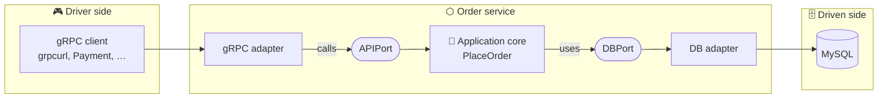
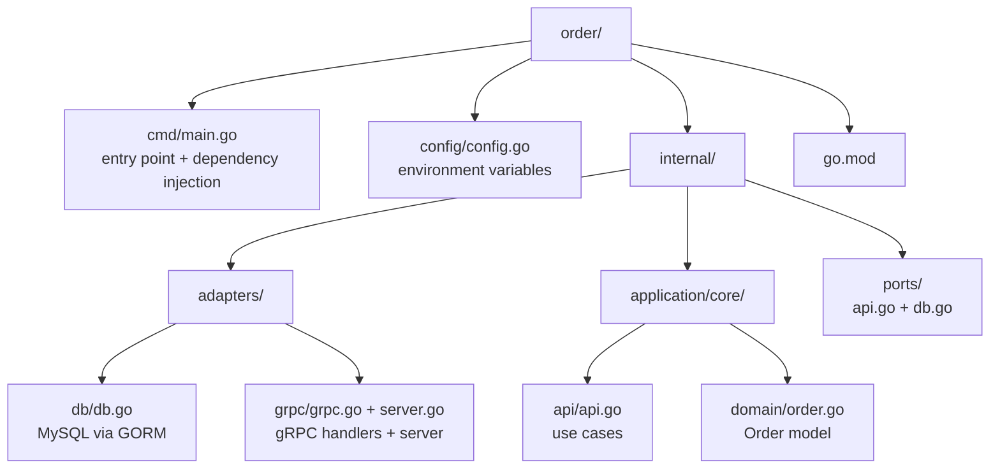
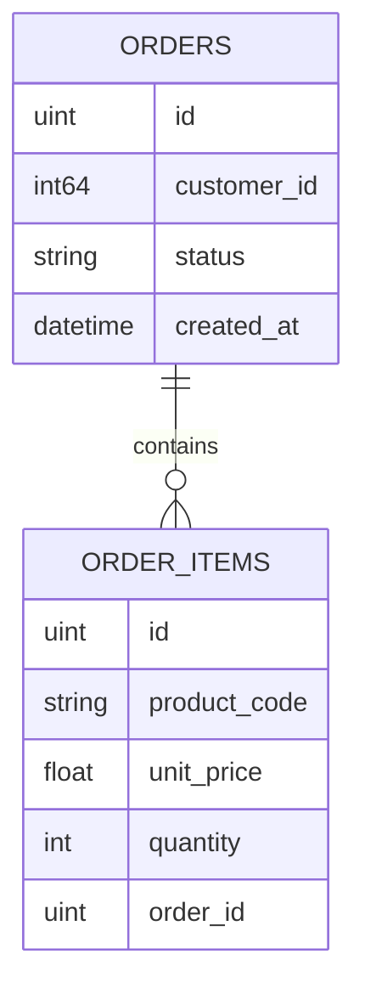
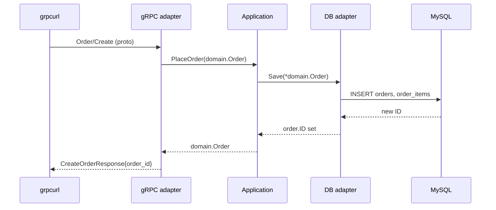
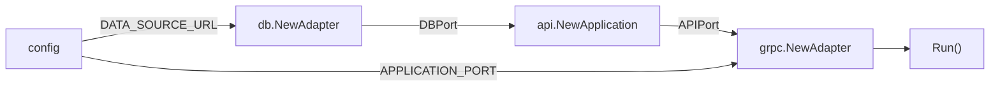

# 🔌 Microservice Project Setup

[[Go/gRPC Microservices in Go - Refactored/README|📚 gRPC Microservices in Go]] · Babal Ch.4

> [!toc]- 📑 Contents
>
> - [[#⬡ Hexagonal Architecture|⬡ Hexagonal Architecture]]
> - [[#📁 Project Folders|📁 Project Folders]]
> - [[#🧠 The Application Core|🧠 The Application Core]]
> - [[#🔌 Ports|🔌 Ports]]
> - [[#🗄️ The Database Adapter|🗄️ The Database Adapter]]
> - [[#📡 The gRPC Adapter|📡 The gRPC Adapter]]
> - [[#⚙️ Configuration That Fails Fast|⚙️ Configuration That Fails Fast]]
> - [[#🧩 Wiring Everything in main.go|🧩 Wiring Everything in main.go]]
> - [[#▶️ Running and Calling the Service|▶️ Running and Calling the Service]]
> - [[#🔨 Hands-On Practice|🔨 Hands-On Practice]]
> - [[#📋 Quick Reference|📋 Quick Reference]]
> - [[#🧠 Things to Remember|🧠 Things to Remember]]
> - [[#💡 Pro Tips|💡 Pro Tips]]
> - [[#🔗 Related Topics|🔗 Related Topics]]

"How should I structure my project?" This chapter answers with **hexagonal architecture**, then builds the first working service: an Order service that saves orders to MySQL and exposes a gRPC `Create` endpoint.

---

## ⬡ Hexagonal Architecture

**Hexagonal architecture**, proposed by Alistair Cockburn in 2005, keeps business logic isolated from technology. The core talks to the outside world only through **ports** (interfaces), and **adapters** plug real technology into those ports. That's why it's also called **ports and adapters**.



- 🧠 **Application (core)** → technology-agnostic business logic: the use cases.

- 🎭 **Actors** → anything outside the application.

    - **Driver (primary)** actors start the conversation: a CLI, a web controller, a gRPC client.

    - **Driven (secondary)** actors are called by the application: MySQL, a payment provider.

- 🔌 **Ports** → interfaces that define each interaction.

    - A **driver port** lists what the application offers (`APIPort`).

    - A **driven port** lists what the application needs (`DBPort`).

- 🔧 **Adapters** → translate between a technology and a port.

    - The **gRPC adapter** turns a gRPC request into a call on `APIPort`.

    - The **DB adapter** turns a `DBPort` call into SQL.

gRPC fits naturally: generated stubs already act as adapters for calling other services, and proto messages give us separate models for the transport layer.

> 💡 **Same idea, different names.** Shuiskov layers services as **handler** (API) → **controller** (business logic) → **repository** (database) and **gateway** (other services). The handler never touches the database directly, so switching from HTTP to gRPC doesn't mean rewriting business logic.

| Hexagonal (Babal) | Shuiskov |
|---|---|
| gRPC adapter | handler |
| Application core | controller |
| DB adapter | repository |
| Payment stub adapter (Chapter 5) | gateway |

---

## 📁 Project Folders

Hexagonal architecture has no mandated layout, but folder names should show each layer:



- 🔒 **`internal/`** → Go allows only code inside the parent of `internal/` to import it, so no outside project can depend on our core by accident.

- ▶️ **`cmd/`** → the executable with `main()`, where adapters are created and injected.

- ⚙️ **`config/`** → shows which parameters the service accepts.

Create the module and folders:

```bash
mkdir -p microservices/order && cd microservices/order
go mod init github.com/<username>/microservices/order

mkdir cmd config
mkdir -p internal/adapters/db internal/adapters/grpc
mkdir -p internal/application/core/api internal/application/core/domain
mkdir -p internal/ports
```

- **`go mod init <path>`** → the module path is the VCS URL other projects will use to import it.

- **`mkdir -p`** → creates missing parent folders.

---

## 🧠 The Application Core

Outer layers depend on inner ones, never the reverse, so we build from the inside out: domain first.

### 📦 Domain Model

```go
// internal/application/core/domain/order.go
package domain

import "time"

type OrderItem struct {
    ProductCode string  `json:"product_code"`
    UnitPrice   float32 `json:"unit_price"`
    Quantity    int32   `json:"quantity"`
}

type Order struct {
    ID         int64       `json:"id"`
    CustomerID int64       `json:"customer_id"`
    Status     string      `json:"status"`
    OrderItems []OrderItem `json:"order_items"`
    CreatedAt  int64       `json:"created_at"`
}

func NewOrder(customerId int64, orderItems []OrderItem) Order {
    return Order{
        CreatedAt:  time.Now().Unix(),
        Status:     "Pending",
        CustomerID: customerId,
        OrderItems: orderItems,
    }
}
```

- 🏷️ **Struct tags** like `json:"customer_id"` control serialized field names.

- 🆕 **`NewOrder`** → every new order starts as `Pending`, with a creation time.

### 🎯 Use Case

```go
// internal/application/core/api/api.go
package api

type Application struct {
    db ports.DBPort
}

func NewApplication(db ports.DBPort) *Application {
    return &Application{db: db}
}

func (a Application) PlaceOrder(order domain.Order) (domain.Order, error) {
    err := a.db.Save(&order)
    if err != nil {
        return domain.Order{}, err
    }
    return order, nil
}
```

- 🔌 **`db ports.DBPort`** → the core depends on an **interface**, not on MySQL.

- 💉 **`NewApplication(db)`** → the concrete adapter is **injected** at startup.

---

## 🔌 Ports

Ports are plain Go interfaces.

```go
// internal/ports/api.go
package ports

type APIPort interface {
    PlaceOrder(order domain.Order) (domain.Order, error)
}
```

```go
// internal/ports/db.go
package ports

type DBPort interface {
    Get(id string) (domain.Order, error)
    Save(*domain.Order) error
}
```

- 🎮 **`APIPort`** → the driver port. `Application` implements it, and the gRPC adapter calls it.

- 🗄️ **`DBPort`** → the driven port. The DB adapter implements it, and `Application` calls it.

Go interfaces are satisfied implicitly: any type with these methods fits, so tests can pass an in-memory fake instead of MySQL.

---

## 🗄️ The Database Adapter

The DB adapter implements `DBPort` with **GORM**, a popular Go ORM, so we don't hand-write SQL:

```bash
go get -u gorm.io/gorm
go get -u gorm.io/driver/mysql
```

An order has many items:



### 📦 Database Entities

```go
// internal/adapters/db/db.go
package db

type Order struct {
    gorm.Model
    CustomerID int64
    Status     string
    OrderItems []OrderItem
}

type OrderItem struct {
    gorm.Model
    ProductCode string
    UnitPrice   float32
    Quantity    int32
    OrderID     uint // back reference to Order
}

type Adapter struct {
    db *gorm.DB
}
```

- 🧱 **`gorm.Model`** → adds `ID`, `CreatedAt`, `UpdatedAt`, and `DeletedAt`.

- 🔗 **`OrderItems []OrderItem` + `OrderID`** → GORM detects the one-to-many relationship and creates the tables in the right order, with snake_case column names.

These DB entities are **separate from the domain model**. The core never sees GORM types.

### 🔗 Connecting

```go
func NewAdapter(dataSourceUrl string) (*Adapter, error) {
    db, openErr := gorm.Open(mysql.Open(dataSourceUrl), &gorm.Config{})
    if openErr != nil {
        return nil, fmt.Errorf("db connection error: %v", openErr)
    }

    err := db.AutoMigrate(&Order{}, &OrderItem{})
    if err != nil {
        return nil, fmt.Errorf("db migration error: %v", err)
    }
    return &Adapter{db: db}, nil
}
```

- 🔌 **`gorm.Open(mysql.Open(url))`** → connects through the MySQL driver.

- 🏗️ **`AutoMigrate`** → creates or updates the tables to match the structs.

- ❗ **Returned errors** let `main` decide whether startup can continue.

### 🔄 Save and Get: Converting Between Models

```go
func (a Adapter) Save(order *domain.Order) error {
    var orderItems []OrderItem
    for _, item := range order.OrderItems {
        orderItems = append(orderItems, OrderItem{
            ProductCode: item.ProductCode,
            UnitPrice:   item.UnitPrice,
            Quantity:    item.Quantity,
        })
    }

    orderModel := Order{
        CustomerID: order.CustomerID,
        Status:     order.Status,
        OrderItems: orderItems,
    }
    res := a.db.Create(&orderModel)
    if res.Error == nil {
        order.ID = int64(orderModel.ID) // pass the new ID back to the core
    }
    return res.Error
}

func (a Adapter) Get(id string) (domain.Order, error) {
    var orderEntity Order
    res := a.db.Preload("OrderItems").First(&orderEntity, id)

    var orderItems []domain.OrderItem
    for _, item := range orderEntity.OrderItems {
        orderItems = append(orderItems, domain.OrderItem{
            ProductCode: item.ProductCode,
            UnitPrice:   item.UnitPrice,
            Quantity:    item.Quantity,
        })
    }

    return domain.Order{
        ID:         int64(orderEntity.ID),
        CustomerID: orderEntity.CustomerID,
        Status:     orderEntity.Status,
        OrderItems: orderItems,
        CreatedAt:  orderEntity.CreatedAt.Unix(),
    }, res.Error
}
```

- 🔄 **Every method converts** domain ↔ DB entity at the boundary.

- 🆔 **`Save` takes a pointer** so it can write the generated ID back into the domain order.

- 📥 **`Preload("OrderItems")`** → loads the related items too; without it, `Get` returns an order with no items.

### 🧪 Interview Q&A

**Q1:** What's the difference between a driver port and a driven port?

**Q2:** Why does `Application` depend on `ports.DBPort` instead of the DB adapter?

**Q3:** Why keep separate domain and database structs?

**Q4:** Why does `Save` take `*domain.Order`?

> [!answer]- 📋 Answers
>
> **A1:** A driver port (`APIPort`) lists what the application offers to callers. A driven port (`DBPort`) lists what the application needs from outside systems.
>
> **A2:** So the core doesn't depend on MySQL or GORM. Any adapter that implements the interface, including a test fake, can be injected.
>
> **A3:** The core stays free of database concerns like `gorm.Model`, and either side can change without affecting the other.
>
> **A4:** So it can write the database-generated ID back into the caller's order.

---

## 📡 The gRPC Adapter

The gRPC adapter is the **driver adapter**: it receives gRPC requests and calls `APIPort`. Its request and response types come from the generated Order module in the separate proto repository from Chapter 3:

```bash
go get github.com/huseyinbabal/microservices-proto/golang/order
```

The Order contract it implements looks like this (the shape used by this chapter's requests):

```protobuf
service Order {
  rpc Create(CreateOrderRequest) returns (CreateOrderResponse) {}
}

message CreateOrderRequest {
  int64 user_id = 1;
  repeated OrderItem order_items = 2;
}

message OrderItem {
  string product_code = 1;
  float unit_price = 2;
  int32 quantity = 3;
}

message CreateOrderResponse {
  int64 order_id = 1;
}
```

The adapter is split into two files: `server.go` runs the server, and `grpc.go` holds the handlers.

### 🖥️ The Server

```go
// internal/adapters/grpc/server.go
package grpc

type Adapter struct {
    api  ports.APIPort
    port int
    order.UnimplementedOrderServer
}

func NewAdapter(api ports.APIPort, port int) *Adapter {
    return &Adapter{api: api, port: port}
}

func (a Adapter) Run() {
    listen, err := net.Listen("tcp", fmt.Sprintf(":%d", a.port))
    if err != nil {
        log.Fatalf("failed to listen on port %d, error: %v", a.port, err)
    }

    grpcServer := grpc.NewServer()
    order.RegisterOrderServer(grpcServer, a)
    if config.GetEnv() == "development" {
        reflection.Register(grpcServer)
    }

    if err := grpcServer.Serve(listen); err != nil {
        log.Fatalf("failed to serve grpc on port %d", a.port)
    }
}
```

- 🧩 **`order.UnimplementedOrderServer`** → an embedded, generated struct with default methods that return "unimplemented".

    - If a new RPC is added to the `.proto` file, the adapter still compiles. That's the **forward compatibility** it provides.

- 📡 **`order.RegisterOrderServer(grpcServer, a)`** → generated by `protoc`; connects our adapter to the `Order` service.

- 🔎 **`reflection.Register`** → lets tools like `grpcurl` discover services without the `.proto` files.

    - Enabled only in `development`, so production doesn't expose its API description.

### 📝 The Handler

```go
// internal/adapters/grpc/grpc.go
package grpc

func (a Adapter) Create(ctx context.Context, request *order.CreateOrderRequest) (*order.CreateOrderResponse, error) {
    var orderItems []domain.OrderItem
    for _, item := range request.OrderItems {
        orderItems = append(orderItems, domain.OrderItem{
            ProductCode: item.ProductCode,
            UnitPrice:   item.UnitPrice,
            Quantity:    item.Quantity,
        })
    }

    newOrder := domain.NewOrder(request.UserId, orderItems)
    result, err := a.api.PlaceOrder(newOrder)
    if err != nil {
        return nil, err
    }
    return &order.CreateOrderResponse{OrderId: result.ID}, nil
}
```

The flow mirrors the DB adapter in the other direction: proto request → domain order → core use case → proto response.



---

## ⚙️ Configuration That Fails Fast

The **12-factor app** methodology recommends keeping configuration in **environment variables**, so the same binary runs in dev, staging, and production with different settings. The Order service needs three:

- 🌍 **`ENV`** → `development` or `production`.

    - Used to enable reflection, or debug logging outside production.

- 🗄️ **`DATA_SOURCE_URL`** → the database connection URL.

- 🔌 **`APPLICATION_PORT`** → the port the gRPC server listens on.

#### ❌ The Problem

```go
dsn := os.Getenv("DATA_SOURCE_URL") // "" when the variable is unset
```

An empty value lets the service start in a broken state and fail later, far from the cause, with inconsistent results.

#### ✅ The Fix

```go
// config/config.go
package config

func GetEnv() string {
    return getEnvironmentValue("ENV")
}

func GetDataSourceURL() string {
    return getEnvironmentValue("DATA_SOURCE_URL")
}

func GetApplicationPort() int {
    portStr := getEnvironmentValue("APPLICATION_PORT")
    port, err := strconv.Atoi(portStr)
    if err != nil {
        log.Fatalf("port: %s is invalid", portStr)
    }
    return port
}

func getEnvironmentValue(key string) string {
    if os.Getenv(key) == "" {
        log.Fatalf("%s environment variable is missing.", key)
    }
    return os.Getenv(key)
}
```

`log.Fatalf` prints the message and exits with status `1`. The service refuses to start until its configuration is complete, and the log names the exact missing variable.

---

## 🧩 Wiring Everything in main.go

`main` is the only place that knows the concrete types. It builds the layers from the inside out and **injects** each into the next:

```go
// cmd/main.go
package main

func main() {
    dbAdapter, err := db.NewAdapter(config.GetDataSourceURL())
    if err != nil {
        log.Fatalf("Failed to connect to database. Error: %v", err)
    }

    application := api.NewApplication(dbAdapter)
    grpcAdapter := grpc.NewAdapter(application, config.GetApplicationPort())
    grpcAdapter.Run()
}
```



To swap MySQL for another store, only `main` and a new adapter change; the core stays untouched.

---

## ▶️ Running and Calling the Service

1. 🐳 **Start MySQL** with a predefined database:

   ```bash
   docker run -p 3306:3306 \
     -e MYSQL_ROOT_PASSWORD=verysecretpass \
     -e MYSQL_DATABASE=order mysql
   ```

   - **`-p 3306:3306`** → exposes MySQL on the host.

   - **`MYSQL_DATABASE=order`** → creates the `order` database on first start.

2. ▶️ **Run the Order service:**

   ```bash
   DATA_SOURCE_URL="root:verysecretpass@tcp(127.0.0.1:3306)/order" \
   APPLICATION_PORT=3000 \
   ENV=development \
   go run cmd/main.go
   ```

   If you see dependency errors, run `go mod tidy` and try again.

3. 📡 **Create an order with `grpcurl`:**

   ```bash
   grpcurl -plaintext \
     -d '{"user_id": 123, "order_items": [{"product_code": "prod", "quantity": 4, "unit_price": 12}]}' \
     localhost:3000 Order/Create
   ```

   - **`-plaintext`** → no TLS, for local development.

   - **`-d`** → the request as JSON, like `curl -d`.

   - **`Order/Create`** → `<service>/<method>`; `grpcurl` learns the schema through reflection.

   ✅ Response:

   ```json
   {
     "orderId": "1"
   }
   ```

   The same call with **`buf curl`** (Chapter 3), which also uses reflection:

   ```bash
   buf curl --protocol grpc --http2-prior-knowledge \
     --data '{"user_id": 123, "order_items": [{"product_code": "prod", "quantity": 4, "unit_price": 12}]}' \
     http://localhost:3000/Order/Create
   ```

   - **`--http2-prior-knowledge`** → plaintext HTTP/2, which a local gRPC server expects.

   - With the Buf-linted contract from Chapter 3, the path becomes `order.v1.OrderService/Create`.

   The field becomes `orderId` because Protobuf's JSON mapping uses camelCase. The value is a string because JSON can't represent every `int64` exactly.

> 🆕 **Current practice:** the book's `go.mod` targets Go 1.17. Use a currently supported Go release.

### 🧪 Interview Q&A

**Q1:** Why embed `UnimplementedOrderServer` in the gRPC adapter?

**Q2:** Why enable reflection only in development?

**Q3:** Why should the service exit when an environment variable is missing?

**Q4:** What does `main.go` do in a hexagonal service?

**Q5:** Why does `grpcurl` show `"orderId": "1"` instead of `"order_id": 1`?

> [!answer]- 📋 Answers
>
> **A1:** It provides default "unimplemented" methods, so the adapter still compiles when new RPCs are added to the contract.
>
> **A2:** Reflection lets anyone discover the service's API. It's convenient for `grpcurl` locally but unnecessary exposure in production.
>
> **A3:** Starting with empty configuration leads to hidden, inconsistent failures later. Failing fast gives a clear error at startup.
>
> **A4:** It reads configuration, creates the concrete adapters, and injects them into the core: the only place that knows concrete types.
>
> **A5:** Protobuf's JSON mapping converts field names to camelCase and encodes `int64` as a string.

---

## 🔨 Hands-On Practice

1. ▶️ **Build and run the Order service.**

   Follow the folders and files in this note, then run the three steps above.

   ✅ `grpcurl` returns `{"orderId": "1"}`, and a second call returns `"2"`.

2. 🔎 **Explore with reflection.**

   With the service running in `development`:

   ```bash
   grpcurl -plaintext localhost:3000 list
   grpcurl -plaintext localhost:3000 describe Order
   ```

   ✅ `list` shows `Order` (plus the reflection service), and `describe` shows `rpc Create`.

3. 🔁 **Swap the database adapter.**

   Write an in-memory adapter that implements `DBPort` with a map and a counter, and inject it in `main.go` instead of `db.NewAdapter`.

   ```go
   // internal/adapters/memory/memory.go
   type Adapter struct {
       orders map[int64]domain.Order
       nextID int64
   }

   func (a *Adapter) Save(order *domain.Order) error {
       a.nextID++
       order.ID = a.nextID
       a.orders[order.ID] = *order
       return nil
   }
   ```

   ✅ After you add `Get` and a constructor, the service runs without MySQL, and nothing in `internal/application` changed.

4. 💥 **Watch fail-fast work.**

   Run `go run cmd/main.go` without `DATA_SOURCE_URL`.

   ✅ The service exits immediately with `DATA_SOURCE_URL environment variable is missing.`

---

### 📋 Quick Reference

| Piece | File | Role |
|---|---|---|
| **Domain** | `internal/application/core/domain/order.go` | `Order`, `OrderItem`, `NewOrder` |
| **Use case** | `internal/application/core/api/api.go` | `Application.PlaceOrder` |
| **Driver port** | `internal/ports/api.go` | `APIPort` |
| **Driven port** | `internal/ports/db.go` | `DBPort` (`Get`, `Save`) |
| **DB adapter** | `internal/adapters/db/db.go` | GORM + MySQL |
| **gRPC adapter** | `internal/adapters/grpc/{server,grpc}.go` | `Run`, `Create` |
| **Config** | `config/config.go` | `ENV`, `DATA_SOURCE_URL`, `APPLICATION_PORT` |
| **Wiring** | `cmd/main.go` | Dependency injection |

```bash
grpcurl -plaintext localhost:3000 list
grpcurl -plaintext -d '{"user_id": 123, "order_items": [...]}' localhost:3000 Order/Create
```

### 🧠 Things to Remember

- The core depends only on ports; adapters depend on the core.

- Driver adapters call driver ports; the core calls driven ports, which driven adapters implement.

- Convert between proto, domain, and DB types at each adapter boundary.

- Embed `Unimplemented<Service>Server` so new RPCs don't break the build.

- Configuration comes from environment variables, and missing values stop startup.

- `main.go` is the only place that wires concrete types together.

### 💡 Pro Tips

- **Keep `internal/application` free of gRPC and GORM imports** → a quick `grep` proves the core is technology-agnostic.

- **Pass `ctx` from the handler into the core** → the book's `PlaceOrder` drops it, so deadlines and traces stop at the adapter.

- **Use `AutoMigrate` for development only** → production schemas are safer with versioned migrations.

- **Write the in-memory adapter early** → it makes core unit tests fast and doesn't need Docker (Chapter 7).

### 🔗 Related Topics

- ⬅️ Previous: [[3. Getting Up and Running with gRPC and Golang]]

- ➡️ Next: [[5. Interservice Communication]]

- 📖 Original study guide: [[Go/gRPC Microservices in Go/4. Microservice project setup - Study Guide]]

- 💻 Working codebase: [[Go/gRPC Microservices in Go - Refactored/microservices/README|Order + Payment codebase]] — hexagonal layout in `order/internal/`, `make up` to run it

- 🐳 Docker basics: [[DevOps/NaNa/Docker/3. Basic Commands]]

- 🌍 Environment variables: [[DevOps/NaNa/Linux/3. Environment Variables]]
