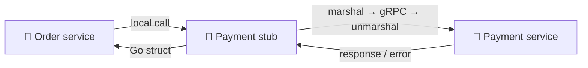
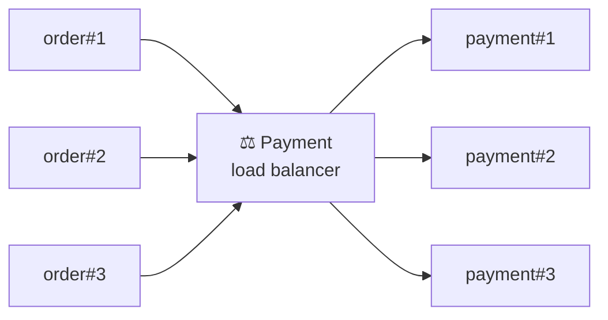
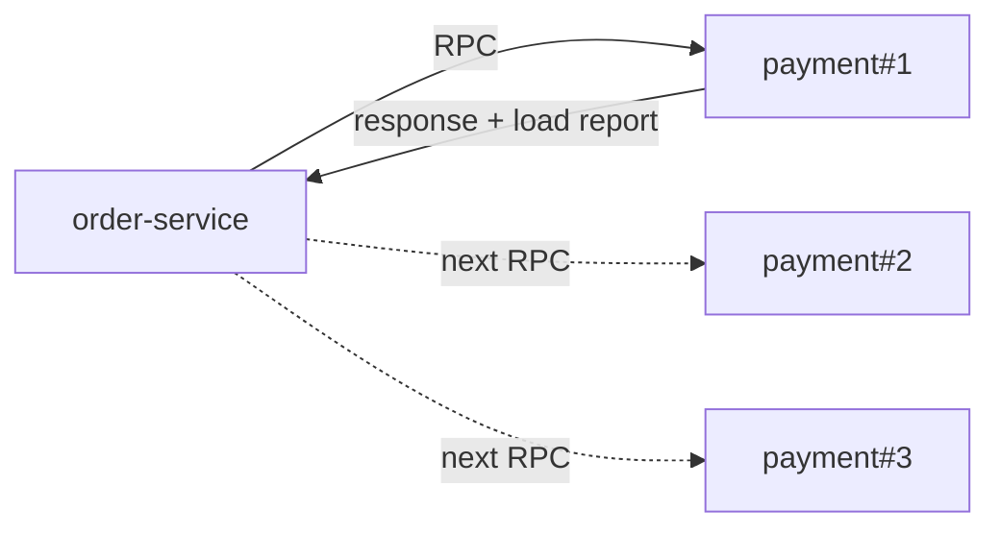
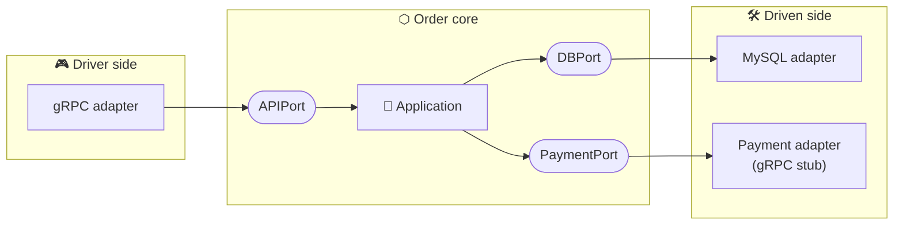
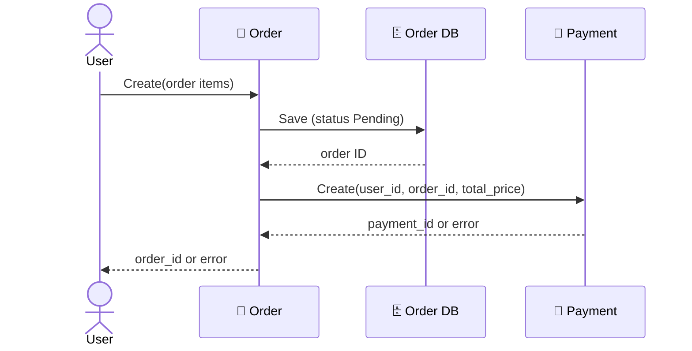
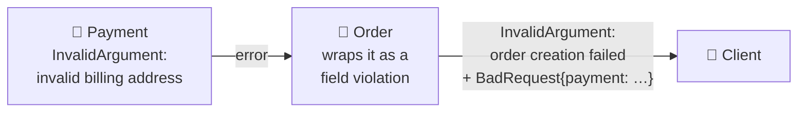

# 🔗 Interservice Communication

[[Go/gRPC Microservices in Go - Refactored/README|📚 gRPC Microservices in Go]] · Babal Ch.5

> [!toc]- 📑 Contents
>
> - [[#⚖️ Load Balancing Between Services|⚖️ Load Balancing Between Services]]
> - [[#📦 Depending on the Payment Stub|📦 Depending on the Payment Stub]]
> - [[#🔌 The Payment Port|🔌 The Payment Port]]
> - [[#🔌 The Payment Adapter|🔌 The Payment Adapter]]
> - [[#🧩 Wiring Payment into the Order Service|🧩 Wiring Payment into the Order Service]]
> - [[#🚨 gRPC Status Codes|🚨 gRPC Status Codes]]
> - [[#📤 Returning Errors with Codes and Details|📤 Returning Errors with Codes and Details]]
> - [[#📥 Handling Errors on the Client Side|📥 Handling Errors on the Client Side]]
> - [[#▶️ Running Order and Payment Together|▶️ Running Order and Payment Together]]
> - [[#🔨 Hands-On Practice|🔨 Hands-On Practice]]
> - [[#📋 Quick Reference|📋 Quick Reference]]
> - [[#🧠 Things to Remember|🧠 Things to Remember]]
> - [[#💡 Pro Tips|💡 Pro Tips]]
> - [[#🔗 Related Topics|🔗 Related Topics]]

Chapter 4 built a lonely Order service. This chapter makes it **call the Payment service** through a gRPC stub, and shows how to send and read **errors** across that call.



The Order service only calls a local Go method. The stub does the marshalling, the network trip, and the unmarshalling.

---

## ⚖️ Load Balancing Between Services

"Order calls Payment" rarely means one Payment instance. There are usually several, and something must **pick one** for each call.

### 🏢 Server-Side Load Balancing

The client calls **one address**: a load balancer or proxy. The balancer forwards each call to a healthy instance and tracks their load.



- 🙈 **The client doesn't know the backends.** It only knows the balancer's address.

- ☸️ **This is what the book uses.** A Kubernetes Service gives Payment one stable address and spreads calls behind it (Chapter 8).

### 💻 Client-Side Load Balancing

The client **knows every backend address** and picks one itself. The simplest policy is **round-robin**: take the instances in turn. Smarter clients read a **load report** that each instance returns with its response.



| | Server-side LB | Client-side LB |
|---|---|---|
| **Pros** | Easy to configure; client knows nothing about backends | No extra hop, so faster; no single point of failure |
| **Cons** | Extra hop adds latency; the balancer's throughput can limit scale | Harder to configure; client must track health and load; implementation differs per language |

Server-side is simpler to run; client-side is faster but pushes work into every client.

> 💡 **Real-World Example:** A checkout service on Kubernetes calls `payment:3001`. Kubernetes routes each new connection to one of five Payment pods, so the Order code never changes when Payment scales from 5 to 50 pods.

---

## 📦 Depending on the Payment Stub

Chapter 3 published generated code for every service in the `microservices-proto` repo. The Order service now imports Payment's **generated stub** as a normal Go module.

```bash
# latest version of the payment module
go get -u github.com/huseyinbabal/microservices-proto/golang/payment

# a fixed version: same code on every rebuild
go get github.com/huseyinbabal/microservices-proto/golang/payment@v1.0.38
```

- 📌 **Pin a version** (`@v1.0.38`) so a new proto release can't change your build by surprise.

- 🔄 **`-u`** also upgrades the module's own dependencies to their latest minor or patch versions.

- 🏷️ **Use your own GitHub user** in module paths if you publish your own proto repo.

Once imported, calling Payment takes two lines:

```go
paymentClient := payment.NewPaymentClient(conn)
paymentClient.Create(ctx, &payment.CreatePaymentRequest{ /* ... */ })
```

The rest of this chapter puts those two lines in the right place in the hexagon.

---

## 🔌 The Payment Port

Order depends on Payment, so Payment is a **driven** dependency: the core calls out to it. Like the database, it gets a **port** on the driven side and an **adapter** that implements it.



The core sees only `PaymentPort`. Whether payment happens over gRPC, HTTP, or a fake in a test is the adapter's business.

```go
// order/internal/ports/payment.go
package ports

import "github.com/huseyinbabal/microservices/order/internal/application/core/domain"

type PaymentPort interface {
    Charge(*domain.Order) error
}
```

- 💳 **One method, `Charge`:** give it the order, and it charges the customer for it.

- 🧱 **Domain type, not proto type:** the port speaks `domain.Order`, so the core never imports generated code.

---

## 🔌 The Payment Adapter

The adapter holds the generated `PaymentClient` and translates a `domain.Order` into a `CreatePaymentRequest`.

### 🔧 Creating the Adapter

```go
// order/internal/adapters/payment/payment.go
package payment

type Adapter struct {
    payment payment.PaymentClient // generated stub
}

func NewAdapter(paymentServiceUrl string) (*Adapter, error) {
    var opts []grpc.DialOption
    opts = append(opts, grpc.WithTransportCredentials(insecure.NewCredentials()))

    conn, err := grpc.Dial(paymentServiceUrl, opts...)
    if err != nil {
        return nil, err
    }

    client := payment.NewPaymentClient(conn)
    return &Adapter{payment: client}, nil
}
```

- 🔓 **`insecure.NewCredentials()`** turns TLS off to keep the example simple. Chapter 6 adds TLS.

- 🔗 **Keep the connection open.** The stub reuses `conn` for every `Charge`, so it must live as long as the adapter. Close it only when the service shuts down.

    - A `defer conn.Close()` inside `NewAdapter` would close it before the first call.

> 🆕 **Current grpc-go:** `grpc.Dial` is deprecated. Use `grpc.NewClient(paymentServiceUrl, opts...)`; it connects lazily on the first RPC.

### 💳 Implementing `Charge`

```go
// order/internal/adapters/payment/payment.go
func (a *Adapter) Charge(order *domain.Order) error {
    _, err := a.payment.Create(context.Background(), &payment.CreatePaymentRequest{
        UserId:     order.CustomerID,
        OrderId:    order.ID,
        TotalPrice: order.TotalPrice(),
    })
    return err
}
```

```go
// order/internal/application/core/domain/order.go
func (o *Order) TotalPrice() float32 {
    var totalPrice float32
    for _, orderItem := range o.OrderItems {
        totalPrice += orderItem.UnitPrice * float32(orderItem.Quantity)
    }
    return totalPrice
}
```

- 🔄 **Domain → proto mapping** happens here, at the edge. `CustomerID` becomes `UserId`.

- 🧮 **`TotalPrice`** is business logic, so it lives on the domain type.

    - Example: 2 × `12.50` + 1 × `5.00` = `30.00`.

- ⏱️ **`context.Background()`** has no deadline, so a stuck Payment call can hang forever. Chapter 6 fixes this.

> 💡 **Why two model types?** The generated `CreatePaymentRequest` is for the wire; `domain.Order` is for your logic. Keeping them apart means a proto change or a switch to another format touches only the adapters, and the core never fights generated getters and `nil` fields.

---

## 🧩 Wiring Payment into the Order Service

### ⚙️ Configuration

The adapter needs Payment's address. It comes from the environment, through the same fail-fast helper as Chapter 4.

```go
// order/config/config.go
func GetPaymentServiceUrl() string {
    return getEnvironmentValue("PAYMENT_SERVICE_URL")
}
```

For now you set `PAYMENT_SERVICE_URL` by hand. Chapter 8 lets Kubernetes provide a stable name for it.

### 🧠 Using the Port in the Core

The `Application` gets a second dependency, and `PlaceOrder` gets a payment step.

```go
// order/internal/application/core/api/api.go
type Application struct {
    db      ports.DBPort
    payment ports.PaymentPort
}

func NewApplication(db ports.DBPort, payment ports.PaymentPort) *Application {
    return &Application{db: db, payment: payment}
}

func (a Application) PlaceOrder(order domain.Order) (domain.Order, error) {
    err := a.db.Save(&order)
    if err != nil {
        return domain.Order{}, err
    }
    paymentErr := a.payment.Charge(&order)
    if paymentErr != nil {
        return domain.Order{}, paymentErr
    }
    return order, nil
}
```

- 💾 **Save first:** the order is stored as `Pending`, so it gets an `ID` for the payment request.

- 💳 **Then charge:** a payment error is returned to the caller. The next sections make that error useful.



### 🧩 `main.go`

```go
// order/cmd/main.go
func main() {
    dbAdapter, err := db.NewAdapter(config.GetDataSourceURL())
    if err != nil {
        log.Fatalf("Failed to connect to database. Error: %v", err)
    }

    paymentAdapter, err := payment.NewAdapter(config.GetPaymentServiceUrl())
    if err != nil {
        log.Fatalf("Failed to initialize payment stub. Error: %v", err)
    }

    application := api.NewApplication(dbAdapter, paymentAdapter)
    grpcAdapter := grpc.NewAdapter(application, config.GetApplicationPort())
    grpcAdapter.Run()
}
```

- 🧩 **`main.go` is still the only place that wires concrete types.** The gRPC adapter didn't change: it calls `api.PlaceOrder`, which now charges too.

- 🛑 **No Payment config, no Order service.** A missing `PAYMENT_SERVICE_URL` stops startup.

---

## 🚨 gRPC Status Codes

When a call fails, gRPC returns two things: a **status code** and an optional **message**. Codes are part of the protocol, so a Go server and a Java client agree on what they mean.

| Code | Meaning | Example |
|---|---|---|
| `OK` | Success | Payment created |
| `CANCELLED` | The client gave up on the call | You asked two services and kept whichever answered first |
| `INVALID_ARGUMENT` | The caller sent bad input | Empty order ID in a payment request |
| `DEADLINE_EXCEEDED` | The deadline passed before the work finished | 5 s deadline, call takes 6 s → error after 5 s |
| `NOT_FOUND` | The resource doesn't exist | Order with that ID is missing |
| `ALREADY_EXISTS` | Would create a duplicate | User with an existing email |
| `PERMISSION_DENIED` | Caller isn't allowed | Logged in, but lacks the needed role |
| `RESOURCE_EXHAUSTED` | A quota or limit was reached | SaaS plan's API limit hit |
| `INTERNAL` | Server-side failure | Bug or broken database |

The code tells the caller **whose fault** it is: `INVALID_ARGUMENT` and `NOT_FOUND` mean "fix your request", while `INTERNAL` means "the server had a problem, maybe try later".

> 💡 **Validate early.** Check requests at the top of the handler and return `InvalidArgument` for bad input. It gives the caller a clear answer and prevents panics from `nil` fields deeper in the code.

---

## 📤 Returning Errors with Codes and Details

### ❌ The Problem

Payment returns a plain Go error.

```go
// payment/internal/adapters/grpc/grpc.go
result, err := a.api.Charge(newPayment)
// err = errors.New("failed to charge customer")
if err != nil {
    return nil, err
}
```

```text
$ grpcurl -d '{"user_id": 123, "order_id": 12, "total_price": 32}' -plaintext localhost:3001 Payment/Create
ERROR:
  Code: Unknown
  Message: failed to charge customer
```

gRPC can't guess a code from a plain error, so it sends `Unknown`. The caller can't tell bad input from a crash.

### ✅ The Fix: `status.Errorf`

Build the error with a code.

```go
// payment/internal/adapters/grpc/grpc.go
err = status.Errorf(codes.InvalidArgument, "failed to charge user: %d", request.UserId)
```

```text
ERROR:
  Code: InvalidArgument
  Message: failed to charge user: 123
```

- 🏷️ **`status.Errorf(code, format, args...)`** returns an `error` that carries a gRPC code.

- 📦 Imports: `google.golang.org/grpc/status` and `google.golang.org/grpc/codes`.

### 🧾 Adding Details

Order depends on several services, so "order failed" isn't enough. The user needs to know **which part** failed. The **`errdetails`** package provides standard detail messages, such as `BadRequest` with a list of **field violations**.

```go
// order/internal/application/core/api/api.go
paymentErr := a.payment.Charge(&order)
if paymentErr != nil {
    st, _ := status.FromError(paymentErr)
    fieldErr := &errdetails.BadRequest_FieldViolation{
        Field:       "payment",
        Description: st.Message(),
    }
    badReq := &errdetails.BadRequest{}
    badReq.FieldViolations = append(badReq.FieldViolations, fieldErr)

    orderStatus := status.New(codes.InvalidArgument, "order creation failed")
    statusWithDetails, _ := orderStatus.WithDetails(badReq)
    return domain.Order{}, statusWithDetails.Err()
}
```

- 🔍 **`status.FromError`** reads the code and message out of Payment's error.

- 🧾 **`Field: "payment"`** names the source of the problem.

- 🏗️ **`status.New(...).WithDetails(...)`** builds the outer status, then attaches the detail. **`.Err()`** turns it back into a Go `error`.

```text
$ grpcurl -d '{"user_id": 123, "order_items": [{"product_code": "sku1", "unit_price": 0.12, "quantity": 1}]}' -plaintext localhost:3000 Order/Create
ERROR:
  Code: InvalidArgument
  Message: order creation failed
  Details:
  1)	{"@type":"type.googleapis.com/google.rpc.BadRequest","fieldViolations":[{"field":"payment","description":"failed to charge. invalid billing address"}]}
```



The user gets one clear top-level message, plus details that say the payment step caused it.

---

## 📥 Handling Errors on the Client Side

If Payment itself sends **details**, Order should read them instead of just the top message. `status.Convert` returns the status, and `st.Details()` lists the attached detail messages.

```go
// order/internal/application/core/api/api.go
st := status.Convert(paymentErr)
var allErrors []string
for _, detail := range st.Details() {
    switch t := detail.(type) {
    case *errdetails.BadRequest:
        for _, violation := range t.GetFieldViolations() {
            allErrors = append(allErrors, violation.Description)
        }
    }
}
fieldErr := &errdetails.BadRequest_FieldViolation{
    Field:       "payment",
    Description: strings.Join(allErrors, "\n"),
}
// ... build orderStatus WithDetails(badReq) as before
```

- 🔄 **`status.FromError(err)`** returns `(status, ok)`. `ok` is `false` when the error didn't come from gRPC.

- 🔄 **`status.Convert(err)`** is the same without `ok`: it always returns a status, using `Unknown` for non-gRPC errors.

- 🧩 **Type switch on details:** each detail is a proto message. Pick out the kinds you understand and skip the rest.

Service-to-service calls rarely need this much unpacking. It matters most in **client SDKs**, where the whole app must turn errors into messages a user can act on.

### 🧪 Interview Q&A

**Q1:** What's the trade-off between server-side and client-side load balancing?

**Q2:** Why does the Order service define a `PaymentPort` instead of calling the stub directly from `PlaceOrder`?

**Q3:** Why does returning `errors.New(...)` from a gRPC handler produce `Code: Unknown`?

**Q4:** Which status codes signal a client mistake, and which signal a server problem?

**Q5:** Why must the payment adapter keep its `conn` open after `NewAdapter` returns?

> [!answer]- 📋 Answers
>
> **A1:** Server-side is simple and hides the backends, but adds a hop and a possible bottleneck. Client-side skips the hop and has no single point of failure, but every client must track backends, health, and load.
>
> **A2:** The core then depends only on an interface. The gRPC details stay in the adapter, and tests can plug in a fake payment.
>
> **A3:** A plain Go error carries no gRPC code, so the framework can only report `Unknown`. Use `status.Errorf` with a code.
>
> **A4:** `INVALID_ARGUMENT`, `NOT_FOUND`, `ALREADY_EXISTS`, and `PERMISSION_DENIED` mean the caller must change something. `INTERNAL` points to the server and may be worth retrying later.
>
> **A5:** The stub sends every RPC over that connection. Closing it early makes every `Charge` fail.

---

## ▶️ Running Order and Payment Together

Start Payment on port `3001`, from the `payment` folder:

```bash
DB_DRIVER=mysql \
DATA_SOURCE_URL="root:verysecretpass@tcp(127.0.0.1:3306)/payment" \
APPLICATION_PORT=3001 \
ENV=development \
go run cmd/main.go
```

Then start Order on port `3000`, from the `order` folder, pointing it at Payment:

```bash
DB_DRIVER=mysql \
DATA_SOURCE_URL="root:verysecretpass@tcp(127.0.0.1:3306)/order" \
APPLICATION_PORT=3000 \
ENV=development \
PAYMENT_SERVICE_URL=localhost:3001 \
go run cmd/main.go
```

- 🗄️ **Two databases** on one MySQL: `order` and `payment`. Each service owns its own data.

- 🔒 **Only Order is public.** Users call Order; Order calls Payment over the internal network. Payment has no endpoint meant for end users.

- 💬 **Quotes around `DATA_SOURCE_URL`** stop the shell from reading the parentheses.

---

## 🔨 Hands-On Practice

1. **Place an order end to end.** Run both services, then:

    ```bash
    grpcurl -plaintext -d '{"user_id": 123, "order_items": [{"product_code": "sku1", "unit_price": 12.5, "quantity": 2}]}' localhost:3000 Order/Create
    ```

    ✅ You get `{"orderId": "…"}`, and the Payment service logs a charge for `25`.

2. **Watch a failure travel.** Stop the Payment service and repeat the call.

    ✅ Order answers `order creation failed`, with a `payment` detail describing the connection failure. The order row is still saved as `Pending`.

3. **Return a coded error.** In Payment's `Charge`, return `status.Errorf(codes.InvalidArgument, "failed to charge. invalid billing address")` when `total_price > 1000`. Send an order worth more than 1000.

    ✅ Order answers `InvalidArgument: order creation failed`, with a `BadRequest` detail whose field is `payment`.

---

### 📋 Quick Reference

| Need | Code |
|---|---|
| Import a stub | `go get github.com/huseyinbabal/microservices-proto/golang/payment@v1.0.38` |
| Create the client | `payment.NewPaymentClient(conn)` |
| Coded error | `status.Errorf(codes.InvalidArgument, "msg: %d", id)` |
| Read a status | `st, ok := status.FromError(err)` / `st := status.Convert(err)` |
| Status with details | `status.New(code, msg).WithDetails(&errdetails.BadRequest{...})` |
| Status → error | `st.Err()` |
| Read details | `for _, d := range st.Details() { switch t := d.(type) { ... } }` |

| File | Role |
|---|---|
| `internal/ports/payment.go` | `PaymentPort` with `Charge` |
| `internal/adapters/payment/payment.go` | Stub-backed adapter |
| `config/config.go` | `GetPaymentServiceUrl()` → `PAYMENT_SERVICE_URL` |
| `cmd/main.go` | `api.NewApplication(dbAdapter, paymentAdapter)` |

### 🧠 Things to Remember

- Another service is just another **driven port and adapter** in the hexagon.

- The core speaks domain types; adapters map them to and from proto messages.

- Pin the proto module version so builds are repeatable.

- Create the gRPC connection once and reuse it for every call.

- Return `status` errors with a real code; plain errors arrive as `Unknown`.

- `errdetails.BadRequest` field violations tell the caller which part failed.

### 💡 Pro Tips

- **Create one connection per downstream service** → gRPC multiplexes many calls over it, so a connection per request only adds handshakes.

- **Map errors at the adapter boundary** → turn Payment's codes into Order's codes in one place, instead of leaking Payment's codes to Order's users.

- **Don't put stack traces or SQL in status messages** → messages reach end users; log internals and return a short description.

- **Keep `Field` names stable** (`payment`, `shipping`) → client code can switch on them to show the right message.

### 🔗 Related Topics

- ⬅️ Previous: [[4. Microservice Project Setup]]

- ➡️ Next: [[6. Resilient Communication]]

- 📖 Original study guide: [[Go/gRPC Microservices in Go/5. Interservice communication]]

- 📬 When to call and when to publish instead: [[Brokers/Kafka/Kafka The Definitive Guide/1. Sync vs Async and Publish-Subscribe|Kafka lesson 1]]

- 💻 Working codebase: [[Go/gRPC Microservices in Go - Refactored/microservices/README|Order + Payment codebase]] — `order/internal/adapters/payment/` and the error wrapping in `order/internal/application/core/api/api.go`

- 🧭 Service discovery and the first stub call: [[2. gRPC Meets Microservices]]

- 📜 Generating stubs into a proto repo: [[3. Getting Up and Running with gRPC and Golang]]
