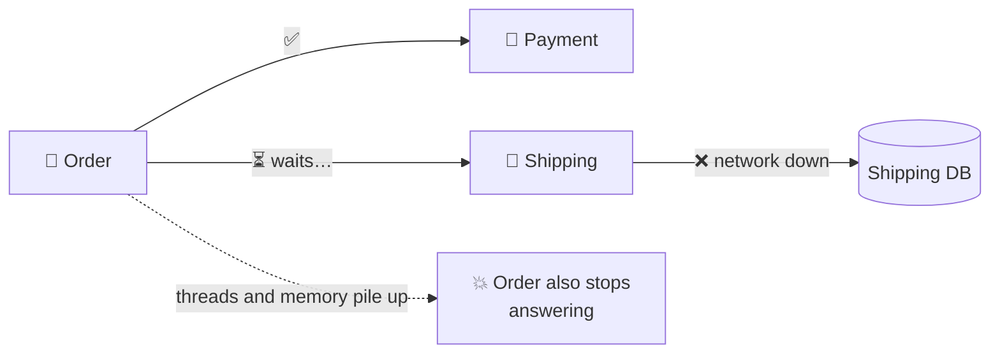
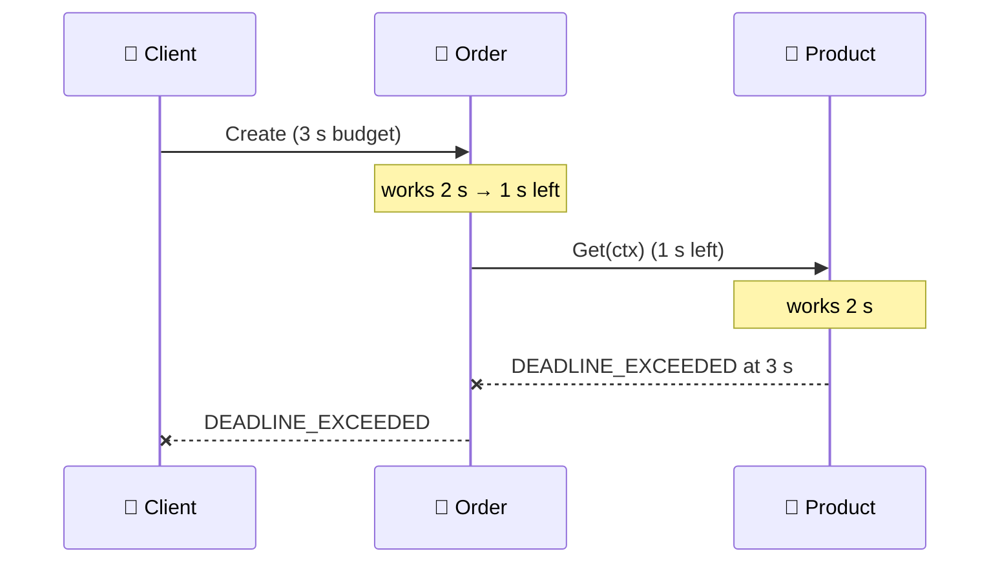
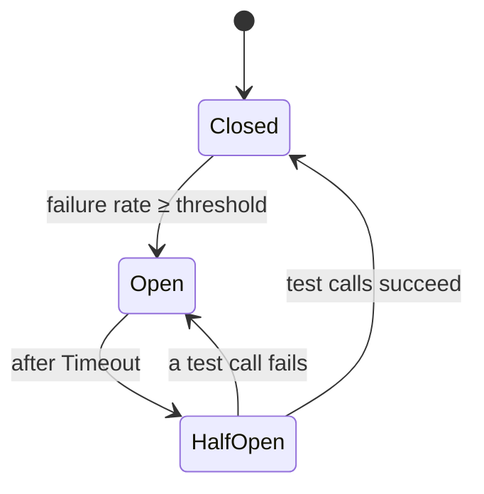
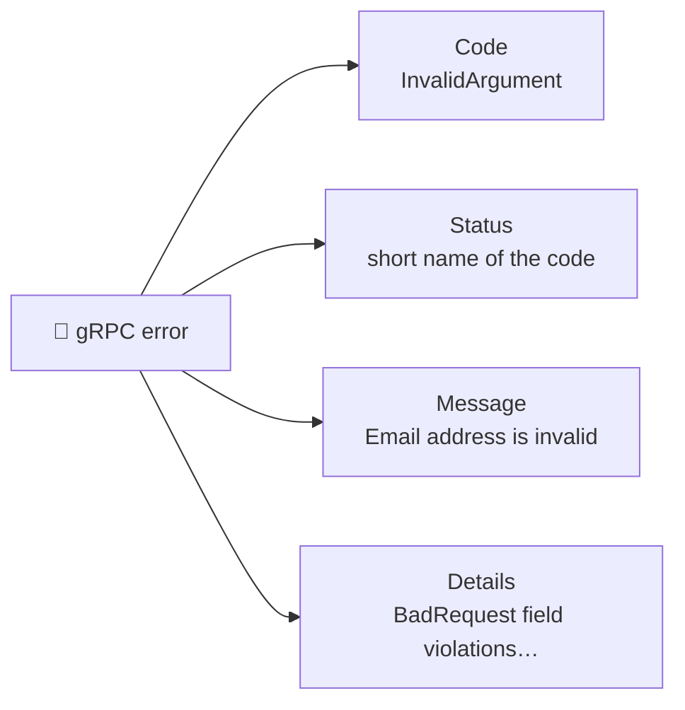
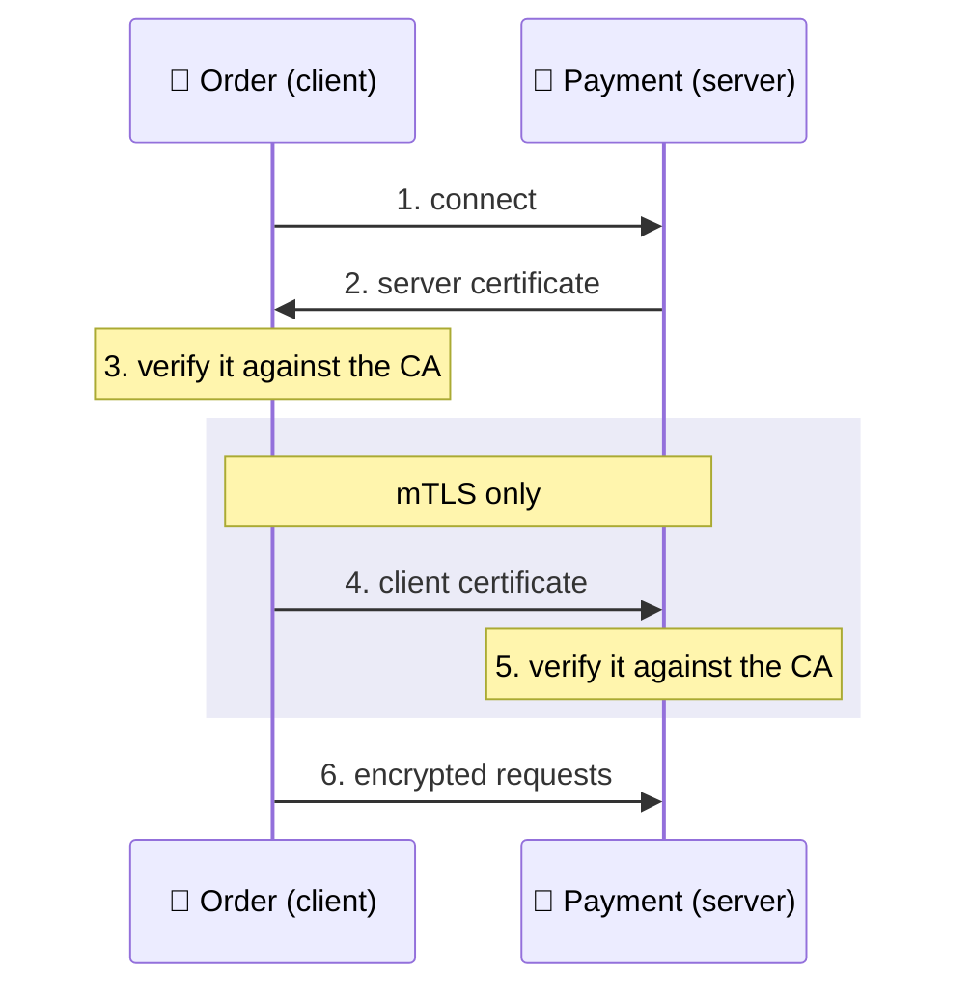

# 🛡️ Resilient Communication

[[Go/gRPC Microservices in Go - Refactored/README|📚 gRPC Microservices in Go]] · Babal Ch.6

> [!toc]- 📑 Contents
>
> - [[#💥 Cascading Failures|💥 Cascading Failures]]
> - [[#⏱️ Timeout Pattern|⏱️ Timeout Pattern]]
> - [[#🔁 Retry Pattern|🔁 Retry Pattern]]
> - [[#🔌 Circuit Breaker Pattern|🔌 Circuit Breaker Pattern]]
> - [[#🧅 Interceptors|🧅 Interceptors]]
> - [[#🚨 Error Handling for Resilience|🚨 Error Handling for Resilience]]
> - [[#🔐 Securing Communication with TLS|🔐 Securing Communication with TLS]]
> - [[#🔨 Hands-On Practice|🔨 Hands-On Practice]]
> - [[#📋 Quick Reference|📋 Quick Reference]]
> - [[#🧠 Things to Remember|🧠 Things to Remember]]
> - [[#💡 Pro Tips|💡 Pro Tips]]
> - [[#🔗 Related Topics|🔗 Related Topics]]

Services fail, networks hang, and attackers listen. This chapter answers two questions: **how does one slow service avoid taking down the rest**, and **how do services talk securely**?

---

## 💥 Cascading Failures

In a monolith, one crash takes everything down. Microservices split the system up, but a dependency can still drag its callers down with it.



- 🐢 **Full or partial failure:** Shipping can be fully unreachable, or just slow. If you promised 50 ms per call and Shipping takes 2 s, that's a failure too.

- 💥 **Cascade:** Order keeps waiting on Shipping, its connections and memory pile up, and soon it can't serve requests that don't even need Shipping.

- 🛡️ **The cure:** fail fast and recover later. Three patterns do this: **timeout**, **retry**, and **circuit breaker**.

---

## ⏱️ Timeout Pattern

A **timeout** puts an upper limit on how long a call may take. When it runs out, the call is cancelled and returns `DEADLINE_EXCEEDED`, instead of hanging.

In Go, that limit travels in a **`context.Context`**. That's why every generated RPC method takes `ctx` as its first parameter.

```go
// order/internal/adapters/shipping/shipping.go
shippingClient := shipping.NewShippingServiceClient(conn)

ctx, cancel := context.WithTimeout(context.Background(), 1*time.Second)
defer cancel()

_, err := shippingClient.Create(ctx, &shipping.CreateShippingRequest{UserId: 23})
if err != nil {
    log.Printf("Failed to create shipping. Err: %v", err)
}
```

- ⏲️ **`WithTimeout(parent, d)`** = "finish within `d` from now".

- 📅 **`WithDeadline(parent, t)`** = "finish before time `t`". `WithTimeout` is a shortcut for `WithDeadline(parent, time.Now().Add(d))`.

- 🧹 **`defer cancel()`** frees the context's timer as soon as the call returns. Don't throw `cancel` away.

    - `cancel` is also useful on its own: call three competing endpoints with one context, keep the first answer, and cancel the other two.

### 🌊 Deadlines Travel Across Services

gRPC sends the deadline with the request. The server's `ctx` carries the **remaining** time, so if it passes that `ctx` to the next call, the whole chain shares one budget.



```go
// order service: pass the incoming ctx on, don't start a new one
func (s *server) Create(ctx context.Context, in *order.CreateOrderRequest) (*order.CreateOrderResponse, error) {
    time.Sleep(2 * time.Second) // simulate work
    productInfo, err := s.productClient.Get(ctx, &product.GetProductRequest{ProductId: in.ProductId})
    if err != nil {
        return nil, err
    }
    return &order.CreateOrderResponse{OrderId: 123, ProductTitle: productInfo.Title}, nil
}
```

- 🧮 **The math:** Order needs 2 s and Product needs 2 s, so the chain needs 4 s. The client allowed 3 s, so it fails at 3 s.

- 🔗 **Pass `ctx` down, don't replace it.** A fresh `context.Background()` in Order would let Product keep working after the client has already given up.

> 💡 **Real-World Example:** A mobile app gives checkout 3 seconds. Because the deadline travels, Payment and Shipping stop work the moment the app gives up, instead of finishing charges nobody is waiting for.

---

## 🔁 Retry Pattern

Some failures are **transient**: they fix themselves in a moment. A **retry** simply calls again.

- 🌐 A brief network blip.

- 🔧 A service that's restarting or in short maintenance.

- 📈 A service that's throttling because of load.

### 🔧 A Retry Interceptor

Instead of writing a retry loop around every call, register a **retry interceptor** once. It wraps every unary call made on that connection.

```go
// order/internal/adapters/shipping/shipping.go
import grpc_retry "github.com/grpc-ecosystem/go-grpc-middleware/retry"

var opts []grpc.DialOption
opts = append(opts, grpc.WithUnaryInterceptor(grpc_retry.UnaryClientInterceptor(
    grpc_retry.WithCodes(codes.Unavailable, codes.ResourceExhausted),
    grpc_retry.WithMax(5),
    grpc_retry.WithBackoff(grpc_retry.BackoffLinear(time.Second)),
)))
opts = append(opts, grpc.WithTransportCredentials(insecure.NewCredentials()))

conn, err := grpc.Dial("localhost:8080", opts...)
```

- 🎯 **`WithCodes`** — retry **only** on these codes. `Unavailable` and `ResourceExhausted` are the defaults: the service may come back, or the throttling may lift.

- 🔢 **`WithMax(5)`** — at most 5 attempts. It stops early as soon as a call returns any other code, including `OK`.

- ⏳ **`WithBackoff`** — how long to wait between attempts:

    - `BackoffLinear(1s)` → wait 1 s every time.

    - `BackoffExponential(1s)` → 1 s, 2 s, 4 s, … (doubles each time).

    - `…WithJitter` variants add randomness, so a thousand clients don't all retry at the same instant.

> 🆕 **Current go-grpc-middleware:** v2 moved the package to `github.com/grpc-ecosystem/go-grpc-middleware/v2/interceptors/retry` (same `WithCodes`, `WithMax`, `WithBackoff` options). `grpc.Dial` is deprecated in favour of `grpc.NewClient`.

### 🎯 Which Errors Are Worth Retrying?

| Retry ✅ | Don't retry ❌ |
|---|---|
| `UNAVAILABLE`, `RESOURCE_EXHAUSTED`, sometimes `DEADLINE_EXCEEDED` | `INVALID_ARGUMENT`, `NOT_FOUND`, `ALREADY_EXISTS`, `PERMISSION_DENIED` |

A retry fixes the **server's** temporary trouble. It can't fix a bad request: the same invalid payload fails the same way every time.

### ⚠️ Retries Need Idempotency

A retry after a timeout may repeat a call that **already succeeded**: the charge went through, only the reply was lost.

- 🔑 **Idempotency key:** the client sends a unique ID (for example, `order_id` or a `transaction_id`) with each request. The server remembers it and returns the earlier result for a repeat instead of charging twice.

- 📝 **Document it:** say in the API which operations are safe to retry and how.

---

## 🔌 Circuit Breaker Pattern

Retries help with short failures. When a service is down for a long time, retries just pile **more load** onto it. A **circuit breaker** stops calling it for a while.



- 🟢 **Closed** — calls pass through normally, and failures are counted.

- 🔴 **Open** — calls fail **immediately** without touching the network. The dependency gets time to recover.

- 🟡 **Half-open** — after a wait, a few test calls go through. Success closes the circuit; failure opens it again.

### ⚙️ Configuring `gobreaker`

The book uses Sony's [gobreaker](https://github.com/sony/gobreaker). Requirements: trip at a failure ratio of 0.6, allow 3 calls while half-open, wait 4 seconds before half-open, and log every state change.

```go
cb := gobreaker.NewCircuitBreaker(gobreaker.Settings{
    Name:        "demo",
    MaxRequests: 3,
    Timeout:     4 * time.Second,
    ReadyToTrip: func(counts gobreaker.Counts) bool {
        failureRatio := float64(counts.TotalFailures) / float64(counts.Requests)
        return failureRatio >= 0.6
    },
    OnStateChange: func(name string, from, to gobreaker.State) {
        log.Printf("Circuit Breaker: %s, changed from %v, to %v", name, from, to)
    },
})
```

| Setting | Meaning |
|---|---|
| `MaxRequests` | Calls allowed through while **half-open** |
| `Interval` | How often counts reset while **closed** (`0` = never reset) |
| `Timeout` | How long to stay **open** before going half-open |
| `ReadyToTrip` | Called after a failure; return `true` to open the circuit |
| `OnStateChange` | Hook for logs and metrics on every transition |

`Timeout` is a `time.Duration`, so write `4 * time.Second`. A bare `4` means 4 nanoseconds.

### 📡 Wrapping a gRPC Call

`cb.Execute` runs your function and records whether it failed.

```go
orderClient := order.NewOrderServiceClient(conn)
for {
    orderResponse, err := cb.Execute(func() (interface{}, error) {
        return orderClient.Create(context.Background(), &order.CreateOrderRequest{
            UserId: 23, ProductId: 1234, Price: 3.2,
        })
    })
    if err != nil {
        log.Printf("Failed to create order. Err: %v", err)
    } else {
        log.Printf("Order %d is created successfully.", orderResponse.(*order.CreateOrderResponse).OrderId)
    }
    time.Sleep(1 * time.Second)
}
```

- 🔴 **While open**, `Execute` returns `gobreaker.ErrOpenState` ("circuit breaker is open") without calling the server.

- 🔄 **`interface{}` result** must be type-asserted back to `*order.CreateOrderResponse`.

---

## 🧅 Interceptors

Wrapping every call by hand gets repetitive. An **interceptor** is gRPC middleware: a function that runs around **every** call. Client interceptors run before a request leaves; server interceptors run before the request reaches your handler.


Here is the circuit breaker as a client interceptor:

```go
// order/internal/middleware/circuit_breaker.go
package middleware

func CircuitBreakerClientInterceptor(cb *gobreaker.CircuitBreaker) grpc.UnaryClientInterceptor {
    return func(ctx context.Context, method string, req, reply interface{},
        cc *grpc.ClientConn, invoker grpc.UnaryInvoker, opts ...grpc.CallOption) error {

        _, cbErr := cb.Execute(func() (interface{}, error) {
            err := invoker(ctx, method, req, reply, cc, opts...)
            return nil, err
        })
        return cbErr
    }
}
```

```go
opts = append(opts, grpc.WithUnaryInterceptor(middleware.CircuitBreakerClientInterceptor(cb)))
conn, err := grpc.Dial("localhost:8080", opts...)
```

- 📞 **`invoker`** performs the real RPC. The interceptor decides what happens around it.

- 📦 **`reply`** is filled in by `invoker`, so the caller still gets its response normally.

- 🌊 **Streaming calls** use `grpc.WithStreamInterceptor` and a `StreamClientInterceptor` instead.

- 🔗 **More than one interceptor** (breaker + retry): use `grpc.WithChainUnaryInterceptor(a, b)`; `a` runs outermost. Calling `WithUnaryInterceptor` twice keeps only the last one.

### 🧪 Interview Q&A

**Q1:** What is a cascading failure, and which patterns prevent it?

**Q2:** The client sets a 3 s timeout; Order works 2 s and then calls Product, which works 2 s. What happens, and why?

**Q3:** Why retry on `UNAVAILABLE` but not on `INVALID_ARGUMENT`?

**Q4:** What problem does a circuit breaker solve that retries don't?

**Q5:** What happens in the half-open state?

> [!answer]- 📋 Answers
>
> **A1:** A slow or failed dependency makes its callers hang until they fail too. Timeouts, retries, and circuit breakers make callers fail fast and recover.
>
> **A2:** The call fails with `DEADLINE_EXCEEDED` at 3 s. The deadline travels with `ctx`, and the chain needs 4 s.
>
> **A3:** `UNAVAILABLE` is often temporary, so a later attempt may succeed. An invalid request fails the same way every time.
>
> **A4:** Retries keep hitting a dead service and add load. An open circuit stops calls entirely for a while and fails them instantly.
>
> **A5:** A limited number of test calls (`MaxRequests`) go through. If they succeed, the circuit closes; if one fails, it opens again.

---

## 🚨 Error Handling for Resilience

Retries and breakers decide what to do from the **status code**. For example, `{code: ResourceExhausted, message: "Order Limit Exceeded"}` says "try again later", while an unstructured message string would leave the client guessing.



The **details** can carry a list, so one response can report every bad field of a form at once.

### 📤 Server: Validate and Return Every Violation

```go
// order service
func (s *server) Create(ctx context.Context, in *order.CreateOrderRequest) (*order.CreateOrderResponse, error) {
    var validationErrors []*errdetails.BadRequest_FieldViolation
    if in.UserId < 1 {
        validationErrors = append(validationErrors, &errdetails.BadRequest_FieldViolation{
            Field: "user_id", Description: "user id cannot be less than 1",
        })
    }
    if in.ProductId < 0 {
        validationErrors = append(validationErrors, &errdetails.BadRequest_FieldViolation{
            Field: "product_id", Description: "product id cannot be negative",
        })
    }
    if len(validationErrors) > 0 {
        stat := status.New(codes.InvalidArgument, "invalid order request")
        badRequest := &errdetails.BadRequest{FieldViolations: validationErrors}
        s, _ := stat.WithDetails(badRequest)
        return nil, s.Err()
    }
    return &order.CreateOrderResponse{OrderId: 1243}, nil
}
```

- 📋 **Collect, then return:** the user fixes both fields in one go instead of discovering them one by one.

- 🏷️ **`codes.InvalidArgument`**, not HTTP `400`: gRPC codes are their own numbering.

### 📥 Client: Read the Violations

```go
_, err := orderClient.Create(ctx, &order.CreateOrderRequest{UserId: -1, ProductId: 0, Price: 2})
if err != nil {
    stat := status.Convert(err)
    for _, detail := range stat.Details() {
        switch errType := detail.(type) {
        case *errdetails.BadRequest:
            for _, violation := range errType.GetFieldViolations() {
                log.Printf("The field %s has invalid value. desc: %v",
                    violation.GetField(), violation.GetDescription())
            }
        }
    }
}
```

The client now knows exactly what to fix, and its retry or breaker logic can tell "bad input" from "server in trouble".

> 💡 **Graceful degradation:** when a non-critical call still fails after retries, fall back instead of failing the whole request. For example, show cached recommendations, and log clearly that the fallback was used.

---

## 🔐 Securing Communication with TLS

**TLS** (Transport Layer Security, the successor of SSL) encrypts traffic so nobody can read or change it in transit. It starts with a **handshake** that proves who is on the other end, using certificates.

### 🤝 TLS vs mTLS



- 🔐 **TLS:** only the server proves its identity. Fine for browsers talking to a website.

- 🔐🔐 **mTLS (mutual TLS):** both sides show certificates. Each side knows **who** is calling, which suits **zero-trust** networks where being inside the network proves nothing.

### 📜 Generating Certificates with OpenSSL

A **certificate authority (CA)** signs certificates; anyone who trusts the CA trusts what it signed. For development, create your own CA, then sign a server and a client certificate with it.

**1. CA key and self-signed certificate**

```bash
openssl req -x509 \
  -sha256 \
  -newkey rsa:4096 \
  -days 365 \
  -keyout ca-key.pem \
  -out ca-cert.pem \
  -subj "/C=TR/ST=EURASIA/L=ISTANBUL/O=Software/OU=Microservices/CN=*.microservices.dev/emailAddress=huseyin@microservices.dev" \
  -nodes
```

- **`-x509`** → output a certificate instead of a signing request.

- **`-newkey rsa:4096`** → create a new 4096-bit RSA key at the same time.

- **`-nodes`** → "no DES": leave the private key unencrypted (development only).

- **`-subj`** → identity: country `C`, state `ST`, city `L`, organization `O`, unit `OU`, domain `CN`, contact `emailAddress`.

**2. Server key and signing request**, then **sign it with the CA**

```bash
openssl req -newkey rsa:4096 -nodes -sha256 \
  -keyout server-key.pem \
  -out server-req.pem \
  -subj "/C=TR/ST=EURASIA/L=ISTANBUL/O=Microservices/OU=PaymentService/CN=*.microservices.dev/emailAddress=huseyin@microservices.dev"

echo "subjectAltName=DNS:*.microservices.dev,DNS:localhost,IP:127.0.0.1" > server-ext.cnf

openssl x509 -req -in server-req.pem -days 60 -sha256 \
  -CA ca-cert.pem -CAkey ca-key.pem -CAcreateserial \
  -out server-cert.pem \
  -extfile server-ext.cnf
```

- 🏷️ **`subjectAltName` (SAN)** lists the names the certificate is valid for. Clients check the server name against it, not against `CN`.

- 🔢 **`-CAcreateserial`** creates the serial-number file the CA needs for signing.

**3. Client key and certificate**: same as step 2 with `client-key.pem`, `client-req.pem`, `OU=OrderService`, and output `client-cert.pem`.

**4. Inspect any certificate**

```bash
openssl x509 -in server-cert.pem -noout -text
```

✅ Shows the issuer (your CA), the validity dates, and the SAN list.

### 🖥️ Server Side: Payment Requires Client Certificates

```go
// payment/cmd/main.go
func getTlsCredentials() (credentials.TransportCredentials, error) {
    serverCert, err := tls.LoadX509KeyPair("cert/server-cert.pem", "cert/server-key.pem")
    if err != nil {
        return nil, err
    }
    certPool := x509.NewCertPool()
    caCert, err := os.ReadFile("cert/ca-cert.pem")
    if err != nil {
        return nil, err
    }
    if ok := certPool.AppendCertsFromPEM(caCert); !ok {
        return nil, errors.New("failed to append the CA certs")
    }
    return credentials.NewTLS(&tls.Config{
        ClientAuth:   tls.RequireAndVerifyClientCert,
        Certificates: []tls.Certificate{serverCert},
        ClientCAs:    certPool,
    }), nil
}

// in main:
grpcServer := grpc.NewServer(grpc.Creds(tlsCredentials))
```

- 🪪 **`Certificates`** — what the server shows to clients.

- 🏛️ **`ClientCAs`** — which CA a client certificate must be signed by.

- 🔒 **`RequireAndVerifyClientCert`** — this is what makes it **mutual**: no valid client certificate, no connection.

### 💻 Client Side: Order Presents Its Certificate

```go
// order/internal/adapters/payment/payment.go
func getTlsCredentials() (credentials.TransportCredentials, error) {
    clientCert, err := tls.LoadX509KeyPair("cert/client-cert.pem", "cert/client-key.pem")
    if err != nil {
        return nil, err
    }
    certPool := x509.NewCertPool()
    caCert, err := os.ReadFile("cert/ca-cert.pem")
    if err != nil {
        return nil, err
    }
    if ok := certPool.AppendCertsFromPEM(caCert); !ok {
        return nil, errors.New("failed to append CA cert")
    }
    return credentials.NewTLS(&tls.Config{
        ServerName:   "*.microservices.dev",
        Certificates: []tls.Certificate{clientCert},
        RootCAs:      certPool,
    }), nil
}

// when connecting:
conn, err := grpc.Dial(paymentServiceUrl, grpc.WithTransportCredentials(tlsCredentials))
```

- 🏛️ **`RootCAs`** — which CA the server certificate must be signed by.

- 🏷️ **`ServerName`** — the name checked against the server certificate's SAN.

- 🔁 `insecure.NewCredentials()` from Chapter 5 is replaced by `tlsCredentials`.

Hand-made certificates are fine locally. In production, a tool such as cert-manager issues and rotates them automatically (Chapter 8).

> 🆕 **Current Go and grpc-go:** `ioutil.ReadFile` is deprecated; use `os.ReadFile`. `grpc.Dial` is deprecated; use `grpc.NewClient` with the same credentials option.

---

## 🔨 Hands-On Practice

1. **Watch a deadline travel.** Add `time.Sleep(2 * time.Second)` to Payment's `Create`. In Order, call it with `context.WithTimeout(ctx, 1*time.Second)`.

    ✅ Order gets `DeadlineExceeded` after about 1 second, not 2.

2. **Retry through a restart.** Add the retry interceptor (`Unavailable`, max 5, linear 1 s) to Order's payment connection. Stop Payment, send an order, and start Payment again within 3 seconds.

    ✅ The order succeeds; Order's logs show failed attempts before the success.

3. **Trip a breaker.** Wrap the payment call with the circuit-breaker interceptor, then stop Payment and send orders once a second.

    ✅ After the first failures, calls fail instantly with `circuit breaker is open`; after 4 s one test call goes through.

4. **Turn on mTLS.** Generate the CA, server, and client certificates, then wire both `getTlsCredentials` functions in.

    ✅ Orders still work. Removing `Certificates` from Order's config makes the handshake fail.

---

### 📋 Quick Reference

| Pattern | Code |
|---|---|
| Timeout | `ctx, cancel := context.WithTimeout(ctx, 1*time.Second); defer cancel()` |
| Deadline | `context.WithDeadline(ctx, t)` |
| Retry | `grpc_retry.UnaryClientInterceptor(WithCodes(...), WithMax(5), WithBackoff(BackoffLinear(time.Second)))` |
| Circuit breaker | `gobreaker.NewCircuitBreaker(gobreaker.Settings{...})`, `cb.Execute(fn)` |
| Add interceptors | `grpc.WithChainUnaryInterceptor(breaker, retry)` (first = outermost) |
| Coded error with details | `status.New(codes.InvalidArgument, msg).WithDetails(&errdetails.BadRequest{...})` |
| Server mTLS | `grpc.NewServer(grpc.Creds(credentials.NewTLS(&tls.Config{ClientAuth: tls.RequireAndVerifyClientCert, ...})))` |
| Client TLS | `grpc.WithTransportCredentials(credentials.NewTLS(&tls.Config{RootCAs: pool, ...}))` |

```bash
openssl x509 -in server-cert.pem -noout -text   # inspect a certificate
```

### 🧠 Things to Remember

- Every outgoing call needs a deadline, and the incoming `ctx` should be passed on.

- Retry only transient codes (`UNAVAILABLE`, `RESOURCE_EXHAUSTED`), with backoff and a maximum.

- Retried writes must be idempotent.

- A circuit breaker moves Closed → Open → Half-open → Closed, and fails fast while open.

- Interceptors apply a policy to every call in one place.

- mTLS = both sides present certificates signed by a CA the other trusts.

### 💡 Pro Tips

- **Give `ReadyToTrip` a minimum request count** (`counts.Requests >= 5 && ratio >= 0.6`) → otherwise the very first failure is a 100% failure rate and trips the circuit.

- **Order matters in the interceptor chain** → put the breaker outside the retry, so one logical call with five attempts counts as one result, not five.

- **Add jitter to backoff in production** → it spreads retries out, so a recovering service isn't hit by everyone at once.

- **Set a per-attempt timeout as well as an overall deadline** → one hung attempt then can't eat the whole budget.

- **Never ship `-nodes` keys or a hand-made CA to production** → use a managed issuer that rotates certificates.

### 🔗 Related Topics

- ⬅️ Previous: [[5. Interservice Communication]]

- ➡️ Next: [[7. Testing Microservices]]

- 📖 Original study guide: [[Go/gRPC Microservices in Go/6. Resilient communication - Study Guide]]

- 💻 Working codebase: [[Go/gRPC Microservices in Go - Refactored/microservices/README|Order + Payment codebase]] — retry + circuit breaker in `order/internal/adapters/payment/`, mTLS with `make up-tls`

- 🚨 Status codes and error details: [[5. Interservice Communication]]

- ⏳ Context cancellation in Go: [[Go/Concurrency in Go/README]]
