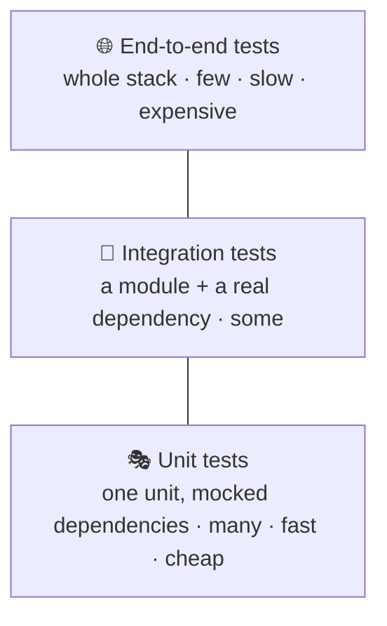
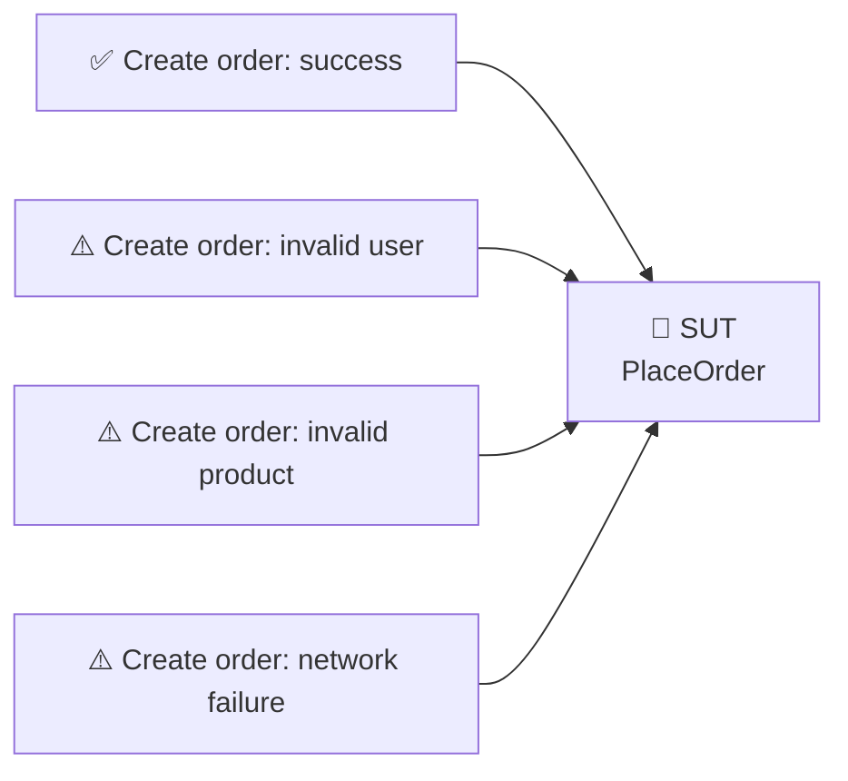
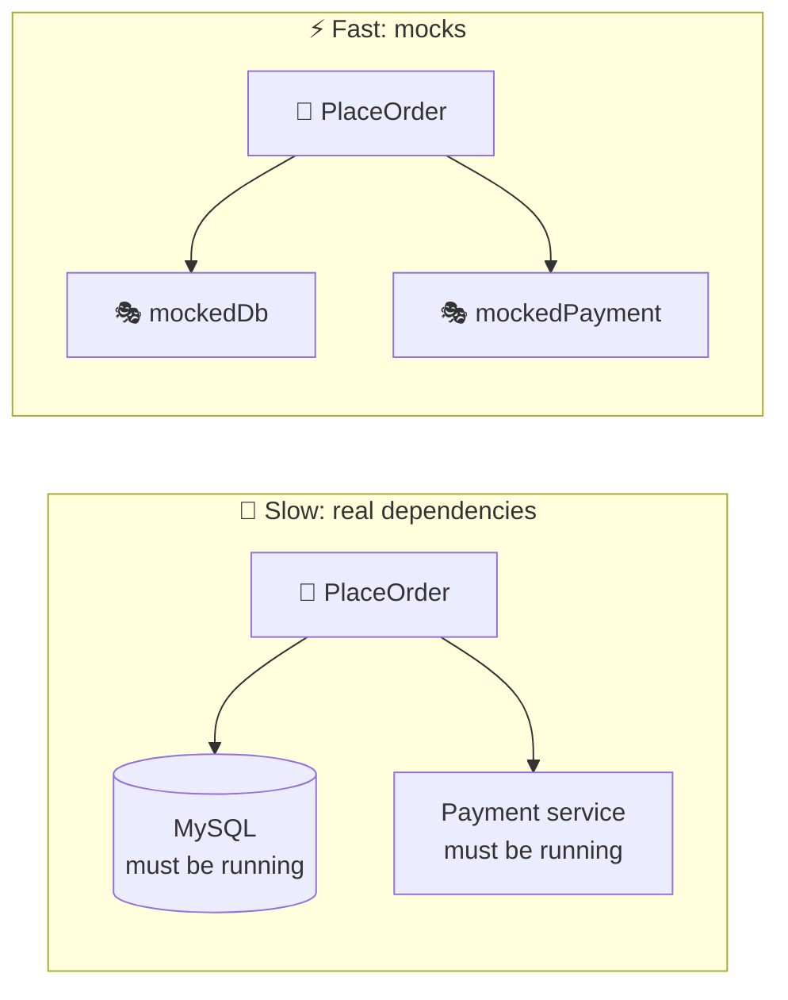
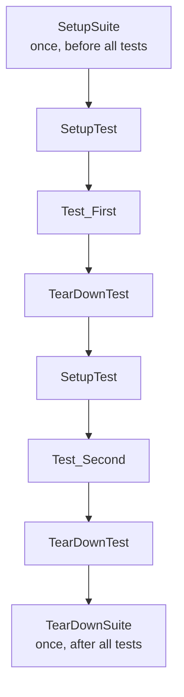
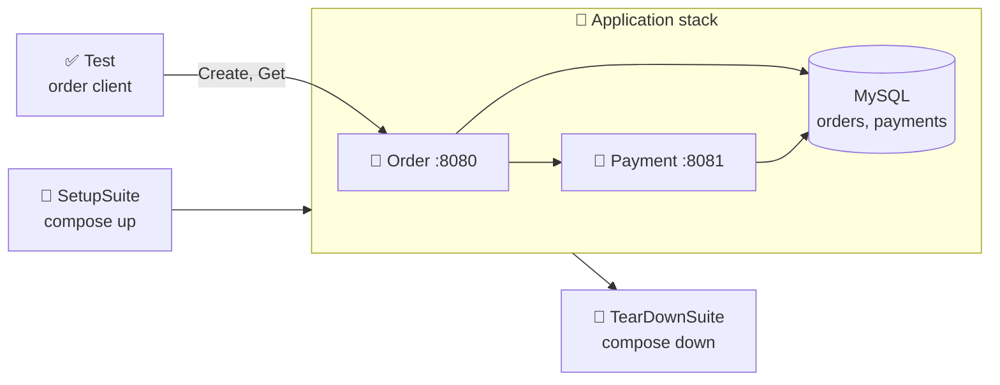
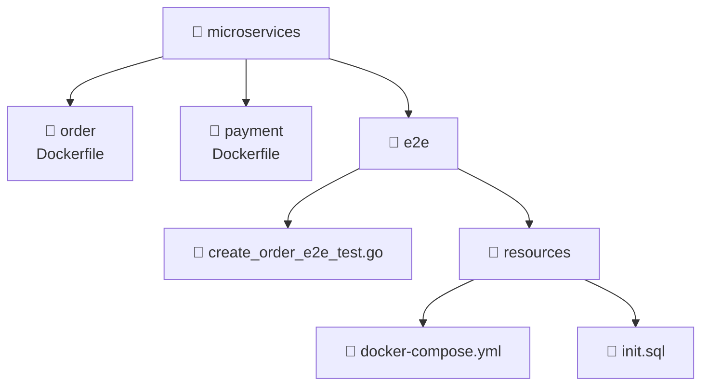
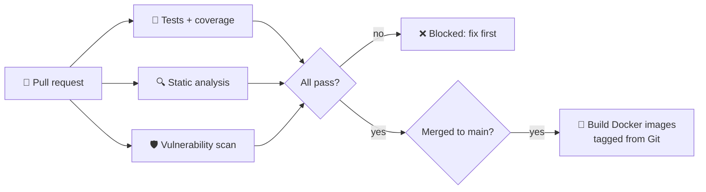

# 🧪 Testing Microservices

[[Go/gRPC Microservices in Go - Refactored/README|📚 gRPC Microservices in Go]] · Babal Ch.7

> [!toc]- 📑 Contents
>
> - [[#🔺 The Testing Pyramid|🔺 The Testing Pyramid]]
> - [[#🎯 System Under Test and Test Workflow|🎯 System Under Test and Test Workflow]]
> - [[#🎭 Unit Tests with Mocks|🎭 Unit Tests with Mocks]]
> - [[#🤖 Generating Mocks with mockery|🤖 Generating Mocks with mockery]]
> - [[#🐳 Integration Tests with Testcontainers|🐳 Integration Tests with Testcontainers]]
> - [[#🌐 End-to-End Tests with Docker Compose|🌐 End-to-End Tests with Docker Compose]]
> - [[#📊 Test Coverage|📊 Test Coverage]]
> - [[#🔁 Tests in a CI Pipeline|🔁 Tests in a CI Pipeline]]
> - [[#🔨 Hands-On Practice|🔨 Hands-On Practice]]
> - [[#📋 Quick Reference|📋 Quick Reference]]
> - [[#🧠 Things to Remember|🧠 Things to Remember]]
> - [[#💡 Pro Tips|💡 Pro Tips]]
> - [[#🔗 Related Topics|🔗 Related Topics]]

Manual testing means starting MySQL, Payment, and Order, then clicking through the flow after every change. **Automated tests** give that feedback in seconds. This chapter tests the Order service at three levels: unit, integration, and end to end.

---

## 🔺 The Testing Pyramid

The **testing pyramid** sorts tests into three layers and says how many of each to write.



| Layer | Tests | Needs |
|---|---|---|
| **Unit** | One component in full isolation | Just the test runner and mocks |
| **Integration** | Two modules together, such as the DB adapter + real MySQL | Third-party tools such as test containers |
| **End-to-end** | A complete user flow across services | The whole stack running |

Going up the pyramid adds more real components: confidence rises, but so do run time and cost. So write **many** unit tests, **some** integration tests, and **a few** end-to-end tests. You still need all three.

---

## 🎯 System Under Test and Test Workflow

The **system under test (SUT)** is the thing a test checks: a function, a struct, or a whole service. A group of related tests for one SUT is a **test suite**: usually one happy path plus several edge cases.



Every automated test runs through four phases:

1. **🔧 Setup** — prepare the SUT and its dependencies (maybe a MySQL instance).

2. **▶️ Invoke** — call the SUT.

3. **✅ Verify** — compare the actual result with the expected one.

4. **🧹 Teardown** — release what setup created (destroy that MySQL instance).

A pure function needs only phases 2 and 3:

```go
// math.go
func Fibonacci(n int) int {
    if n <= 1 {
        return n
    }
    return Fibonacci(n-1) + Fibonacci(n-2)
}
```

```go
// math_test.go
func TestFibonacci(t *testing.T) {
    expected := 2
    actual := Fibonacci(3)
    assert.Equal(t, expected, actual)
}
```

- 📄 **`_test.go` suffix** — `go test` finds and runs these files; normal builds skip them.

- 🧮 **Why 2?** Fibonacci(3) = Fibonacci(2) + Fibonacci(1) = (1 + 0) + 1 = 2.

- ✅ **`assert.Equal(t, expected, actual)`** comes from [testify](https://github.com/stretchr/testify). Expected goes first, so failure messages read correctly.

---

## 🎭 Unit Tests with Mocks

`PlaceOrder` depends on a database and on Payment. To unit test it, you can either start real ones (slow) or replace them with **mocks** (fast).



A **mock** is a fake implementation whose answers you script in the test. You can only mock an **interface**, and hexagonal architecture already gives you two: `DBPort` and `PaymentPort`.

### 🎭 Writing the Mocks

testify's `mock.Mock` records calls and returns the values you programmed.

```go
// order/internal/application/core/api/api_test.go
type mockedPayment struct {
    mock.Mock
}

func (p *mockedPayment) Charge(order *domain.Order) error {
    args := p.Called(order)
    return args.Error(0)
}

type mockedDb struct {
    mock.Mock
}

func (d *mockedDb) Save(order *domain.Order) error {
    args := d.Called(order)
    return args.Error(0)
}

func (d *mockedDb) Get(id string) (domain.Order, error) {
    args := d.Called(id)
    return args.Get(0).(domain.Order), args.Error(1)
}
```

- 🧩 **Embed `mock.Mock`**, then add every method of the port with the **same signature**.

- 📞 **`Called(args...)`** records the call and returns the scripted values.

- 📤 **`args.Error(0)`**, **`args.Get(0)`** — read return value number 0, 1, … in order.

### ✅ Happy Path

```go
func Test_Should_Place_Order(t *testing.T) {
    payment := new(mockedPayment)
    db := new(mockedDb)
    payment.On("Charge", mock.Anything).Return(nil)
    db.On("Save", mock.Anything).Return(nil)

    application := NewApplication(db, payment)
    _, err := application.PlaceOrder(domain.Order{
        CustomerID: 123,
        OrderItems: []domain.OrderItem{
            {ProductCode: "camera", UnitPrice: 12.3, Quantity: 3},
        },
        CreatedAt: 0,
    })
    assert.Nil(t, err)
}
```

- 🎬 **`On("Charge", mock.Anything).Return(nil)`** — "whatever order you're given, succeed".

- 💉 **`NewApplication(db, payment)`** — the same constructor as production, now fed mocks.

### ❌ Database Failure

```go
func Test_Should_Return_Error_When_Db_Persistence_Fail(t *testing.T) {
    payment := new(mockedPayment)
    db := new(mockedDb)
    payment.On("Charge", mock.Anything).Return(nil)
    db.On("Save", mock.Anything).Return(errors.New("connection error"))

    application := NewApplication(db, payment)
    _, err := application.PlaceOrder(domain.Order{
        CustomerID: 123,
        OrderItems: []domain.OrderItem{
            {ProductCode: "phone", UnitPrice: 14.7, Quantity: 1},
        },
    })
    assert.EqualError(t, err, "connection error")
}
```

`PlaceOrder` returns the `Save` error unchanged, so the test checks the exact message.

### ❌ Payment Failure

`PlaceOrder` wraps a payment error in an `InvalidArgument` status with a `BadRequest` detail (Chapter 5). The test checks every part of it.

```go
func Test_Should_Return_Error_When_Payment_Fail(t *testing.T) {
    payment := new(mockedPayment)
    db := new(mockedDb)
    payment.On("Charge", mock.Anything).Return(errors.New("insufficient balance"))
    db.On("Save", mock.Anything).Return(nil)

    application := NewApplication(db, payment)
    _, err := application.PlaceOrder(domain.Order{
        CustomerID: 123,
        OrderItems: []domain.OrderItem{
            {ProductCode: "bag", UnitPrice: 2.5, Quantity: 6},
        },
    })

    st, _ := status.FromError(err)
    assert.Equal(t, "order creation failed", st.Message())
    assert.Equal(t, "insufficient balance",
        st.Details()[0].(*errdetails.BadRequest).FieldViolations[0].Description)
    assert.Equal(t, codes.InvalidArgument, st.Code())
}
```

- 🔍 **`status.FromError`** turns the error back into a status, so the test can check code, message, and details separately.

- 🧭 **Three tests, three branches:** together they cover every path through `PlaceOrder`.

```bash
go test ./...
```

✅ Runs every test in the module and prints `ok` per package. No database or Payment service needed.

---

## 🤖 Generating Mocks with mockery

Hand-written mocks get tedious with many ports, and they must be updated every time an interface changes. **[mockery](https://github.com/vektra/mockery)** generates them from your interfaces.

```bash
cd order
mockery --all --keeptree
```

- 📦 **`--all`** — generate a mock for every interface in the module.

- 🌳 **`--keeptree`** — mirror the source folder structure under `mocks/`.

- 🔁 **Re-run after changing a port.** You use the generated mocks exactly like the hand-written ones: `On(...)`, `Return(...)`.

> 🆕 **Current mockery:** v3 is configured through a `.mockery.yml` file (packages and interfaces to mock) instead of `--all` and `--keeptree`; run plain `mockery`.

### 🧪 Interview Q&A

**Q1:** Why does the pyramid have more unit tests than end-to-end tests?

**Q2:** Why is mocking so easy in a hexagonal project?

**Q3:** What do `On(...).Return(...)` and `Called(...)` each do in a testify mock?

**Q4:** Why check the status code and details in the payment-failure test, not just `err != nil`?

> [!answer]- 📋 Answers
>
> **A1:** Unit tests are fast, cheap, and isolated. End-to-end tests need the whole stack, so they are slow and expensive; a few cover the key flows.
>
> **A2:** Every dependency of the core is a port, which is an interface. A mock just implements that interface.
>
> **A3:** `On(...).Return(...)` scripts the answer for a method call. `Called(...)` runs inside the mock method, records the call, and hands back that scripted answer.
>
> **A4:** The caller depends on the code (`InvalidArgument`) and the `payment` field violation. A test that only checks `err != nil` would still pass if the error shape broke.

---

## 🐳 Integration Tests with Testcontainers

The DB adapter talks to MySQL, so a mock can't prove it works. An **integration test** runs it against a **real** MySQL. That catches broken queries, mapping mistakes, and surprises after a MySQL upgrade.

**[Testcontainers](https://testcontainers.com/)** starts a throwaway Docker container from inside the test and removes it afterwards.

### 🧰 Test Suites

A test **suite** (testify's `suite` package) adds setup and teardown hooks around tests:



| Hook | Runs | Typical use |
|---|---|---|
| `SetupSuite` | Once, before all tests | Start the MySQL container |
| `SetupTest` | Before each test | Create fresh mocks |
| `TearDownTest` | After each test | Delete temp files |
| `TearDownSuite` | Once, after all tests | Destroy the container |

### 🐬 Starting MySQL in `SetupSuite`

```bash
go get github.com/testcontainers/testcontainers-go
```

```go
// order/internal/adapters/db/db_integration_test.go
type OrderDatabaseTestSuite struct {
    suite.Suite
    DataSourceUrl string
}

func (o *OrderDatabaseTestSuite) SetupSuite() {
    ctx := context.Background()
    port := "3306/tcp"
    dbURL := func(port nat.Port) string {
        return fmt.Sprintf("root:s3cr3t@tcp(localhost:%s)/orders?charset=utf8mb4&parseTime=True&loc=Local", port.Port())
    }
    req := testcontainers.ContainerRequest{
        Image:        "docker.io/mysql:8.0.30",
        ExposedPorts: []string{port},
        Env: map[string]string{
            "MYSQL_ROOT_PASSWORD": "s3cr3t",
            "MYSQL_DATABASE":      "orders",
        },
        WaitingFor: wait.ForSQL(nat.Port(port), "mysql", dbURL).WithStartupTimeout(30 * time.Second),
    }
    mysqlContainer, err := testcontainers.GenericContainer(ctx, testcontainers.GenericContainerRequest{
        ContainerRequest: req,
        Started:          true,
    })
    if err != nil {
        log.Fatal("Failed to start Mysql.", err)
    }
    endpoint, _ := mysqlContainer.Endpoint(ctx, "")
    o.DataSourceUrl = fmt.Sprintf("root:s3cr3t@tcp(%s)/orders?charset=utf8mb4&parseTime=True&loc=Local", endpoint)
}
```

- 🐳 **`ContainerRequest`** — image, exposed port, and env vars, like a `docker run`.

- ⏳ **`wait.ForSQL`** — keeps running `SELECT 1` until MySQL accepts connections (up to 30 s). Without it, tests start before MySQL is ready.

- 🔌 **`Endpoint`** — returns `host:port`. Docker maps `3306` to a **random free port** on the host, so tests never clash with a local MySQL.

- 🔐 Tests use `root` for brevity; real setups use a non-root database user.

### ✅ Tests and Runner

```go
func (o *OrderDatabaseTestSuite) Test_Should_Save_Order() {
    adapter, err := NewAdapter(o.DataSourceUrl)
    o.Nil(err)
    saveErr := adapter.Save(&domain.Order{})
    o.Nil(saveErr)
}

func (o *OrderDatabaseTestSuite) Test_Should_Get_Order() {
    adapter, _ := NewAdapter(o.DataSourceUrl)
    order := domain.NewOrder(2, []domain.OrderItem{
        {ProductCode: "CAM", Quantity: 5, UnitPrice: 1.32},
    })
    adapter.Save(&order)
    ord, _ := adapter.Get(strconv.FormatInt(order.ID, 10))
    o.Equal(int64(2), ord.CustomerID)
}

func TestOrderDatabaseTestSuite(t *testing.T) {
    suite.Run(t, new(OrderDatabaseTestSuite))
}
```

- 🧩 **Methods on the suite** — assertions (`o.Nil`, `o.Equal`) come from the embedded `suite.Suite`.

- ▶️ **`suite.Run`** — the one normal `TestXxx` function; it runs every `Test_…` method of the suite.

- 🔄 **`Get` round trip** — `Save` fills `order.ID`, then `Get` must return the same customer.

```bash
cd internal/adapters/db
go test ./...
```

✅ Docker pulls `mysql:8.0.30` the first time, starts it, runs both tests, and cleans up.

> 🆕 **Current testcontainers-go:** the MySQL module wraps this setup: `mysql.Run(ctx, "mysql:8.0.36", mysql.WithDatabase("orders"), mysql.WithPassword("s3cr3t"))`, then `container.ConnectionString(ctx)`.

---

## 🌐 End-to-End Tests with Docker Compose

An **end-to-end (e2e) test** runs the smallest stack that can serve a real flow (MySQL + Payment + Order) and calls it like a real client would.



### 📁 Folder Layout

The e2e tests get their **own Go module**, next to `order` and `payment`:

```bash
mkdir -p e2e/resources && cd e2e
go mod init github.com/huseyinbabal/microservices/e2e
go get github.com/huseyinbabal/microservices-proto/golang/order
```



### 🐳 Docker Compose Fields

| Field | Purpose |
|---|---|
| `build` | Folder with the service's `Dockerfile` |
| `environment` | Env vars, such as `APPLICATION_PORT` |
| `depends_on` | Start only after another service (optionally once it's healthy) |
| `ports` | `host:container` ports reachable from outside |
| `healthcheck` | Command that decides when the service is really ready |
| `volumes` | Mount a local file or folder into the container |

### 🗄️ Database Layer

```yaml
# e2e/resources/docker-compose.yml
services:
  mysql:
    image: "mysql:8.0.30"
    environment:
      MYSQL_ROOT_PASSWORD: "s3cr3t"
    volumes:
      - "./init.sql:/docker-entrypoint-initdb.d/init.sql"
    healthcheck:
      test: ["CMD", "mysqladmin", "ping", "-h", "localhost", "-uroot", "-ps3cr3t"]
      interval: 5s
      timeout: 5s
      retries: 20
```

```sql
-- e2e/resources/init.sql
CREATE DATABASE IF NOT EXISTS payments;
CREATE DATABASE IF NOT EXISTS orders;
```

- 📂 **`/docker-entrypoint-initdb.d/`** — the MySQL image runs SQL files from here on first start, so both databases exist before the services connect.

- ❤️ **Health check** — pings every 5 s, up to 20 times (about 100 s), before marking MySQL healthy.

### 🧩 Payment and Order Layers

Each service needs a `Dockerfile`. A **multistage build** compiles with the Go image, then copies only the binary into an empty `scratch` image (Chapter 8 explains it in detail).

```dockerfile
# payment/Dockerfile (order's is the same with "order" as the binary name)
FROM golang:1.18 AS builder
WORKDIR /usr/src/app
COPY . .
RUN CGO_ENABLED=0 GOOS=linux go build -a -installsuffix cgo -o payment ./cmd/main.go

FROM scratch
COPY --from=builder /usr/src/app/payment ./payment
CMD ["./payment"]
```

```yaml
# e2e/resources/docker-compose.yml (continued)
  payment:
    depends_on:
      mysql:
        condition: service_healthy
    build: ../../payment/
    environment:
      APPLICATION_PORT: 8081
      ENV: "development"
      DATA_SOURCE_URL: "root:s3cr3t@tcp(mysql:3306)/payments?charset=utf8mb4&parseTime=True&loc=Local"

  order:
    depends_on:
      mysql:
        condition: service_healthy
      payment:
        condition: service_started
    build: ../../order/
    ports:
      - "8080:8080"
    environment:
      APPLICATION_PORT: 8080
      ENV: "development"
      DATA_SOURCE_URL: "root:s3cr3t@tcp(mysql:3306)/orders?charset=utf8mb4&parseTime=True&loc=Local"
      PAYMENT_SERVICE_URL: "payment:8081"
```

- 🏷️ **Service names are hostnames.** Inside the Compose network, `mysql:3306` and `payment:8081` reach the other containers. `localhost` would point back at the container itself.

- 🚪 **Only Order publishes a port** (`8080:8080`), because only the test calls it from outside, just like production.

### ▶️ The Test Suite

```go
// e2e/create_order_e2e_test.go
type CreateOrderTestSuite struct {
    suite.Suite
    compose *testcontainers.LocalDockerCompose
}

func (c *CreateOrderTestSuite) SetupSuite() {
    composeFilePaths := []string{"resources/docker-compose.yml"}
    identifier := strings.ToLower(uuid.New().String())
    c.compose = testcontainers.NewLocalDockerCompose(composeFilePaths, identifier)
    if err := c.compose.WithCommand([]string{"up", "-d"}).Invoke().Error; err != nil {
        log.Fatalf("Could not run compose stack: %v", err)
    }
}

func (c *CreateOrderTestSuite) Test_Should_Create_Order() {
    conn, err := grpc.Dial("localhost:8080", grpc.WithTransportCredentials(insecure.NewCredentials()))
    if err != nil {
        log.Fatalf("Failed to connect order service. Err: %v", err)
    }
    defer conn.Close()

    orderClient := order.NewOrderClient(conn)
    createOrderResponse, errCreate := orderClient.Create(context.Background(), &order.CreateOrderRequest{
        UserId:     23,
        OrderItems: []*order.OrderItem{{ProductCode: "CAM123", Quantity: 3, UnitPrice: 1.23}},
    })
    c.Nil(errCreate)

    getOrderResponse, errGet := orderClient.Get(context.Background(),
        &order.GetOrderRequest{OrderId: createOrderResponse.OrderId})
    c.Nil(errGet)
    c.Equal(int64(23), getOrderResponse.UserId)
    orderItem := getOrderResponse.OrderItems[0]
    c.Equal(float32(1.23), orderItem.UnitPrice)
    c.Equal(int32(3), orderItem.Quantity)
    c.Equal("CAM123", orderItem.ProductCode)
}

func (c *CreateOrderTestSuite) TearDownSuite() {
    if err := c.compose.WithCommand([]string{"down"}).Invoke().Error; err != nil {
        log.Fatalf("Could not shutdown compose stack: %v", err)
    }
}

func TestCreateOrderTestSuite(t *testing.T) {
    suite.Run(t, new(CreateOrderTestSuite))
}
```

- 🆔 **Random identifier** — the Compose project gets a unique name, so parallel runs don't collide.

- 🔄 **Create, then Get** — proves the order really went through Order, Payment, and MySQL, and that every field survived the trip.

- 🧹 **`down` in `TearDownSuite`** — runs whether the test passes or fails, so no containers are left behind.

```bash
cd e2e
go test -run "^TestCreateOrderTestSuite$"
```

✅ `-run` takes a regex; `^…$` matches exactly the suite runner.

> 🆕 **Current tooling:** `LocalDockerCompose` is deprecated; use `compose.NewDockerCompose(...)` from `testcontainers-go/modules/compose` with `Up(ctx, compose.Wait(true))` and `Down(ctx)`. Docker Compose v2 is `docker compose` (no dash) and ignores the old top-level `version:` key.

---

## 📊 Test Coverage

**Code coverage** is the share of your code that tests execute. It shows which branches have no test yet.

```bash
go test -cover ./...
```

```text
ok  github.com/huseyinbabal/microservices/order/internal/application/core/api  0.274s  coverage: 93.3% of statements
```

To see **which lines** are covered, write a profile and open it as HTML:

```bash
go test -coverprofile=coverage.out ./...
go tool cover -html=coverage.out
```

- 🟩 **Green** lines ran during tests; 🟥 **red** lines never did.

- 🤖 In CI, `coverage.out` is passed to quality tools instead of opened by hand.

---

## 🔁 Tests in a CI Pipeline

**Continuous integration (CI)** runs checks on every pull request and builds artifacts after a merge.



- 🚦 **Gate on coverage** — fail the PR if coverage drops below a threshold, so new code arrives with tests.

- 🐳 **Merge builds the artifact** — usually a Docker image whose tag comes from a Git tag. Chapter 8 deploys it.

---

## 🔨 Hands-On Practice

1. **Make a unit test fail on purpose.** In `Test_Should_Place_Order`, change `payment.On("Charge", ...)` to return `errors.New("card expired")`, and run `go test ./...`.

    ✅ The test fails at `assert.Nil`, and the output shows the `order creation failed` status.

2. **Turn the three `PlaceOrder` tests into one table test.** Use a slice of cases (`name`, `saveErr`, `chargeErr`, `wantCode`) and run each one with `t.Run(tc.name, ...)`.

    ✅ `go test -v ./...` lists each case as its own subtest.

3. **Run the integration suite and check coverage.**

    ```bash
    go test -coverprofile=coverage.out ./internal/adapters/db/
    go tool cover -func=coverage.out
    ```

    ✅ A MySQL container starts and stops, and `NewAdapter`, `Save`, and `Get` show coverage above 0%.

---

### 📋 Quick Reference

| Command | Purpose |
|---|---|
| `go test ./...` | Run all tests in the module |
| `go test -v -run "^TestName$"` | Run one test, with verbose output |
| `go test -cover ./...` | Coverage per package |
| `go test -coverprofile=coverage.out ./...` | Write a coverage profile |
| `go tool cover -html=coverage.out` | Line-by-line HTML report |
| `go test -race ./...` | Detect data races |
| `go test -count=100 ./...` | Repeat tests to catch flaky ones |
| `mockery --all --keeptree` | Generate mocks for all interfaces (v2) |

| testify | Use |
|---|---|
| `assert.Equal(t, expected, actual)` | Compare values |
| `m.On("Method", mock.Anything).Return(...)` | Script a mock |
| `args := m.Called(x); args.Error(0)` | Inside a mock method |
| `suite.Suite` + `suite.Run(t, new(S))` | Suites with `SetupSuite`/`TearDownSuite` |

### 🧠 Things to Remember

- Many unit tests, some integration tests, few end-to-end tests.

- Every test follows setup → invoke → verify → teardown.

- Only interfaces can be mocked; hexagonal ports make that free.

- Integration tests use real dependencies in throwaway containers.

- In Compose, containers reach each other by service name, never `localhost`.

- Coverage shows untested code; CI turns it into a merge gate.

### 💡 Pro Tips

- **Call `m.AssertExpectations(t)` at the end of mock tests** → it fails the test if `Charge` was never called, which `assert.Nil(err)` alone can't catch.

- **Skip slow tests in short mode** (`if testing.Short() { t.Skip() }`) → `go test -short ./...` stays fast during development; CI runs everything.

- **Don't `time.Sleep` in tests to wait for things** → use wait strategies or polling with a timeout; sleeps make tests slow and flaky.

- **Treat coverage as a hint, not a goal** → 90% coverage with no assertions proves nothing; check behaviour, not lines.

### 🔗 Related Topics

- ⬅️ Previous: [[6. Resilient Communication]]

- ➡️ Next: [[8. Deployment]]

- 📖 Original study guide: [[Go/gRPC Microservices in Go/7. Testing microservices - Study Guide]]

- 💻 Working codebase: [[Go/gRPC Microservices in Go - Refactored/microservices/README|Order + Payment codebase]] — `make test`, `make test-integration` (Testcontainers MySQL), `make e2e` (Testcontainers Compose)

- 🔌 Ports that make mocking easy: [[4. Microservice Project Setup]]

- 🐳 Docker Compose basics: [[DevOps/NaNa/Docker/5. Docker Compose]]
