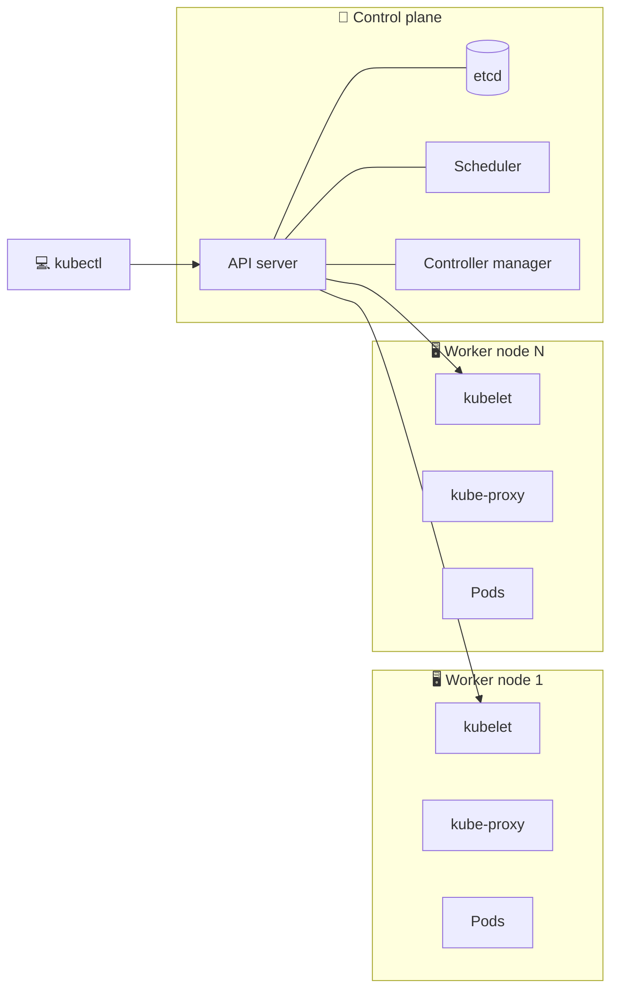
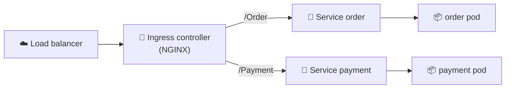
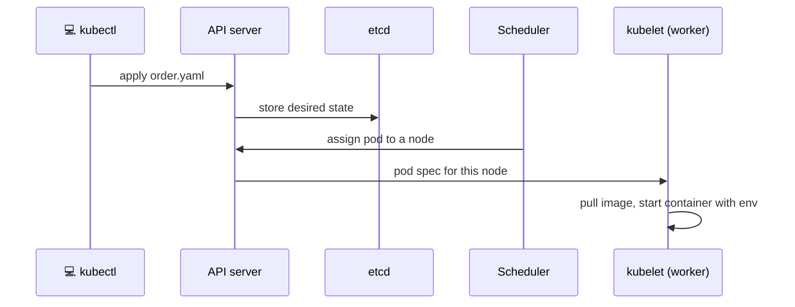
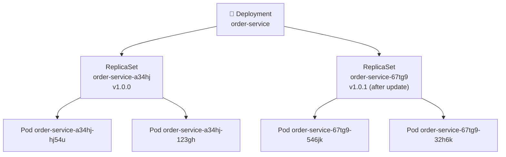
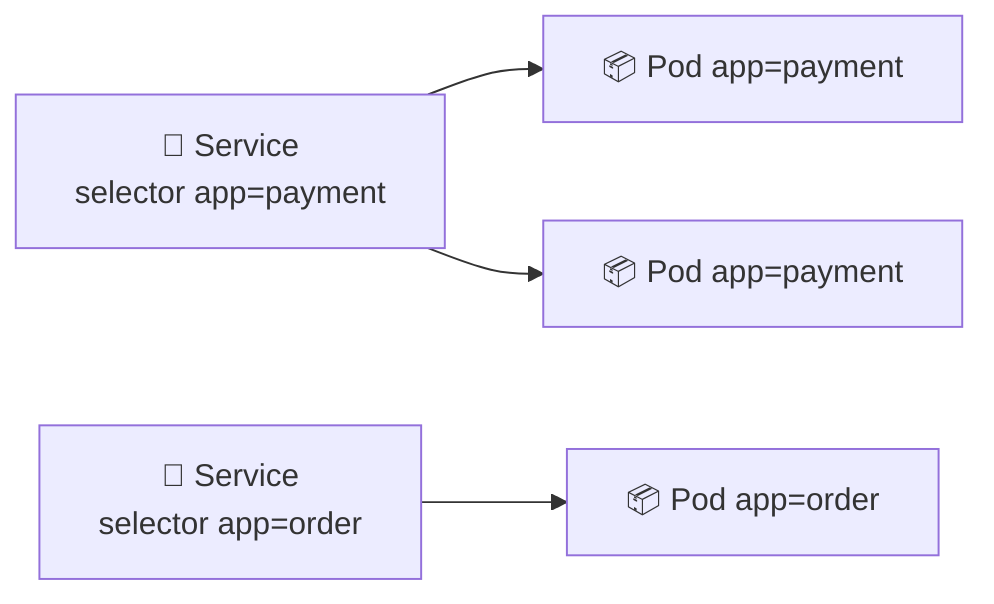
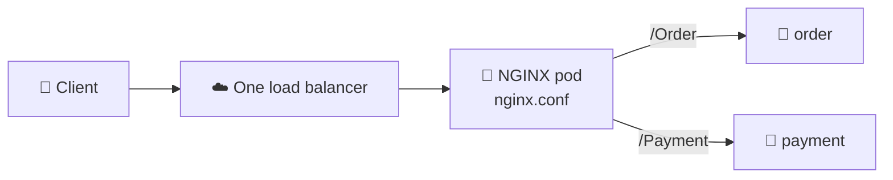
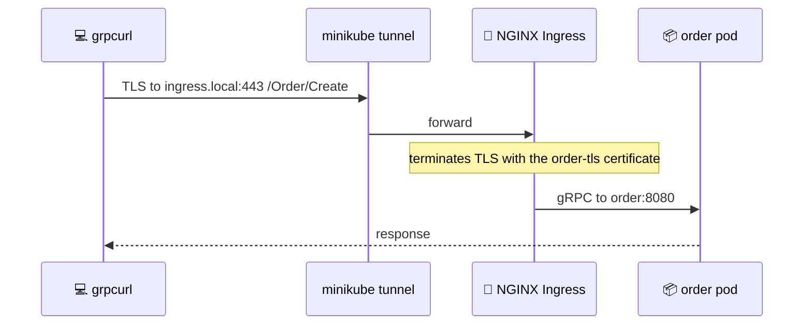
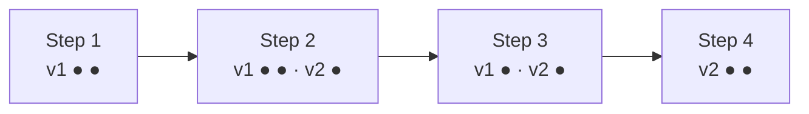
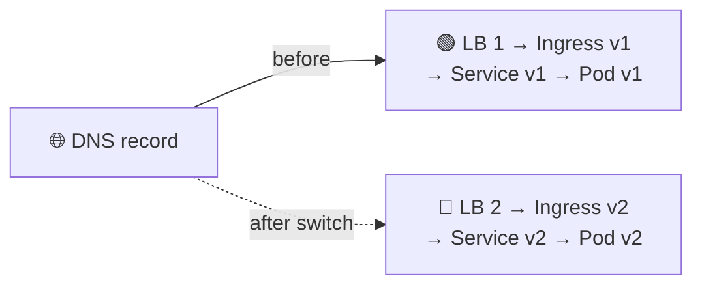
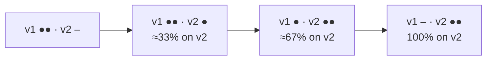

# 🚀 Deployment

[[Go/gRPC Microservices in Go - Refactored/README|📚 gRPC Microservices in Go]] · Babal Ch.8

> [!toc]- 📑 Contents
>
> - [[#🐳 Building Docker Images|🐳 Building Docker Images]]
> - [[#☸️ Kubernetes Architecture|☸️ Kubernetes Architecture]]
> - [[#🗺️ The Big Picture|🗺️ The Big Picture]]
> - [[#📦 Pod|📦 Pod]]
> - [[#🔁 Deployment|🔁 Deployment]]
> - [[#🔌 Service|🔌 Service]]
> - [[#🚪 NGINX Ingress Controller|🚪 NGINX Ingress Controller]]
> - [[#🔐 Certificates with cert-manager|🔐 Certificates with cert-manager]]
> - [[#🎛️ Deployment Strategies|🎛️ Deployment Strategies]]
> - [[#🔨 Hands-On Practice|🔨 Hands-On Practice]]
> - [[#📋 Quick Reference|📋 Quick Reference]]
> - [[#🧠 Things to Remember|🧠 Things to Remember]]
> - [[#💡 Pro Tips|💡 Pro Tips]]
> - [[#🔗 Related Topics|🔗 Related Topics]]

The services run on your laptop. This chapter packages them as **Docker images**, runs them on **Kubernetes**, exposes them securely over **TLS**, and compares ways to **roll out new versions**.


---

## 🐳 Building Docker Images

A Go service compiles to **one static binary** that already contains its dependencies. So its image only needs that binary.

A **multistage build** separates the two needs:

- 🔨 **Build stage** — the Go toolchain image runs `go build`.

- 📦 **Runtime stage** — copy only the binary into **`scratch`**, a special empty image you can build on but can't pull or run on its own.

```dockerfile
# order/Dockerfile
FROM golang:1.18 AS builder
WORKDIR /usr/src/app
COPY . .
RUN CGO_ENABLED=0 GOOS=linux go build -a -installsuffix cgo -o order ./cmd/main.go

FROM scratch
COPY --from=builder /usr/src/app/order ./order
CMD ["./order"]
```

- 🏷️ **`AS builder`** names the stage so the second stage can `COPY --from=builder`.

- 🚫 **`CGO_ENABLED=0`** builds a fully static binary. `scratch` has no C library, so a binary that needs one would fail to start.

- 🐧 **`GOOS=linux`** targets Linux even if you build on a Mac.

- 📉 **Result:** a final image of roughly the binary's size, instead of the 800 MB+ Go image.

`payment/Dockerfile` is the same with `payment` in place of `order`.

### 💻 Build, Tag, Push

```bash
cd order
docker build -t order .
docker tag order huseyinbabal/order:1.0.0
docker push huseyinbabal/order:1.0.0
```

- 📁 **`.`** — the build context: the folder sent to Docker, which holds the `Dockerfile`.

- 🏷️ **`docker tag`** — gives the image a registry name and a version.

- 🏪 **`docker push`** — uploads it to a **registry** (Docker Hub, Quay, Google Artifact Registry, AWS ECR) so Kubernetes can pull it. Pushing needs `docker login` first.

> 💡 **Real-World Example:** In CI, a merge to `main` with Git tag `v1.0.0` builds `huseyinbabal/order:1.0.0` and pushes it. Kubernetes then pulls exactly that version, and in the cluster an **image pull secret** replaces `docker login`.

---

## ☸️ Kubernetes Architecture

**Kubernetes (k8s)** is a container orchestration platform. You **declare** what should run, and it keeps the cluster in that state: it places containers on machines, restarts them, and gives them stable names to find each other.

You can get a cluster from any cloud (EKS on AWS, AKS on Azure, GKE on Google Cloud), install one on bare metal with Kubespray, or run **Minikube** locally to learn.



| Component | Job |
|---|---|
| **kubectl** | Command-line client; sends your requests to the API server |
| **API server** | The cluster's single entry point for all management |
| **etcd** | Key-value store holding every resource's state |
| **Scheduler** | Picks a node for each new pod, based on its resource needs |
| **Controller manager** | Runs controllers that turn actual state into desired state (replica count, image version, …) |
| **kubelet** | On each worker; runs the pod's containers, checks their health, reports back |
| **kube-proxy** | On each worker; routes Service traffic to the right pods |

The control plane is the **brain**; workers run your services.

---

## 🗺️ The Big Picture

With plain Docker you'd run a container directly:

```bash
docker run -d \
  -e APPLICATION_PORT=8080 \
  -e PAYMENT_SERVICE_URL=payment:8081 \
  huseyinbabal/order:1.0.0
```

In Kubernetes, the container lives inside a **pod**, and several resources stack on top of it to reach users:



- 📦 **Pod** — runs the container with its configuration.

- 🔌 **Service** — a stable address in front of a set of pods.

- 🚪 **Ingress** — maps a URL path to a Service.

- ☁️ **Ingress controller** — owns one cloud load balancer and applies all the Ingress rules.

Why the pod layer? Kubernetes isn't tied to one container runtime. When it dropped the Docker engine as a runtime in v1.24, existing pod definitions kept working unchanged.

---

## 📦 Pod

A **pod** is the smallest deployable unit. Every resource YAML has `apiVersion`, `kind`, and `spec`; the `spec` describes what to run.

```yaml
# order.yaml
apiVersion: v1
kind: Pod
metadata:
  name: order
spec:
  containers:
    - name: order
      image: huseyinbabal/order:1.0.0
      env:
        - name: APPLICATION_PORT
          value: "8080"
        - name: PAYMENT_SERVICE_URL
          value: "payment:8081"
```

```bash
kubectl apply -f order.yaml
```

What happens next:



- 🔧 **A spec can also hold** env values from a **ConfigMap** (plain key-value config) or a **Secret** (sensitive values, base64-encoded), CPU and memory requests, and a restart policy.

- 🏷️ **`payment:8081`** works because Kubernetes gives each Service a DNS name. No IP addresses in config.

---

## 🔁 Deployment

One pod is one instance. A **ReplicaSet** keeps **N identical pods** running. A **Deployment** manages ReplicaSets for you, so updating a version is just changing the image.



Names chain: Deployment → `deployment-<hash>` ReplicaSet → `replicaset-<hash>` pods. Each image update creates a new ReplicaSet.

The Payment Deployment: image `v1.0.2`, port `8081`, its database URL, and **two replicas**.

```yaml
# payment/deployment.yaml
apiVersion: apps/v1
kind: Deployment
metadata:
  name: payment
  labels:
    app: payment
spec:
  replicas: 2
  selector:
    matchLabels:
      app: payment
  template:
    metadata:
      labels:
        app: payment
    spec:
      containers:
        - name: payment
          image: huseyinbabal/payment:v1.0.2
          env:
            - name: APPLICATION_PORT
              value: "8081"
            - name: DATA_SOURCE_URL
              value: "root:changeit@tcp(mysql:3306)/payments"
```

- 🔢 **`replicas: 2`** — two pods, always. If one dies, a new one replaces it.

- 🎯 **`selector.matchLabels`** — which pods this Deployment owns. It **must match** `template.metadata.labels`.

- 📋 **`template`** — the pod spec every replica is created from.

```bash
kubectl apply -f deployment.yaml
kubectl get deployments
kubectl get deployment payment -o yaml
```

✅ `kubectl get deployments` shows `payment` with `READY 2/2`.

---

## 🔌 Service

Pods come and go, and each new one gets a new IP. A **Service** gives a group of pods **one stable name and address**, and spreads traffic across them. It finds its pods by **label selector**.



| Type | Reachable from | How |
|---|---|---|
| `ClusterIP` (default) | Inside the cluster only | `payment:8081` from other pods |
| `NodePort` | Outside, via any node | `<node-public-ip>:<nodePort>` on every worker |
| `LoadBalancer` | Outside, via a cloud load balancer | The cloud plugin creates an AWS/GCP/Azure LB |

Payment is called only by Order, so `ClusterIP` would be enough. Here it's exposed through a cloud load balancer to show the `LoadBalancer` type:

```yaml
# payment/service.yaml
apiVersion: v1
kind: Service
metadata:
  name: payment
  labels:
    app: payment
spec:
  selector:
    app: payment
  ports:
    - name: grpc
      port: 8081
      protocol: TCP
      targetPort: 8081
  type: LoadBalancer
```

- 🎯 **`selector: app: payment`** — traffic goes to pods with that label, which the Deployment set.

- 🔢 **`port`** is what clients call; **`targetPort`** is the container's port. They can differ (for example `80` → `8081`).

- 🌐 **NodePort** — with two workers at `34.12.23.4` and `34.12.23.5`, the service answers on **both** IPs at the same port. If you hit a node without the pod, kube-proxy forwards the request to the node that has it.

---

## 🚪 NGINX Ingress Controller

Three `LoadBalancer` Services mean **three** cloud load balancers, and three bills. An **Ingress controller** creates **one** load balancer and routes by path to many Services, using **Ingress** resources as the rules.



When you create or change an Ingress, the controller notices and regenerates its `nginx.conf`.

Install it with **Helm**, the Kubernetes package manager:

```bash
helm repo add ingress-nginx https://kubernetes.github.io/ingress-nginx
helm repo update
helm install nginx-ingress ingress-nginx/ingress-nginx
```

The Ingress for the Order service:

```yaml
# order/ingress.yaml
apiVersion: networking.k8s.io/v1
kind: Ingress
metadata:
  name: order
  annotations:
    kubernetes.io/ingress.class: nginx
    nginx.ingress.kubernetes.io/backend-protocol: GRPC
    nginx.ingress.kubernetes.io/ssl-redirect: "true"
    cert-manager.io/cluster-issuer: selfsigned-issuer
spec:
  rules:
    - http:
        paths:
          - path: /Order
            pathType: Prefix
            backend:
              service:
                name: order
                port:
                  number: 8080
  tls:
    - hosts:
        - ingress.local
      secretName: order-tls
```

- 📡 **`backend-protocol: GRPC`** — NGINX talks gRPC (HTTP/2) to the pods.

- 🛣️ **`path: /Order`** — every gRPC call is an HTTP/2 request to `/<service>/<method>`, such as `/Order/Create`. A prefix on the service name routes all of Order's methods.

- 🔒 **`ssl-redirect`** and **`tls`** — clients must use HTTPS. gRPC through an Ingress needs TLS because NGINX negotiates HTTP/2 over TLS.

- 🔐 **`cert-manager.io/cluster-issuer`** — asks cert-manager to issue the certificate into the Secret `order-tls`.

> 🆕 **Current Kubernetes:** the `kubernetes.io/ingress.class` annotation is deprecated; set `spec.ingressClassName: nginx` instead.

---

## 🔐 Certificates with cert-manager

Chapter 6 made certificates by hand with OpenSSL. **[cert-manager](https://cert-manager.io/)** automates it in the cluster: it obtains, stores, and **renews** certificates. It can use Let's Encrypt or Vault as the issuer; locally, a self-signed issuer is enough.

### 📥 Installation

```bash
helm repo add jetstack https://charts.jetstack.io
helm repo update
helm install cert-manager jetstack/cert-manager \
  --namespace cert-manager \
  --create-namespace \
  --version v1.10.0 \
  --set installCRDs=true
```

- 📂 **`--create-namespace`** — creates `cert-manager` if missing.

- 🧩 **`installCRDs=true`** — installs cert-manager's **custom resource definitions (CRDs)**: new resource kinds Kubernetes didn't have before.

```bash
kubectl get crds
```

✅ Lists six cert-manager kinds: `CertificateRequests`, `Certificates`, `Challenges`, `ClusterIssuers`, `Issuers`, and `Orders`.

> 🆕 **Current cert-manager:** recent charts use `--set crds.enabled=true` instead of `installCRDs`, and pin a current `--version`.

### 🏛️ ClusterIssuer

To use a certificate you must **issue** one. A **ClusterIssuer** issues certificates for the whole cluster.

```yaml
# cluster-issuer.yaml
apiVersion: cert-manager.io/v1
kind: ClusterIssuer
metadata:
  name: selfsigned-issuer
spec:
  selfSigned: {}
```

```bash
kubectl apply -f cluster-issuer.yaml
kubectl get clusterissuers -o wide selfsigned-issuer
```

✅ The issuer shows `READY True`. The Ingress annotation above points to it by name.

### 💻 Calling Order Through the Ingress

The certificate covers `ingress.local`, so point that name at your machine:

```text
# /etc/hosts
127.0.0.1 ingress.local
```

Then open a tunnel from `127.0.0.1` to the Ingress controller inside Minikube:

```bash
minikube tunnel
```



1. **Trust the certificate:** open `https://ingress.local` in a browser, download the self-signed certificate from the padlock menu, and add it to your keychain.

2. **Call the service.** The Ingress doesn't expose reflection, so give grpcurl the proto file:

    ```bash
    grpcurl -import-path /path/to/order -proto order.proto ingress.local:443 Order/Create
    ```

    - **`-import-path`** + **`-proto`** — grpcurl reads the methods from the `.proto` file instead of asking the server.

    - A Go client doesn't need this; it already has the generated stub.

---

## 🎛️ Deployment Strategies

Deploying isn't one-off: every new image version, env change, or replica change is a new rollout. The question is **how traffic moves** from old pods to new ones.

### 🔄 RollingUpdate (the default)

Kubernetes creates a new ReplicaSet and swaps pods **one at a time**.

```bash
kubectl set image deployment/order order=huseyinbabal/order:1.1.0
```



1. The Service sends traffic to two v1 pods.

2. A v2 ReplicaSet starts one new pod.

3. One v1 pod is removed; the Service now reaches both versions.

4. The second v2 pod is ready and the last v1 pod is removed.

- ⚠️ **v1 and v2 run at the same time**, so every release must be **backward compatible**: in its API and its database changes.

- ↩️ **Rollback:** `kubectl rollout undo deployment/order` returns to the previous ReplicaSet.

### 🔵🟢 Blue-Green

Run the new version as a **complete second environment**, test it, then switch all traffic at once.



- 🔵 **v2 is deployed behind a second Ingress controller** with its own load balancer. Internal testers use it first.

- 🔀 **The switch** — change the domain's DNS record to the new load balancer. Switching back is just as fast.

- 💸 **Cost** — you run two full copies of the system during the release.

### 🐤 Canary

Send a **small share** of real traffic to the new version, watch it, then grow the share.

- 🔌 **One Service, two Deployments** — both use the label `app: order`, so the Service's selector matches pods from both.

- ⚖️ **Share = replica ratio** — the Service spreads traffic across all matching pods.

    - 2 v1 pods + 1 v2 pod → about 1/3 ≈ 33% of traffic hits v2.

    - 49 v1 pods + 1 v2 pod → 1/50 = 2%.

- 📈 **Then shift** — scale v2 up and v1 down until v1 is at 0.



| Strategy | Traffic switch | Extra cost | Best for |
|---|---|---|---|
| **RollingUpdate** | Gradual, pod by pod | None | Everyday releases |
| **Blue-Green** | All at once, instant switch back | A full second environment | Risky releases needing a quick rollback |
| **Canary** | Small share first, then grow | A few extra pods | Testing on real users, experimental features |

> 💡 **Feature flags** separate *deploying* code from *releasing* a feature: ship the code turned off, then switch it on for some users without a new deployment.

### 🤖 GitOps

Here, you ran `kubectl` by hand to learn. In practice, **GitOps** tools such as **Argo CD** or **Flux** watch a Git repository of manifests and apply every change automatically. Sensitive values go into **Secrets**, optionally synced from an external store with **External Secrets**.

### 🧪 Interview Q&A

**Q1:** Why use a multistage build with `scratch` for a Go service?

**Q2:** What's the difference between a Pod, a ReplicaSet, and a Deployment?

**Q3:** How does a Service know which pods to send traffic to?

**Q4:** Why use an Ingress controller instead of a `LoadBalancer` Service per microservice?

**Q5:** In a canary release with 4 v1 pods and 1 v2 pod, what share of traffic reaches v2?

> [!answer]- 📋 Answers
>
> **A1:** The Go toolchain is needed only to compile. Copying just the static binary into `scratch` gives a tiny image with nothing extra to patch or attack.
>
> **A2:** A Pod runs containers. A ReplicaSet keeps N identical pods running. A Deployment manages ReplicaSets so version updates and rollbacks are automatic.
>
> **A3:** By its label `selector`. Any running pod with matching labels receives traffic.
>
> **A4:** Each `LoadBalancer` Service creates its own cloud load balancer. An Ingress controller uses one load balancer and routes by path to many Services.
>
> **A5:** 1 / (4 + 1) = 20%, because the Service spreads traffic evenly across all matching pods.

---

## 🔨 Hands-On Practice

1. **Build and compare image sizes.**

    ```bash
    cd order && docker build -t order .
    docker images order
    docker images golang:1.18
    ```

    ✅ `order` is a few tens of MB at most; `golang:1.18` is several hundred MB.

2. **Deploy Payment to Minikube.**

    ```bash
    minikube start
    cd payment && docker build -t huseyinbabal/payment:v1.0.2 .
    minikube image load huseyinbabal/payment:v1.0.2
    kubectl apply -f deployment.yaml -f service.yaml
    kubectl get pods -l app=payment
    ```

    ✅ Two `payment-…` pods reach `Running`. Delete one with `kubectl delete pod <name>`, and a replacement appears.

    - `minikube image load` copies a local image into the cluster, so no registry is needed.

3. **Roll out and roll back.**

    ```bash
    docker build -t huseyinbabal/payment:v1.0.3 . && minikube image load huseyinbabal/payment:v1.0.3
    kubectl set image deployment/payment payment=huseyinbabal/payment:v1.0.3
    kubectl rollout status deployment/payment
    kubectl rollout undo deployment/payment
    ```

    ✅ `kubectl get rs` shows a new ReplicaSet appear, then the old one scaled back up after the undo.

---

### 📋 Quick Reference

```bash
docker build -t order .                                   # build image
docker tag order huseyinbabal/order:1.0.0                 # name + version
docker push huseyinbabal/order:1.0.0                      # upload to registry

kubectl apply -f deployment.yaml                          # create / update
kubectl get deployments | pods | services | ingress       # list resources
kubectl get deployment payment -o yaml                    # full live spec
kubectl set image deployment/order order=huseyinbabal/order:1.1.0   # rolling update
kubectl rollout undo deployment/order                     # roll back

helm install nginx-ingress ingress-nginx/ingress-nginx    # Ingress controller
kubectl get clusterissuers                                # cert-manager issuers
minikube tunnel                                           # reach the Ingress locally
```

| Resource | One-line job |
|---|---|
| **Pod** | Runs the container + config |
| **Deployment** | N replicas + version updates |
| **Service** | Stable name/address for pods, by label |
| **Ingress** | Path → Service routing rule |
| **ClusterIssuer** | Issues TLS certificates cluster-wide |

### 🧠 Things to Remember

- Multistage build: compile with `golang`, run from `scratch` with `CGO_ENABLED=0`.

- Push versioned images to a registry; Kubernetes pulls them by tag.

- Deployment → ReplicaSet → Pods; a new image creates a new ReplicaSet.

- Services find pods by labels; inside the cluster you call `service-name:port`.

- One Ingress controller = one load balancer for many services; gRPC Ingress needs `backend-protocol: GRPC` and TLS.

- RollingUpdate is the default; Blue-Green switches at once; Canary shifts a share of traffic.

### 💡 Pro Tips

- **Never deploy `:latest`** → pin a version tag, so rollbacks and "what's running?" have a clear answer.

- **Add readiness and liveness probes** (gRPC health checks) → a RollingUpdate then waits until new pods can really serve before removing old ones.

- **Set CPU and memory `requests` and `limits`** → the scheduler can place pods sensibly, and one leaky pod can't starve its node.

- **Keep `DATA_SOURCE_URL` in a Secret, not in the YAML** → manifests live in Git; passwords shouldn't.

- **Watch canary metrics before shifting more traffic** → error rate and latency are the signal to continue or roll back (Chapter 9).

### 🔗 Related Topics

- ⬅️ Previous: [[7. Testing Microservices]]

- ➡️ Next: [[9. Observability]]

- 📖 Original study guide: [[Go/gRPC Microservices in Go/8. Deployment - Study Guide]]

- 💻 Working codebase: [[Go/gRPC Microservices in Go - Refactored/microservices/README|Order + Payment codebase]] — multistage `Dockerfile`s, `docker-compose.yml`, and kustomize manifests in `deploy/k8s/`

- 🔐 TLS and certificates by hand: [[6. Resilient Communication]]

- 🐳 Dockerfile basics: [[DevOps/NaNa/Docker/6. Dockerfile]]

- 🐳 Docker best practices: [[DevOps/NaNa/Docker/8. Docker Best Practices]]
