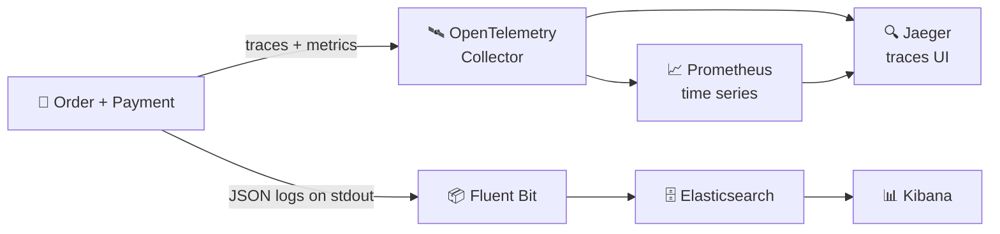
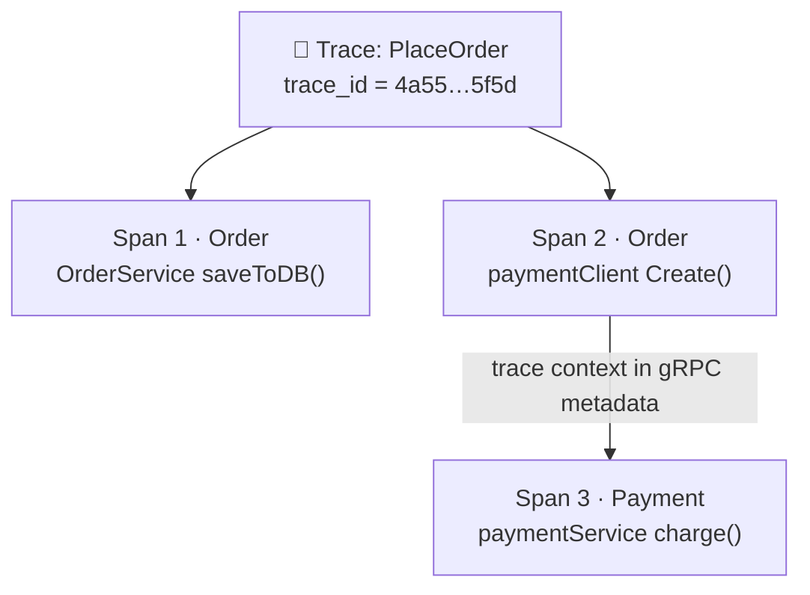
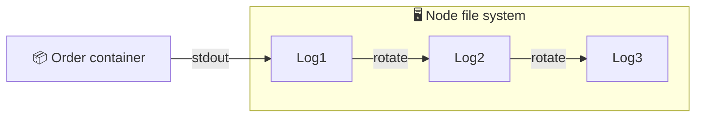
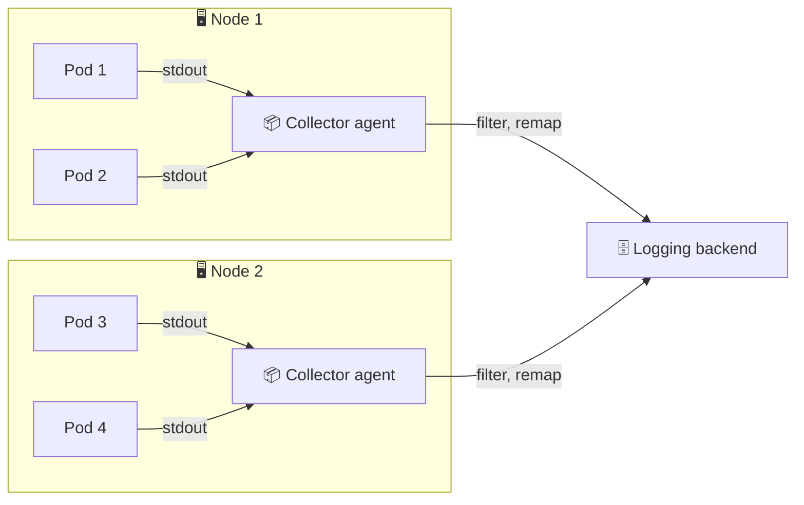
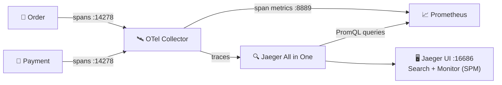
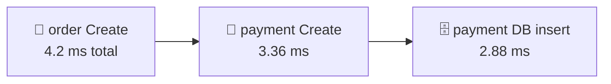
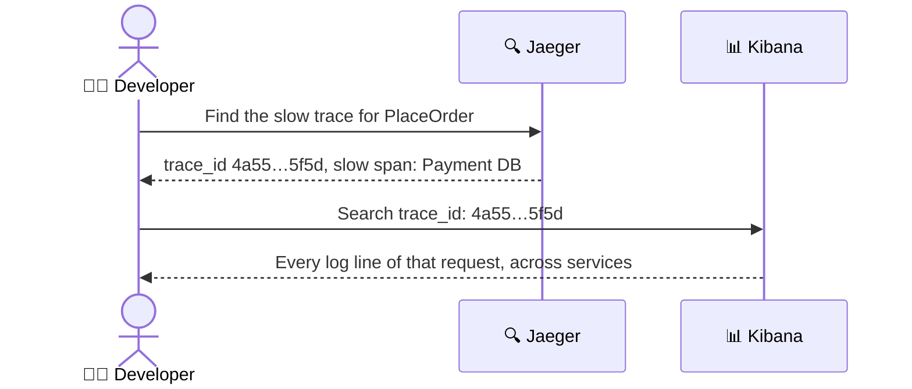

# 🔭 Observability

[[Go/gRPC Microservices in Go - Refactored/README|📚 gRPC Microservices in Go]] · Babal Ch.9

> [!toc]- 📑 Contents
>
> - [[#👀 What Observability Answers|👀 What Observability Answers]]
> - [[#🧵 Traces and Spans|🧵 Traces and Spans]]
> - [[#📈 Metrics, SLAs, SLOs, and SLIs|📈 Metrics, SLAs, SLOs, and SLIs]]
> - [[#📜 Logs in Kubernetes|📜 Logs in Kubernetes]]
> - [[#🛰️ OpenTelemetry|🛰️ OpenTelemetry]]
> - [[#🏗️ The Tracing Backend: Jaeger, Collector, Prometheus|🏗️ The Tracing Backend: Jaeger, Collector, Prometheus]]
> - [[#🔌 Instrumenting the Order Service|🔌 Instrumenting the Order Service]]
> - [[#🔍 Reading Traces in Jaeger|🔍 Reading Traces in Jaeger]]
> - [[#🪪 Trace IDs in Application Logs|🪪 Trace IDs in Application Logs]]
> - [[#📦 Collecting Logs: Fluent Bit, Elasticsearch, Kibana|📦 Collecting Logs: Fluent Bit, Elasticsearch, Kibana]]
> - [[#🔨 Hands-On Practice|🔨 Hands-On Practice]]
> - [[#📋 Quick Reference|📋 Quick Reference]]
> - [[#🧠 Things to Remember|🧠 Things to Remember]]
> - [[#💡 Pro Tips|💡 Pro Tips]]
> - [[#🔗 Related Topics|🔗 Related Topics]]

`PlaceOrder` now crosses Order, Payment, and their databases. When it fails or slows down, which part was it? **Observability** lets you answer that from the outside, using three kinds of data: **traces**, **metrics**, and **logs**.

---

## 👀 What Observability Answers

- 💥 *Why did the Product service crash yesterday?*

- 🐢 *Why does performance drop every Thursday at noon?*

- 📊 *How is the Payment service doing right now?*



This chapter builds that whole picture: the top half for traces and metrics, the bottom half for logs. The **trace ID** ties them together.

---

## 🧵 Traces and Spans

A **trace** is the journey of one request across services. It's split into **spans**, one per operation, and every span carries the same **trace ID**.



- 🆔 **Trace ID** — generated when `PlaceOrder` starts, then passed to every service the request touches.

- ⏱️ **Span** — one operation with a start, a duration, and **tags**.

- 🔎 **Use** — search the trace ID to see every step of that request, in order, with timings.

The gRPC instrumentation tags each span with standard keys:

| Span key | Value | Meaning |
|---|---|---|
| `rpc.system` | `grpc` | Type of RPC |
| `rpc.service` | `Payment` | gRPC service name |
| `rpc.method` | `Create` | gRPC method name |
| `span.kind` | `server` | Recorded on the server or client side |

---

## 📈 Metrics, SLAs, SLOs, and SLIs

A **metric** is a number tracked over time. In Prometheus, each data point has a **name**, a **value**, **labels**, and a **timestamp**. Labels let you group and filter: for example, request count by `service="order"`.

- 🔢 **Counter** — only goes up: total requests, total errors. Its **rate** gives requests per second.

- 🌡️ **Gauge** — goes up and down: free disk space, active connections.

- 📊 **Histogram** — counts values in buckets: how many requests took 0–5 ms, 5–10 ms, …. Percentiles are calculated from it.

### 🤝 Service Levels

| Term | What it is | Example |
|---|---|---|
| **SLI** (indicator) | A measured metric of quality | Latency, error rate, throughput: "1,000 operations per ms" |
| **SLO** (objective) | The team's target for an SLI | "Object Storage is up 99.999% of the time" |
| **SLA** (agreement) | The promise to customers, often with penalties | Terms page: uptime and latency guarantees |

The team measures SLIs, aims for SLOs, and keeps SLOs stricter than the SLA so customers stay covered.

> 🧮 **What 99.999% allows:** 0.001% of a year = 0.00001 × 525,600 min ≈ **5.3 minutes** of downtime per year.

### ⚠️ Why Averages Lie

Ten latency samples: `1, 3, 2, 4, 5, 3, 2, 9, 5, 1` ms.

```text
average = (1 + 3 + 2 + 4 + 5 + 3 + 2 + 9 + 5 + 1) / 10 = 35 / 10 = 3.5 ms
```

Now take 1,000 fast requests at 1 ms and 10 slow ones at 4 s:

```text
total   = 1,000 × 1 ms + 10 × 4,000 ms = 1,000 + 40,000 = 41,000 ms
average = 41,000 ms / 1,010 requests ≈ 40.6 ms
```

An average of 40.6 ms matches **no real request**: 99% took 1 ms, and ten users waited 4 seconds. The average hides both.

### 🎯 Percentiles

A **percentile** says "X% of requests were this fast or faster". "p95 = 3 ms" means 95% of requests took 3 ms or less.

Latencies: `10, 22, 2, 3, 9, 1, 87, 11, 7, 4` ms.

1. **Sort them:** `1, 2, 3, 4, 7, 9, 10, 11, 22, 87`

2. **Find the rank:** p80 → 80% of 10 values = position **8**.

3. **Read the value:** the 8th value is **11 ms**.

So p80 = 11 ms: 8 of 10 requests took 11 ms or less. The p95 here is 87 ms, which shows the slow tail that an average would blur.

---

## 📜 Logs in Kubernetes

A **log** is an event your application writes, such as "Creating order…" or an error with details. In a monolith you read one file. With many services and pods, you need logs **in one place** and **filterable**.

### 🖥️ Node-Level Logging

Containers write to stdout; the node stores that output in files under `/var/log/containers`. **Log rotation** starts a new file when one gets too big, so files don't grow forever.



The logs exist, but they're spread across files and nodes.

### ☸️ Cluster-Level Logging

A **collector agent** on every node streams those files to a central **logging backend**, which stores, searches, graphs, and alerts on them.



The classic stack is **ELK**: **E**lasticsearch (backend), **L**ogstash (collector), **K**ibana (UI). This chapter uses **Fluent Bit** in place of Logstash.

### 🧪 Interview Q&A

**Q1:** What's the difference between a trace and a span?

**Q2:** Why is p95 latency more useful than average latency in an SLO?

**Q3:** Compute p80 for `5, 1, 9, 3, 7, 2, 8, 4, 6, 10`.

**Q4:** How do an SLI, an SLO, and an SLA relate?

> [!answer]- 📋 Answers
>
> **A1:** A trace is one request's whole journey across services. A span is one timed operation inside it; all spans share the trace ID.
>
> **A2:** A few very slow requests drag the average up, while many fast ones pull it down, so it matches nobody's experience. p95 states what 95% of users actually got.
>
> **A3:** Sorted: `1 … 10`; 80% of 10 = position 8 → **8 ms**.
>
> **A4:** The SLI is what you measure, the SLO is the internal target for it, and the SLA is the external promise, which should be looser than the SLO.

---

## 🛰️ OpenTelemetry

**[OpenTelemetry (OTel)](https://opentelemetry.io/)** is a vendor-neutral set of APIs and SDKs to **generate, collect, and export** traces, metrics, and logs. You instrument once and can send the data to Jaeger, Prometheus, or any other compatible backend.

Where to instrument a gRPC service:

- 📤 **gRPC client calls** — Order → Payment.

- 📥 **gRPC server handlers** — every incoming call.

- 🗄️ **Database calls** — the `otelgorm` plugin records GORM queries.

- 🔗 **Propagation** — trace context travels to the next service, so spans join into one trace.

As with retries and circuit breakers (Chapter 6), the gRPC part is an **interceptor**:

```go
// order/internal/adapters/payment/payment.go
var opts []grpc.DialOption
opts = append(opts,
    grpc.WithTransportCredentials(insecure.NewCredentials()),
    grpc.WithUnaryInterceptor(otelgrpc.UnaryClientInterceptor()),
)
conn, err := grpc.Dial(paymentServiceUrl, opts...)
```

Every call from Order to Payment now produces a client span and carries the trace context in gRPC metadata.

---

## 🏗️ The Tracing Backend: Jaeger, Collector, Prometheus

**[Jaeger](https://www.jaegertracing.io/)**, created at Uber, stores traces and shows them in a UI. Its **Service Performance Monitoring (SPM)** tab also draws latency, request-rate, and error-rate charts, using Prometheus as the time-series store.



| Component | Image | Role |
|---|---|---|
| **Jaeger All in One** | `jaegertracing/all-in-one` | Jaeger collector, storage, query API, and UI in one pod |
| **OpenTelemetry Collector** | `otel/opentelemetry-collector-contrib` | `14278` receives spans; `8889` exposes metrics for Prometheus |
| **Prometheus** | — | Stores the time series SPM charts are drawn from |

Jaeger finds Prometheus through two env vars:

```text
METRICS_STORAGE_TYPE=prometheus
PROMETHEUS_SERVER_URL=http://jaeger-prometheus.jaeger.svc.cluster.local:9090
```

The address is Kubernetes DNS: `<service>.<namespace>.svc.cluster.local`. Here, Service `jaeger-prometheus` in namespace `jaeger`.

### 💻 Install the Stack

A single Helm chart from the book's author bundles all three:

```bash
helm repo add huseyinbabal https://huseyinbabal.github.io/charts
helm install my-jaeger huseyinbabal/jaeger -n jaeger --create-namespace
kubectl get pods -n jaeger
```

✅ Jaeger, OpenTelemetry Collector, and Prometheus pods reach `Running`. Services send spans to `http://jaeger-otel.jaeger.svc.cluster.local:14278/api/traces`.

---

## 🔌 Instrumenting the Order Service

Two steps: configure a **tracer provider** once in `main.go`, then add the **server interceptor**.

### 1️⃣ Tracer Provider

```go
// order/cmd/main.go
const (
    service     = "order"
    environment = "development"
    id          = 1
)

func tracerProvider(url string) (*tracesdk.TracerProvider, error) {
    exp, err := jaeger.New(jaeger.WithCollectorEndpoint(jaeger.WithEndpoint(url)))
    if err != nil {
        return nil, err
    }
    tp := tracesdk.NewTracerProvider(
        tracesdk.WithBatcher(exp),
        tracesdk.WithResource(resource.NewWithAttributes(
            semconv.SchemaURL,
            semconv.ServiceNameKey.String(service),
            attribute.String("environment", environment),
            attribute.Int64("ID", id),
        )),
    )
    return tp, nil
}
```

- 📤 **Exporter** — sends finished spans to the collector URL.

- 📦 **`WithBatcher`** — sends spans in **batches**, not one request per span, to keep the overhead low.

- 🏷️ **Resource** — attributes attached to every span from this service: `service.name`, `environment`, `ID`. You can filter by them in the Jaeger UI.

### 2️⃣ Register It and Choose Propagation

```go
// order/cmd/main.go
func main() {
    tp, err := tracerProvider("http://jaeger-otel.jaeger.svc.cluster.local:14278/api/traces")
    if err != nil {
        log.Fatal(err)
    }
    otel.SetTracerProvider(tp)
    otel.SetTextMapPropagator(propagation.NewCompositeTextMapPropagator(propagation.TraceContext{}))
    // ... adapters as before
}
```

- 🌍 **`SetTracerProvider`** — makes it the global provider that the interceptors use.

- 🔗 **`propagation.TraceContext{}`** — passes the trace in the W3C `traceparent` header. Payment reads it and adds its spans to the **same** trace.

### 3️⃣ Server Interceptor

```go
// order/internal/adapters/grpc/server.go
grpcServer := grpc.NewServer(
    grpc.UnaryInterceptor(otelgrpc.UnaryServerInterceptor()),
)
```

Every incoming call now creates a server span and joins any trace the caller started.

> 🆕 **Current OpenTelemetry Go:** the Jaeger exporter was removed; use OTLP (`otlptracegrpc.New(ctx, otlptracegrpc.WithEndpoint(...))`), which Jaeger and the Collector accept. The otelgrpc interceptors are deprecated; use `grpc.StatsHandler(otelgrpc.NewServerHandler())` and `grpc.WithStatsHandler(otelgrpc.NewClientHandler())`.

---

## 🔍 Reading Traces in Jaeger

Open the UI by forwarding its port from the Jaeger pod:

```bash
kubectl get pods -n jaeger
kubectl port-forward -n jaeger jaeger-c55bf4988-ghfsd 16686
```

Then visit `http://localhost:16686`, pick the `order` service, and search.

### 🧵 A Create-Order Trace



- ⏱️ **4.2 ms** for the whole create-order flow.

- 🧩 **3.36 ms** of it inside Payment's `Create`.

- 🗄️ **2.88 ms** of that in Payment's database call → the database is where most of the time goes.

Clicking a span shows its tags: `rpc.service`, `rpc.method`, `span.kind=server`, and the resource attributes (`environment`, `ID`). A **database span** also shows the database name and the **SQL statement**, which often reveals a slow query directly.

### 📊 Service Performance Monitoring

Jaeger's **Monitor** tab shows per-service charts calculated from Prometheus: **p95 latency**, **request rate**, and **error rate**.

> 💡 **Reading SPM:** "Order p95 = 46.79 ms at 6 req/s" means 95% of Order's requests finished in 46.79 ms or less, at a load of about 6 requests per second.

---

## 🪪 Trace IDs in Application Logs

To pull every log line of **one request** across services, each line needs the **trace ID**. Teams also call it a *correlation ID* or *distributed trace ID*.

### 📝 Structured Logging with logrus

```go
log.WithFields(log.Fields{
    "id": "12212",
}).Info("Order is updated")
```

The ID is a **field**, not text inside the message, so a backend can filter on `id` directly.

### 🧩 A Formatter That Adds Trace and Span IDs

```go
// order/cmd/main.go
type serviceLogger struct {
    formatter log.JSONFormatter
}

func (l serviceLogger) Format(entry *log.Entry) ([]byte, error) {
    span := trace.SpanFromContext(entry.Context)
    entry.Data["trace_id"] = span.SpanContext().TraceID().String()
    entry.Data["span_id"] = span.SpanContext().SpanID().String()
    return l.formatter.Format(entry)
}

func init() {
    log.SetFormatter(serviceLogger{
        formatter: log.JSONFormatter{FieldMap: log.FieldMap{"msg": "message"}},
    })
    log.SetOutput(os.Stdout)
    log.SetLevel(log.InfoLevel)
}
```

- 🔍 **`trace.SpanFromContext`** — reads the current span from the log entry's context.

- 🧾 **JSON output** — harder for humans, perfect for backends: each key becomes a searchable field without a custom parser.

- 🚀 **`init()`** — runs when `main.go` loads, so every log call in the service uses the formatter.

Log **with the request context**:

```go
log.WithContext(ctx).Info("Creating order...")
```

```json
{"level":"info","message":"Creating order...","span_id":"1ab65b1c982ee940","time":"2022-12-04T06:37:25Z","trace_id":"4a55375c835c1e0f78d5a0001b6f5f5d"}
```

The `trace_id` here is the same one Jaeger shows, so you can jump from a slow trace to its logs and back.

---

## 📦 Collecting Logs: Fluent Bit, Elasticsearch, Kibana

```bash
kubectl logs -f order-74b6b997c-4rwb5
```

`kubectl logs` just reads the container's stdout file on the node: `/var/log/containers/<pod>_<namespace>_<container>-<id>.log`. A collector can stream the same files.

### 📦 Fluent Bit as a DaemonSet

**[Fluent Bit](https://fluentbit.io/)** is a lightweight log processor and shipper. A **DaemonSet** runs exactly **one pod per node**, which is what a log agent needs.

```bash
helm repo add fluent https://fluent.github.io/helm-charts
helm repo update
helm install fluent-bit fluent/fluent-bit
```

By default it sends to a host named `elasticsearch-master`, so it needs configuring once Elasticsearch exists.

### 🗄️ Elasticsearch with the ECK Operator

**Elasticsearch** is a search engine built on Lucene. The **ECK operator** adds `Elasticsearch` and `Kibana` resource kinds to Kubernetes and manages them for you.

```bash
kubectl create -f https://download.elastic.co/downloads/eck/2.5.0/crds.yaml
kubectl apply -f https://download.elastic.co/downloads/eck/2.5.0/operator.yaml
```

```bash
cat <<EOF | kubectl apply -f -
apiVersion: elasticsearch.k8s.elastic.co/v1
kind: Elasticsearch
metadata:
  name: quickstart
spec:
  version: 8.5.2
  nodeSets:
    - name: default
      count: 1
      config:
        node.store.allow_mmap: false
EOF
```

- 🧩 **CRDs, then operator, then a resource** — the same pattern as cert-manager in Chapter 8.

- 🧠 **`allow_mmap: false`** — avoids needing to raise the node's virtual-memory limit; fine for a local cluster.

ECK stores the `elastic` user's password in a Secret:

```bash
PASSWORD=$(kubectl get secret quickstart-es-elastic-user -o go-template='{{.data.elastic | base64decode}}')
```

### 🔧 Point Fluent Bit at Elasticsearch

```yaml
# fluent.yaml
env:
  - name: ELASTIC_PASSWORD
    valueFrom:
      secretKeyRef:
        name: quickstart-es-elastic-user
        key: elastic
config:
  outputs: |
    [OUTPUT]
        Name               es
        Match              kube.*
        Host               quickstart-es-http
        HTTP_User          elastic
        HTTP_Passwd        ${ELASTIC_PASSWORD}
        tls                On
        tls.verify         Off
        Logstash_Format    On
        Suppress_Type_Name On
        Retry_Limit        False
```

```bash
helm upgrade --install fluent-bit fluent/fluent-bit -f fluent.yaml
```

- 🎯 **`Match kube.*`** — forward container logs (Fluent Bit tags them `kube.…`).

- 🔐 **`HTTP_Passwd ${ELASTIC_PASSWORD}`** — Fluent Bit reads the password from the env var, which comes from ECK's Secret.

- 🔓 **`tls.verify Off`** — ECK uses a self-signed certificate locally; keep verification on in production.

- 📅 **`Logstash_Format On`** — writes to daily `logstash-YYYY.MM.DD` indices.

- 🔁 **`Retry_Limit False`** — retry forever if Elasticsearch is down, instead of dropping logs.

### 📊 Kibana

```bash
cat <<EOF | kubectl apply -f -
apiVersion: kibana.k8s.elastic.co/v1
kind: Kibana
metadata:
  name: quickstart
spec:
  version: 8.5.2
  count: 1
  elasticsearchRef:
    name: quickstart
EOF

kubectl port-forward service/quickstart-kb-http 5601
```

1. Open `https://localhost:5601` and sign in as `elastic` with `$PASSWORD`.

2. Create a data view with the pattern `logstash*`.

3. Add the `kubernetes.container_name` and `message` columns.

4. Search `trace_id: "4a55375c835c1e0f78d5a0001b6f5f5d"`.

✅ Every log line of that one request appears, from Order and Payment, in time order.



> 💡 **Alerting** builds on the same data: a rule such as "Order p95 > 200 ms **for 10 minutes**" notifies the on-call engineer. The `for` duration filters out short spikes, so every alert needs action.

---

## 🔨 Hands-On Practice

1. **Find a request in Jaeger.** Install the Jaeger chart, add the tracer provider and both interceptors to Order and Payment, then place an order with grpcurl.

    ✅ In Jaeger, one trace contains spans from both `order` and `payment`.

2. **Correlate logs.** Add the `serviceLogger` formatter and `log.WithContext(ctx).Info("Creating order...")` to Order's `Create`. Place an order and run `kubectl logs` on the Order pod.

    ✅ The JSON log line's `trace_id` matches the trace ID shown in Jaeger.

3. **Calculate a percentile.** For latencies `12, 4, 30, 8, 6, 15, 5, 7, 100, 9` ms, find the average and p90.

    ✅ Average = 196 / 10 = 19.6 ms. Sorted: `4, 5, 6, 7, 8, 9, 12, 15, 30, 100`; 90% of 10 = position 9 → p90 = **30 ms**.

---

### 📋 Quick Reference

| Need | Code / command |
|---|---|
| Client spans | `grpc.WithUnaryInterceptor(otelgrpc.UnaryClientInterceptor())` |
| Server spans | `grpc.NewServer(grpc.UnaryInterceptor(otelgrpc.UnaryServerInterceptor()))` |
| Global provider | `otel.SetTracerProvider(tp)` |
| Propagation | `otel.SetTextMapPropagator(propagation.TraceContext{})` |
| Trace ID from ctx | `trace.SpanFromContext(ctx).SpanContext().TraceID().String()` |
| Log with context | `log.WithContext(ctx).Info("...")` |

```bash
helm install my-jaeger huseyinbabal/jaeger -n jaeger --create-namespace   # Jaeger + Collector + Prometheus
kubectl port-forward -n jaeger <jaeger-pod> 16686                         # Jaeger UI
kubectl logs -f <pod>                                                     # one pod's logs
helm upgrade --install fluent-bit fluent/fluent-bit -f fluent.yaml        # log shipper
kubectl port-forward service/quickstart-kb-http 5601                      # Kibana UI
```

| Port | Component |
|---|---|
| `14278` | OTel Collector: span intake |
| `8889` | OTel Collector: Prometheus metrics |
| `9090` | Prometheus |
| `16686` | Jaeger UI |
| `5601` | Kibana |

### 🧠 Things to Remember

- Traces show *where* time went, metrics show *how much and how often*, logs show *what happened*.

- A trace is many spans sharing one trace ID, carried between services by context propagation.

- Use percentiles (p95, p99), not averages, for latency targets.

- SLI = what you measure, SLO = your target, SLA = your promise to customers.

- Write JSON logs to stdout with `trace_id`; a per-node agent ships them to a central backend.

- OpenTelemetry instruments once and exports to any compatible backend.

### 💡 Pro Tips

- **Instrument the client and the server** → with only one side, a trace breaks at the service boundary.

- **Sample traces in production** → recording 100% of requests at high traffic is expensive; a sampler such as 10% keeps costs down while showing patterns.

- **Never log secrets or personal data** → logs are widely readable and kept a long time.

- **Use the same field names in every service** (`trace_id`, `order_id`) → one query then works across all services.

- **Call `tp.Shutdown(ctx)` on exit** → the batcher flushes its last spans instead of dropping them.

### 🔗 Related Topics

- ⬅️ Previous: [[8. Deployment]]

- ➡️ Next: the async side, in the [[Brokers/Kafka/Kafka The Definitive Guide/README|📬 Kafka: The Definitive Guide lessons]]

- 🏁 Start of the book: [[1. Introduction to Go gRPC Microservices]]

- 📖 Original study guide: [[Go/gRPC Microservices in Go/9. Observability - Study Guide]]

- 💻 Working codebase: [[Go/gRPC Microservices in Go - Refactored/microservices/README|Order + Payment codebase]] — OTLP tracing and trace-aware `slog` logs in `internal/telemetry/`, Jaeger at `localhost:16686` after `make up`

- 🧅 Interceptors: [[6. Resilient Communication]]

- ☸️ Helm, CRDs, and port-forwarding: [[8. Deployment]]
