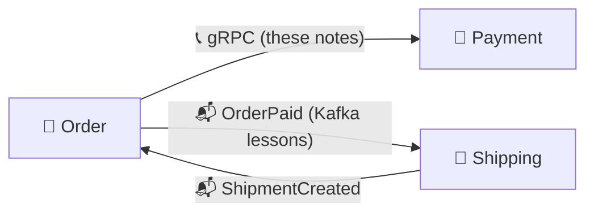

# 📡 gRPC Microservices in Go

Refactored, easier-to-read notes for Hüseyin Babal’s *gRPC Microservices in Go* (Manning, 2023), checked against the book and enriched with Alexander Shuiskov’s *Microservices with Go, 2nd Edition*. Written with [[Go/gRPC Microservices in Go - Refactored/AI Prompt - gRPC Microservices in Go|this folder's prompt]].

## 📚 Chapter Map

| Chapter | Focus | Note |
|---|---|---|
| 1 | Microservices, why Go and gRPC, REST vs gRPC, production architecture | [[1. Introduction to Go gRPC Microservices]] |
| 2 | Monolith pains, scale cube, sagas, service discovery, first gRPC call | [[2. gRPC Meets Microservices]] |
| 3 | Protobuf messages and encoding, stub generation with protoc and Buf, proto repo, compatibility | [[3. Getting Up and Running with gRPC and Golang]] |
| 4 | Hexagonal architecture and the first Order service | [[4. Microservice Project Setup]] |
| 5 | Load balancing, payment port and adapter, status codes and error details | [[5. Interservice Communication]] |
| 6 | Timeouts, retries, circuit breakers, interceptors, mTLS | [[6. Resilient Communication]] |
| 7 | Testing pyramid, mocks, Testcontainers, end-to-end tests, coverage | [[7. Testing Microservices]] |
| 8 | Docker images, Kubernetes resources, Ingress, cert-manager, rollout strategies | [[8. Deployment]] |
| 9 | Traces, metrics, percentiles, OpenTelemetry, Jaeger, Fluent Bit + Elasticsearch + Kibana | [[9. Observability]] |

## 📬 The Async Side: Kafka

Babal covers synchronous gRPC only. Asynchronous communication is taught in a separate series of 20 short lessons from *Kafka: The Definitive Guide*, built on this same project: [[Brokers/Kafka/Kafka The Definitive Guide/README|📬 Kafka: The Definitive Guide lessons]].



## 💻 Working Codebase

[[Go/gRPC Microservices in Go - Refactored/microservices/README|microservices/]] is the book's complete project, rebuilt with Go 1.27 and current libraries: Order + Payment over gRPC, plus a Shipping service connected through Kafka:

- 📜 **Buf** for the contract: `buf lint`, `buf format`, `buf breaking`, `buf generate` with pinned remote plugins, and `buf curl`.

- 🧩 **Both services** in hexagonal layout, with retries, a circuit breaker, optional mTLS, health checks, and graceful shutdown.

- 🧪 **Tests** at every level: mockery mocks, Testcontainers MySQL, and a Testcontainers Compose end-to-end test.

- 📬 **Kafka (KRaft)** between Order and Shipping: transactional outbox, idempotent consumers, retries, dead-letter topics, and one trace across Kafka.

- 🚀 **Docker, Compose, Kubernetes manifests, a Makefile, and CI**; traces go to Jaeger over OTLP.

```bash
cd microservices && make up && make create-order
```

## 🧭 Suggested Learning Path

1. Understand why services split and how gRPC fits in Chapters 1–2.

2. Learn the Protobuf contract and code generation in Chapter 3.

3. Build and run the first service with ports and adapters in Chapter 4.

4. Connect Order to Payment and handle errors in Chapter 5, then make those calls resilient and secure in Chapter 6.

5. Test each layer in Chapter 7.

6. Deploy to Kubernetes in Chapter 8 and observe the running system in Chapter 9.

7. Continue with the async side in the [[Brokers/Kafka/Kafka The Definitive Guide/README|📬 Kafka: The Definitive Guide lessons]].

The original, more detailed study guides stay in `Go/gRPC Microservices in Go/`.
