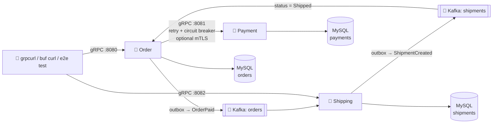
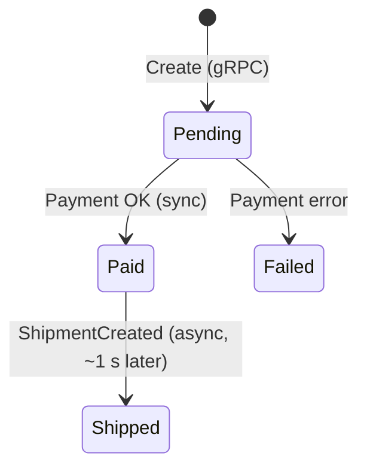

# 🛒 Order + Payment + Shipping: gRPC and Kafka Microservices in Go

A complete, working version of the project from Hüseyin Babal's *gRPC Microservices in Go*, rebuilt with current Go, current libraries, and **Buf**, and extended with **Kafka** so it covers both kinds of communication:

- 📞 **Sync:** Order → Payment over gRPC (the book's design).

- 📬 **Async:** Order → Kafka `orders` → **Shipping** → Kafka `shipments` → Order. Shipping is the third service from Babal's architecture (Chapter 1).

Notes: [[Go/gRPC Microservices in Go - Refactored/README|📚 gRPC Microservices in Go]] for the sync side, [[Brokers/Kafka/Kafka The Definitive Guide/README|📬 Kafka lessons]] for the async side.





---

## 🚀 Quick Start

Needs **Go 1.27** (go.mod pins toolchain `go1.27.3`, downloaded automatically) and **Docker** with Compose v2.

```bash
make up              # build images, start MySQL + Kafka + Payment + Order + Shipping + Jaeger
make create-order    # → {"orderId": "1"}
make get-order       # → "status": "Shipped" (a second later: Kafka round trip)
make get-shipment    # → the shipment Shipping created from the OrderPaid event
make events          # the events in "orders" and "shipments", decoded to JSON
make lag             # consumer groups "shipping" and "order": offsets and lag
make poison          # an undecodable record → see it with `make dlq`
make bad-order       # → InvalidArgument with one field violation per bad field
make buf-curl-create # same call with buf curl
make down            # stop and delete data
```

Open **http://localhost:16686**, choose `order`, and open a `Create` trace: one trace spans Order → Payment (gRPC) → `orders publish` → Shipping → `shipments publish` → Order, including every database call.

Run `make` to list every target.

---

## 📁 Layout

```text
microservices/
├── proto/                     # the book's "microservices-proto" repo, as a local module
│   ├── buf.yaml               # module + lint/breaking rules
│   ├── buf.gen.yaml           # pinned remote plugins, managed go_package
│   ├── order/v1/order.proto       # OrderService (sync API)
│   ├── order/v1/events.proto      # OrderPaid (async event)
│   ├── payment/v1/payment.proto
│   ├── shipping/v1/shipping.proto # ShippingService.Get
│   ├── shipping/v1/events.proto   # ShipmentCreated
│   └── gen/go/…               # generated code (committed; `make proto-generate`)
├── order/                     # Order service (hexagonal)
│   ├── cmd/main.go            # wiring: config → adapters → core
│   ├── config/
│   └── internal/
│       ├── application/core/  # domain + api (business logic, no gRPC/GORM)
│       ├── ports/             # APIPort, DBPort, PaymentPort (+ mocks/)
│       ├── adapters/
│       │   ├── grpc/          # driver adapter: OrderService server
│       │   ├── db/            # driven adapter: GORM + MySQL, outbox table
│       │   ├── events/        # Kafka: outbox relay (driven) + ShipmentCreated consumer (driver)
│       │   └── payment/       # driven adapter: Payment client, retry, breaker, mTLS
│       └── telemetry/         # OTLP tracing + slog JSON logs with trace_id
├── payment/                   # Payment service, same structure (sync only)
├── shipping/                  # Shipping service: OrderPaid consumer, idempotent, outbox, gRPC Get
├── tools/eventtail/           # prints Kafka events as JSON using the event-type header
├── e2e/                       # Testcontainers runs docker-compose.yml: sync and async paths
├── deploy/
│   ├── k8s/                   # kustomize: MySQL, Kafka (KRaft), Payment, Order, Shipping, Ingress
│   ├── kafka/create-topics.sh # orders, shipments (3 partitions), *.dlq
│   └── mysql/init.sql
├── scripts/gen-certs.sh       # dev CA + mTLS certificates
├── docker-compose.yml         # full stack
├── docker-compose.tls.yml     # overlay: mTLS between Order and Payment
├── .github/workflows/ci.yml   # buf + tests + e2e
├── go.work                    # one workspace for editors and `go` commands
└── Makefile
```

Each service's `go.mod` points at the local proto module with `replace github.com/huseyinbabal/microservices-proto => ../proto`. In the book, services instead `go get` a tagged version of the separate proto repo (Chapter 3); the imports are the same either way.

---

## 🔁 Book → This Code

| Book | Here | Why |
|---|---|---|
| `service Order`, `CreateOrderRequest` | `order.v1.OrderService`, `CreateRequest` | Buf's `STANDARD` lint: versioned packages, `*Service` names, `<Method>Request` |
| `grpcurl … Order/Create` | `grpcurl … order.v1.OrderService/Create` | The full name includes the package |
| `protoc` + `run.sh` | `buf generate` with pinned remote plugins | One config file, same output on every machine |
| `grpc.Dial`, `WithInsecure` | `grpc.NewClient` + `insecure.NewCredentials()` or mTLS | `Dial` is deprecated |
| `go-grpc-middleware/retry` v1 | `go-grpc-middleware/v2/interceptors/retry` | v2 is the maintained module |
| `sony/gobreaker` | `sony/gobreaker/v2` (generic) + `IsSuccessful` | Client errors don't trip the breaker |
| `otelgrpc.Unary*Interceptor` | `otelgrpc.NewServerHandler` / `NewClientHandler` | Interceptors are deprecated |
| Jaeger exporter | OTLP exporter (`otlptracegrpc`) | The Jaeger exporter was removed |
| logrus + custom formatter | `log/slog` JSON handler adding `trace_id`, `span_id` | Standard library |
| `ioutil.ReadFile` | `os.ReadFile` | `ioutil` is deprecated |
| `RequireAnyClientCert` | `RequireAndVerifyClientCert`, TLS 1.3 | Real mutual verification |
| `testcontainers.GenericContainer`, `LocalDockerCompose` | `modules/mysql`, `modules/compose` | Current Testcontainers API |
| `golang:1.18` → `scratch` | `golang:1.27.3-alpine` → `distroless/static:nonroot` | Supported Go, non-root runtime |
| `kubernetes.io/ingress.class` annotation | `spec.ingressClassName: nginx` | Annotation is deprecated |

**Additions** that make the book's design safe to run:

- ✅ **Request validation** returns `InvalidArgument` with a `BadRequest` violation per field (Chapter 6, listing 6.7).

- 🔑 **Idempotent payments:** `order_id` is unique in Payment, so a retried `Create` returns the first payment instead of charging twice.

- 📌 **Order status:** `Pending` → `Paid`, or `Failed` when the charge fails.

- 🚦 **Error codes are kept:** a Payment outage reaches the caller as `Unavailable`/`DeadlineExceeded`, not as `InvalidArgument`.

- ❤️ **gRPC health service** on both servers, used by Kubernetes probes, and **graceful shutdown** on `SIGTERM`.

- 📬 **Kafka (async), see the [[Brokers/Kafka/Kafka The Definitive Guide/README|Kafka lessons]]:**

    - **Transactional outbox:** `Paid` and the `OrderPaid` event are written in one MySQL transaction; a relay publishes the outbox with `SKIP LOCKED`.

    - **Keys = `order_id`**, so one order's events stay in order; 3 partitions per topic.

    - **At-least-once consumers:** manual commits after processing, rebalance-safe; Shipping drops duplicates through a `processed_events` table.

    - **Retries + dead-letter topics:** 3 attempts for transient errors, at once for undecodable records (`shipping.dlq`, `order.dlq`).

    - **One trace across Kafka:** the outbox stores the trace context, and franz-go's `kotel` hooks continue it through record headers.

- ⚖️ **Client-side load balancing:** Payment uses a headless Service, and Order's client uses `round_robin` (Chapter 5).

---

## 📜 Protobuf with Buf

```bash
make proto           # buf format -w, buf lint, buf generate
make proto-breaking  # buf breaking against main (set BREAKING_AGAINST to change)
```

- **`buf.yaml`** sets the module and rules: `STANDARD` + `COMMENTS` lint, `FILE` breaking checks.

- **`buf.gen.yaml`** uses **managed mode**, so `go_package` isn't written in the `.proto` files, and pins `buf.build/protocolbuffers/go:v1.36.12` and `buf.build/grpc/go:v1.6.2`.

- Buf, mockery, and grpcurl run through `go run tool@version`, so nothing needs installing globally.

---

## 🧪 Tests

| Command | Runs | Needs |
|---|---|---|
| `make test` | Unit tests with `-race`: cores with mockery mocks, validation, event handlers, retry + circuit breaker over an in-memory `bufconn` server | Go |
| `make test-integration` | Unit + DB adapter tests against real MySQL 8.4 (Testcontainers): outbox commit/rollback, one shipment per event | Docker |
| `make e2e` | Builds images, starts the Compose stack via Testcontainers, checks the sync path and waits for the async `Shipped` status | Docker |
| `make cover` | Coverage HTML per service | Go |
| `make mocks` | Regenerates `internal/ports/mocks` (mockery v3, `.mockery.yml`) | Go |

---

## 🔐 mTLS Between Order and Payment

```bash
make up-tls          # runs scripts/gen-certs.sh once, then starts the stack with TLS_CERT_DIR=/certs
make create-order
```

Payment requires a client certificate signed by the dev CA; Order presents `client-cert.pem` and verifies Payment's `server-cert.pem` (SAN: `payment`, `localhost`). Certificates are for development only.

---

## 💻 Run on the Host

```bash
make db-up           # MySQL (MYSQL_PORT, default 3306) + Kafka (localhost:9092) + topics
make run-payment     # :3001
make run-order       # :3000 → Payment :3001   (in another terminal)
make run-shipping    # :3002                   (in a third terminal)
make create-order ORDER_ADDR=localhost:3000
```

---

## ☸️ Kubernetes (minikube)

Install the Ingress controller and cert-manager first (Chapter 8), then:

```bash
make k8s-deploy      # build images, minikube image load, kubectl apply -k deploy/k8s
echo "127.0.0.1 ingress.local" | sudo tee -a /etc/hosts
minikube tunnel
grpcurl -insecure -import-path proto -proto order/v1/order.proto \
  -d '{"user_id": 23, "order_items": [{"product_code": "CAM123", "unit_price": 12.5, "quantity": 2}]}' \
  ingress.local:443 order.v1.OrderService/Create
```

- 🔒 Production mode turns reflection off, so grpcurl reads the `.proto` file.

- 🔑 Database URLs come from Secrets; pods run as non-root with a read-only root filesystem.

- ❤️ Kubernetes' native `grpc` probes call the health service.

---

## ⚙️ Configuration

| Variable | Service | Required | Example |
|---|---|---|---|
| `ENV` | both | ✅ | `development` turns on reflection |
| `APPLICATION_PORT` | both | ✅ | `8080` (Order), `8081` (Payment) |
| `DATA_SOURCE_URL` | both | ✅ | `root:s3cr3t@tcp(mysql:3306)/orders?charset=utf8mb4&parseTime=True&loc=Local` |
| `PAYMENT_SERVICE_URL` | Order | ✅ | `payment:8081` |
| `KAFKA_BROKERS` | Order, Shipping | ✅ | `kafka:19092` (Compose), `localhost:9092` (host), `kafka:9092` (Kubernetes) |
| `TLS_CERT_DIR` | both | — | `/certs` turns on mTLS |
| `OTEL_EXPORTER_OTLP_ENDPOINT` | both | — | `http://jaeger:4317`; empty = no span export |

A missing required variable stops the service at startup.

---

## 🩺 Troubleshooting

- **Port 3306 or 8080 already in use** → `MYSQL_PORT=3307 ORDER_PORT=8090 make up`, then `make create-order ORDER_ADDR=localhost:8090`.

- **`order creation failed` with `Unavailable`** → Payment is down or the circuit is open; it closes again 4 s after Payment recovers.

- **`make e2e` fails on startup** → run `make down` first; the e2e stack uses the same ports.
