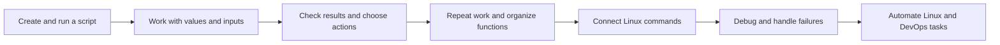

# 🐚 Bash Scripting Learning Path

[[Linux/AI Prompt - Linux|🐧 Linux Study Prompt]]

This path builds from a runnable script to small, reliable automations for Linux and DevOps work: checking services and logs, handling files, making backups, and supporting deployment workflows.

> [!toc]- 📑 Contents
>
> - [[#📚 Source Books|📚 Source Books]]
> - [[#🧭 Planned Lessons|🧭 Planned Lessons]]
> - [[#🗺️ Learning Sequence|🗺️ Learning Sequence]]

## 📚 Source Books

| Book | Chapter | Role in this path |
|---|---|---|
| *The Software Developer’s Guide to Linux* | 12 — Automating Tasks with Shell Scripts | Main learning sequence, modern Bash syntax, and developer-focused examples. |
| *Linux Bible*, 11th edition | 7 — Writing Simple Shell Scripts | Adds positional parameters, arithmetic, control flow, text tools, and script exercises. |
| *CompTIA Linux+ Guide to Linux Certification* | 7 — Working with the BASH Shell | Reinforces script execution, interactive input, decisions, loops, and admin-oriented fundamentals. |

SDGL leads the lesson order. Linux Bible adds breadth and practice; CompTIA adds a clear review of foundational shell scripting constructs.

## 🧭 Planned Lessons

| # | Planned lesson file | Main concepts and syntax | Book coverage |
|---:|---|---|---|
| 1 | [[Linux/Bash Scripting/1 - First Script: Shebang, Shell Choice, and Execution\|1 - First Script: Shebang, Shell Choice, and Execution]] | `#!/usr/bin/env bash`, script permissions, `bash script.sh`, and running an executable script. | All three: script files and execution. |
| 2 | [[Linux/Bash Scripting/2 - Variables, Quoting, and Expansion\|2 - Variables, Quoting, and Expansion]] | Assignments, `"$var"`, `${var}`, command substitution `$(...)`, and exported variables. | SDGL Ch. 12; Bible Ch. 7; CompTIA Ch. 7. |
| 3 | `3 - Script Inputs: Arguments, Environment, and read.md` | Positional parameters such as `$1`, `"$@"`, `$#`, environment variables, and `read`. | Bible Ch. 7 covers positional parameters; CompTIA Ch. 7 covers `read`; SDGL Ch. 12 covers exported environment variables. |
| 4 | `4 - Exit Status and Test Expressions.md` | `$?`, command success and failure, file and string tests, and `[[ ... ]]`. | SDGL testing; Bible and CompTIA test expressions. |
| 5 | `5 - Decisions with if and case.md` | `if`, `elif`, `else`, `case`, and choosing actions from command results or user input. | All three: decision constructs; Bible and CompTIA also cover `case`. |
| 6 | `6 - Loops and File Batches.md` | `for`, `while`, `until`, `read`, `break`, and `continue` for repeatable file and service checks. | All three: loop constructs. |
| 7 | `7 - Arithmetic and Counters.md` | `$((...))`, `((...))`, counters, and arithmetic inside loops. | Bible Ch. 7; SDGL arithmetic tests and C-style loops; CompTIA counter examples. |
| 8 | `8 - Functions and Local Variables.md` | Reusable functions, parameters, `local`, and keeping script sections manageable. | SDGL functions and local scope; Bible Ch. 7 introduces user-defined functions. |
| 9 | `9 - Pipelines, Redirection, and Text Processing.md` | the pipe operator, `>`, `>>`, `2>&1`, `grep`, `cut`, `tr`, and `sed` for logs and command output. | SDGL Chs. 11–12; Bible Ch. 7; CompTIA command I/O. |
| 10 | `10 - Debugging and Reliable Script Behavior.md` | `bash -x`, `set -u`, `set -o pipefail`, readable diagnostics, and checking failures. | SDGL Bash options and pitfalls; Bible script debugging; CompTIA staged testing. |
| 11 | `11 - Linux and DevOps Automation Projects.md` | Small scripts for backups, log summaries, service checks, and deployment helpers. | Bible backup exercise; SDGL startup and Docker examples; CompTIA admin scripting. |

## 🗺️ Learning Sequence

Start with lessons 1–3 to understand how a script receives its environment and input. Lessons 4–10 add the control flow and reliability tools used to turn commands into repeatable operations; lesson 11 brings them together in practical projects.
