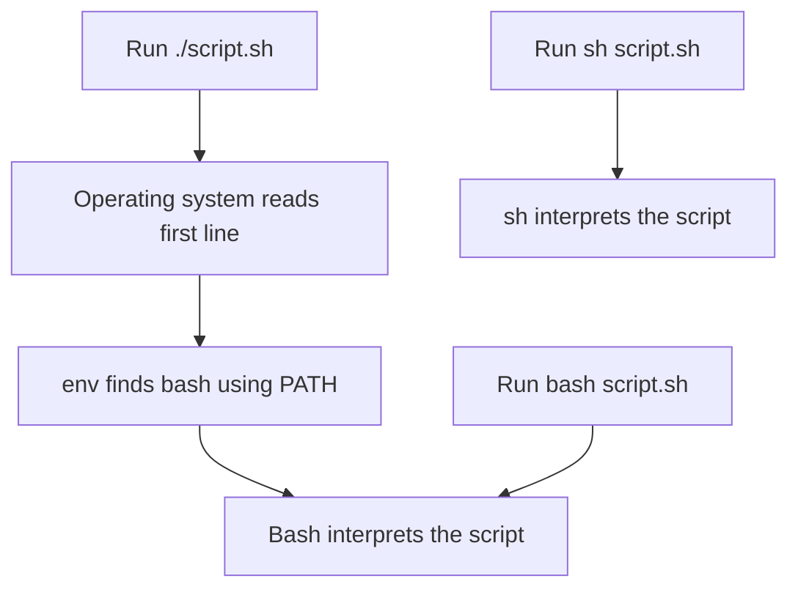
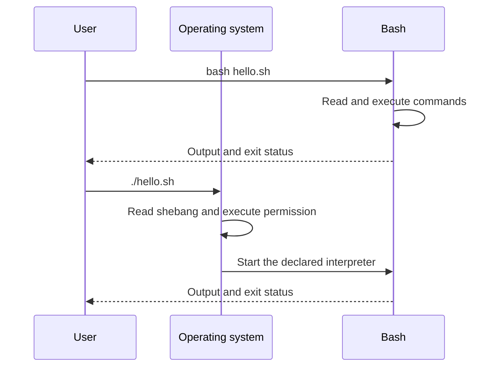
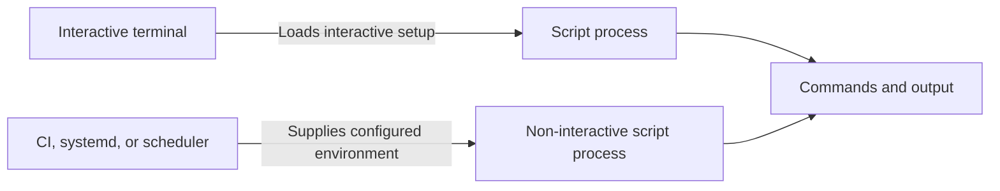
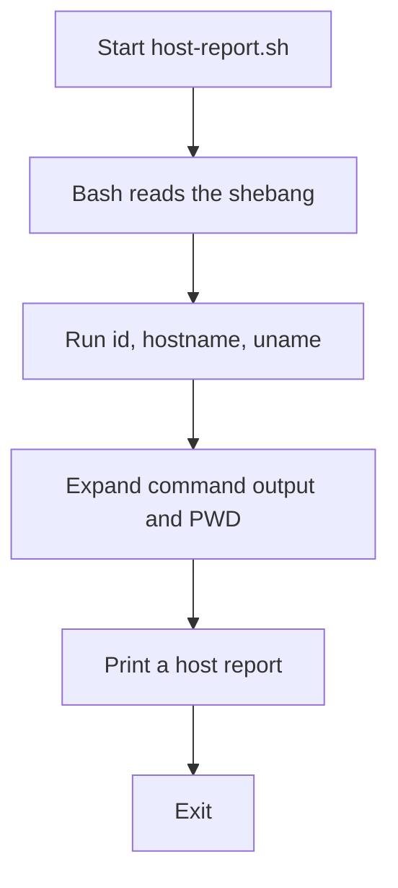

# 🐚 Lesson 1: Your First Bash Script

[[Linux/Bash Scripting/0 - Bash Scripting Learning Path|📚 Bash Scripting Learning Path]]

### 📖 Chapter Summary

A shell script is a text file whose commands are interpreted by a shell. This lesson shows how to choose Bash, name it with a shebang, run a script while developing, and make it executable for direct use.

The examples are read-only: they report host information and check available tools. These are useful first steps before writing scripts for backups, log checks, services, or deployments.

#### Sources

| Reference | Chapter / pages | Focus |
|---|---|---|
| *The Software Developer’s Guide to Linux* | Ch. 12, “Automating Tasks with Shell Scripts,” pp. 151–166 | Bash-first scripting, shebangs, execution, options, and common pitfalls. |
| *Linux Bible*, 11th edition | Ch. 7, “Writing Simple Shell Scripts,” pp. 145–161 | Script structure, execution and debugging, plus administration examples. |
| *CompTIA Linux+ Guide to Linux Certification* | Ch. 7, “Working with the BASH Shell,” pp. 320–334 | Script files, permissions, input, decisions, and loops. |
| Current references | GNU Bash Reference Manual; ShellCheck documentation | Interpreter behavior, startup files, syntax checks, and common quoting hazards. |

#### 🆕 Key New Concepts

| Concept | Meaning | Why it matters in Linux and DevOps |
|---|---|---|
| Interpreter | The program that reads and executes a script. | Bash syntax must be run by Bash; `sh` may not support it. |
| Shebang | The first line that names the script interpreter. | It controls how an executable script is launched. |
| Execute permission | The permission that allows a file to run as a program. | Needed for `./script.sh`, but not for `bash script.sh`. |
| Non-interactive shell | A shell running a script without a prompt. | CI jobs and services may not load your interactive shell setup. |

#### 📊 Book Comparison at a Glance

| Topic | SDGL | Linux Bible | CompTIA | 2026 practice |
|---|---|---|---|---|
| First script | Developer-focused Bash crash course. | Administration-focused examples. | Introduces scripts for system tasks. | Start with a harmless script and run it explicitly with Bash. |
| Interpreter | Explains Bash versus other shells and recommends `#!/usr/bin/env bash`. | Shows Bash scripts. | Uses `#!/bin/bash` examples. | Declare the interpreter; use `sh` only for POSIX shell syntax. |
| Execution | Explains shebang and executable text files. | Shows `bash file` and direct execution. | Covers `bash file` and `chmod` + direct execution. | Validate with `bash -n`; use ShellCheck for static review. |
| Automation context | Docker layers, startup ordering, and error checking. | Backups and routine administration. | Basic administrative tasks. | Supply required paths and environment explicitly in CI or services. |

## Part 1: What a Script Does

### 📌 Concepts Explained

A Bash script is a sequence of commands saved in a text file. Bash reads each command and runs it, so you can reuse a routine without typing each command again.

Scripts help with repeated Linux work: reporting host information, checking for required tools, or collecting log output for review.

### 🔧 A First Script

Create `hello.sh` with these complete contents:

```bash
#!/usr/bin/env bash

printf 'Hello from Bash.\n'
printf 'Current user: %s\n' "$(id -un)"
```

`printf` formats output predictably. `$(id -un)` runs `id -un` and substitutes its output into the message.

### 💻 Run It Through Bash

```bash
# Run this from the directory containing hello.sh.
bash hello.sh
```

Expected output resembles:

```text
Hello from Bash.
Current user: ryan
```

The username depends on the account running the command.

| Command | Purpose | Common use |
|---|---|---|
| `bash hello.sh` | Ask Bash to read and run the file. | First run, quick testing, or a file without execute permission. |
| `printf` | Print formatted text. | Predictable messages and reports. |
| `$(command)` | Substitute command output. | Insert a hostname, date, or command result. |

### 🧪 Interview Q&A

**Q1:** What makes a text file a shell script?

**Q2:** Does a script run automatically when you save it?

**Q3:** What does Bash do when you run `bash hello.sh`?

**Q4:** Why might an operator turn repeated commands into a script?

**Q5:** What does `$(id -un)` contribute to the example?

> [!success]- 📋 Answers — Part 1
> **A1:** It contains commands that a shell can interpret; a shebang and execute permission are needed only for direct execution.
>
> **A2:** No. You must invoke an interpreter or execute the file as a program.
>
> **A3:** Bash reads the file and executes its commands in order.
>
> **A4:** A script makes a repeated sequence easier to run and less likely to be mistyped.
>
> **A5:** It inserts the current account name into the printed message.

## Part 2: Choose the Interpreter

### 📌 Concepts Explained

A script’s syntax belongs to an interpreter. This path teaches Bash, so the script should declare Bash instead of relying on whichever shell happens to run it.

`#!/usr/bin/env bash` asks `env` to find Bash using the process’s `PATH`. `#!/bin/bash` names Bash at a fixed Linux path. Either can work: `env bash` helps when Bash is installed at different paths, while a fixed path can suit a controlled system environment.

`#!/bin/sh` means the script promises to use portable POSIX shell syntax. Bash-specific syntax such as `[[ ... ]]` or arrays should not be placed in a script declared as `sh`.

### 🔧 Shebang and Shell Choice

The shebang is the first line of an executable script:

```bash
#!/usr/bin/env bash
```

Keep it at the top, before any blank lines or other text. The GNU Bash manual documents script invocation and shell behavior: [Bash Reference Manual: Shell Scripts](https://www.gnu.org/software/bash/manual/html_node/Shell-Scripts.html).



When you run `bash script.sh`, Bash is already selected on the command line; the shebang does not choose a different interpreter. Running `sh script.sh` explicitly chooses `sh`, so Bash-only syntax may fail.

| Form | Interpreter selection | Use it when |
|---|---|---|
| `#!/usr/bin/env bash` | Finds `bash` through `PATH`. | Bash may live at different paths across environments. |
| `#!/bin/bash` | Uses Bash at `/bin/bash`. | The target environment guarantees that path. |
| `#!/bin/sh` | Uses the system’s POSIX shell. | The script intentionally avoids Bash-only features. |
| `bash script.sh` | The command chooses Bash directly. | Testing or running a script without execute permission. |
| `sh script.sh` | The command chooses `sh` directly. | Only for scripts designed for POSIX `sh`. |

```bash
# Show unique PATH directories that env searches for Bash.
printf '%s\n' "$PATH" | tr ':' '\n' | sort -u
```

These directories are candidates; `command -v bash` shows the actual Bash command resolved in this shell.

```bash
# Print the directory containing the Bash command found by this shell.
command -v bash | sed 's|/[^/]*$|/'
```

This pipeline assumes `command -v bash` returns a filesystem path, as it normally does for Bash in a non-interactive script.

### 🧪 Interview Q&A

**Q1:** What is the purpose of a shebang?

**Q2:** What is the difference between `#!/usr/bin/env bash` and `#!/bin/bash`?

**Q3:** Why is `#!/bin/sh` a poor declaration for a script that uses Bash syntax?

**Q4:** Does the shebang choose the interpreter when you run `bash script.sh`?

**Q5:** Why must the shebang be the first line for direct execution?

> [!success]- 📋 Answers — Part 2
> **A1:** It tells the operating system which interpreter to use when the script is executed as a program.
>
> **A2:** The first finds Bash using `PATH`; the second names a fixed filesystem location.
>
> **A3:** `/bin/sh` may be a different shell and may not understand Bash-only syntax.
>
> **A4:** No. The explicit `bash` command already selected the interpreter.
>
> **A5:** Direct execution checks the file’s first line for its interpreter declaration.

## Part 3: Run a Script in Two Ways

### 📌 Concepts Explained

There are two common ways to launch a script:

1. **Interpreter form:** `bash script.sh`. Bash reads the file; the script does not need execute permission.

2. **Program form:** `./script.sh`. The operating system uses the shebang, and the file needs execute permission.

Use interpreter form while learning because it makes the chosen interpreter explicit. Use program form when the script is a tool you intend to invoke directly.

### 💻 Try Both Forms

```bash
# Explicitly run the file with Bash.
bash hello.sh
```

```bash
# Add execute permission for your account, then run via the shebang.
chmod u+x hello.sh
./hello.sh
```

Both forms should print the same result. `u+x` adds execute permission for the file’s owner without changing group or other-user permissions.

### 📊 Execution Path



### 🧪 Interview Q&A

**Q1:** Which invocation requires execute permission: `bash script.sh` or `./script.sh`?

**Q2:** What does `chmod u+x script.sh` change?

**Q3:** Why does `./script.sh` begin with `./`?

**Q4:** Which invocation makes the interpreter easiest to see in the command itself?

**Q5:** If `bash script.sh` works but `./script.sh` fails, what should you check?

> [!success]- 📋 Answers — Part 3
> **A1:** `./script.sh` requires execute permission.
>
> **A2:** It adds the execute bit for the file owner.
>
> **A3:** It names the script in the current directory; the current directory is not normally searched through `PATH`.
>
> **A4:** `bash script.sh` explicitly names Bash.
>
> **A5:** Check the shebang, execute permission, and line endings.

## Part 4: Paths, Permissions, and the Current Directory

### 📌 Concepts Explained

A relative path is interpreted from the process’s current working directory. A script launched from another directory may not find a relative file, even if that file is beside the script.

`./` means “in the current directory.” It is common to run a local script as `./script.sh`; the shell does not normally search the current directory for commands, which helps avoid running an unintended file.

For reliable operations, scripts should use explicit paths or calculate their own directory when they need adjacent files. This lesson keeps examples self-contained and avoids assuming a particular working directory.

### 🔧 Check the File and Directory

```bash
# Show permissions, owner, and filename.
ls -l hello.sh

# Show the directory from which relative paths are resolved.
pwd
```

Example permission text:

```text
-rwx------ 1 ryan ryan 82 Oct 24 12:00 hello.sh
```

The exact owner, date, and mode vary. The `x` in the owner’s permission group means that the owner can execute this file.

| Command | Purpose | Common use |
|---|---|---|
| `pwd` | Print the current working directory. | Diagnose a relative-path failure. |
| `ls -l file` | Show file permissions and ownership. | Check direct execution permission. |
| `chmod u+x file` | Add owner execute permission. | Make a personal script directly runnable. |
| `./file` | Run a file from the current directory. | Invoke a local script without installing it. |

### 🧪 Interview Q&A

**Q1:** What does `./` mean in a command?

**Q2:** Why can a script fail to find a relative file when launched from another directory?

**Q3:** Does `chmod u+x` change group permissions?

**Q4:** Why is the current directory usually omitted from `PATH`?

**Q5:** What is a useful first check when a relative path behaves unexpectedly?

> [!success]- 📋 Answers — Part 4
> **A1:** It refers to the current directory.
>
> **A2:** Relative paths are resolved from the caller’s working directory, which may differ from the script’s directory.
>
> **A3:** No. It changes the owner’s execute permission only.
>
> **A4:** Omitting it reduces accidental execution of a file in the current directory.
>
> **A5:** Run `pwd` and inspect the path the script is using.

## Part 5: Interactive Shells and Automation Environments

### 📌 Concepts Explained

A terminal session is usually interactive: it has a prompt and may load profile or shell configuration files. A script launched by CI, `cron`, or a service is usually non-interactive and may have a different `PATH`, working directory, and environment.

Do not rely on `.bashrc` to set variables needed by a service or pipeline. Put required configuration in the job or service configuration, or pass it explicitly when launching the script. Bash’s startup-file rules distinguish interactive shells from non-interactive script execution: [Bash Reference Manual: Bash Startup Files](https://www.gnu.org/software/bash/manual/html_node/Bash-Startup-Files.html).

| Context | Typical properties | Practical implication |
|---|---|---|
| Interactive terminal | Prompt, user shell setup, human input. | A command may work because `.bashrc` changed `PATH`. |
| CI job | Non-interactive, job-defined environment. | Declare required tools and variables in the pipeline. |
| `systemd` service | Service-defined user, environment, and working directory. | Configure the service explicitly; do not depend on terminal state. |
| Scheduled task | Often limited environment and a different working directory. | Use explicit paths and log useful output. |



### 🔎 Compare the Environments

```bash
# Print the Bash version and PATH visible to this process.
printf 'Bash: %s\nPATH: %s\n' "$BASH_VERSION" "$PATH"
```

For a real CI or service job, inspect these values from inside that job. A value printed in your terminal does not prove that automation has the same value.

### 🧪 Interview Q&A

**Q1:** Why might a command work in your terminal but fail in CI?

**Q2:** Does a non-interactive Bash script normally use the same startup files as an interactive terminal?

**Q3:** Where should a service’s required environment variables be configured?

**Q4:** Why should an automation script avoid depending on its caller’s working directory?

**Q5:** What does a terminal test prove about a `systemd` service’s environment?

> [!success]- 📋 Answers — Part 5
> **A1:** CI may have a different `PATH`, working directory, user, or environment variables.
>
> **A2:** No. Bash distinguishes interactive and non-interactive startup behavior.
>
> **A3:** In the service or deployment configuration that launches it, using the platform’s supported environment mechanism.
>
> **A4:** The caller can launch it from a different directory, changing how relative paths resolve.
>
> **A5:** Very little; inspect the environment from the service or a faithful equivalent context.

## Part 6: Check and Debug Before Use

### 📌 Concepts Explained

A syntax check catches parse errors without running the script. Bash tracing shows commands as Bash executes them, which helps locate a failing step.

Tracing can reveal expanded values. Avoid enabling it around credentials or other sensitive environment variables. For a static review, ShellCheck identifies common shell mistakes such as unquoted expansions.

### 💻 Validation Commands

```bash
# Parse the script without executing its commands.
bash -n hello.sh
```

No output and a zero exit status mean Bash found no syntax error. This does not prove the script’s behavior is correct.

```bash
# Show each command as Bash runs it.
bash -x hello.sh
```

```bash
# If ShellCheck is installed, review common scripting hazards.
shellcheck hello.sh
```

| Check | Finds | Does not prove |
|---|---|---|
| `bash -n script.sh` | Bash syntax errors. | Correct paths, permissions, or runtime results. |
| `bash -x script.sh` | The command sequence and expanded values. | Safe behavior; trace output may expose data. |
| `shellcheck script.sh` | Many common shell mistakes. | Correctness for your infrastructure. |

See [ShellCheck: SC2086](https://www.shellcheck.net/wiki/SC2086) for why unquoted expansions can split into multiple words or expand filenames.

### 🧪 Interview Q&A

**Q1:** Does `bash -n` execute the commands in a script?

**Q2:** What does `bash -x` add?

**Q3:** Why can tracing be unsafe around credentials?

**Q4:** What kind of feedback does ShellCheck provide?

**Q5:** If syntax validation passes, is runtime behavior verified?

> [!success]- 📋 Answers — Part 6
> **A1:** No. It asks Bash to parse the file without executing its commands.
>
> **A2:** It prints commands as Bash executes them, which helps trace the flow.
>
> **A3:** Expanded secret values can appear in the trace output and logs.
>
> **A4:** It flags common shell scripting mistakes and suggests safer forms.
>
> **A5:** No. Syntax validation is only one check; behavior depends on the real environment and inputs.

## Part 7: A Read-Only Host Report

### 📌 Concepts Explained

A good first operational script reports useful facts without changing the host. This example prints the user, hostname, operating system, and current directory. It is a small diagnostic aid before writing a larger deployment helper.

### 💻 Complete Script: `host-report.sh`

```bash
#!/usr/bin/env bash

printf 'User: %s\n' "$(id -un)"
printf 'Host: %s\n' "$(hostname)"
printf 'OS: %s\n' "$(uname -srm)"
printf 'Working directory: %s\n' "$PWD"
```

Run it with Bash:

```bash
bash host-report.sh
```

Or give it execute permission and run it directly:

```bash
chmod u+x host-report.sh
./host-report.sh
```

Illustrative output:

```text
User: ryan
Host: devbox
OS: Linux 6.8.0 x86_64
Working directory: /home/ryan/lab
```

Your machine prints its own values. The script is read-only: it asks existing commands for information and prints the results.

### 🧭 What Happens



### 🧪 Interview Q&A

**Q1:** Why is this a suitable first operations script?

**Q2:** Which line obtains the kernel and machine architecture?

**Q3:** Does `PWD` mean the directory containing the script?

**Q4:** Does the host report modify system state?

**Q5:** Why are `id`, `hostname`, and `uname` inside `$(...)`?

> [!success]- 📋 Answers — Part 7
> **A1:** It demonstrates a complete script while only reading and printing system information.
>
> **A2:** `uname -srm` prints the kernel name, release, and machine hardware name.
>
> **A3:** No. `PWD` is the caller’s current working directory.
>
> **A4:** No. It only reads information and writes output to the terminal.
>
> **A5:** Command substitution captures each command’s output for `printf`.

## Part 8: Combined Practices and Book Comparison

### 📌 Concepts Explained

For a script you intend to reuse, name the interpreter, choose an invocation style, and make its paths and environment requirements clear. Validate syntax before running it, then test in the same kind of environment that will launch it.

The books overlap on creating, executing, and debugging scripts. SDGL gives the clearest Bash-first explanation for a developer; Linux Bible adds administration examples and exercises; CompTIA reinforces basic shell constructs and review.

#### 📊 Book Comparison at a Glance

| Topic | SDGL | Linux Bible | CompTIA | 2026 practice |
|---|---|---|---|---|
| Audience | Developer learning Bash. | Linux power user and administrator. | Certification learner and operator. | Teach the syntax, then apply it in CI or a service context. |
| Script execution | Interpreter, shebang, executable text file. | Interpreter invocation and direct execution. | Basic execution and permissions. | Use explicit Bash and validate before operational use. |
| Debugging | Bash options and practical pitfalls. | Script debugging and exercises. | Staged testing and review. | Combine `bash -n`, ShellCheck, and controlled runtime checks. |

### 🔧 Practical Checklist

- Start with `#!/usr/bin/env bash` for a Bash script unless the target requires a fixed interpreter path.
- Run `bash script.sh` while iterating; use `./script.sh` when testing executable behavior.
- Check the current directory and use explicit paths where automation requires them.
- Configure required environment variables in CI or the service, not only in an interactive shell file.
- Use `bash -n` and ShellCheck before running a script that changes files or services.

### 🧪 Interview Q&A

**Q1:** What is a useful first validation step before running a new script?

**Q2:** What is the difference between a syntax check and a runtime test?

**Q3:** Why should a script’s required environment be explicit?

**Q4:** Which book would you use first as a developer learning Bash, and why?

**Q5:** Which book adds the most Linux administration practice to this topic?

> [!success]- 📋 Answers — Part 8
> **A1:** Run `bash -n script.sh`, then invoke it with `bash script.sh` in a safe environment.
>
> **A2:** Syntax checking parses the file; a runtime test executes it with actual inputs and environment.
>
> **A3:** CI and services may not load the same configuration as an interactive terminal.
>
> **A4:** SDGL, because it teaches Bash from a developer’s perspective and calls out Bash-specific behavior.
>
> **A5:** Linux Bible, whose chapter includes administration examples and exercises.

### 🔨 Hands-On Tasks

#### Task 1: Run the Same File Two Ways

**Goal:** See how the shebang and execute bit change direct invocation.

**Commands:**

```bash
cat > hello.sh <<'SCRIPT'
#!/usr/bin/env bash
printf 'Hello from Bash.\n'
SCRIPT

bash hello.sh
chmod u+x hello.sh
./hello.sh
```

**Steps:**

1. Create the file in a temporary learning directory.
2. Run it with `bash hello.sh`.
3. Add owner execute permission and run `./hello.sh`.

**Done when:** Both invocations print `Hello from Bash.`

#### Task 2: Inspect Your Host Without Changing It

**Goal:** Create a small report script and validate it.

**Commands:**

```bash
bash -n host-report.sh
bash host-report.sh
```

Use the full `host-report.sh` listing from Part 7.

**Done when:** Syntax validation is silent, and the report shows your user, host, OS, and working directory.

### 💡 Pro Tips & Best Practices (Combined)

1. Keep the shebang consistent with the syntax the script uses.
2. Prefer `printf` when output formatting matters.
3. Check `pwd` before assuming a relative path refers to the script’s directory.
4. Treat CI, `systemd`, and scheduled jobs as separate launch environments.
5. Avoid tracing scripts that may print credentials or tokens.
6. Use `bash -n` for a quick syntax pass and ShellCheck for common hazards.

### 📚 Further Reading

| Resource | Topic |
|---|---|
| [GNU Bash Reference Manual: Shell Scripts](https://www.gnu.org/software/bash/manual/html_node/Shell-Scripts.html) | Script invocation and interpreter behavior. |
| [GNU Bash Reference Manual: Bash Startup Files](https://www.gnu.org/software/bash/manual/html_node/Bash-Startup-Files.html) | Interactive and non-interactive startup behavior. |
| [ShellCheck](https://www.shellcheck.net/) | Static analysis for shell scripts. |
| [[Linux/Bash Scripting/2 - Variables, Quoting, and Expansion]] | The next lesson: Bash values and expansions. |

### 🤖 Regenerate this guide

1. [[AI Prompt/00 - General Study Guide Prompt]] — use the Linux lesson inputs and all three Bash scripting references.
2. [[Linux/The Software Developer’s Guide to Linux/AI Prompt - linux beginner]] — apply the SDGL source hierarchy and developer-focused teaching style.
