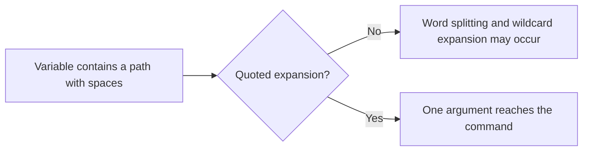
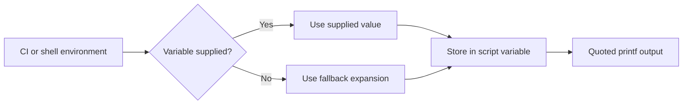

# 🐚 Lesson 2: Variables, Quoting, and Expansion

[[Linux/Bash Scripting/0 - Bash Scripting Learning Path|📚 Bash Scripting Learning Path]]

### 📖 Chapter Summary

Bash variables hold values that scripts use to build paths, configure tools, and report deployment details. Quoting controls how those values are passed to commands; expansion inserts variable values, command output, or defaults.

The key habit is simple: quote variable expansions when they are arguments, and use `${name}` when braces make the boundary clear. These habits keep scripts working when values contain spaces or wildcard characters.

#### Sources

| Reference | Chapter / pages | Focus |
|---|---|---|
| *The Software Developer’s Guide to Linux* | Ch. 12, “Automating Tasks with Shell Scripts,” pp. 152–165 | Bash variables, exported values, command substitution, interpolation, and pitfalls. |
| *Linux Bible*, 11th edition | Ch. 7, “Writing Simple Shell Scripts,” pp. 147–150 | Shell variables, positional parameters, and Bash parameter expansion. |
| *CompTIA Linux+ Guide to Linux Certification* | Ch. 7, “Working with the BASH Shell,” pp. 312–323 | Environment and user-defined variables, input, and script examples. |
| Current references | GNU Bash Reference Manual; ShellCheck documentation | Quoting, expansions, and safe handling of values. |

#### 🆕 Key New Concepts

| Concept | Meaning | Why it matters in Linux and DevOps |
|---|---|---|
| Assignment | Store a value with `name=value`. | Scripts use variables for paths, release names, and configuration. |
| Expansion | Replace a variable reference with its value. | Lets one script adapt to different hosts and environments. |
| Quoting | Control splitting and wildcard expansion. | Prevents a path with spaces from becoming multiple arguments. |
| Environment variable | A value exported to child processes. | Passes configuration from a CI job or service to a script. |
| Command substitution | Capture a command’s standard output with `$(...)`. | Turns a Git revision, hostname, or timestamp into a value. |

#### 📊 Book Comparison at a Glance

| Topic | SDGL | Linux Bible | CompTIA | 2026 practice |
|---|---|---|---|---|
| Variables | Bash variables and exported values, with developer-friendly naming. | Shell variables, parameters, and expansion in a broader admin chapter. | Environment and user-defined variables. | Distinguish shell-local values from exported process environment. |
| Quoting and expansion | Calls out Bash interpolation and common pitfalls. | Explains quoting, parameter expansion, and shell behavior. | Introduces variable use in Bash scripts. | Quote expansions used as command arguments; check with ShellCheck. |
| Command output | Uses `$(...)` in operational examples. | Shows command-derived variable values. | Uses shell commands inside examples. | Prefer `$(...)` over legacy backticks. |
| Operational use | Docker and software startup examples. | Admin tasks and shell routines. | Certification and system administration. | Keep configuration explicit and avoid printing secrets. |

## Part 1: Assign a Value, Then Expand It

### 📌 Concepts Explained

An assignment stores a value in a shell variable. The variable name has no `$` on the left side of `=`, and there must not be spaces around the equals sign.

Use `$name` or `${name}` to expand the value. Bash does not add types like Python or Go; values are shell strings unless an arithmetic context interprets them numerically.

### 💻 Assignment and Expansion

```bash
# Set two values and print them as separate formatted fields.
app_name='orders-api'
release_version='1.4.0'
printf 'App: %s\nVersion: %s\n' "$app_name" "$release_version"
```

Expected output:

```text
App: orders-api
Version: 1.4.0
```

This is an assignment:

```bash
release_version='1.4.0'
```

This is a command with arguments, not an assignment:

```bash
release_version = '1.4.0'
```

| Syntax | Meaning | Example |
|---|---|---|
| `name=value` | Assign a shell variable. | `region='eu-west'` |
| `$name` | Expand its value. | `printf '%s\n' "$region"` |
| `${name}` | Expand with an explicit boundary. | `printf '%s-prod\n' "${region}"` |

### 🧪 Interview Q&A

**Q1:** Why is there no `$` before the variable name in an assignment?

**Q2:** Why should there be no spaces around `=` in `name=value`?

**Q3:** What does `$app_name` do in the `printf` command?

**Q4:** Are Bash variables automatically typed as numbers or strings?

**Q5:** When is `${name}` clearer than `$name`?

> [!success]- 📋 Answers — Part 1
> **A1:** Assignment syntax uses the variable’s name; `$` requests its value through expansion.
>
> **A2:** Spaces make Bash parse separate command words instead of one assignment word.
>
> **A3:** It expands to the value stored in `app_name`.
>
> **A4:** No. Bash variables are not declared with general-purpose data types; arithmetic syntax provides numeric operations.
>
> **A5:** When characters immediately follow the name, braces show exactly where the variable name ends.

## Part 2: Single Quotes, Double Quotes, and Escapes

### 📌 Concepts Explained

Single quotes preserve the characters inside them literally. Double quotes still allow variable and command substitution, while protecting spaces and wildcard characters from being split or expanded.

A backslash can protect one special character. In most scripts, single and double quotes are easier to read for whole values.

### 🔧 Compare the Quotes

```bash
# Single quotes keep $APP_ENV literal.
APP_ENV='staging'
printf 'Single: %s\n' '$APP_ENV'

# Double quotes expand the variable while preserving the value as one argument.
printf 'Double: %s\n' "$APP_ENV"
```

Expected output:

```text
Single: $APP_ENV
Double: staging
```

| Form | Variable expansion? | Typical use |
|---|---:|---|
| `'literal text'` | No | Fixed text that should remain unchanged. |
| `"$value"` | Yes | A value that should stay one argument, including spaces. |
| `\$value` | No for the escaped `$` | Escape one special character inside an unquoted context. |

The Bash manual describes these mechanisms in [Quoting](https://www.gnu.org/software/bash/manual/html_node/Quoting.html).

### 🧪 Interview Q&A

**Q1:** Does `$APP_ENV` expand inside single quotes?

**Q2:** Why is `"$APP_ENV"` usually preferred when passing a variable to a command?

**Q3:** How can a backslash help when printing a literal dollar sign?

**Q4:** Do double quotes prevent variable expansion?

**Q5:** Which quoting form should hold a fixed literal value?

> [!success]- 📋 Answers — Part 2
> **A1:** No. Single quotes keep the contents literal.
>
> **A2:** Double quotes preserve the expanded value as one argument, even if it contains spaces or wildcard characters.
>
> **A3:** `\$` prevents that dollar sign from starting an expansion.
>
> **A4:** No. Double quotes allow variable and command substitution while protecting the result from splitting and globbing.
>
> **A5:** Single quotes, unless the value needs expansion.

## Part 3: Prevent Word Splitting and Filename Expansion

### 📌 Concepts Explained

After an unquoted variable expands, Bash may split it at whitespace and treat wildcard characters such as `*` as filename patterns. This can turn one intended value into several command arguments.

Quote expansions that represent one argument. ShellCheck’s [SC2086 guidance](https://www.shellcheck.net/wiki/SC2086) explains this common failure mode.

### 💡 A Path with Spaces

```bash
# Keep the full path as a single argument.
log_file='/var/log/my app/api.log'
printf 'Selected file: %s\n' "$log_file"
```

Expected output:

```text
Selected file: /var/log/my app/api.log
```

Use this pattern when passing a path to another command:

```bash
# The quotes ensure wc receives one filename argument.
wc -l -- "$log_file"
```

The `--` marks the end of command options for tools that support it. It prevents a path beginning with `-` from being interpreted as an option.

| Form | What Bash may pass to the command |
|---|---|
| `wc -l $log_file` | Multiple words; wildcard characters may also expand. |
| `wc -l -- "$log_file"` | One filename argument, even when it contains spaces. |

### 📊 Argument Flow



### 🧪 Interview Q&A

**Q1:** What can happen when `$log_file` is unquoted?

**Q2:** Why does `"$log_file"` preserve one argument?

**Q3:** What problem does `--` solve for commands that support it?

**Q4:** Does quoting a variable make its contents safe to execute as shell code?

**Q5:** What ShellCheck warning often points to an unquoted expansion?

> [!success]- 📋 Answers — Part 3
> **A1:** Bash can split on whitespace and expand wildcard patterns into filenames.
>
> **A2:** The quotes prevent word splitting and filename expansion for that expansion.
>
> **A3:** It marks the end of options so a filename beginning with `-` is treated as a filename.
>
> **A4:** No. Quoting prevents splitting and globbing; it does not make `eval` or other code execution safe.
>
> **A5:** ShellCheck SC2086.

## Part 4: Use Braces and Safe Defaults

### 📌 Concepts Explained

Braces make a variable’s name boundary explicit. This matters when text follows the name: `${release}build` means the value of `release` followed by `build`.

Parameter expansion can provide a default value when a variable is unset or empty. `${NAME:-default}` uses a fallback without assigning it; `${NAME:=default}` also assigns the fallback. `${NAME:?message}` stops expansion with an error if the value is unset or empty.

### 🔧 Deployment Defaults

```bash
# Use staging when DEPLOY_ENV is unset or empty.
deploy_env=${DEPLOY_ENV:-staging}
printf 'Target environment: %s\n' "$deploy_env"
```

With `DEPLOY_ENV` unset, expected output is:

```text
Target environment: staging
```

To require a value instead of silently choosing one:

```bash
# Stop with a useful message if RELEASE_TAG is missing or empty.
: "${RELEASE_TAG:?Set RELEASE_TAG before deploying}"
printf 'Deploying release: %s\n' "$RELEASE_TAG"
```

Bash documents the colon forms and their unset/empty behavior in [Shell Parameter Expansion](https://www.gnu.org/software/bash/manual/html_node/Shell-Parameter-Expansion.html).

| Expansion | If variable is unset or empty | Example use |
|---|---|---|
| `${NAME}` | Expands to an empty value. | Show an optional value. |
| `${NAME:-default}` | Expands to `default`; does not assign it. | Choose a harmless default for local development. |
| `${NAME:=default}` | Assigns and expands `default`. | Set a default for later commands in the same shell. |
| `${NAME:?message}` | Reports an error and fails the expansion. | Require a deployment target or release value. |

### 🧪 Interview Q&A

**Q1:** Why use `${release}build` instead of `$releasebuild`?

**Q2:** What is the difference between `${NAME:-default}` and `${NAME:=default}`?

**Q3:** When is `${NAME:?message}` useful?

**Q4:** Does `${NAME:-default}` treat an empty value as needing a default?

**Q5:** What does the colon change in these parameter expansions?

> [!success]- 📋 Answers — Part 4
> **A1:** Braces show that the variable name is `release`, not `releasebuild`.
>
> **A2:** `:-` supplies a value for this expansion; `:=` also assigns the fallback to the variable.
>
> **A3:** When a script cannot continue safely without a required configuration value.
>
> **A4:** Yes. The colon form tests both unset and null (empty) values.
>
> **A5:** It makes the operator treat both unset and empty values as missing.

## Part 5: Capture Command Output

### 📌 Concepts Explained

Command substitution runs a command and replaces `$(...)` with its standard output. Use it when a script needs a value produced by another Linux or DevOps tool, such as the current hostname, a timestamp, or a Git revision.

Prefer `$(...)` over legacy backticks. The parentheses are easier to read and can be nested more clearly. Bash removes trailing newline characters from command-substitution output.

### 💻 Build a Release Identifier

```bash
# Capture a UTC timestamp as a value.
release_time=$(date -u +%Y%m%dT%H%M%SZ)
printf 'Release time: %s\n' "$release_time"
```

The timestamp depends on when the command runs. A second useful pattern is to capture a version-control identifier:

```bash
# Capture the short commit ID from the current Git checkout.
commit_id=$(git rev-parse --short HEAD)
printf 'Commit: %s\n' "$commit_id"
```

Use that second example inside a Git repository. It fails if Git is missing or the current directory is not in a repository.

### 🔀 Pipelines with Captured Values

```bash
# Split PATH into entries and show entries under /usr/local, when present.
printf '%s\n' "$PATH" | tr ':' '\n' | grep '/usr/local'
```

The pipeline passes text from `printf` to `tr`, then filters matching paths with `grep`. It may print nothing when no `/usr/local` entry exists.

```bash
# Filter only these non-secret deployment settings from the environment.
env | grep -E '^(APP_ENV|DEPLOY_REGION)='
```

Filtering by explicit names is safer than printing the entire environment, which may contain credentials.

### 🧪 Interview Q&A

**Q1:** What does `$(date -u +%Y%m%dT%H%M%SZ)` produce?

**Q2:** Why is `$(...)` preferred to backticks?

**Q3:** Which stream does command substitution capture by default?

**Q4:** What happens to trailing newlines from command output?

**Q5:** Why should a script check whether `git rev-parse` can succeed?

> [!success]- 📋 Answers — Part 5
> **A1:** A UTC timestamp in a compact date-and-time format.
>
> **A2:** It is easier to read and nest than backticks.
>
> **A3:** Standard output; standard error remains available for diagnostics.
>
> **A4:** Bash removes trailing newlines from the substituted output.
>
> **A5:** The command requires Git and a current directory inside a Git repository.

## Part 6: Shell Variables and the Process Environment

### 📌 Concepts Explained

A shell variable belongs to the current shell. `export` marks it for inheritance by child processes, such as a command or script launched from that shell.

An assignment before a command sets a value for that command’s environment only. This is handy for a one-off staging run because it does not change the variable in the current shell.

### 🔧 Pass Configuration to a Child Process

```bash
# Export a value so child commands can read it.
export APP_ENV='staging'
bash -c 'printf "Child sees: %s\n" "$APP_ENV"'
```

Expected output:

```text
Child sees: staging
```

Use a temporary assignment for one command:

```bash
# This value is supplied only to this command and its child processes.
APP_ENV='production' bash -c 'printf "One run: %s\n" "$APP_ENV"'
```

Expected output:

```text
One run: production
```

Afterward, the current shell’s `APP_ENV` is unchanged by the temporary assignment.

| Form | Current shell | Launched command |
|---|---|---|
| `APP_ENV=staging` | Sets a shell variable. | Later commands inherit it only if exported. |
| `export APP_ENV=staging` | Sets and exports the variable. | Child processes inherit it. |
| `APP_ENV=staging command` | Does not persist the temporary assignment in the shell. | That command receives the value. |

### 🧪 Interview Q&A

**Q1:** What does `export` change about a shell variable?

**Q2:** Can a child process change its parent shell’s variables?

**Q3:** What is useful about `APP_ENV=staging command`?

**Q4:** Why should secrets not be printed while inspecting the environment?

**Q5:** Does exporting a variable make it permanent across logins?

> [!success]- 📋 Answers — Part 6
> **A1:** It marks the variable for inclusion in the environment inherited by child processes.
>
> **A2:** No. A child receives an environment from its parent, but changes in the child do not flow back to the parent.
>
> **A3:** It supplies a value for one command without changing the current shell’s variable for later commands.
>
> **A4:** Output may be captured in terminal history, logs, or CI artifacts.
>
> **A5:** No. `export` affects the current shell and its children; persistence requires configuration elsewhere.

## Part 7: Make a Configuration Report

### 📌 Concepts Explained

This complete script combines assignments, defaults, command substitution, and quoted output. It uses environment values when provided and safe fallbacks for a local preview.

The script reports configuration; it does not deploy anything. A real deployment script should validate the target and credential handling before performing changes.

### 💻 Complete Script: `release-report.sh`

```bash
#!/usr/bin/env bash

app_name=${APP_NAME:-orders-api}
deploy_env=${DEPLOY_ENV:-staging}
release_tag=${RELEASE_TAG:-local-$(date -u +%Y%m%dT%H%M%SZ)}

printf 'App: %s\n' "$app_name"
printf 'Environment: %s\n' "$deploy_env"
printf 'Release: %s\n' "$release_tag"
```

Run with the defaults:

```bash
bash release-report.sh
```

Illustrative output:

```text
App: orders-api
Environment: staging
Release: local-20261024T090000Z
```

Override values for a single run:

```bash
APP_NAME='market api' DEPLOY_ENV='test' RELEASE_TAG='v1.4.0' bash release-report.sh
```

Expected output:

```text
App: market api
Environment: test
Release: v1.4.0
```

The quotes around `"$app_name"` keep `market api` as one value when it is passed to `printf`.

### 🧭 Value Flow



### 🧪 Interview Q&A

**Q1:** Which value is used when `DEPLOY_ENV` is unset?

**Q2:** How can a CI job override the script’s default release tag?

**Q3:** Why is `$(date ...)` inside the default expression?

**Q4:** Why does the example quote each variable passed to `printf`?

**Q5:** Does this report script deploy the release?

> [!success]- 📋 Answers — Part 7
> **A1:** `staging`.
>
> **A2:** Set `RELEASE_TAG` in the command environment before launching the script.
>
> **A3:** It generates a timestamped fallback when no release tag was supplied.
>
> **A4:** Quoting preserves each value as one argument, including values with spaces.
>
> **A5:** No. It only prints the chosen values.

## Part 8: Combined Practices and Book Comparison

### 📌 Concepts Explained

Keep values separate from commands. Do not construct a command line by placing flags and paths into one ordinary string; later lessons will cover arrays and functions for variable argument lists.

Use environment variables for deployment configuration, but keep secret values out of output. Prefer explicit defaults for safe local behavior and fail clearly when a required value is missing.

#### 📊 Book Comparison at a Glance

| Topic | SDGL | Linux Bible | CompTIA | 2026 practice |
|---|---|---|---|---|
| Variables | Bash-specific examples and exported values. | Broader shell variable, parameter, and expansion coverage. | Environment and user-defined variable basics. | Keep local and exported values distinct. |
| Quoting | Highlights common usage pitfalls. | Explains shell quoting and expansions. | Uses values in Bash examples. | Quote arguments and check scripts with ShellCheck. |
| Operational config | Developer and container examples. | Admin-oriented shell use. | Certification and system administration. | Supply deployment values explicitly; never print secrets. |

### 🔧 Command Summary

| Syntax | Purpose | Example |
|---|---|---|
| `name=value` | Assign a value. | `app_name='orders-api'` |
| `"$name"` | Expand as one argument. | `printf '%s\n' "$app_name"` |
| `${name:-default}` | Use a fallback if unset or empty. | `deploy_env=${DEPLOY_ENV:-staging}` |
| `$(command)` | Capture standard output. | `commit_id=$(git rev-parse --short HEAD)` |
| `export name=value` | Pass a value to child processes. | `export APP_ENV=staging` |
| `NAME=value command` | Set a one-command environment value. | `APP_ENV=staging ./release-report.sh` |

### 🧪 Interview Q&A

**Q1:** What is the main reason to quote a variable expansion used as an argument?

**Q2:** When should you use `${NAME:?message}` rather than a default?

**Q3:** What is the difference between a shell variable and an environment variable?

**Q4:** Which book gives the broadest scripting practice in this comparison?

**Q5:** What current tool can flag many unsafe unquoted expansions?

> [!success]- 📋 Answers — Part 8
> **A1:** To preserve it as one argument and prevent word splitting and wildcard expansion.
>
> **A2:** When continuing without a required value would be unsafe or misleading.
>
> **A3:** An environment variable is exported so child processes inherit it; a shell variable may remain local to the current shell.
>
> **A4:** Linux Bible, with its broader parameter, arithmetic, control-flow, and exercise coverage.
>
> **A5:** ShellCheck.

### 🔨 Hands-On Tasks

#### Task 1: Test Quoting with a Space in a Value

**Goal:** Confirm that quoted expansions preserve one argument.

**Commands:**

```bash
APP_NAME='market api' DEPLOY_ENV='test' RELEASE_TAG='v1.4.0' bash release-report.sh
```

Use the complete `release-report.sh` file from Part 7.

**Done when:** The report prints `market api` on one `App:` line.

#### Task 2: Compare Exported and One-Command Values

**Goal:** See how child processes receive environment values.

**Commands:**

```bash
export APP_ENV='staging'
bash -c 'printf "Child sees: %s\n" "$APP_ENV"'
APP_ENV='production' bash -c 'printf "One run: %s\n" "$APP_ENV"'
printf 'Parent still sees: %s\n' "$APP_ENV"
```

**Done when:** The child prints `staging`, the one-command run prints `production`, and the parent still prints `staging`.

### 💡 Pro Tips & Best Practices (Combined)

1. Use names that describe the value, such as `DEPLOY_ENV` or `release_tag`.
2. Keep `=` adjacent to the name and value in assignments.
3. Quote expansions used as arguments: `"$value"`.
4. Use `${name}` when text follows a variable name.
5. Prefer `$(...)` to backticks for command substitution.
6. Use `${NAME:-default}` for a safe fallback and `${NAME:?message}` for a required setting.
7. Do not print credentials while debugging environment values.

### 📚 Further Reading

| Resource | Topic |
|---|---|
| [GNU Bash Reference Manual: Quoting](https://www.gnu.org/software/bash/manual/html_node/Quoting.html) | Single quotes, double quotes, and escapes. |
| [GNU Bash Reference Manual: Shell Expansions](https://www.gnu.org/software/bash/manual/html_node/Shell-Expansions.html) | Expansion order and word splitting. |
| [GNU Bash Reference Manual: Shell Parameter Expansion](https://www.gnu.org/software/bash/manual/html_node/Shell-Parameter-Expansion.html) | Variables, braces, and default-value forms. |
| [ShellCheck: SC2086](https://www.shellcheck.net/wiki/SC2086) | Quoting expansions used as arguments. |
| [[Linux/Bash Scripting/1 - First Script: Shebang, Shell Choice, and Execution]] | The previous lesson: interpreters and script execution. |
**Next planned lesson:** `3 - Script Inputs: Arguments, Environment, and read`.

### 🤖 Regenerate this guide

1. [[AI Prompt/00 - General Study Guide Prompt]] — use the Linux lesson inputs and all three Bash scripting references.
2. [[Linux/The Software Developer’s Guide to Linux/AI Prompt - linux beginner]] — apply the SDGL source hierarchy and developer-focused teaching style.
