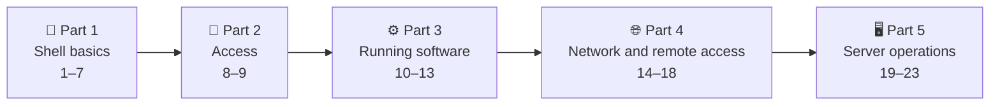

# 🐧 Linux Handbook

Every Linux concept you've studied, merged from all your sources into one place, ordered from beginner to advanced.

> [!toc]- 📑 Contents
>
> - [[#🧭 How to Use It|🧭 How to Use It]]
> - [[#🗺️ Learning Order|🗺️ Learning Order]]
> - [[#📖 Notes|📖 Notes]]
> - [[#📚 Sources|📚 Sources]]
> - [[#🔁 Keeping It Up to Date|🔁 Keeping It Up to Date]]

---

## 🧭 How to Use It

- 📘 **Learn and review here.** Each note merges the same concept from SDGL, the Nana course, your Server Administration notes and the books, so you read it once.

- 🗃️ **Source notes stay where they are.** The [[Linux/The Software Developer’s Guide to Linux/README|SDGL notes]], the [[DevOps/NaNa/Linux/0. Linux Learning Path|Nana Linux notes]] and the [[DevOps/Server Administration/0. Server Administration Learning Path|Server Administration notes]] are records of each course. Each one points to the Handbook note it was merged into.

- ✅ **Only what you've studied has content.** 📖 *planned* notes get written when you study that topic. The [[Linux/The Software Developer’s Guide to Linux/README|SDGL README]] says what to read next.

- 📚 **Every note ends with References:** the exact book pages for each concept, marked ✅ studied, 📖 planned or 🔭 optional.

    - 📖 **planned** sections aren't in the note yet. Their hint says what's 🔁 already covered here from another source, and what's 🆕 new and → which note it will go into once you read it.

**Last updated:** 2026-11-18, from SDGL Ch.1–4, Nana Linux notes 1–8, and Server Administration notes 1–3.

---

## 🗺️ Learning Order

Each part only needs the parts before it. Inside a part, read the notes in number order.

---

## 📖 Notes

**Status:** ✅ written · 🟡 written, more to merge later · 📖 planned (no note yet)

### 🐚 Part 1: Shell basics

| # | Note | Status | Merged from |
|---|---|---|---|
| 1 | [[Linux/Linux Handbook/1. The Shell and How Commands Run\|The Shell and How Commands Run]] | ✅ | SDGL Ch.1 |
| 2 | [[Linux/Linux Handbook/2. Files and Directories\|Files and Directories]] | 🟡 | SDGL Ch.1 · Nana ep 9 · *later: SDGL Ch.5* |
| 3 | [[Linux/Linux Handbook/3. Editing Files with Vim\|Editing Files with Vim]] | ✅ | Nana Vim note · Scattered Vim note |
| 4 | [[Linux/Linux Handbook/4. Streams, Pipes, and Redirection\|Streams, Pipes, and Redirection]] | 🟡 | Nana Pipes note · SDGL Ch.1–2 · *later: SDGL Ch.11* |
| 5 | Text Processing | 📖 | *SDGL Ch.11, CompTIA Ch.3 and Ch.7* |
| 6 | [[Linux/Linux Handbook/6. Environment Variables and Shell Startup\|Environment Variables and Shell Startup]] | 🟡 | Nana Env Vars note · SDGL Ch.1–2, Ch.4 · *later: SDGL Ch.10* |
| 7 | Shell Scripting | 📖 | *SDGL Ch.12 + the scripting track* |

### 👥 Part 2: Access

| # | Note | Status | Merged from |
|---|---|---|---|
| 8 | [[Linux/Linux Handbook/8. Users, Groups, and sudo\|Users, Groups, and sudo]] | 🟡 | Nana Users and Server Configuration notes · SDGL Ch.2–3 · *later: SDGL Ch.7* |
| 9 | [[Linux/Linux Handbook/9. Ownership and Permissions\|Ownership and Permissions]] | ✅ | Nana Permissions note · SDGL Ch.1 · Server Admin SSH note |

### ⚙️ Part 3: Running software

| # | Note | Status | Merged from |
|---|---|---|---|
| 10 | [[Linux/Linux Handbook/10. Processes and Signals\|Processes and Signals]] | ✅ | SDGL Ch.2–3 · Nana Pipes note |
| 11 | [[Linux/Linux Handbook/11. systemd, Services, and Timers\|systemd, Services, and Timers]] | ✅ | SDGL Ch.3 · Nana systemd note |
| 12 | Software and Packages | 📖 | *Nana ep 12 · SDGL Ch.9 · CompTIA Ch.11* |
| 13 | Logs | 📖 | *SDGL Ch.16 · CompTIA Ch.10* |

### 🌐 Part 4: Network and remote access

| # | Note | Status | Merged from |
|---|---|---|---|
| 14 | [[Linux/Linux Handbook/14. IP Addressing and Routing\|IP Addressing and Routing]] | ✅ | Nana Networking note |
| 15 | [[Linux/Linux Handbook/15. Ports, Sockets, and DNS\|Ports, Sockets, and DNS]] | ✅ | Nana Networking note · SDGL Ch.2 |
| 16 | [[Linux/Linux Handbook/16. SSH Keys and Hardening\|SSH Keys and Hardening]] | 🟡 | Nana Server Configuration note · Server Admin SSH note · *later: SDGL Ch.13* |
| 17 | [[Linux/Linux Handbook/17. Firewalls and Network Exposure\|Firewalls and Network Exposure]] | ✅ | Server Admin Firewalls note · Nana Networking note |
| 18 | HTTP and Load Balancing | 📖 | *SDGL Ch.17* |

### 🖥️ Part 5: Server operations

| # | Note | Status | Merged from |
|---|---|---|---|
| 19 | Disks, Filesystems, and Mounts | 📖 | *Bible Ch.12 · CompTIA Ch.5* |
| 20 | Performance and Resources | 📖 | *CompTIA Ch.14 · Bible Ch.21* |
| 21 | Containers Under the Hood | 📖 | *SDGL Ch.15 · Bible Ch.6, Ch.27* |
| 22 | Security Hardening | 📖 | *Bible Ch.23 · Server Admin notes 4–9* |
| 23 | [[Linux/Linux Handbook/23. Auditing a Server\|Auditing a Server]] | 🟡 | Server Admin Audit note · *later: Server Admin note 12* |

---

## 📚 Sources

| Source | Where | Notes |
|---|---|---|
| 📕 **SDGL** | `Book/SDGL/Packt.The.Software.Developers.Guide.to.Linux.pdf` | Main book. PDF page = printed + 31 |
| 📗 **CompTIA 6th** | `Book/CompTIA Linux+ and LPIC-1 Guide to Linux Certification 6th ed - Eckert.pdf` | PDF page = printed + 16 |
| 📘 **Linux Bible 11th** | `Book/Linux BIBLE 11th 2026.pdf` | Offset changes by chapter; References give the PDF page |
| 📝 **Nana course** | [[DevOps/NaNa/Linux/0. Linux Learning Path\|Nana Linux notes]] | Watched up to ep 106 |
| 🖥️ **Server Administration** | [[DevOps/Server Administration/0. Server Administration Learning Path\|Server Administration notes]] | Notes 1–3 studied; 4–12 are fix guides to apply later |
| 🗒️ **Scattered notes** | `Linux/Scatterd Learning/` | Extra references only |

---

## 🔁 Keeping It Up to Date

After every study session about Linux, from any source, the new concepts are merged into the right note here. The rules are in [[Linux/Linux Handbook/AI Prompt - Linux Handbook|AI Prompt - Linux Handbook]].
