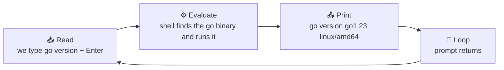
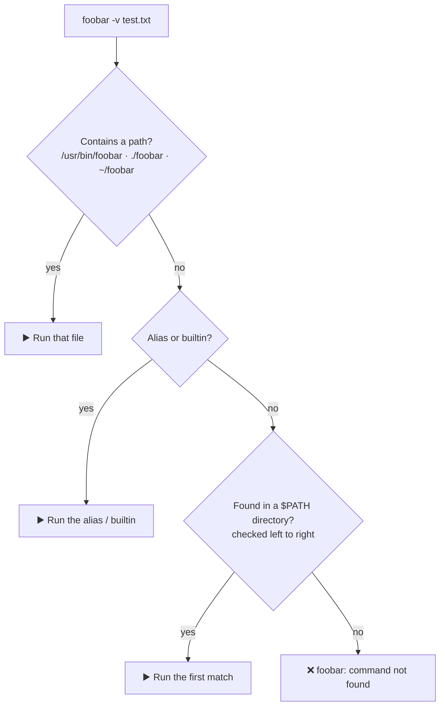

# 🐚 The Shell and How Commands Run

[[Linux/Linux Handbook/0. Linux Handbook|🐧 Linux Handbook]] · Part 1: Shell basics · ➡️ [[Linux/Linux Handbook/2. Files and Directories|2. Files and Directories]]

What happens between typing a command and seeing its output, how the shell decides which program to run, and how to get help.

> [!toc]- 📑 Contents
>
> - [[#🔁 The REPL|🔁 The REPL]]
> - [[#🐚 Command Line vs. Shell|🐚 Command Line vs. Shell]]
> - [[#✍️ Command Syntax|✍️ Command Syntax]]
> - [[#🔎 How the Shell Finds a Command|🔎 How the Shell Finds a Command]]
> - [[#📏 POSIX|📏 POSIX]]
> - [[#📖 Getting Help|📖 Getting Help]]
> - [[#⇥ Tab Completion|⇥ Tab Completion]]
> - [[#🧪 Interview Q&A|🧪 Interview Q&A]]
> - [[#🔨 Hands-On Practice|🔨 Hands-On Practice]]
> - [[#📚 References|📚 References]]

---

## 🔁 The REPL

A **command line** is a loop: it **R**eads what we type, **E**valuates it, **P**rints the result, and **L**oops back to the prompt. That's a **REPL**, the same idea as `python3` or `node` with no script.



In code, the whole idea is one line: `while (true) { print(eval(read())) }`. Bash is far bigger, but it follows exactly this loop.

---

## 🐚 Command Line vs. Shell

The two words are often used as if they mean the same thing. They don't.

- 💬 **Command line:** the *general idea*, a text REPL for talking to a system.

- 🐚 **Shell:** a *specific program* that implements a command line.

| Shell | Talks to |
|---|---|
| `bash`, `zsh` | The operating system |
| `psql`, `mysql`, `redis-cli` | A database |
| `python3`, `irb` | A language interpreter |

In this Handbook, "the shell" means a **Unix shell** (Bash or zsh). The shell is itself a running program, a process with a PID: see [[Linux/Linux Handbook/10. Processes and Signals|10. Processes and Signals]].

---

## ✍️ Command Syntax

Every command has the same shape:

```text
command [options] [arguments]
```

Think of it as a function call: the command is the function, everything after it is the argument list.

- 🧩 **Each program defines its own options.**

    - The shell only checks that the command exists. `ls --colour-me` is rejected by `ls` itself, not by the shell.

- 🏳️ **Short vs. long flags**

    - `-l` and `--long` often mean the same, but only if the program's author implemented both.

    - Short flags combine: `ls -l -h` = `ls -lh`.

- ␣ **Spaces separate arguments.**

    - `mkdir "my project"` makes one directory. Without the quotes, it makes two: `my` and `project`.

### 📖 Reading syntax in documentation

Man pages and `--help` output share one notation:

```text
command [-flags] [--example=foobar] [even_more_options ...]
```

| Notation | Meaning |
|---|---|
| `[ ... ]` | Optional |
| `...` | Zero or more of the previous item |
| `-f` | Short flag |
| `--flag=value` | Long flag with a value |

---

## 🔎 How the Shell Finds a Command

When we press Enter on `foobar -v test.txt`, the shell must decide *which program* `foobar` is. It checks in this order:



1. 📁 **A path was given.**

   `/usr/bin/foobar`, `./foobar` (`.` = current directory) or `~/foobar`. The shell runs exactly that file.

2. 🐚 **An alias or a builtin.**

   - **Aliases** are shortcuts we define: `alias ll='ls -lh'`. Saved in `~/.bashrc` or `~/.zshrc` (see [[Linux/Linux Handbook/6. Environment Variables and Shell Startup|6. Environment Variables and Shell Startup]]).

   - **Builtins** live inside the shell itself: `cd`, `echo`, `type`, `export`. `cd` *must* be a builtin, because a child process can't change its parent's directory.

3. 🔎 **Search `$PATH`.**

   `$PATH` is a colon-separated list of directories. The shell checks them **left to right** and runs the **first** match.

   ```bash
   echo $PATH | tr ':' '\n'
   ```

   Go installs, Python virtualenvs and version managers all work by **adding a directory to the front** of `$PATH`.

Once found, the shell starts the program and passes `-v` and `test.txt` to it as arguments, in that order.

> ⚠️ A script in the current directory needs `./deploy.sh`. The current directory isn't in `$PATH`, so plain `deploy.sh` gives "command not found".

### 💻 Which program will actually run?

```bash
command -v go     # POSIX: path of what runs, works everywhere
type ls           # Bash/zsh: also says if it's an alias or builtin
type -a go        # every match in $PATH, in order
```

Illustrative output:

```text
/usr/local/go/bin/go
ls is aliased to `ls --color=auto'
go is /usr/local/go/bin/go
go is /usr/bin/go
```

- 💡 **Prefer `command -v` over `which` in scripts.** It's part of POSIX and always present.

- 🔎 **`type -a`** reveals two installed versions; the first line is the one that runs.

---

## 📏 POSIX

**POSIX** is a family of standards for what Unix-like systems share: basic commands, their behavior, and shell syntax. It requires `ls`, for example, and `command -v` to check whether a command exists.

- ✅ **Sticking to POSIX makes scripts portable** across distros, macOS and BSD.

- ⚠️ **It isn't a guarantee.** GNU (Linux) and BSD (macOS) tools differ in small ways, such as `sed -i`.

---

## 📖 Getting Help

```bash
man ls          # the full manual page
ls --help       # short usage summary (most GNU tools)
apropos compress   # search manual descriptions (same as man -k)
```

A man page has a **NAME**, a **SYNOPSIS** (syntax in the notation above) and a **DESCRIPTION** of every option. Navigate it like `less`: `/word` to search, `n` for the next match, `q` to quit.

### 📚 Manual sections

`ls(1)` means "`ls`, section 1". When a name exists in several sections, give the number.

| Section | Contains |
|---|---|
| **1** | User commands (`ls`, `grep`) |
| 2 | System calls (`fork`, `open`) |
| 3 | C library functions |
| **5** | File formats and config files (`passwd`, `crontab`) |
| 7 | Overviews (`signal`, `regex`) |
| **8** | Admin commands and daemons (`useradd`, `sshd`) |

```bash
man 1 crontab   # the crontab command
man 5 crontab   # the crontab file format
```

For DevOps work, sections **1, 5 and 8** are the ones we use.

---

## ⇥ Tab Completion

Press **Tab** to complete commands, file names and directories:

```text
~ cd D<Tab>
Desktop/  Documents/  Downloads/
~ cd Doc<Tab>
~ cd Documents/
```

Each extra letter narrows the matches; when one is left, Tab completes it.

Tab also **prevents path typos**: if Tab won't complete, the path probably doesn't exist.

📜 History expansion (`!!`, `!$`) is one more expansion the shell does before running a line: see [[Linux/Linux Handbook/6. Environment Variables and Shell Startup#📜 Shell History|6. Shell History]].

---

### 🧪 Interview Q&A

**Q1:** What's the difference between a shell and the command line?

**Q2:** We run `deploy.sh` in the folder that contains it and get "command not found". Why, and what are two fixes?

**Q3:** Two Go versions are installed. How do we find out which one `go` runs, and why that one?

**Q4:** Why can't the shell tell us that `ls --colour-me` is an invalid flag before running it?

**Q5:** `man crontab` shows the command, but we need the file format. What do we run?

> [!answer]- 📋 Answers
>
> **A1:** The command line is the general idea of a text REPL. A shell is a specific program, such as Bash or `psql`, that implements one.
>
> **A2:** The current directory isn't in `$PATH`, and there's no path in the command. Run `./deploy.sh`, or move it to a `$PATH` directory such as `~/.local/bin`.
>
> **A3:** `type -a go` lists every match. The shell runs the first match in `$PATH`, so the directory that comes earlier wins.
>
> **A4:** Each program parses its own options. The shell only finds the executable; `ls` itself rejects the flag.
>
> **A5:** `man 5 crontab`. Section 5 holds file formats.

---

## 🔨 Hands-On Practice

1. 🔎 **Trace how commands resolve.**

   ```bash
   type cd ls go
   command -v go
   echo $PATH | tr ':' '\n'
   foobar
   ```

   ✅ `cd` is a builtin, `ls` is probably an alias, `go` is a file in a `$PATH` directory, and `foobar` gives "command not found".

2. 🧩 **Make and remove an alias.**

   ```bash
   alias ll='ls -lh'
   type ll
   unalias ll
   ```

   ✅ `type ll` prints `ll is aliased to 'ls -lh'`.

3. 📖 **Find a command you don't know the name of.**

   ```bash
   apropos "disk usage"
   man 1 du
   ```

   ✅ `apropos` lists `du (1)`, and its man page opens.

---

### 📋 Quick Reference

| Command | Purpose |
|---|---|
| `command -v cmd` | What will run, POSIX-safe |
| `type cmd` · `type -a cmd` | Alias, builtin or file · all matches |
| `echo $PATH` | Where the shell looks for commands |
| `alias name='…'` · `unalias name` | Create · remove an alias |
| `man [section] cmd` | Manual page |
| `cmd --help` | Quick usage |
| `apropos word` | Search the manuals |

### 🧠 Things to Remember

- The shell is a **REPL**: read → evaluate → print → loop.

- **Lookup order:** explicit path → alias or builtin → `$PATH` (first match wins) → "command not found".

- The **shell** is one program; the **command line** is the general idea.

- Each program parses its own flags; the shell only finds the program.

### 💡 Pro Tips

- **Debug "wrong version" problems with `type -a`**: it shows every match in order.

- **Check for tools in scripts** with `command -v jq >/dev/null || echo "install jq"`.

- **Lean on Tab completion for paths**: if it won't complete, the path is wrong.

### 🔗 Related Topics

- ➡️ [[Linux/Linux Handbook/2. Files and Directories|2. Files and Directories]]

- [[Linux/Linux Handbook/6. Environment Variables and Shell Startup|6. Environment Variables and Shell Startup]] (`PATH`, aliases)

- [[Linux/Linux Handbook/10. Processes and Signals|10. Processes and Signals]] (the shell is a process)

- [[Linux/Scatterd Learning/Alias|Aliases (scattered notes)]]

---

## 📚 References

| Source | Where | Status |
|---|---|---|
| 📝 SDGL note: [[Linux/The Software Developer’s Guide to Linux/1. How the Command Line Works\|1. How the Command Line Works]] | REPL → tab completion | ✅ studied |
| 📕 SDGL Ch.1 | REPL p. 1 · syntax p. 3 · shell p. 4 · evaluate p. 5 · POSIX p. 6 · help p. 17 · completion p. 18 | ✅ studied |
| 📝 Nana | eps 10–11, CLI parts 1–2 | ✅ studied |
| 📕 SDGL Ch.4 | Shell history, pp. 45–49 | ✅ studied · merged into [[Linux/Linux Handbook/6. Environment Variables and Shell Startup#📜 Shell History\|note 6]] |
| 📗 CompTIA 6th Ch.2 | Shells, terminals and the kernel p. 51 · basic commands p. 55 · metacharacters p. 56 · help p. 58 [PDF 67–74] | 🔭 optional |
| 📘 Linux Bible Ch.3 | Shells p. 60 · running commands p. 64 · syntax p. 65 · locating commands p. 68 · completion p. 73 · help p. 86 [PDF 93–119] | 🔭 optional |
| 🗒️ Scattered: [[Linux/Scatterd Learning/Alias\|Alias]] | Making aliases permanent | 🔭 optional |
