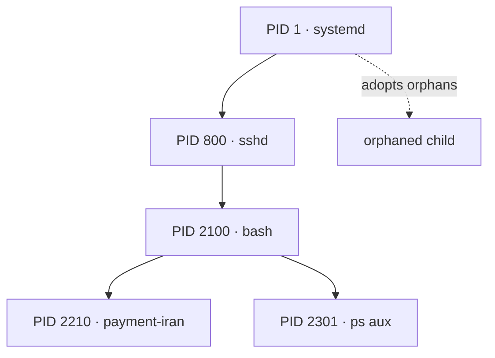
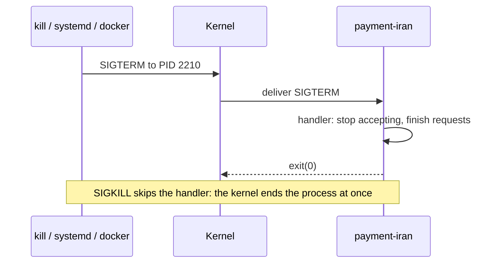
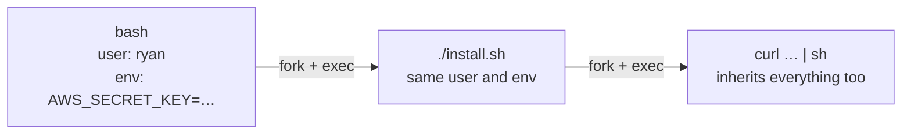
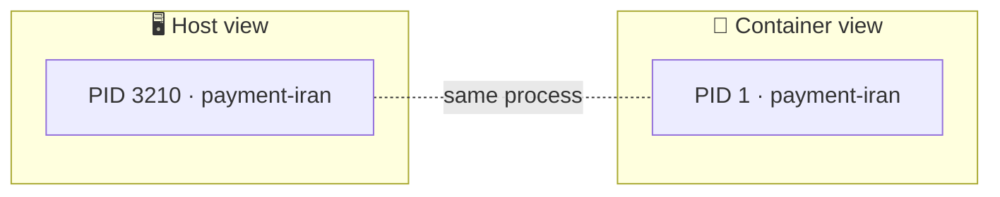
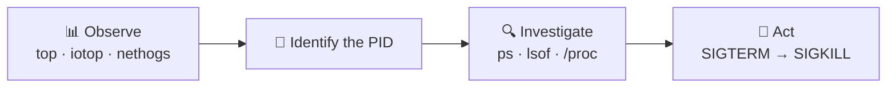

# ⚙️ Processes and Signals

[[Linux/Linux Handbook/0. Linux Handbook|🐧 Linux Handbook]] · Part 3: Running software · ⬅️ [[Linux/Linux Handbook/9. Ownership and Permissions|9. Ownership and Permissions]] · ➡️ [[Linux/Linux Handbook/11. systemd, Services, and Timers|11. systemd, Services, and Timers]]

When our code runs, Linux wraps it in one abstraction: the **process**. This note covers what a process carries, how to find and inspect one, and how to stop it safely with signals.

> [!toc]- 📑 Contents
>
> - [[#⚙️ What a Process Is|⚙️ What a Process Is]]
> - [[#🧬 Process Attributes|🧬 Process Attributes]]
> - [[#💻 Inspecting Processes|💻 Inspecting Processes]]
> - [[#📡 Signals|📡 Signals]]
> - [[#🔫 kill and the Safe Stop Order|🔫 kill and the Safe Stop Order]]
> - [[#🗂️ /proc and lsof|🗂️ /proc and lsof]]
> - [[#🧬 Inheritance|🧬 Inheritance]]
> - [[#🐳 Processes in Containers|🐳 Processes in Containers]]
> - [[#🚑 Troubleshooting Pattern|🚑 Troubleshooting Pattern]]
> - [[#🧪 Interview Q&A|🧪 Interview Q&A]]
> - [[#📚 References|📚 References]]

---

## ⚙️ What a Process Is

A **program** is a file on disk. A **process** is that program while it runs: the kernel's record of it. Everything that does work is a process: `ls`, nginx, our Go service, and the shell we type into.

For each process the kernel tracks its memory, CPU time, open files and network sockets, the signals and pipes it uses, and the processes it started.

```bash
ps aux
```

Illustrative output:

```text
USER   PID %CPU %MEM    VSZ   RSS TTY   STAT START  TIME COMMAND
root     1  0.0  0.1 168000 12000 ?     Ss   09:00  0:02 /sbin/init
ryan  2210  0.3  0.6 712000 48000 ?     Sl   09:15  0:05 ./payment-iran
ryan  2301  0.0  0.0  10000  3500 pts/0 R+   09:20  0:00 ps aux
```

---

## 🧬 Process Attributes

### 🔢 PID and PPID

- 🔢 **PID:** a unique number given at start. Like a primary key, it's how every command refers to a process.

- 🌱 **PID 1 is init**, the first process the kernel starts. On most distros it's **systemd** (see [[Linux/Linux Handbook/11. systemd, Services, and Timers|11. systemd]]). It can't be killed, even by root.

- 👪 **PPID:** the parent that started this process. Every process except init has one.

    - 👶 **Orphan:** the parent died first. The child is **re-parented to PID 1**.

    - 🧟 **Zombie:** the child *finished*, but its parent hasn't collected its exit status. It uses no CPU or memory, only a PID entry. Fix the parent, not the zombie.



### 🚦 STAT: state

| Code | State |
|---|---|
| `R` | Running or ready to run |
| `S` | Sleeping, waiting for an event (most processes) |
| `D` | Uninterruptible sleep, usually waiting on disk I/O |
| `T` | Stopped (`Ctrl+Z`) |
| `Z` | Zombie |

Extra characters: `s` session leader, `l` multithreaded, `+` foreground.

> 💡 Many processes in `D` usually mean slow disks or a hung network mount, not a CPU problem.

### 🔐 User, 🌿 environment, 📁 working directory

- 🔐 **EUID / EGID:** the user and group the process runs as. They decide what it may access ([[Linux/Linux Handbook/9. Ownership and Permissions|9. Permissions]]).

- 🌿 **Environment variables:** its own copy, given at start ([[Linux/Linux Handbook/6. Environment Variables and Shell Startup|6. Environment Variables]]).

- 📁 **Working directory:** relative paths in the program resolve from here.

> ⚠️ A service started by systemd runs with `/` as its working directory unless the unit sets `WorkingDirectory=`. Code that opens `./config.yaml` works in our terminal but fails as a service.

- 🎚️ **Also tracked:** niceness (priority), `VSZ` (virtual memory reserved) and `RSS` (physical memory in use).

---

## 💻 Inspecting Processes

```bash
ps aux | head            # snapshot of every process
ps -ef --forest          # parent/child tree (or: pstree -p)
pgrep -a payment         # PIDs + command lines by name
pgrep -u www-data        # every process of a user
top                      # live view: M sort by memory, P by CPU, q quit
```

- 🔎 **`pgrep` replaces `ps aux | grep name`**, which also matches the `grep` itself.

- 📊 **`top`'s header** shows load average and total CPU and memory; `htop` is a friendlier version.

| Tool | Like `top`, but for |
|---|---|
| `sudo iotop` | Disk I/O per process |
| `sudo nethogs` | Network traffic per process |

---

## 📡 Signals

**Signals** are small numbered messages sent to a process: stop, reload your config, die now.

A process can **trap** (catch) most signals and run a handler, like catching an exception. That's how a server shuts down cleanly:

```go
ctx, stop := signal.NotifyContext(context.Background(), syscall.SIGTERM, syscall.SIGINT)
defer stop()
<-ctx.Done()            // block until a signal arrives
server.Shutdown(ctx)    // finish in-flight requests, then exit
```



| Signal | No. | Meaning | Trappable |
|---|---|---|---|
| `SIGHUP` | 1 | "Hang up". Daemons often treat it as **reload config** | ✅ |
| `SIGINT` | 2 | Interrupt, what `Ctrl+C` sends | ✅ |
| `SIGKILL` | 9 | **Kill now**, no cleanup | ❌ |
| `SIGUSR1` | 10 | App-defined (nginx: reopen log files) | ✅ |
| `SIGTERM` | 15 | **Please terminate.** Default for `kill` | ✅ |
| `SIGSTOP` / `SIGCONT` | 19 / 18 | Pause / resume | ❌ / ✅ |

Numbers differ on other platforms (macOS `USR1` = 30), so use **names**. `kill -l` lists them; `man 7 signal` describes them.

---

## 🔫 `kill` and the Safe Stop Order

Despite its name, `kill` sends **any** signal. By default it sends `SIGTERM`, a polite request.

```bash
kill 2600              # SIGTERM: please exit cleanly
kill -HUP 2600         # reload config
kill -9 2600           # SIGKILL: last resort
pkill payment-iran     # by name instead of PID
```

1. 🙏 **Send `SIGTERM`** and wait a few seconds.

2. 🔎 **Check** with `pgrep` whether it's still there.

3. 💥 **Only then `SIGKILL`.**

> ⚠️ `SIGKILL` gives no chance to flush writes or close files, so it can corrupt data.

💡 `systemctl stop`, `docker stop` and Kubernetes all follow the same pattern: `SIGTERM`, a timeout, then `SIGKILL`. A Go service that ignores `SIGTERM` gets killed mid-request.

---

## 🗂️ `/proc` and `lsof`

`/proc` is a **virtual filesystem**: nothing in it is on disk; the kernel generates it when read. Each process has `/proc/<PID>/`. `ps` and `top` read from here.

```bash
tr '\0' ' ' < /proc/2210/cmdline     # full command line
ls -l /proc/2210/cwd                  # working directory
tr '\0' '\n' < /proc/2210/environ     # environment variables
ls -l /proc/2210/fd                   # open file descriptors
grep VmRSS /proc/2210/status          # real memory in use
```

**`lsof`** lists open files, including sockets, since network sockets are files too:

```bash
sudo lsof -p 2210        # everything a process has open
sudo lsof -i :8080       # who holds port 8080 ("address already in use")
```

Leaking file handles causes "too many open files" errors.

---

## 🧬 Inheritance

Every process except init is created by a parent that **copies itself** (`fork`) and then loads a new program (`exec`). The child **inherits** the parent's user, environment and working directory.



- 🔐 **Run something with `sudo`**, and every child it spawns is root too.

- 🌿 **Secrets in env vars** pass down to every child.

Well-behaved servers like nginx start as root to bind port 80, then **drop privileges** to a normal user for their workers.

---

## 🐳 Processes in Containers

A container isn't a VM. Its processes are ordinary host processes:

- 🔢 **PID namespaces** give it its own numbering. Inside, our app is PID 1; on the host, the same process has an ordinary PID.

- 📏 **cgroups** limit what it can use. Going over the memory limit means the OOM killer, and exit code 137.



**PID 1 is special.** The kernel applies **no default signal actions** to PID 1, and PID 1 must reap orphaned zombies.

- 📡 **An app without a `SIGTERM` handler ignores `docker stop`** as PID 1, waits out the 10-second timeout, and gets `SIGKILL`.

- 🐣 **`docker run --init`** (or `init: true` in Compose) adds **tini** as PID 1. It forwards signals to the app and reaps zombies.

```bash
docker stats --no-stream          # CPU, memory/limit, PIDs per container
docker top <name>                 # processes inside, like ps
docker inspect --format '{{.State.Pid}}' <name>   # the host PID of its PID 1
```

> ⚠️ `top` or `free` **inside** a container shows the **host's** memory, not the container's limit. Check `docker stats` from outside.

🔜 **Later:** namespaces and cgroups in depth go in **21. Containers Under the Hood**.

---

## 🚑 Troubleshooting Pattern

**Symptom:** a server is suddenly slow.

1. 📊 **Observe:** `top` shows `bzip2`, PID `1763`, at 94% CPU.

2. 🙏 **Ask it to stop:** `kill 1763`.

3. 🔎 **Check:** `pgrep bzip2` still prints `1763`.

4. 💥 **Force it:** `kill -9 1763`. ✅ `pgrep` prints nothing and load drops.



Pick the tool for the resource: `top` for CPU and memory, `iotop` for disk, `nethogs` for network.

---

### 🧪 Interview Q&A

**Q1:** What's the difference between a program and a process?

**Q2:** A server shows dozens of `Z` processes. Is `kill -9` on them useful?

**Q3:** What's the difference between `SIGTERM` and `SIGKILL`?

**Q4:** Our Go service reads `./config.yaml` fine in the terminal but fails under systemd. Why?

**Q5:** "Address already in use" on port 8080. How do we find the culprit?

**Q6:** Why might a Go service in a container ignore `docker stop` and only die after 10 seconds?

> [!answer]- 📋 Answers
>
> **A1:** A program is an executable file. A process is a running instance with a PID, memory, an owner and an environment.
>
> **A2:** No: zombies are already dead. Their parent isn't reaping them. Fix or restart the parent, and init reaps them.
>
> **A3:** `SIGTERM` asks the process to exit and can be trapped for cleanup. `SIGKILL` can't be trapped; the kernel ends it immediately.
>
> **A4:** The working directory differs. Under systemd it's `/` unless `WorkingDirectory=` is set.
>
> **A5:** `sudo lsof -i :8080` or `sudo ss -ltnp | grep :8080`, then signal that PID.
>
> **A6:** As PID 1 it gets no default signal actions; without a `SIGTERM` handler the signal is ignored until `SIGKILL`. Handle `SIGTERM` in code or run with `--init`.

---

## 🔨 Hands-On Practice

1. 🌳 **Your own process tree.**

   ```bash
   echo $$
   ps -ef --forest | less
   ```

   ✅ Your shell's chain ends at PID 1.

2. 📡 **Trap a signal.**

   ```bash
   bash -c 'trap "echo got TERM; exit 0" TERM; while true; do sleep 1; done' &
   kill %1
   ```

   ✅ Prints `got TERM`. Repeat with `kill -9 %1`: no message, because `SIGKILL` can't be trapped.

3. 🗂️ **Inheritance through `/proc`.**

   ```bash
   sleep 300 &
   PID=$!
   ls -l /proc/$PID/cwd
   tr '\0' '\n' < /proc/$PID/environ | head
   kill $PID
   ```

   ✅ The `cwd` and environment match the shell that started it.

4. 🐳 **Optional: container PIDs.**

   ```bash
   docker run -d --name pidtest alpine sleep 300
   docker exec pidtest ps
   ps aux | grep "sleep 300"
   docker rm -f pidtest
   ```

   ✅ Inside, `sleep` is PID 1; on the host it has a normal PID.

---

### 📋 Quick Reference

| Command | Purpose |
|---|---|
| `ps aux` · `ps -ef --forest` | All processes · tree |
| `pgrep -a name` | Find PIDs by name |
| `top` · `htop` | Live CPU and memory |
| `kill PID` · `kill -HUP PID` · `kill -9 PID` | Terminate · reload · force |
| `pkill name` | Signal by name |
| `kill -l` · `man 7 signal` | List signals |
| `ls -l /proc/PID/{cwd,fd}` | Working dir, open files |
| `sudo lsof -p PID` · `sudo lsof -i :PORT` | Open files · who holds a port |
| `docker stats` · `docker top NAME` | Container resources · processes |

### 🧠 Things to Remember

- A **process** is a running program with a **PID**. PID 1 is init.

- Orphans go to PID 1; **zombies** wait for their parent to reap them.

- `kill` sends **`SIGTERM`** by default. `SIGKILL` can't be trapped.

- Children **inherit** user, environment and working directory.

- In a container, the app is PID 1: handle `SIGTERM` or use `--init`.

### 💡 Pro Tips

- **Always handle `SIGTERM` in services**: systemd, Docker and Kubernetes all send it first.

- **Use signal names, not numbers.**

- **Check for `D` states before blaming CPU**: high load with idle CPU often means stuck I/O.

### 🔗 Related Topics

- ⬅️ [[Linux/Linux Handbook/9. Ownership and Permissions|9. Ownership and Permissions]] · ➡️ [[Linux/Linux Handbook/11. systemd, Services, and Timers|11. systemd, Services, and Timers]]

- [[Linux/Linux Handbook/15. Ports, Sockets, and DNS|15. Ports, Sockets, and DNS]] (`ss -ltnp`)

- [[DevOps/NaNa/Docker/1. Container|Containers and Images]]

- [[DevOps/Server Administration/6. Memory Swap and Resource Limits|Memory, Swap, and Resource Limits]] (🛠️ apply)

---

## 📚 References

| Source | Where | Status |
|---|---|---|
| 📝 SDGL note: [[Linux/The Software Developer’s Guide to Linux/2. Working with Processes\|2. Working with Processes]] | whole note | ✅ studied |
| 📝 SDGL note: [[Linux/The Software Developer’s Guide to Linux/3. Service Management with systemd\|3. Service Management with systemd]] | Containers and init, tini | ✅ studied |
| 📕 SDGL Ch.2 | Basics p. 22 · PID p. 24 · EUID p. 25 · commands p. 26 · signals p. 28 · `kill` p. 29 · `lsof` p. 31 · inheritance p. 33 · troubleshooting p. 33 | ✅ studied |
| 📕 SDGL Ch.3 | A note on Docker, p. 43 | ✅ studied |
| 📕 SDGL Ch.15 | Container theory: namespacing, p. 219 | 📖 planned · 🔁 PID namespaces in brief · 🆕 every namespace type in depth → note 21 |
| 📗 CompTIA 6th Ch.9 | Processes p. 361 · viewing p. 363 · killing p. 368 · background p. 372 · priorities p. 374 [PDF 377–392] | 🔭 optional |
| 📘 Linux Bible Ch.6 | Listing p. 130 · background p. 137 · killing p. 139 · `nice` p. 141 [PDF 162–173] | 🔭 optional |
| 📘 Linux Bible Ch.6 | Limiting processes with cgroups, pp. 142–143 [PDF 174–175] | 📖 planned · 🔁 `OOMKilled` in brief · 🆕 how cgroups limit CPU and memory → note 21 |
