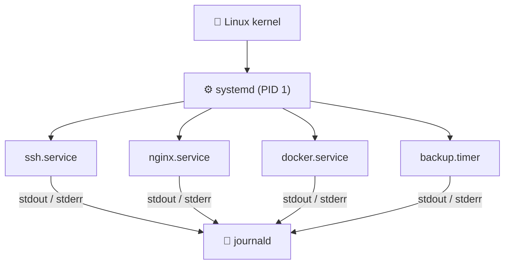
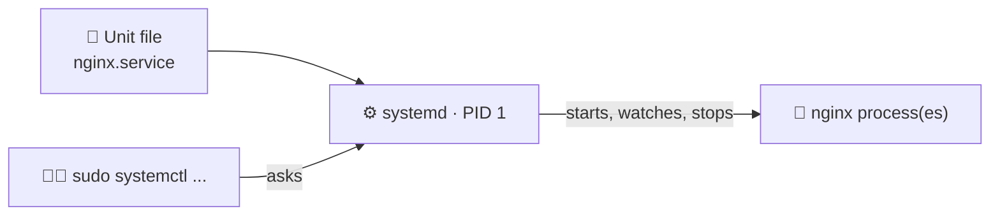
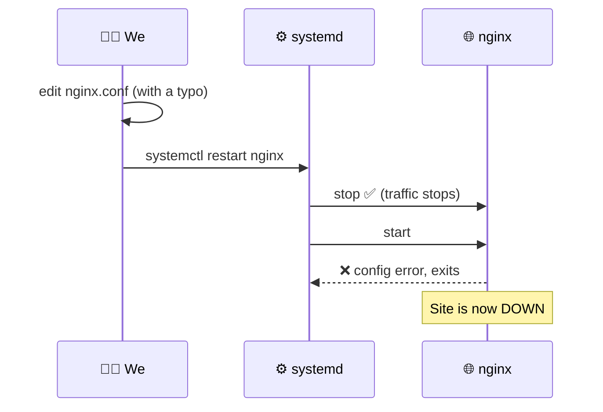
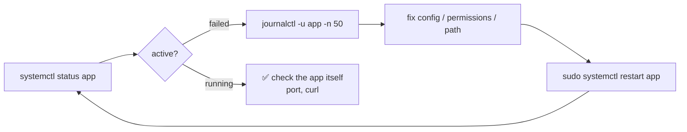
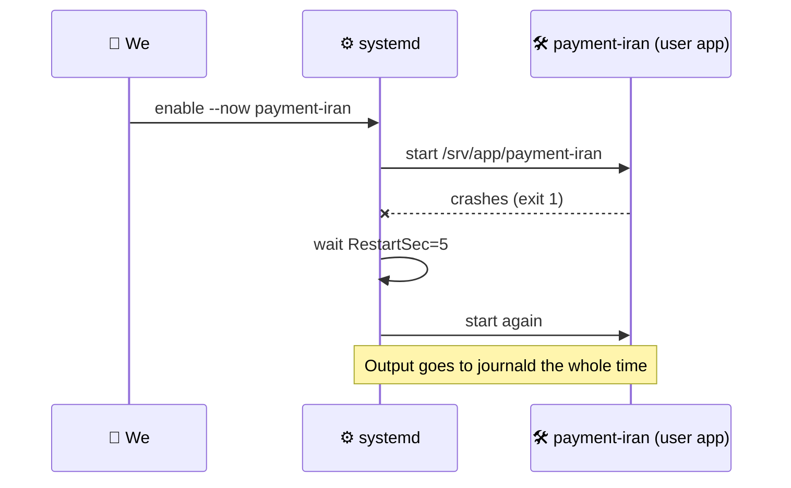
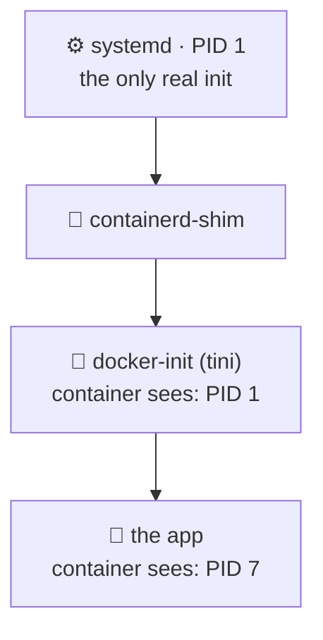

# 🛠️ systemd, Services, and Timers

[[Linux/Linux Handbook/0. Linux Handbook|🐧 Linux Handbook]] · Part 3: Running software · ⬅️ [[Linux/Linux Handbook/10. Processes and Signals|10. Processes and Signals]] · ➡️ [[Linux/Linux Handbook/14. IP Addressing and Routing|14. IP Addressing and Routing]]

Who starts long-running programs like nginx, Postgres, `sshd` and our Go API, keeps them alive, and lets us control them? On almost every modern distro: **systemd**, controlled with `systemctl` and read with `journalctl`.

> [!toc]- 📑 Contents
>
> - [[#🌱 init and systemd|🌱 init and systemd]]
> - [[#🧩 Units and Unit Files|🧩 Units and Unit Files]]
> - [[#🩺 Reading systemctl status|🩺 Reading systemctl status]]
> - [[#▶️ Start, Stop, Restart, Reload|▶️ Start, Stop, Restart, Reload]]
> - [[#⏰ Enable and Disable|⏰ Enable and Disable]]
> - [[#📜 Reading Logs with journalctl|📜 Reading Logs with journalctl]]
> - [[#🛠️ Running Your Own App as a Service|🛠️ Running Your Own App as a Service]]
> - [[#✏️ Overriding a Package's Service|✏️ Overriding a Package's Service]]
> - [[#⏲️ Timers Instead of cron|⏲️ Timers Instead of cron]]
> - [[#🐳 Containers Don't Boot|🐳 Containers Don't Boot]]
> - [[#🩺 Common Failures|🩺 Common Failures]]
> - [[#🧪 Interview Q&A|🧪 Interview Q&A]]
> - [[#📚 References|📚 References]]

---

## 🌱 init and systemd

A **service** (or **daemon**) is a long-running background process. Something has to start them all at boot: **init**, the first process the kernel starts, always **PID 1**. It also adopts orphaned processes (see [[Linux/Linux Handbook/10. Processes and Signals|10. Processes]]).

"init" is a role. Several **init systems** can fill it:

| Init system | Where we'll see it |
|---|---|
| **systemd** | Ubuntu, Debian, Fedora, RHEL, Arch: almost every modern distro |
| **SysV init** | Older Linux and traditional Unix |
| **OpenRC** | Alpine and Gentoo, on a real boot |

```bash
ps -p 1 -o pid,comm      # → 1 systemd
```

systemd does more than start services:

- 🚀 **Boot:** starts services in dependency order, in parallel where possible.

- 🔁 **Supervise:** starts, stops, and restarts daemons after a crash.

- 📜 **Logs:** `journald` collects every service's output.

- ⏲️ **Schedule:** timers run jobs, like cron.



> ⚠️ Changing system services needs `sudo`. Read-only commands like `systemctl status` don't.

---

## 🧩 Units and Unit Files

A **process** is a running program. A **service** is **packaging around that program** so the system can manage it. The packaging is a **unit file**: an INI-style recipe.

A unit file can set the program's name, its **dependencies and start order**, **environment variables** and **working directory**, the **user** it runs as, **resource limits**, and what to do when it **crashes**.



We don't run `nginx` ourselves; we ask systemd to, and it follows the unit file.

| Unit type | Purpose | Example |
|---|---|---|
| `.service` | A program or daemon | `nginx.service` |
| `.timer` | Runs a service on a schedule | `backup.timer` |
| `.socket` | Starts a service when a connection arrives | `ssh.socket` |
| `.mount` | A filesystem mount | `home.mount` |
| `.target` | A group of units, a boot milestone | `multi-user.target` |

📁 **Where unit files live:**

- `/lib/systemd/system/` (or `/usr/lib/systemd/system/`) → installed by packages. **Don't edit**: upgrades overwrite them.

- `/etc/systemd/system/` → our own units and overrides. **These win.**

🎯 **Targets** replace old runlevels. `multi-user.target` is a normal server without a GUI; `WantedBy=multi-user.target` means "start me when the server is up".

```bash
systemctl cat nginx      # read the recipe, plus any overrides
```

---

## 🩺 Reading `systemctl status`

The first command when a service misbehaves:

```bash
systemctl status nginx
```

Illustrative output:

```text
● nginx.service - A high performance web server and a reverse proxy server
     Loaded: loaded (/lib/systemd/system/nginx.service; enabled; preset: enabled)
     Active: active (running) since Mon 2026-11-16 09:12:03 UTC; 1 day ago
   Main PID: 1042 (nginx)
      Tasks: 3 (limit: 4558)
     Memory: 6.1M
     CGroup: /system.slice/nginx.service
             ├─1042 "nginx: master process /usr/sbin/nginx"
             ├─1043 "nginx: worker process"
             └─1044 "nginx: worker process"

Nov 16 09:12:03 web1 systemd[1]: Started nginx.service - A high performance web server...
```

| Line | What it tells us |
|---|---|
| **●** | Green when running, red when failed |
| **Loaded** | Unit file path, and whether it's **enabled** at boot |
| **Active** | `active (running)`, `inactive (dead)` or `failed`, and **for how long** |
| **Main PID** | The main process |
| **CGroup** | Every process that belongs to the service |
| **Log lines** | The last few log lines, often the error itself |

- 🕐 **"since … ago" is a free clue.** `3s ago` when nobody restarted it means a **crash loop**.

- 🧺 **The cgroup is how systemd tracks the whole service**, even after it forks workers. Docker uses the same kernel feature to limit containers.

---

## ▶️ Start, Stop, Restart, Reload

```bash
sudo systemctl start nginx     # start now
sudo systemctl stop nginx      # stop now
sudo systemctl restart nginx   # stop, then start
sudo systemctl reload nginx    # re-read config, keep running
```

- ✅ **`start` and `stop` are idempotent.**

- 📡 **`stop` sends `SIGTERM`**, then `SIGKILL` after a timeout (90 s by default).

### ⚠️ The restart trap

`restart` doesn't check the new config first. It stops a healthy service, then fails to start it:



**Validate first, and prefer `reload`:**

```bash
sudo nginx -t && sudo systemctl reload nginx
```

- 🔄 **`reload`** asks the running process to re-read its config without stopping. For nginx it sends `SIGHUP`. A good reload keeps the old config if the new one is broken.

- 🤷 **Reload is a convention**: some services don't support it. `reload-or-restart` covers both cases.

- 🧪 **Validators:** `nginx -t`, `sshd -t`, `apachectl configtest`.

> ⚠️ **`daemon-reload` is different.** `sudo systemctl daemon-reload` makes **systemd itself** re-read **unit files** after we edit a `.service` file. It doesn't touch the app's own config.

---

## ⏰ Enable and Disable

- **`start` / `stop`** → **now**.

- **`enable` / `disable`** → at the **next boot**.

The classic mistake: **`enable` doesn't start the service.**

| Command | Running now? | Starts at boot? |
|---|---|---|
| `start` | ✅ | unchanged |
| `enable` | unchanged | ✅ |
| `enable --now` | ✅ | ✅ |
| `disable --now` | ❌ | ❌ |

```bash
sudo systemctl enable --now nginx
systemctl is-active nginx      # active / inactive / failed
systemctl is-enabled nginx     # enabled / disabled
```

`enable` creates a symlink in `/etc/systemd/system/multi-user.target.wants/`; `disable` removes it.

```bash
systemctl list-units --type=service              # loaded and running
systemctl --failed                               # broken ones
systemctl list-unit-files --type=service         # everything installed + enabled state
```

---

## 📜 Reading Logs with `journalctl`

systemd captures each service's stdout and stderr into the **journal**. We don't need to know where an app writes logs: ask for the unit.

```bash
journalctl -u nginx                      # all logs for one unit
journalctl -u nginx -f                   # follow live
journalctl -u nginx --since "1 hour ago"
journalctl -u nginx -n 50 --no-pager     # last 50 lines
journalctl -b -p err                     # errors since this boot (-b -1: previous boot)
```

🩺 **Debugging loop** for any broken service:



🔜 **Later:** log levels, syslog, Docker logging and log rotation go in **13. Logs** (SDGL Ch.16).

---

## 🛠️ Running Your Own App as a Service

Instead of `nohup ./server &`, give the app a unit file. We get start at boot, restart on crash, a non-root user and central logs.

1. 📄 **Create** `/etc/systemd/system/payment-iran.service`:

   ```ini
   [Unit]
   Description=Payment API
   After=network-online.target
   Wants=network-online.target

   [Service]
   User=app
   Group=app
   WorkingDirectory=/srv/app
   ExecStart=/srv/app/payment-iran
   Environment=PORT=8080
   EnvironmentFile=-/etc/payment-iran/env
   Restart=on-failure
   RestartSec=5

   [Install]
   WantedBy=multi-user.target
   ```

   - **`User=app`** → the service user from [[Linux/Linux Handbook/8. Users, Groups, and sudo#🖥️ Setting Up a Server's Accounts|8. Users]], not root.

   - **`WorkingDirectory=`** → without it, relative paths resolve from `/`.

   - **`ExecStart`** → an **absolute path**. It isn't run through a shell, so pipes, `&&` and `~` don't work.

   - **`EnvironmentFile=-…`** → `KEY=value` lines; `-` means "don't fail if missing". Keep secrets here with `chmod 600`.

   - **`Restart=on-failure`** → restart after a crash or non-zero exit, `RestartSec=5` later.

2. 🔄 **`sudo systemctl daemon-reload`** → systemd caches unit files; needed after **every** edit.

3. 🚀 **`sudo systemctl enable --now payment-iran`**

4. ✅ **Verify:** `systemctl status payment-iran`, `journalctl -u payment-iran -f`, `curl localhost:8080`.



> 💡 **Real-World Example**
>
> After a deploy, nginx returns **502**. `systemctl status payment-iran` shows `activating (auto-restart)` and `since 4s ago`: a crash loop. The log lines say `open ./config.yaml: no such file or directory`. `systemctl cat payment-iran` shows no `WorkingDirectory=`, so `./config.yaml` meant `/config.yaml`. Add `WorkingDirectory=/srv/app`, `daemon-reload`, restart.

---

## ✏️ Overriding a Package's Service

Don't edit a package's file in `/lib`. Add a **drop-in**:

```bash
sudo systemctl edit nginx
```

This opens `/etc/systemd/system/nginx.service.d/override.conf`. Add only the lines to change:

```ini
[Service]
Restart=always
LimitNOFILE=65535
```

- Saving runs `daemon-reload` for us; restart the service to apply it.

- `systemctl cat nginx` shows the original plus every override; `systemctl revert nginx` removes them.

---

## ⏲️ Timers Instead of cron

A timer is a pair of units: a `.service` that does the job, and a `.timer` that says when. Compared with cron we get journal logs, a status command and catch-up runs.

📄 `/etc/systemd/system/backup.service`

```ini
[Unit]
Description=Nightly backup

[Service]
Type=oneshot
User=app
ExecStart=/srv/app/backup.sh
```

📄 `/etc/systemd/system/backup.timer`

```ini
[Unit]
Description=Run backup nightly

[Timer]
OnCalendar=*-*-* 02:00:00
Persistent=true

[Install]
WantedBy=timers.target
```

- `Type=oneshot` → runs to completion and exits.

- `OnCalendar` → 02:00 every day (`daily`, `hourly` also work).

- `Persistent=true` → if the server was off at 02:00, it runs at the next boot.

```bash
sudo systemctl daemon-reload
sudo systemctl enable --now backup.timer   # enable the TIMER, not the service
systemctl list-timers
journalctl -u backup.service
```

🔜 **Later:** classic `cron` syntax (CompTIA Ch.9), still used by Kubernetes CronJobs.

---

## 🐳 Containers Don't Boot

An Alpine **VM** boots with OpenRC; an Alpine **container** has no OpenRC at all. **The init system belongs to a booted machine, and a container never boots.** PID 1 in a container is whatever `ENTRYPOINT`/`CMD` says, or tini with `--init` (see [[Linux/Linux Handbook/10. Processes and Signals#🐳 Processes in Containers|10. Processes]]).

So we never run `systemctl` inside containers. On the host, the chain is:



- 👪 **The shim's parent is systemd, not containerd.** We can restart `containerd` or `dockerd` without killing running containers.

- 🧩 systemd manages `docker.service` and `containerd.service`; they manage containers; tini looks after the one app inside.

---

## 🩺 Common Failures

| Symptom | Likely cause | Fix |
|---|---|---|
| Edited a unit, nothing changed | Cache not reloaded | `daemon-reload`, then restart |
| Service gone after reboot | Started but never enabled | `enable` |
| `status=203/EXEC` | Wrong `ExecStart` path, or not executable | Absolute path; `chmod +x` |
| `status=217/USER` | `User=` doesn't exist | Create the user |
| `Permission denied` in logs | Service user can't read/write its files | `chown -R app:app /srv/app` |
| Restarts, then `start-limit-hit` | Crashes on startup | `journalctl -u app -n 50`, fix, `systemctl reset-failed app` |
| Works by hand, fails as a service | Different user, working dir or env | Check `User=`, `WorkingDirectory=`, `Environment=` |

---

### 🧪 Interview Q&A

**Q1:** We ran `sudo systemctl enable nginx` on a fresh server, but the site is down. Why?

**Q2:** What's the difference between `systemctl reload nginx` and `systemctl daemon-reload`?

**Q3:** Why is `restart` risky right after editing a config file?

**Q4:** Why use `systemctl edit` instead of editing the file in `/lib/systemd/system/`?

**Q5:** Alpine uses OpenRC. Why isn't OpenRC running in an Alpine container?

**Q6:** We restart `containerd` on a host. Do running containers die?

> [!answer]- 📋 Answers
>
> **A1:** `enable` only sets start-at-boot. Run `start`, or use `enable --now`.
>
> **A2:** `reload nginx` tells **nginx** to re-read **its config** (via `SIGHUP`). `daemon-reload` tells **systemd** to re-read **unit files**.
>
> **A3:** It stops the healthy service before trying the new config; a broken config leaves it down. Validate first (`nginx -t && …`) and prefer `reload`.
>
> **A4:** Package upgrades overwrite files in `/lib`. Drop-ins in `/etc/systemd/system/<unit>.d/` survive and show exactly what we changed.
>
> **A5:** Init systems run when a machine boots. A container doesn't boot; it starts only its `ENTRYPOINT`/`CMD` as PID 1, and the image doesn't even include OpenRC.
>
> **A6:** No. Each container's shim is re-parented to systemd and keeps running independently.

---

## 🔨 Hands-On Practice

> ⚠️ Use a VM. Stopping `ssh` or networking on a remote machine can lock you out.

1. 🌱 **Find init and running services.**

   ```bash
   ps -p 1 -o pid,comm
   systemctl list-units --type=service --state=running
   ```

2. 🩺 **Read a real status and unit file.**

   ```bash
   systemctl status ssh
   systemctl cat ssh
   journalctl -u ssh -n 20
   ```

   ✅ Identify Loaded, Active, Main PID and CGroup, and the `ExecStart=` line.

3. 🛠️ **A tiny service** in `/etc/systemd/system/hello.service`:

   ```ini
   [Unit]
   Description=Hello loop

   [Service]
   ExecStart=/bin/sh -c 'while true; do echo "hello $(date)"; sleep 5; done'
   Restart=on-failure

   [Install]
   WantedBy=multi-user.target
   ```

   ```bash
   sudo systemctl daemon-reload
   sudo systemctl enable --now hello
   journalctl -u hello -f
   ```

   ✅ A `hello …` line every 5 seconds.

4. 💥 **Watch auto-restart.**

   ```bash
   sudo systemctl kill -s KILL hello
   systemctl status hello
   ```

   ✅ systemd starts it again with a new main PID.

5. 🧹 **Clean up.**

   ```bash
   sudo systemctl disable --now hello
   sudo rm /etc/systemd/system/hello.service
   sudo systemctl daemon-reload
   ```

---

### 📋 Quick Reference

| Task | Command |
|---|---|
| Status | `systemctl status UNIT` |
| Start / stop / restart | `sudo systemctl start\|stop\|restart UNIT` |
| Reload config safely | `sudo systemctl reload UNIT` (or `reload-or-restart`) |
| Start now and at boot | `sudo systemctl enable --now UNIT` |
| Stop and disable | `sudo systemctl disable --now UNIT` |
| After editing a unit file | `sudo systemctl daemon-reload` |
| Override a package unit | `sudo systemctl edit UNIT` |
| Show the effective unit | `systemctl cat UNIT` |
| Failed units | `systemctl --failed` |
| Logs, live | `journalctl -u UNIT -f` |
| Errors this boot | `journalctl -b -p err` |
| Timers | `systemctl list-timers` |

### 🧠 Things to Remember

- systemd is **PID 1**: it boots the system and supervises every service.

- A **service** is a program packaged by a **unit file**.

- Our units and overrides go in `/etc/systemd/system/`. Never edit `/lib`.

- `start` = now, `enable` = boot. `daemon-reload` after every unit edit.

- `restart` can take a healthy service down; validate and **prefer `reload`**.

- When something breaks: `status`, then `journalctl -u`.

### 💡 Pro Tips

- **`systemd-analyze verify app.service`** catches typos before starting a new unit.

- **`Restart=on-failure`, not `always`**, so an intentional clean exit stays stopped.

- **Quick hardening for our own units:** `NoNewPrivileges=true`, `ProtectSystem=strict` plus `ReadWritePaths=/srv/app`.

- **`journalctl --disk-usage`** shows how big logs are; cap them with `SystemMaxUse=` in `/etc/systemd/journald.conf`.

### 🔗 Related Topics

- ⬅️ [[Linux/Linux Handbook/10. Processes and Signals|10. Processes and Signals]] · ➡️ [[Linux/Linux Handbook/14. IP Addressing and Routing|14. IP Addressing and Routing]]

- [[Linux/Linux Handbook/6. Environment Variables and Shell Startup|6. Environment Variables]] (`EnvironmentFile=`)

- [[DevOps/Server Administration/7. Logs and Disk Space|Logs and Disk Space]] · [[DevOps/Server Administration/11. Monitoring and Health Checks|Monitoring and Health Checks]] (🛠️ apply)

---

## 📚 References

| Source | Where | Status |
|---|---|---|
| 📝 SDGL note: [[Linux/The Software Developer’s Guide to Linux/3. Service Management with systemd\|3. Service Management with systemd]] | whole note | ✅ studied |
| 📝 Nana: [[DevOps/NaNa/Linux/8. systemd and Services\|systemd and Services]] | whole note | ✅ studied |
| 📕 SDGL Ch.3 | init p. 39 · processes and services p. 39 · status p. 40 · start/stop/restart p. 41 · reload p. 42 · enable p. 42 · Docker p. 43 | ✅ studied |
| 📕 SDGL Ch.10 | systemd units, create your own service, pp. 122–124 | 📖 planned · 🔁 mostly review: writing your own unit file is already here |
| 📕 SDGL Ch.16 | The systemd journal and `journalctl`, pp. 225–228 | 📖 planned · 🔁 `-u`, `-f`, `--since`, `-p`, `-b` are here · 🆕 kernel messages, log levels → note 13 |
| 📗 CompTIA 6th Ch.8 | The systemd initialization process, pp. 338–343 [PDF 354–359] | 🔭 optional |
| 📗 CompTIA 6th Ch.10 | Systemd journal daemon, pp. 403–408 [PDF 419–424] | 📖 planned · 🆕 rsyslog, journald storage, log rotation → note 13 |
| 📗 CompTIA 6th Ch.9 | Scheduling with `at` and `cron`, pp. 376–383 [PDF 392–399] | 📖 planned · 🔁 systemd timers are here · 🆕 `cron` syntax, `at` → here |
| 📘 Linux Bible Ch.15 | systemd basics p. 369 · start/stop p. 377 · enable p. 379 · targets p. 382 · new services p. 383 [PDF 397–414] | 🔭 optional |
