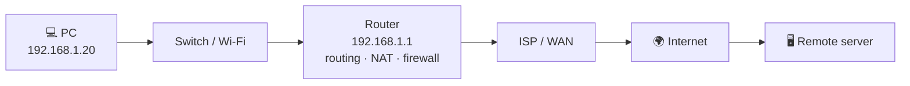
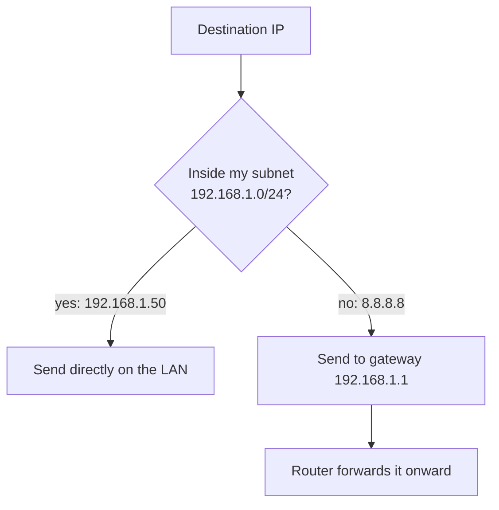
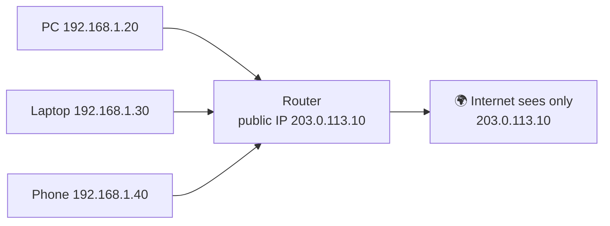
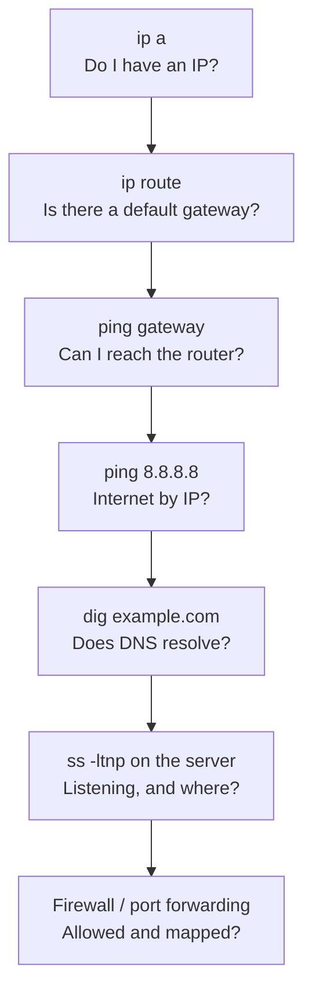

# 🌐 IP Addressing and Routing

[[Linux/Linux Handbook/0. Linux Handbook|🐧 Linux Handbook]] · Part 4: Network and remote access · ⬅️ [[Linux/Linux Handbook/11. systemd, Services, and Timers|11. systemd]] · ➡️ [[Linux/Linux Handbook/15. Ports, Sockets, and DNS|15. Ports, Sockets, and DNS]]

How a packet finds its way: addresses, subnets, the default gateway, NAT, and the interfaces a machine uses to reach each network. Plus the commands to check each step.

> [!toc]- 📑 Contents
>
> - [[#🗺️ The Big Picture|🗺️ The Big Picture]]
> - [[#📍 IP Addresses|📍 IP Addresses]]
> - [[#🏠 LAN, Switch, Router, WAN|🏠 LAN, Switch, Router, WAN]]
> - [[#🧮 Subnets and CIDR|🧮 Subnets and CIDR]]
> - [[#🚪 Default Gateway|🚪 Default Gateway]]
> - [[#🔁 NAT|🔁 NAT]]
> - [[#🖥️ Interfaces: One Door per Network|🖥️ Interfaces: One Door per Network]]
> - [[#💻 Commands|💻 Commands]]
> - [[#🩺 Troubleshooting Bottom-Up|🩺 Troubleshooting Bottom-Up]]
> - [[#🧪 Interview Q&A|🧪 Interview Q&A]]
> - [[#📚 References|📚 References]]

---

## 🗺️ The Big Picture

Networking is mostly answering a few questions about each packet:

| Question | Concept | Note |
|---|---|---|
| Who am I? | 📍 IP address | here |
| Is the destination on my network? | 🧮 Subnet | here |
| Where does remote traffic go? | 🚪 Default gateway | here |
| How does my private IP reach the Internet? | 🔁 NAT | here |
| Which application receives it? | 🔌 Port | [[Linux/Linux Handbook/15. Ports, Sockets, and DNS\|15]] |
| How does `example.com` become an IP? | 📛 DNS | [[Linux/Linux Handbook/15. Ports, Sockets, and DNS\|15]] |
| Is the traffic allowed? | 🧱 Firewall | [[Linux/Linux Handbook/17. Firewalls and Network Exposure\|17]] |



---

## 📍 IP Addresses

An **IP address** identifies a **network interface**, not a whole machine. A laptop with Wi-Fi, a VPN and Docker has several interfaces, each with its own address. `127.0.0.1` (loopback) always means "this machine".

An **IPv4** address is **32 bits**, written as four 8-bit **octets**:

```text
192 . 168 .   1 .  20
 8  +  8  +   8 +   8  = 32 bits
```

- 🔢 **Each octet:** `2^8 = 256` values → `0` to `255`.

- 🌍 **Whole space:** `2^32 ≈ 4.3 billion` addresses, many reserved, which is why IPv4 ran short.

### 🏠 Public vs. private

Three ranges are **private**: free to use inside any LAN, never routed on the Internet.

```text
10.0.0.0/8        10.0.0.0    – 10.255.255.255
172.16.0.0/12     172.16.0.0  – 172.31.255.255
192.168.0.0/16    192.168.0.0 – 192.168.255.255
```

Everything else usable is **public**: globally unique. A laptop uses a private address; the router's WAN side holds the public one.

---

## 🏠 LAN, Switch, Router, WAN

- 🏠 **LAN** → a local network, usually one subnet like `192.168.1.0/24`.

- 🔀 **Switch** → connects devices **inside** a LAN by **MAC address** (Layer 2).

- 🧭 **Router** → connects **different IP networks** by destination IP, using its routing table (Layer 3).

- 🌍 **WAN** → a wide-area network; for a home, the router's ISP side.

| Switch | Router |
|---|---|
| Inside one network | Between networks |
| Forwards frames by MAC | Routes packets by IP |
| Layer 2 | Layer 3 |

A home "router" box is usually a router, switch, Wi-Fi access point, NAT and firewall in one.

---

## 🧮 Subnets and CIDR

A **subnet** splits an address into a **network part** and a **host part**. The **CIDR prefix** says how many leading bits are the network.

```text
192.168.1.20/24

32 total bits − 24 network bits = 8 host bits
```

The prefix as a **mask**: 24 ones, then 8 zeros → `255.255.255.0`.

```text
8 host bits → 2^8 = 256 addresses

Network address:   192.168.1.0     (names the subnet)
Usable hosts:      192.168.1.1 – 192.168.1.254
Broadcast address: 192.168.1.255   (all hosts)

256 − 1 network − 1 broadcast = 254 usable
```

**usable = 2^(32 − prefix) − 2**

| Prefix | Mask | Total | Usable |
|---|---|---|---|
| `/16` | `255.255.0.0` | 65,536 | 65,534 |
| `/24` | `255.255.255.0` | 256 | 254 |
| `/28` | `255.255.255.240` | 16 | 14 |
| `/32` | `255.255.255.255` | 1 | a single host |

> 💡 **Real-World Example**
>
> The PC is `192.168.1.20/24`, so its network is `192.168.1.0/24`.
>
> - ✅ `192.168.1.50` → same first 24 bits → **local**
>
> - ❌ `192.168.2.50` → third octet differs → **remote**, needs a router

---

## 🚪 Default Gateway

The **default gateway** is the router a host sends packets to when the destination isn't on any network it's directly connected to.



On Linux, it's the `default` line of the routing table:

```bash
ip route
```

```text
default via 192.168.1.1 dev enp5s0
192.168.1.0/24 dev enp5s0 proto kernel scope link src 192.168.1.20
```

- 🚪 **`default via 192.168.1.1`** → "no better route? send it here".

- 🏠 **`192.168.1.0/24 dev enp5s0`** → the local subnet, reached directly.

⚠️ The gateway must be inside the host's own subnet. With gateway `192.168.10.1` on a `192.168.1.20/24` host, the LAN works but the Internet doesn't.

---

## 🔁 NAT

**NAT (Network Address Translation)** rewrites addresses as packets pass a router. At home it lets many private devices share **one public IPv4**.



Home routers use **PAT**: they rewrite the source **port** too, and keep a table to match the replies.

```text
Outgoing:  192.168.1.20:51500  →  rewritten to  203.0.113.10:62001  →  93.184.216.34:443

NAT table: 203.0.113.10:62001  ↔  192.168.1.20:51500
```

Docker uses the same mechanism: containers on a bridge network reach the Internet through NAT on the host.

> ⚠️ NAT translates addresses; it is **not** a firewall. Allowing or blocking traffic is the firewall's job ([[Linux/Linux Handbook/17. Firewalls and Network Exposure|17. Firewalls]]).

---

## 🖥️ Interfaces: One Door per Network

A machine has **interfaces**, each a door to one network with its own addresses. **Loopback (`lo`)** always exists.

```bash
ip -br addr
```

Illustrative VPS output:

```text
lo               UNKNOWN  127.0.0.1/8 ::1/128
eth0             UP       203.0.113.10/24 2001:db8:0:4::1/64 fe80::be24:11ff:fe4c:331a/64
docker0          DOWN     172.17.0.1/16
br-eec8dadb89e5  UP       172.18.0.1/16
vethe7bd5dc@if2  UP       fe80::28fa:ffff:fe52:549d/64
```

- 🔁 **`lo`** → this machine only. `/8` makes every `127.x.x.x` loopback; `::1` is IPv6 loopback.

- 🌍 **`eth0`** → the Internet: a public IPv4 and a public IPv6.

- 🐳 **`docker0`, `br-…`, `veth…`** → Docker's virtual networks and the "cables" to containers.

- 🏷️ **`fe80::…`** → automatic IPv6 link-local addresses, valid on one link only. Usually ignorable.

Other machines differ: a home laptop has `lo` plus a private Wi-Fi address, and the router holds the public IP. Some cloud VMs (AWS) show only a private `10.0.1.5`; the provider maps the public IP to it.

Which door a service listens on is chosen by the service: see [[Linux/Linux Handbook/15. Ports, Sockets, and DNS#🎯 The Bind Address|15. The Bind Address]].

---

## 💻 Commands

Modern Linux uses the `iproute2` tools:

| Legacy | Modern |
|---|---|
| `ifconfig` | `ip addr` |
| `route` | `ip route` |
| `netstat` | `ss` |

```bash
ip a                     # addresses: look for "inet 192.168.1.20/24"
ip -br addr              # one line per interface
ip route                 # routing table and default gateway
ip route get 8.8.8.8     # which route and interface this destination uses
ping -c 4 192.168.1.1    # reachability; -c stops after 4 packets
```

`ping` output:

```text
64 bytes from 8.8.8.8: icmp_seq=1 ttl=117 time=20.4 ms
```

- `icmp_seq` gaps → packet loss. `time` → round-trip latency.

⚠️ No reply doesn't prove a host is down: many firewalls and cloud providers block ICMP while HTTPS works fine.

---

## 🩺 Troubleshooting Bottom-Up

Check one layer at a time, from the bottom:



The first step that fails is the broken layer. Steps E–G are in [[Linux/Linux Handbook/15. Ports, Sockets, and DNS|15]] and [[Linux/Linux Handbook/17. Firewalls and Network Exposure|17]].

| Symptom | Likely cause | Check |
|---|---|---|
| LAN works, Internet doesn't | Wrong or missing gateway | `ip route` → `default via` in your subnet? |
| `ping 8.8.8.8` works, names don't | DNS | `dig example.com` |
| Reachable on LAN, not from Internet | No public IP or port forwarding | Router rules, ISP CGNAT |

---

### 🧪 Interview Q&A

**Q1:** Why does a host need a default gateway?

**Q2:** What's the difference between a switch and a router?

**Q3:** How many usable addresses are in a `/24`, and why?

**Q4:** What's the difference between NAT and a firewall?

**Q5:** `ip a` shows `eth0`, `lo`, `docker0` and several `veth…`. What are they?

> [!answer]- 📋 Answers
>
> **A1:** To reach destinations outside its own subnet. Those packets go to the gateway router, which forwards them.
>
> **A2:** A switch connects devices inside one network by MAC address; a router connects different networks by IP.
>
> **A3:** 254: `2^(32−24) = 256`, minus the network and broadcast addresses.
>
> **A4:** NAT rewrites addresses so private hosts share a public IP. A firewall decides which traffic is allowed.
>
> **A5:** `eth0` is the real network card, `lo` is loopback, `docker0` is Docker's default bridge, and `veth…` are virtual cables to containers.

---

## 🔨 Hands-On Practice

1. 📍 **Your address and subnet:** `ip a`.

   ✅ An active interface shows `inet <address>/<prefix>`.

2. 🚪 **Your gateway:** `ip route`.

   ✅ The `default via <gateway>` line.

3. 📡 **Test each layer.**

   ```bash
   ping -c 3 <gateway>
   ping -c 3 8.8.8.8
   ip route get 8.8.8.8
   ```

   ✅ Both pings succeed, and `ip route get` names the interface and gateway used.

4. 🧮 **Subnet math:** how many usable hosts in `/26`? `2^(32−26) − 2 = 64 − 2 = 62`.

---

### 📋 Quick Reference

| Concept | One-line meaning |
|---|---|
| IP address | Identifies a network interface |
| `/24` | First 24 bits = network; 254 usable hosts |
| Default gateway | Router for destinations outside the subnet |
| NAT / PAT | Many private IPs share one public IP |
| Interface | One door to one network: `lo`, `eth0`, `br-…` |

| Task | Command |
|---|---|
| Addresses | `ip a` · `ip -br addr` |
| Routes and gateway | `ip route` |
| Route for one destination | `ip route get 8.8.8.8` |
| Reachability | `ping -c 4 host` |

### 🧠 Things to Remember

- Every packet: **in my subnet → send directly; otherwise → default gateway**.

- `usable hosts = 2^(32 − prefix) − 2`.

- Private ranges: `10/8`, `172.16/12`, `192.168/16`.

- NAT translates; the firewall allows or blocks.

### 💡 Pro Tips

- **Test by IP before testing by name**; it separates DNS problems from connectivity problems.

- **`ip route get <ip>`** answers "which interface will this use?" in one line, useful with VPNs and Docker.

### 🔗 Related Topics

- ⬅️ [[Linux/Linux Handbook/11. systemd, Services, and Timers|11. systemd]] · ➡️ [[Linux/Linux Handbook/15. Ports, Sockets, and DNS|15. Ports, Sockets, and DNS]]

- [[DevOps/NaNa/Docker/9. Docker Networking|Docker Networking]]

---

## 📚 References

| Source | Where | Status |
|---|---|---|
| 📝 Nana: [[DevOps/NaNa/Linux/6. Networking Fundamentals\|Networking Fundamentals]] | Big picture → NAT, interfaces, commands, troubleshooting (ep 21) | ✅ studied |
| 📗 CompTIA 6th Ch.12 | IP p. 485 · IPv4 p. 486 · IPv6 p. 490 · configuring an interface p. 491 · routing p. 503 [PDF 501–522] | 🔭 optional |
| 📘 Linux Bible Ch.14 | Networking from the command line, pp. 345–352 [PDF 373–380] | 📖 planned (Stage B) · 🔁 `ip addr`, `ip route` · 🆕 setting IPs, aliases and routes by hand → here |
| 📘 Linux Bible Ch.21 | Troubleshooting networking, pp. 520–525 [PDF 546–551] | 📖 planned (Stage B) · 🔁 bottom-up checks are here · 🆕 more outgoing and incoming checks → here |
