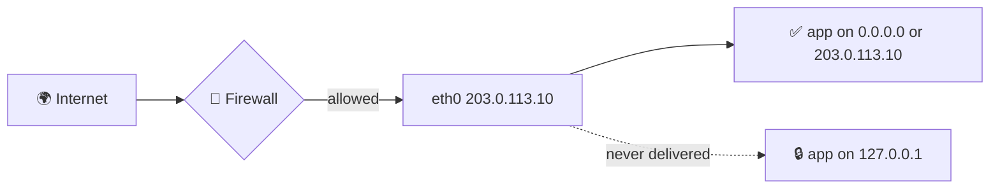
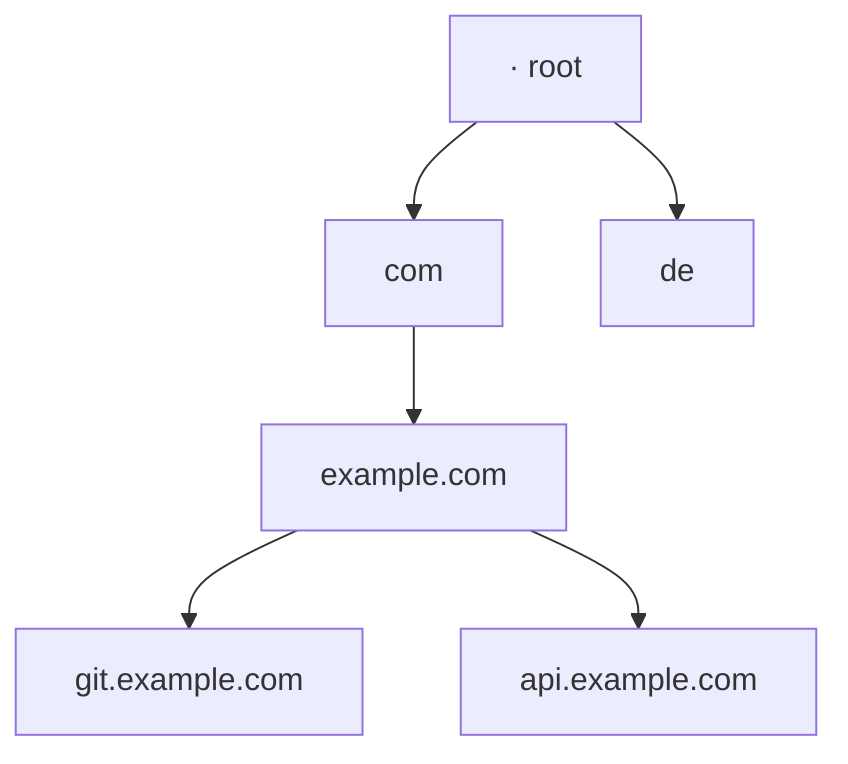
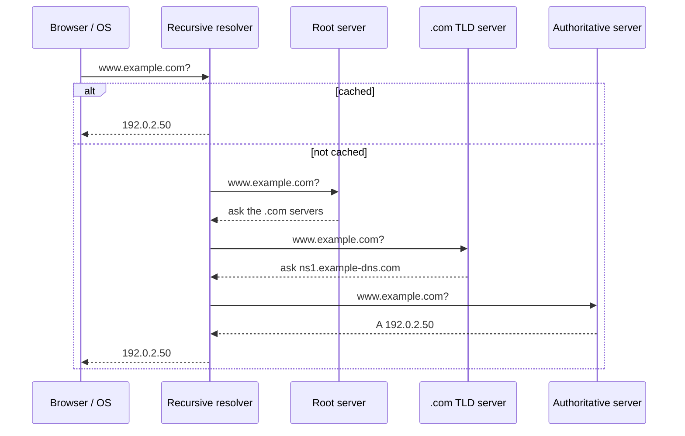

# 🔌 Ports, Sockets, and DNS

[[Linux/Linux Handbook/0. Linux Handbook|🐧 Linux Handbook]] · Part 4: Network and remote access · ⬅️ [[Linux/Linux Handbook/14. IP Addressing and Routing|14. IP Addressing and Routing]] · ➡️ [[Linux/Linux Handbook/16. SSH Keys and Hardening|16. SSH Keys and Hardening]]

An IP address finds the machine; a port finds the program. This note covers ports, which address a service listens on, how to read sockets with `ss`, and how DNS turns names into addresses.

> [!toc]- 📑 Contents
>
> - [[#🔌 Ports|🔌 Ports]]
> - [[#🎯 The Bind Address|🎯 The Bind Address]]
> - [[#🔗 Sockets: Local and Peer|🔗 Sockets: Local and Peer]]
> - [[#💻 Reading ss|💻 Reading ss]]
> - [[#📛 DNS and Domain Names|📛 DNS and Domain Names]]
> - [[#🔎 How DNS Resolution Works|🔎 How DNS Resolution Works]]
> - [[#⏱️ TTL and Record Types|⏱️ TTL and Record Types]]
> - [[#🩺 Troubleshooting|🩺 Troubleshooting]]
> - [[#🧪 Interview Q&A|🧪 Interview Q&A]]
> - [[#📚 References|📚 References]]

---

## 🔌 Ports

TCP and UDP each have ports `0`–`65535`. A service is reached at **address : port / protocol**:

```text
192.168.1.50:443/tcp
```

| Service | Default port |
|---|---|
| SSH | 22/tcp |
| DNS | 53/udp and tcp |
| HTTP / HTTPS | 80/tcp / 443/tcp |
| MySQL / PostgreSQL | 3306/tcp / 5432/tcp |

These are defaults; a service can listen on any port.

- ⚠️ **Two programs can't bind the same IP + protocol + port.** The second fails with `address already in use`.

- ✅ **`8080/tcp` and `8080/udp` are separate** port spaces.

---

## 🎯 The Bind Address

A server program **binds** (listens) on an address and a port. The address decides who can reach it:

| Listening on | Reachable from |
|---|---|
| `127.0.0.1:8080` | This machine only |
| `0.0.0.0:8080` | Every IPv4 interface, so other machines too (if the firewall allows) |
| `192.168.1.50:8080` | Only via that one interface |

"Works with `curl localhost` on the server but not from my laptop" is very often a service bound to `127.0.0.1`.

### 🧑‍⚖️ The program picks the door, the kernel enforces it

Linux doesn't decide who may connect. **Each program chooses its bind address** in its own config:

- 🔐 **`sshd`** → `ListenAddress` in `sshd_config`; default `0.0.0.0`.

- 🐳 **Docker** → `-p 80:80` binds `0.0.0.0`; `-p 127.0.0.1:81:81` binds loopback.

- 💻 **`nc -l 127.0.0.1 9999`** → loopback, because we typed it.

The kernel then enforces loopback: packets to `127.0.0.1` never leave the machine, and packets arriving from outside addressed to `127.0.0.1` are dropped.

⚠️ Binding to a non-loopback address is weaker than it looks. Linux accepts packets for **any** of its addresses on **any** interface, so a service on `172.18.0.1` is also reachable from other Docker networks.



- 🔒 **Bound to `127.0.0.1`** → private, even with no firewall.

- 🌍 **Bound to `0.0.0.0`** → public **unless the firewall blocks it** (see [[Linux/Linux Handbook/17. Firewalls and Network Exposure|17. Firewalls]]).

---

## 🔗 Sockets: Local and Peer

A **socket** is one endpoint of a conversation. Every TCP connection is identified by four values:

```text
( local IP , local port , peer IP , peer port )
  └──── this side ────┘   └─── other side ───┘
```

### 📋 LISTEN is a template; ESTAB is a real conversation

A **listening** socket only knows its own side. The unknown parts are wildcards:

```text
State   Local Address:Port   Peer Address:Port
LISTEN  0.0.0.0:443          0.0.0.0:*
```

- 🏠 **Local `0.0.0.0:443`** → "I accept on all my addresses, port 443". This controls **exposure**.

- ❓ **Peer `0.0.0.0:*`** → "nobody yet; any client may connect". Always the wildcard on a LISTEN row.

When a client connects, the kernel creates a **new socket** for that conversation:

```text
State   Local Address:Port    Peer Address:Port
LISTEN  0.0.0.0:443           0.0.0.0:*             ← still waiting for new clients
ESTAB   203.0.113.10:443      198.51.100.7:51234    ← Alice, tab 1
ESTAB   203.0.113.10:443      192.0.2.44:60100      ← Bob
ESTAB   203.0.113.10:443      198.51.100.7:51240    ← Alice, tab 2
```

- 🏠 **Local is the same** on every ESTAB row.

- 👥 **Peer differs** on each; that's how the kernel tells conversations apart. Alice's two tabs share her IP but not her port.

> 💡 **Real-World Example**
>
> A company has a receptionist at extension 443. Her **sign** (LISTEN) says "I answer any of our lines on ext 443, from any caller". Each call creates a new **call record** (ESTAB): our line, ext 443, the caller's number. The sign never changes.

### 🎲 Client ports are random

The client's OS picks a temporary **ephemeral port** for each connection (`cat /proc/sys/net/ipv4/ip_local_port_range` → `32768 60999`). So:

- **Well-known port (443, 22)** → the server side.

- **Random high port** → the client side.

When our server connects out (say `apt update`), the roles flip: `ESTAB 203.0.113.10:41822 91.189.91.81:443` means *we* are the client.

On one machine, a connection shows **twice**, once from each end, with Local and Peer swapped.

---

## 💻 Reading `ss`

```bash
sudo ss -ltnp                       # listening TCP sockets + processes
sudo ss -tanp '( sport = :443 )'    # every socket on local port 443
sudo ss -ltnp | grep :8080          # who owns port 8080
sudo lsof -i :8080                  # same question, another tool
```

- `-l` listening · `-t` TCP (`-u` UDP) · `-n` numeric · `-p` process (needs `sudo` for other users) · `-a` listening **and** connected.

| Column | LISTEN row | ESTAB row |
|---|---|---|
| **Recv-Q** | Connections waiting to be accepted | Bytes received, not yet read by the app |
| **Send-Q** | Max accept queue (backlog) | Bytes sent, not yet acknowledged |

`0` in both is healthy; a queue that keeps growing means the app isn't keeping up.

A real VPS (trimmed):

```text
State   Local Address:Port   Peer Address:Port  Process
LISTEN        0.0.0.0:443         0.0.0.0:*      users:(("docker-proxy",pid=2484516,fd=8))
LISTEN        0.0.0.0:2202        0.0.0.0:*      users:(("sshd",pid=2421230,fd=3),("systemd",pid=1,fd=86))
LISTEN        0.0.0.0:80          0.0.0.0:*      users:(("docker-proxy",pid=2484480,fd=8))
LISTEN      127.0.0.1:81          0.0.0.0:*      users:(("docker-proxy",pid=2484502,fd=8))
LISTEN  127.0.0.53%lo:53          0.0.0.0:*      users:(("systemd-resolve",pid=2063010,fd=18))
```

- 🌍 **Public:** `80`, `443` (the reverse-proxy container), `2202` (SSH).

- 🔒 **Loopback only:** `81` (proxy admin UI), `53` (the local DNS stub resolver).

- 🐳 **`docker-proxy`** → Docker forwarding a published port into a container.

- ⚙️ **`sshd` and `systemd` share 2202** → **socket activation**: `ssh.socket` holds the port and hands connections to `sshd`.

`ps` answers "is it running?"; `ss` answers "is it listening, and where?".

---

## 📛 DNS and Domain Names

**DNS** turns names into the data computers need, mainly IP addresses. A name is a hierarchy read **right to left**:

```text
git.example.com.
 │     │     │ └─ root (the trailing dot, usually omitted)
 │     │     └─── TLD: com
 │     └───────── registered domain: example
 └─────────────── subdomain: git
```



- 🏷️ **TLD** → the last label: generic (`.com`, `.org`) or country code (`.de`, `.ir`).

- 🌿 **Subdomains** → names we create under our domain: `git`, `api`, `vpn`.

- 📌 **FQDN** → the full name down to the root, `git.example.com.`.

---

## 🔎 How DNS Resolution Works

Our computer asks a **recursive resolver** (the router, ISP, or `1.1.1.1`), and the resolver does the work.



1. 💻 **Browser and OS** check their caches and `/etc/hosts`, then ask the resolver.

2. 🔁 **Recursive resolver** answers from cache, or starts at the root.

3. 🌳 **Root** refers it to the `.com` servers.

4. 🏷️ **TLD** refers it to the domain's **authoritative** servers.

5. ✅ **Authoritative** server returns the record.

DNS only finds the address. TCP then carries the connection and TLS secures it: separate stages that fail separately.

---

## ⏱️ TTL and Record Types

Every answer carries a **TTL** in seconds; resolvers may reuse it until it expires.

```text
www.example.com   3600   IN   A   192.0.2.50

TTL 3600 s ÷ 60 = 60 minutes
```

A DNS change can take up to the old TTL to reach everyone. 💡 Lower the TTL a day before a migration.

| Record | Purpose | Example |
|---|---|---|
| `A` | Name → IPv4 | `api.example.com → 192.0.2.20` |
| `AAAA` | Name → IPv6 | `api.example.com → 2001:db8::20` |
| `CNAME` | Alias to another name | `www → web.example.com` |
| `MX` | Mail servers | `example.com → mail.example.com` |
| `NS` | Authoritative name servers | `example.com → ns1.example-dns.com` |
| `TXT` | Free text: SPF, verification | `"v=spf1 ..."` |
| `PTR` | Reverse: IP → name | `192.0.2.20 → api.example.com` |

```bash
dig +short example.com          # just the answer
dig example.com MX              # a record type, with TTLs and the answering server
nslookup example.com 1.1.1.1    # ask a specific resolver
```

Comparing our resolver with `1.1.1.1` tells us whether a DNS problem is local.

🔜 **Later:** `/etc/hosts`, `/etc/resolv.conf` and `nsswitch.conf` (Bible Ch.14, Stage B). In Kubernetes, every Pod gets its own `resolv.conf`.

---

## 🩺 Troubleshooting

| Symptom | Likely cause | Check |
|---|---|---|
| `ping 8.8.8.8` works, `ping example.com` fails | DNS | `dig example.com`, `resolvectl status` |
| Works on the server, not from outside | Bound to `127.0.0.1` | `ss -ltnp` |
| Listening on `0.0.0.0`, still unreachable | Firewall | `sudo ufw status`, provider firewall |
| `address already in use` on start | Another process has the port | `sudo ss -ltnp \| grep :8080` |
| Users still reach the old server | Cached DNS | Wait out the old TTL |

---

### 🧪 Interview Q&A

**Q1:** A service listens on `127.0.0.1:8080`. Why can't other machines reach it?

**Q2:** In `ss`, what's the difference between Local `0.0.0.0:443` and Peer `0.0.0.0:*`?

**Q3:** Who decides whether a service is reachable only locally or from the network?

**Q4:** In an ESTAB row, how do you tell which side is the server?

**Q5:** Does your PC query the root DNS servers directly?

**Q6:** What's the difference between `A` and `CNAME`?

> [!answer]- 📋 Answers
>
> **A1:** `127.0.0.1` is loopback: only processes on the same machine can connect. Bind to `0.0.0.0` or the LAN IP.
>
> **A2:** Local is this side: listen on all addresses, port 443. Peer is the other side: no client yet, so anyone may connect.
>
> **A3:** The program, through its bind address. The kernel enforces it, and the firewall filters what reaches public interfaces.
>
> **A4:** The server side has the well-known port (443, 22); the client side has a random ephemeral port.
>
> **A5:** Usually not. It asks a recursive resolver, which queries root, TLD and authoritative servers when needed.
>
> **A6:** `A` maps a name to an IPv4 address. `CNAME` maps a name to another name, which is then resolved.

---

## 🔨 Hands-On Practice

1. 🎯 **Bind addresses in action.**

   ```bash
   python3 -m http.server 8000 --bind 127.0.0.1 &
   ss -ltn | grep 8000
   curl -s -o /dev/null -w "%{http_code}\n" http://127.0.0.1:8000
   kill %1
   ```

   ✅ `ss` shows `127.0.0.1:8000` and `curl` prints `200`. From another device on the LAN it fails; with `--bind 0.0.0.0` it works (if the firewall allows).

2. 🔗 **Watch LISTEN become ESTAB.** Three terminals:

   ```bash
   nc -l 127.0.0.1 9999                            # terminal 1
   ss -tln '( sport = :9999 )'; nc 127.0.0.1 9999  # terminal 2
   ss -tan '( sport = :9999 or dport = :9999 )'    # terminal 3
   ```

   ✅ A LISTEN row first, then two ESTAB rows with Local and Peer swapped.

3. 📛 **DNS.**

   ```bash
   dig +short example.com
   dig example.com
   ```

   ✅ The second shows the TTL and which server answered.

---

### 📋 Quick Reference

| Task | Command |
|---|---|
| Listening TCP ports + processes | `sudo ss -ltnp` |
| All sockets on a port | `sudo ss -tanp '( sport = :443 )'` |
| Who holds a port | `sudo ss -ltnp \| grep :8080` · `sudo lsof -i :8080` |
| DNS lookup | `dig +short name` · `nslookup name` |
| Record type, TTL | `dig name MX` |
| Ask a specific resolver | `dig @1.1.1.1 name` |

### 🧠 Things to Remember

- `127.0.0.1` = this machine only; `0.0.0.0` = all interfaces.

- The **program** picks the bind address; the kernel enforces it; the firewall filters.

- In `ss`: Local = this side, Peer = the other side. LISTEN's Peer is always a wildcard.

- Well-known port = server; random high port = client.

- DNS: resolver → root → TLD → authoritative, cached for the TTL.

### 💡 Pro Tips

- **Check the bind address with `ss -ltnp` before touching the firewall.**

- **Use `curl -v http://host:port`** to test a TCP service where `ping` is blocked.

- **Bind admin UIs to `127.0.0.1`** and reach them through an SSH tunnel ([[Linux/Linux Handbook/17. Firewalls and Network Exposure|17]]).

### 🔗 Related Topics

- ⬅️ [[Linux/Linux Handbook/14. IP Addressing and Routing|14. IP Addressing and Routing]] · ➡️ [[Linux/Linux Handbook/16. SSH Keys and Hardening|16. SSH Keys and Hardening]]

- [[Linux/Linux Handbook/10. Processes and Signals|10. Processes and Signals]] (`lsof`)

- [[DevOps/NaNa/Docker/9. Docker Networking|Docker Networking]]

- [[DevOps/Server Administration/10. TLS HTTPS and Reverse Proxy Exposure|TLS, HTTPS, and Reverse Proxy Exposure]] (🛠️ apply)

---

## 📚 References

| Source | Where | Status |
|---|---|---|
| 📝 Nana: [[DevOps/NaNa/Linux/6. Networking Fundamentals\|Networking Fundamentals]] | Ports → DNS, `ss`, troubleshooting (ep 21) | ✅ studied |
| 📝 SDGL note: [[Linux/The Software Developer’s Guide to Linux/2. Working with Processes\|2. Working with Processes]] | `lsof -i :PORT` | ✅ studied |
| 📕 SDGL Ch.17 | HTTP, load balancing, `curl`: pp. 235–251 | 📖 planned · 🆕 HTTP status codes, headers, versions, load balancing, `curl` → note 18 |
| 📗 CompTIA 6th Ch.12 | Name resolution p. 500 · network services p. 506 [PDF 516–522] | 🔭 optional |
| 📗 CompTIA 6th Ch.13 | DNS servers p. 531 [PDF 547] | 🔭 optional |
| 📘 Linux Bible Ch.14 | `/etc/hosts`, `/etc/resolv.conf`, `/etc/nsswitch.conf`: pp. 356–358 [PDF 384–386] | 📖 planned (Stage B) · 🆕 `/etc/hosts`, `resolv.conf`, `nsswitch.conf` → here |
